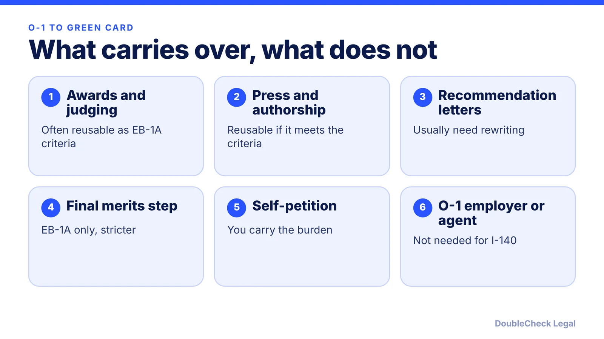
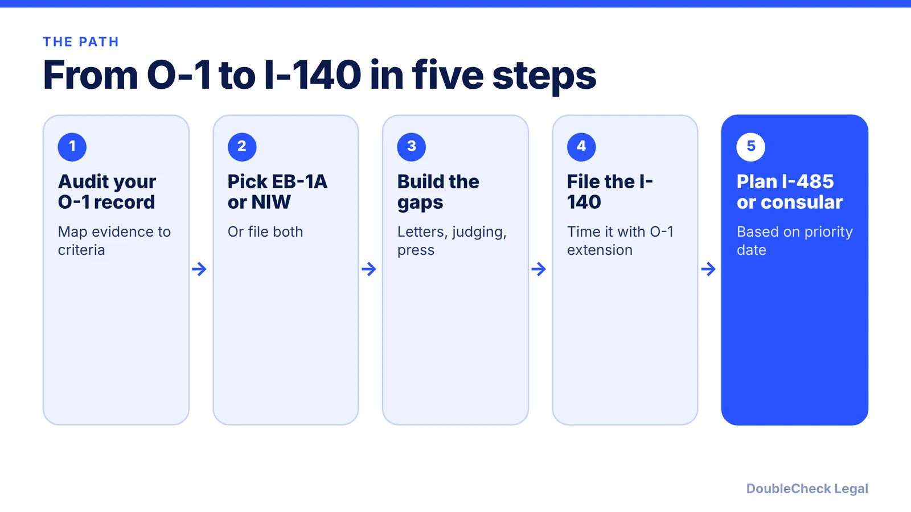

*How to use an approved O-1 as evidence and a bridge to an EB-1A or NIW green card, as of November 2026.*

**Key takeaways:**

- EB-1A and NIW are both I-140 self-petitions with no PERM; EB-1A applies a stricter standard and a final-merits step.
- O-1 evidence like judging, press and critical roles often carries over, but must be re-argued, not just resubmitted.
- O-1 is not statutorily dual intent; per Beyond Border, a pending I-140 cannot alone be the basis to deny an extension, but consular risk remains.
- Published timelines conflict; check USCIS and the visa bulletin, and have an attorney verify strategy before filing.

## 1. The quick answer

**Quick answer:** An approved O-1 is not a green card, but it is useful evidence and a workable bridge. Many O-1 holders self-petition on Form I-140 under EB-1A (extraordinary ability) or EB-2 NIW (national interest waiver), neither of which needs a PERM labor certification. Per Beyond Border (page updated June 2026), O-1 is not statutorily dual intent like H-1B, but a pending I-140 cannot by itself be the basis to deny an O-1 extension, so many holders file the I-140 before or alongside an O-1 extension. Your O-1 record often carries over, but EB-1A applies a stricter standard, so the petition has to re-argue it.

## 2. EB-1A, NIW, and how they overlap

Both categories are self-petitions on Form I-140, so no employer sponsor or PERM is required. They use different standards:

- **EB-1A** requires a major international award or at least three of ten evidentiary criteria, then a final-merits review of whether you are in the small percentage at the very top of the field, per [Locke Immigration](https://www.lockeimmigration.com/eb1a/scenarios/after-o1) and [Beyond Border](https://www.beyondborderglobal.com/resources/o-1-dual-intent-explained-a-green-card-strategy-for-o-1-holders).
- **EB-2 NIW** uses the Dhanasar test (substantial merit and national importance, well positioned to advance the endeavor, and a waiver being beneficial to the U.S.), starting from EB-2 base qualifications.

Per Locke Immigration, an NIW petition can be filed alongside EB-1A as a backup, as two separate I-140s judged independently. Beyond Border suggests this for borderline EB-1A profiles, especially where backlogs apply. Whether doing so makes sense is a strategy call for an attorney.

For founders, see [EB-1A vs NIW for founders](/blog/eb-1a-vs-niw-which-is-better-for-founders/), [NIW for founders](/blog/niw-eb-2-national-interest-waiver-founders/), and [EB-1A vs O-1](/blog/eb-1a-vs-o-1-founder-which-path/). For engineers, see [EB-1A for software engineers](/blog/eb-1a-for-software-engineers-and-tech-employees/) and [NIW for software engineers](/blog/niw-for-software-engineers-and-researchers/).

**Evidence that tends to carry over,** per Beyond Border: peer review and judging, published material about you, and documented critical roles. Evidence should show work already underway, not activity created for the petition. Per Locke Immigration, if the O-1 was approved under the lower O-1B "distinction" standard or the record was thin, build more evidence before filing EB-1A. An O-1 approval is relevant but does not guarantee an I-140 approval. See [O-1A evidence for founders](/blog/o-1a-visa-for-startup-founders-evidence/) and [O-1 recommendation letters](/blog/o-1-recommendation-letters-expert-opinion/).

## 3. Status while the I-140 is pending: O-1 extension and dual intent

**Dual intent.** Per Beyond Border, O-1 holders are not statutorily exempt from the INA 214(b) presumption of immigrant intent at the visa stage, and consular officers keep discretion over the whole case. At the same time, per the same source, USCIS and State Department guidance say a pending I-140 or approved PERM cannot be the sole basis for denying O-1 status or renewal. Treat this as a practical risk, not a guarantee, especially when you travel and apply for a visa abroad.

**Concurrent filing.** Per Beyond Border, when O-1 renewal is approaching and the I-140 is not yet filed, filing the I-140 before or with the extension is a common approach, and O-1 extensions remain available after an I-140 approval. Per Locke Immigration, the O-1 stays independent of the I-140 and continues during adjudication, and EB-1A does not require U.S. presence at filing.

**If an I-140 is denied.** Per Beyond Border, a denial does not automatically affect O-1 status, and you may refile with a stronger record or pivot to NIW. See [what to do after an NIW denial or RFE](/blog/niw-denial-rfe-reapply-options/).

**Timelines and costs (verify before planning).** Published ranges conflict, so use them only as rough guides:

- Beyond Border (updated May 2026) gives about 12 to 34 months from O-1 to EB-1A green card in one section and 8 to 32 months in another, and itself says to check USCIS for current times.
- Per Locke Immigration, premium processing for I-140 is 15 business days; Beyond Border gives $2,965 for the I-140 premium fee effective March 1, 2026. Check the USCIS fee page, and see [premium processing fees and timelines](/blog/premium-processing-fees-and-timelines-2026/).
- Concurrent I-140 and I-485 filing depends on a current priority date. Beyond Border reports India and China have EB-1A and NIW backlogs as of April 2026; confirm in the current [visa bulletin](/blog/visa-bulletin-explained-priority-dates-eb-categories/) and see [retrogression and backlogs](/blog/priority-date-retrogression-india-china-backlog/).

Travel after filing an I-485 needs care; see [advance parole and EAD while an I-485 is pending](/blog/advance-parole-and-ead-while-i-485-pending/) and the [I-485 guide](/blog/i-485-adjustment-of-status-guide/).

## 4. Self-handle or get an attorney to look at it

**Reasonable to do yourself first:** list your O-1 evidence, map it against the ten EB-1A criteria, and note gaps. You can also use AI to organize exhibits and draft a first outline of your petition narrative.

**Get an attorney to verify before filing when:**

- Your O-1 was O-1B or the record is borderline for EB-1A.
- You were born in India or China, or another country with backlogs, so the strategy turns on priority dates.
- You will travel soon, have a visa stamp expiring, or your O-1 ends within about a year.
- You want to file EB-1A and NIW together, or file the I-485 concurrently.
- You have prior status problems, which affect I-485 eligibility; see [unlawful presence and overstays](/blog/immigration-overstay-unlawful-presence-3-10-year-bars-explained/).

Fees vary; see [immigration lawyer fees](/blog/immigration-lawyer-fees-flat-fee-vs-hourly/) and [how to find a good immigration lawyer](/blog/how-to-find-good-immigration-lawyer-startup-founder/). Employer-sponsored alternatives are covered in [PERM labor certification](/blog/perm-labor-certification-green-card-process/) and [H-1B to green card timelines](/blog/h-1b-to-green-card-timeline-tech-workers/). Previous O-1 costs and timing are in [O-1 filing costs](/blog/o-1-visa-cost-filing-and-attorney-fees/) and [O-1 processing times](/blog/o-1-visa-processing-time-premium-processing/).

## Where DoubleCheck fits

[DoubleCheck](https://www.contactdoublecheck.com) helps businesses and founders start legal work with AI, verify it, and, when professional advice is warranted, connect with an independent attorney, including for immigration questions. Attorney availability and practice areas vary. Attorneys on DoubleCheck are independent professionals; an attorney-client relationship forms only if an attorney accepts your engagement.

**Sources:** [Beyond Border on O-1 dual intent](https://www.beyondborderglobal.com/resources/o-1-dual-intent-explained-a-green-card-strategy-for-o-1-holders); [Beyond Border O-1 to green card timeline](https://www.beyondborderglobal.com/resources/o-1-to-green-card-timeline); [Locke Immigration on EB-1A after O-1](https://www.lockeimmigration.com/eb1a/scenarios/after-o1). Both secondary sources are law-firm or practitioner pages; check uscis.gov for current fees, forms and processing times.

## FAQ

**Can I file EB-1A while on an O-1?**

Yes. Per Locke Immigration, the O-1 is independent of the I-140 and continues during adjudication, and O-1 renewal is routinely available while an EB-1A is pending or approved. Confirm your facts with an immigration attorney.

**Is the O-1 a dual intent visa?**

Not statutorily, per Beyond Border. O-1 holders are not exempt from the INA 214(b) presumption at the visa stage, but a pending I-140 cannot by itself be the sole basis to deny O-1 status or renewal.

**Does an approved O-1 guarantee EB-1A approval?**

No. Per Beyond Border, a prior O-1A approval is relevant but does not guarantee EB-1A, and O-1B holders may face an RFE because the O-1B distinction standard is lower.

**Can I file EB-1A and NIW at the same time?**

Per Locke Immigration, an NIW can be filed alongside EB-1A as a backup, as separate I-140 petitions evaluated independently. Whether it makes sense depends on your profile and priority date.

---

*General information only. This article is not legal, tax, investment, or accounting advice.*
