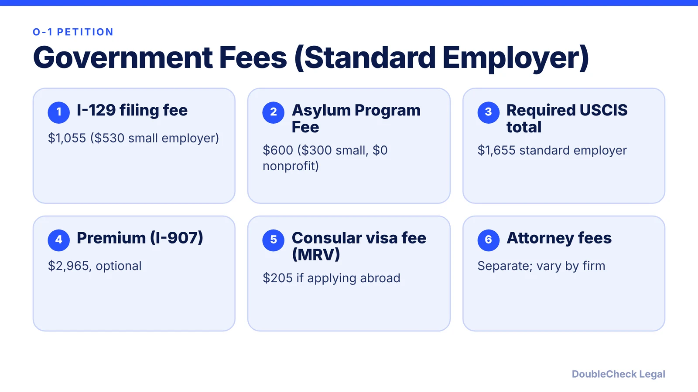
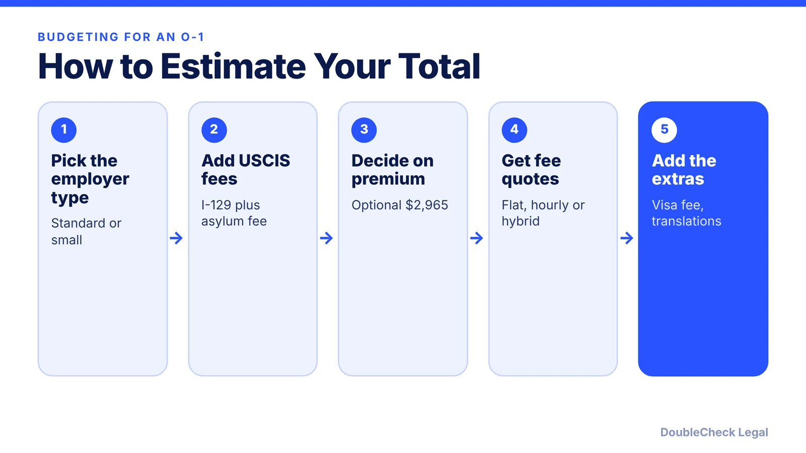

*A sourced breakdown of the government fees for an O-1 petition and what drives lawyer fees, as of November 2026.*

**Key takeaways:**

- Required USCIS fees for a standard employer: $1,055 (I-129) plus a $600 Asylum Program Fee, per F1Jobs; small employers pay less.
- Premium processing is optional and listed at $2,965 as of March 1, 2026.
- Manifest Law cites typical O-1 attorney fees of $5,000 to $15,000 flat or $250 to $600 per hour; RFE work may cost extra.
- Verify every amount on USCIS Form G-1055 before filing.

## 1. The quick answer

**Quick answer:** For a standard employer, the required USCIS fees for an O-1 petition are $1,055 (Form I-129) plus a $600 Asylum Program Fee, or $1,655 total, per F1Jobs and Alma citing the USCIS fee schedule. Small employers (25 or fewer full-time equivalent employees) pay $530 plus $300. Optional premium processing adds $2,965. Attorney fees are separate and vary by firm: Manifest Law cites a typical flat-fee range of $5,000 to $15,000. Confirm all government fees on USCIS Form G-1055 before filing.

## 2. Government fees, line by line

These are the USCIS and State Department charges, which are the same regardless of which lawyer you use (Manifest Law). As of the November 2026 sources reviewed:

- **Form I-129:** $1,055 on paper, $1,005 online, or $530 for a qualifying small employer or nonprofit, per F1Jobs.
- **Asylum Program Fee:** $600 standard, $300 for small employers, $0 for nonprofits, paid with the I-129 (F1Jobs).
- **Premium processing (Form I-907):** $2,965, optional. It rose from $2,805 effective March 1, 2026 (F1Jobs; Alma). Manifest Law describes it as a guaranteed USCIS response within 15 business days. See our guide to [O-1 premium processing and timelines](/blog/o-1-visa-processing-time-premium-processing/) and [premium processing fees in 2026](/blog/premium-processing-fees-and-timelines-2026/).
- **Visa application fee (MRV):** $205 if you apply for the visa at a U.S. consulate, paid by the beneficiary (F1Jobs). Some nationalities also pay a reciprocity fee, per Alma.

Adding it up (Alma): $1,655 for a standard employer without premium processing, $4,620 with it; $830 for a small employer without premium, $3,795 with it.

F1Jobs also notes a $250 Visa Integrity Fee whose implementation status was unclear as of November 2, 2026, so check before you budget for it.

## 3. What drives attorney fees

There is no industry standard. Sources reviewed describe three billing models:

- **Flat fee:** typically $5,000 to $15,000, often covering strategy, document preparation, filing and sometimes the RFE response (Manifest Law).
- **Hourly:** typically $250 to $600 an hour, better for limited-scope help (Manifest Law).
- **Hybrid:** a flat fee for the petition plus hourly billing for extras.

Manifest Law says a longer response to a Request for Evidence may be billed separately, often $2,000 to $4,000. These are one firm's figures, not a market survey, and Alma, which sells these services, gives a similar $5,000 to $15,000 range and notes its own published flat rates.

What moves the price, per Alma and Manifest Law:

- **Applicant type.** Founders, freelancers and agent-sponsored cases usually need more structuring than a standard employee case, including the petitioner entity.
- **Field and evidence.** Arts, fashion and social media often need more narrative work than engineering or academia; emerging fields can need more strategy.
- **Evidence readiness.** Organized documentation takes less time. Use our [O-1 document checklist](/blog/o-1-visa-documents-checklist-founder/).
- **Expert letters.** Coordinating several opinion letters raises cost.
- **RFE risk and billing terms.** Ask whether RFE responses are included.

## 4. Planning your budget and next steps

Manifest Law estimates a total of $10,000 to $25,000 including attorney fees, government fees and optional premium processing; that is a firm estimate, not an official figure. Expect extra spending on items outside the two big categories, such as certified translations ([USCIS translation rules](/blog/uscis-certified-translation-requirements-documents/)).

Before you commit, compare the route itself: see [O-1A for startup founders](/blog/o-1a-visa-for-startup-founders-evidence/), [EB-1A vs. O-1](/blog/eb-1a-vs-o-1-founder-which-path/), and [how to find a good immigration lawyer](/blog/how-to-find-good-immigration-lawyer-startup-founder/). Ask any lawyer for a written scope that says what is included, what triggers extra fees, and who pays government fees. An O-1 filing is not guaranteed to succeed, so budget for the possibility of an RFE.

## Where DoubleCheck fits

[DoubleCheck](https://www.contactdoublecheck.com) helps businesses and founders start legal work with AI, verify it, and, when professional advice is warranted, connect with an independent attorney, including for immigration questions. Attorney availability and practice areas vary. Attorneys on DoubleCheck are independent professionals; an attorney-client relationship forms only if an attorney accepts your engagement.

**Sources:** [F1Jobs, O-1 visa cost 2026](https://www.f1jobs.io/resources/blog/o1-visa-cost-fees-2026); [Alma, O-1A pricing guide](https://www.tryalma.com/learn/what-does-an-o-1a-actually-cost-a-2026-pricing-guide); [Manifest Law, O-1 visa cost](https://manifestlaw.com/blog/o1-visa-cost).

## FAQ

**How much does an O-1 visa cost in government fees?**

For a standard employer, F1Jobs lists $1,055 for the I-129 plus a $600 Asylum Program Fee, so $1,655, before optional premium processing at $2,965. Small employers pay $530 plus $300.

**Who pays the O-1 filing fees?**

The petitioner (the employer or agent) pays the I-129 and Asylum Program Fee, per F1Jobs. The beneficiary typically pays the consular visa fee. Premium processing is usually paid by the employer.

**What do immigration attorneys charge for an O-1?**

Manifest Law reports typical flat fees of $5,000 to $15,000 and hourly rates of $250 to $600. Prices vary by firm and case complexity, so get written quotes.

**Is premium processing worth it?**

It is optional. Manifest Law describes it as a guaranteed USCIS response within 15 business days, which can matter for travel or start-date planning.

---

*General information only. This article is not legal, tax, investment, or accounting advice.*
