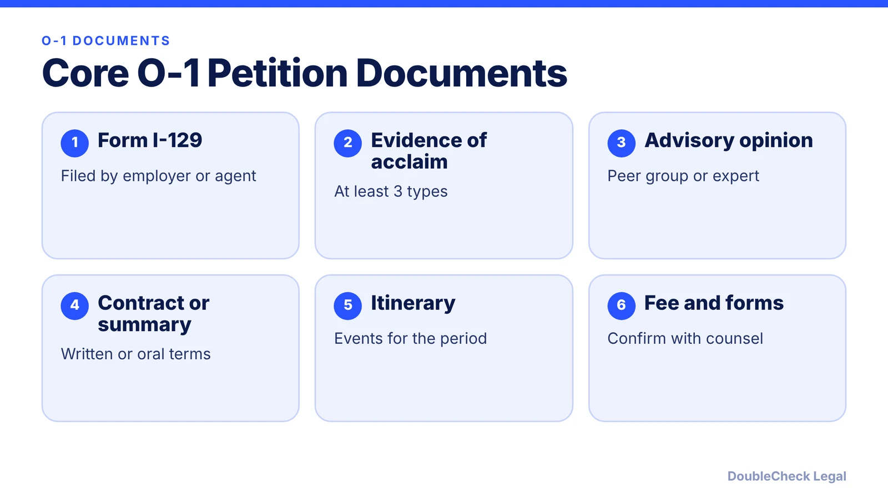
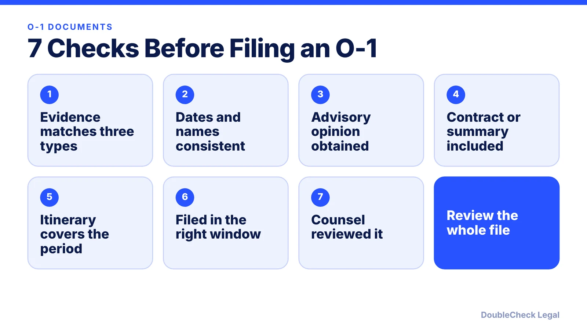

*What documents does an O-1 need? Here is the USCIS list, an evidence folder method for founders, and seven checks before filing.*

**Key takeaways:**

- USCIS lists Form I-129, evidence of acclaim, an advisory opinion, any contract or summary, and an itinerary.
- Evidence needs at least three types of qualifying documentation.
- The petition can be filed no more than one year before work starts and should be filed at least 45 days before.
- Keep every document consistent in names, dates, and roles.

## 1. The quick answer

**Quick answer:** According to USCIS, an O-1 petition includes Form I-129, evidence of sustained acclaim (at least three types of qualifying documentation), a written advisory opinion from a peer group, labor organization, or expert, any written contract or a summary of an oral agreement, and an itinerary or description of the events or activities for the requested period. Your lawyer will tell you what else is needed for your facts.

## 2. Evidence folder: what founders collect

Build the folder around the evidence categories, one folder per type you plan to claim. For each item, save the original, the date, a link, and a one-line note on why it matters.

- **Press:** articles with your name and role.
- **Critical role:** documents that show your role and the company's standing.
- **Original contribution:** product, research, or usage data tied to your work.
- **High pay:** compensation records compared with the field.
- **Judging, awards, scholarly work:** invitations, certificates, publications.

These are examples of what people commonly gather; USCIS decides what counts.

## 3. Advisory opinion, contract, and itinerary

USCIS requires a written advisory opinion, with exceptions where no appropriate peer group exists. If you work for your own company or for several clients, USCIS describes the agent filing route and the need for a contract summary and itinerary. Keep them consistent with each other. For motion picture and television cases, opinions are needed from both a labor union and a management organization.

## 4. Related guides

Start with [O-1A for founders](/blog/o-1a-visa-for-startup-founders-evidence/), then check [O-1 processing time](/blog/o-1-visa-processing-time-premium-processing/). To review your paperwork with AI before a lawyer sees it, use [these seven checks](/blog/check-immigration-documents-with-ai-before-filing/), and see [how to verify an AI-generated legal document](/blog/verify-ai-generated-legal-document/).

## Where DoubleCheck fits

[DoubleCheck](https://www.contactdoublecheck.com) helps businesses and founders start legal work with AI, verify it, and, when professional advice is warranted, connect with an independent attorney, including for immigration questions. Attorney availability and practice areas vary. Attorneys on DoubleCheck are independent professionals; an attorney-client relationship forms only if an attorney accepts your engagement.

**Sources:** [USCIS O-1](https://uscis.gov/o-1).

## FAQ

**What documents do I need for an O-1?**

USCIS lists Form I-129, evidence of sustained acclaim, a written advisory opinion, any contract or a summary of an oral agreement, and an itinerary or description of events.

**When should the O-1 be filed?**

USCIS says no more than one year before services begin and at least 45 days before employment starts.

**Is an advisory opinion always required?**

USCIS says it is required, with exceptions when no appropriate peer group exists or for certain arts applicants seeking readmission.

**Do I need a lawyer to prepare an O-1?**

The law does not require one for you to file, but petitions are evidence-heavy. See how to find good counsel in our lawyer guide.

---

*General information only. This article is not legal, tax, investment, or accounting advice.*
