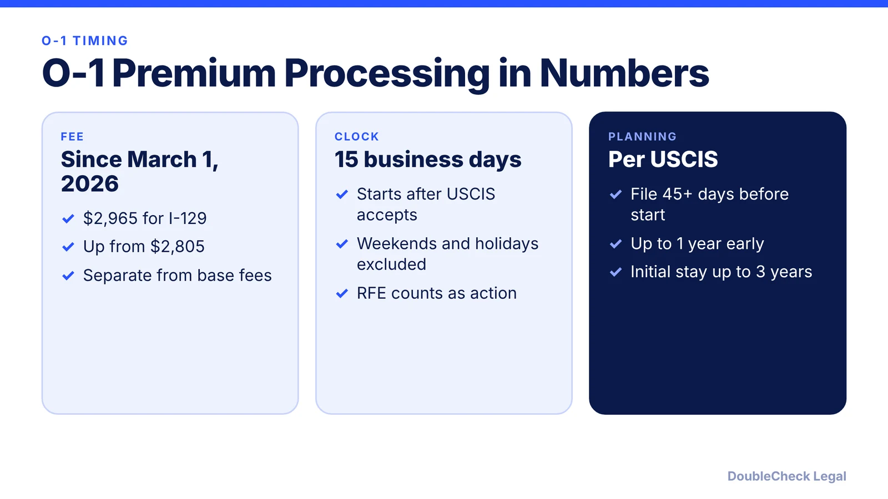
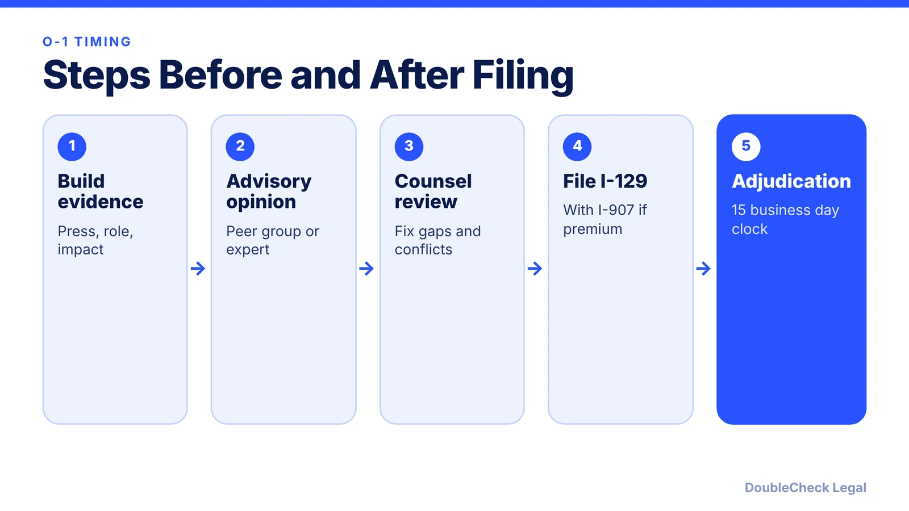

*How long does an O-1 take? Here is the premium processing fee and clock, the filing window, and what really drives the timeline.*

**Key takeaways:**

- Premium processing for I-129 is $2,965 for requests postmarked on or after March 1, 2026.
- USCIS has 15 business days after acceptance, and a request for evidence counts as action.
- File at least 45 days before work starts and no more than one year before.
- Most of a founder's timeline is evidence-building, not adjudication.

## 1. The quick answer

**Quick answer:** Premium processing for Form I-129, which covers O-1 and H-1B petitions, costs $2,965 for requests postmarked on or after March 1, 2026, and USCIS must take qualifying action within 15 business days after it accepts the request. A request for evidence counts as qualifying action, so the case can run longer. USCIS says an O-1 petition should be filed at least 45 days before work starts, and not more than a year before.

## 2. Business days are not calendar days

Beyond Border notes that 15 business days often works out to about three weeks of calendar time, because weekends and federal holidays do not count. Regular processing times vary; check USCIS's processing-times page for the service center handling your case instead of relying on a number from a blog. A JD Supra summary of USCIS's inflation-adjusted fee notice lists the increase from $2,805 to $2,965 for I-129 and I-140 requests, and says requests filed with the old fee after March 1 are rejected and returned.

## 3. A realistic timeline for a founder

There are more steps than the USCIS clock. Evidence gathering, the advisory opinion, and lawyer review usually take longer than the adjudication itself.

Prepare early: read the [O-1 documents checklist](/blog/o-1-visa-documents-checklist-founder/) and [O-1A for founders](/blog/o-1a-visa-for-startup-founders-evidence/).

## 4. What can slow a case down

Premium processing does not guarantee approval. A request for evidence can extend the timeline, inconsistent records can trigger one, and a thin evidence file may lead to a denial. That is why founders review the whole petition before filing. See [seven AI-assisted checks](/blog/check-immigration-documents-with-ai-before-filing/) and [how to find an immigration lawyer](/blog/how-to-find-good-immigration-lawyer-startup-founder/).

## Where DoubleCheck fits

[DoubleCheck](https://www.contactdoublecheck.com) helps businesses and founders start legal work with AI, verify it, and, when professional advice is warranted, connect with an independent attorney, including for immigration questions. Attorney availability and practice areas vary. Attorneys on DoubleCheck are independent professionals; an attorney-client relationship forms only if an attorney accepts your engagement.

**Sources:** [Beyond Border](https://www.beyondborderglobal.com/resources/o-1-visa-premium-processing); [JD Supra](https://www.jdsupra.com/legalnews/uscis-announces-inflation-adjusted-8044509/); [USCIS O-1](https://uscis.gov/o-1).

## FAQ

**How much is O-1 premium processing?**

$2,965 for qualifying I-129 filings postmarked on or after March 1, 2026, per Beyond Border and a JD Supra summary of the USCIS notice.

**How long is 15 business days?**

Often about three weeks on the calendar, since weekends and federal holidays do not count.

**Does premium processing guarantee approval?**

No. It sets a deadline for USCIS action. A request for evidence counts as that action.

**What is regular O-1 processing time?**

It varies. Check USCIS's processing times page for the service center handling your case.

---

*General information only. This article is not legal, tax, investment, or accounting advice.*
