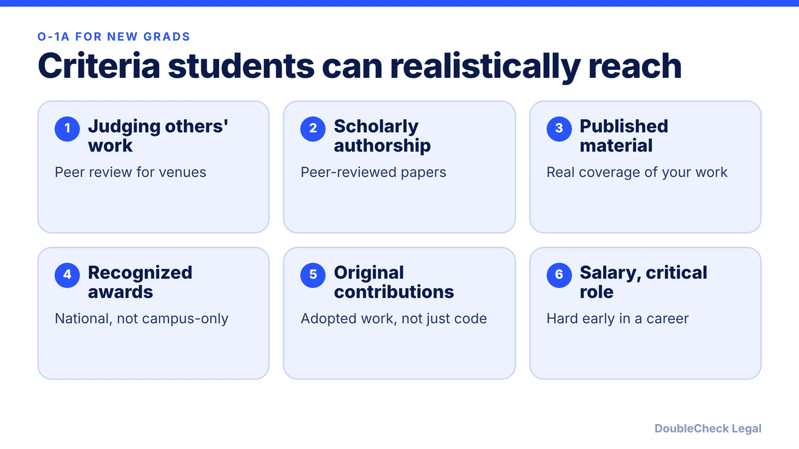
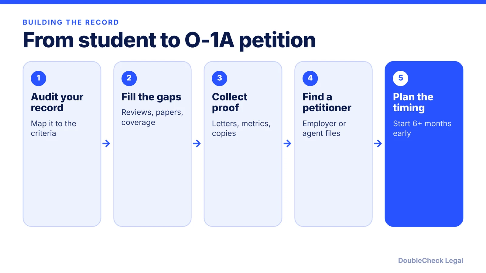

*The O-1A has no age or experience minimum, but it has a high bar. Here is how student and early-career evidence maps to it.*

**Key takeaways:**

- There is no minimum age or experience, but USCIS requires sustained acclaim at the very top of the field.
- Peer review, peer-reviewed papers and genuine press are the most reachable criteria for many students.
- Campus hackathon prizes, paid memberships and ordinary salaries rarely carry weight alone.
- A U.S. employer or agent must file, and a pending O-1 does not extend OPT.

## 1. The quick answer

**Quick answer:** A recent graduate can qualify for the O-1A, because there is no minimum age or years of experience, but the bar is high and most new graduates do not yet meet it. Per USCIS, the O-1A requires sustained national or international acclaim and a level of expertise among the small percentage at the very top of the field, shown by a major internationally recognized award or at least three types of evidence from the regulations. A U.S. employer or agent must file the petition, so you cannot self-petition.

## 2. The criteria, matched to student and early-career evidence

Meeting three criteria is the threshold, not the finish line. Per [f1jobs.io](https://www.f1jobs.io/resources/blog/o1-visa-requirements-criteria-new-grad-examples) (September 29, 2026), USCIS then weighs the whole file for sustained acclaim. Here is how common student evidence maps, drawing on that source and on [WeGreened's guide for Ph.D. students](https://www.wegreened.com/o1-visa/o1a-visa-for-phd-students):

- **Peer-reviewed work (authorship).** First-author papers at peer-reviewed venues are realistic for people with a master's or doctoral research record; per f1jobs.io, fewer well-cited papers beat many weak ones. WeGreened says preprints and technical reports add context only. Patents and conference presentations can add support, per the National Law Review summary below.
- **Judging.** Completed peer reviews for recognized journals or conferences are often the most reachable for engineers, per f1jobs.io. An unanswered invitation does not count.
- **Awards, hackathons and competitions.** Per f1jobs.io, top placement in a national-level competition with a documented selection process is possible but rare; campus or hackathon prizes rarely carry weight alone. WeGreened notes that awards limited to one school or locality usually do not qualify.
- **Scholarships and fellowships.** WeGreened does not list scholarships as a separate criterion; it treats a competitively funded government research grant or stipend as a positive factor in the overall review. Competitive fellowships are named as useful evidence by the [National Law Review](https://natlawreview.com/article/transitioning-f-1-student-visa-o-1-visa) (August 7, 2026).
- **Press.** Articles in professional or major media that substantially discuss your work can count; a passing mention does not, and your own posts or company press releases generally do not, per the two sources above.
- **High salary.** Per f1jobs.io, a strong but ordinary offer for your level does not qualify by itself; a doctoral stipend rarely meets the comparison, per WeGreened.
- **Critical role at a distinguished organization.** Difficult early on; it needs both a distinguished organization and a shown critical role, supported by letters.
- **Membership.** Paid or student-level memberships do not count.
- **Original contributions of major significance.** An open-source library adopted by other organizations can fit, but you need independent evidence of use, per f1jobs.io.

Recommendation letters from independent experts matter; see [O-1 recommendation letters](/blog/o-1-recommendation-letters-expert-opinion/).

## 3. Realistic expectations and F-1 timing

Per f1jobs.io, most new graduates do not yet have a record at the required level, and a file that checks three boxes thinly can still fail the overall review. Comparable evidence can help when a criterion does not fit your occupation, but it does not lower the standard. Whether you qualify is a question for an immigration attorney who has seen your evidence.

Things that trip up students, per the National Law Review and WeGreened:

- **No self-petition.** A U.S. employer or qualifying agent files Form I-129, so you need an offer or an agent, and your university may not sponsor students.
- **OPT is not extended.** Unlike H-1B cap-gap, a pending O-1 petition does not extend F-1 work authorization, and WeGreened notes OPT ends on the O-1 effective date. You cannot work in O-1 status until USCIS approves the change.
- **Start early.** The National Law Review suggests starting about six months or more before OPT or STEM OPT expires.
- **Tied to the employer.** O-1 work authorization covers the listed employment; changes need a new or amended petition.
- **Consultation.** Per USCIS, the petition needs a written advisory opinion from a peer group or an expert in the field.
- **J-1 home residency.** If it applies, WeGreened says you cannot change status inside the U.S.; you would apply abroad.

Per USCIS, the initial stay can be up to three years. For costs and speed, see [O-1 cost](/blog/o-1-visa-cost-filing-and-attorney-fees/) and [processing and premium processing](/blog/o-1-visa-processing-time-premium-processing/).

## 4. How this differs from the other O-1 guides, and when to pick something else

This post is about the student-to-O-1 gap. If you are founding a company, read [O-1A evidence for startup founders](/blog/o-1a-visa-for-startup-founders-evidence/), [F-1 to O-1 change of status for founders](/blog/f-1-to-o-1-change-of-status-founders/) and [the document checklist](/blog/o-1-visa-documents-checklist-founder/). To compare with the green card route, see [EB-1A vs O-1](/blog/eb-1a-vs-o-1-founder-which-path/) and [NIW for engineers and researchers](/blog/niw-for-software-engineers-and-researchers/).

If your record is not there yet, the lower-risk plan is often: stay in status through OPT or STEM OPT, keep building verifiable evidence (reviews, publications, adoption, press), and register for the H-1B in the meantime. See [what to do if you are not selected in the H-1B lottery](/blog/h-1b-lottery-lost-alternatives-international-students/) and [H-1B vs L-1 vs O-1](/blog/h-1b-vs-l-1-vs-o-1-which-visa-for-tech-employees/). Talk to your DSO and a lawyer before building an O-1 case around a short timeline.

## Where DoubleCheck fits

[DoubleCheck](https://www.contactdoublecheck.com) helps businesses and founders start legal work with AI, verify it, and, when professional advice is warranted, connect with an independent attorney, including for immigration questions. Attorney availability and practice areas vary. Attorneys on DoubleCheck are independent professionals; an attorney-client relationship forms only if an attorney accepts your engagement.

**Sources:** [USCIS, O-1 Visa](https://uscis.gov/o-1); [f1jobs.io, O-1 criteria with new grad examples](https://www.f1jobs.io/resources/blog/o1-visa-requirements-criteria-new-grad-examples); [WeGreened, O-1A for Ph.D. students](https://www.wegreened.com/o1-visa/o1a-visa-for-phd-students); [National Law Review, transitioning from F-1 to O-1](https://natlawreview.com/article/transitioning-f-1-student-visa-o-1-visa).

## FAQ

**Can a recent graduate qualify for the O-1A?**

Possibly. Per the National Law Review, there is no minimum age or years of experience, but you need a major internationally recognized award or at least three of eight evidence types, and USCIS weighs the whole record. Most new graduates do not yet have a record at that level, per f1jobs.io.

**Do hackathon wins count toward an O-1?**

Rarely on their own. Per f1jobs.io, top placement in a national-level competition with a documented selection process is possible but rare, and campus or hackathon prizes seldom carry weight alone.

**Can I file my own O-1 petition as a student?**

No. Per the National Law Review, a U.S. employer or qualifying agent must file Form I-129, and self-petitioning is not allowed.

**Does a pending O-1 petition extend my OPT?**

No. The National Law Review says that, unlike H-1B cap-gap, O-1 petitions do not extend F-1 work authorization while pending. It suggests starting six months or more before OPT or STEM OPT ends.

---

*General information only. This article is not legal, tax, investment, or accounting advice.*
