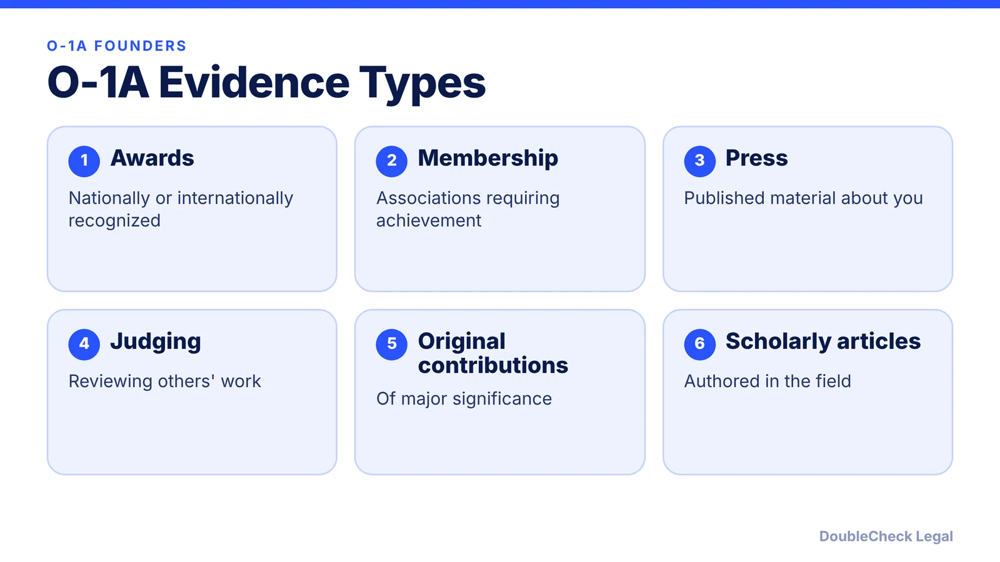
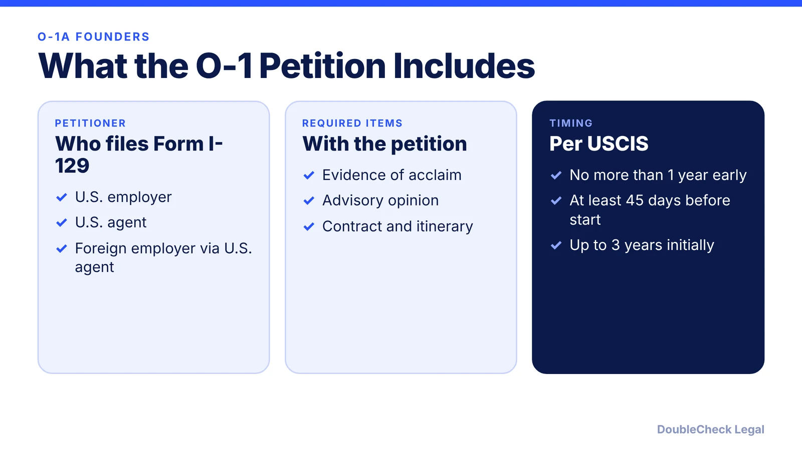

*Can a startup founder qualify for an O-1A? Here is what USCIS requires, how founders map their evidence, and who files the petition.*

**Key takeaways:**

- The O-1A covers sciences, education, business, and athletics; the standard is the very top of the field.
- USCIS says a petition needs at least three types of qualifying documentation, and the evidence as a whole must meet the standard.
- A U.S. employer, a U.S. agent, or a foreign employer through a U.S. agent files Form I-129.
- Initial stay is up to three years; O-3 family members cannot work.

## 1. The quick answer

**Quick answer:** The O-1A is a temporary visa for people with extraordinary ability in sciences, education, business, or athletics. USCIS describes the standard as being one of the small percentage who have risen to the very top of the field, shown through sustained national or international acclaim, and a petition needs at least three types of qualifying documentation. Founders often rely on press, a critical role at a distinguished organization, original contributions, high pay, judging, or awards.

## 2. How a founder maps the criteria

Beyond Border lists eight categories of evidence for the O-1A: awards, judging, membership, press, high remuneration, original contribution, scholarly articles, and critical employment. The USCIS page says at least three types of qualifying documentation are needed, and that the evidence as a whole must meet the standard. A founder's file commonly leans on press coverage, a leading or critical role in the company, original contributions with measurable impact, and compensation or equity, but whether a given item counts is for the adjudicator to decide.

- Keep source links, dates, and screenshots for press, awards, and traction.
- Show impact with numbers where you can document them.
- Ask people in your field for letters that explain, in specifics, why your work matters.

An advisory opinion from a peer group, labor organization, or expert is also required, with exceptions where no appropriate peer group exists.

## 3. Who files: employer, agent, or your own company

USCIS says Form I-129 can be filed by a U.S. employer, a U.S. agent, or a foreign employer through a U.S. agent. An agent may be the actual employer, a representative of both worker and employer, or someone authorized to act for the employer. Founders sometimes ask whether their own U.S. company can be the petitioner; that depends on the facts, so it is a question for counsel. The petition must include any written contract (or a summary of an oral agreement) and an itinerary or description of events for the requested period.

## 4. Limits to know about

The O-1 is for temporary stays: up to three years at first, with extensions in increments of up to one year. Spouses and children get O-3 status and cannot work under it. For a path to permanent residence, compare [EB-1A vs. O-1](/blog/eb-1a-vs-o-1-founder-which-path/) and the [O-1 documents checklist](/blog/o-1-visa-documents-checklist-founder/). For timing and cost, read [O-1 processing time and premium processing](/blog/o-1-visa-processing-time-premium-processing/).

## Where DoubleCheck fits

[DoubleCheck](https://www.contactdoublecheck.com) helps businesses and founders start legal work with AI, verify it, and, when professional advice is warranted, connect with an independent attorney, including for immigration questions. Attorney availability and practice areas vary. Attorneys on DoubleCheck are independent professionals; an attorney-client relationship forms only if an attorney accepts your engagement.

**Sources:** [USCIS O-1](https://uscis.gov/o-1); [Beyond Border](https://www.beyondborderglobal.com/resources/o-1-criteria-evidence-matrix-8-cfr-214-2-o-2026).

## FAQ

**What evidence does an O-1A need?**

USCIS says at least three types of qualifying documentation, or comparable evidence in certain cases, plus an advisory opinion, any contract or summary, and an itinerary.

**Can a founder petition for themselves?**

USCIS says a U.S. employer, a U.S. agent, or a foreign employer acting through a U.S. agent files the petition. Whether your own company can serve depends on the facts, so ask counsel.

**How long is an O-1 valid?**

The initial stay can be up to three years, with extensions in increments of up to one year.

**Can my spouse work on an O-3?**

No. USCIS says O-3 spouses and children cannot work under that status.

---

*General information only. This article is not legal, tax, investment, or accounting advice.*
