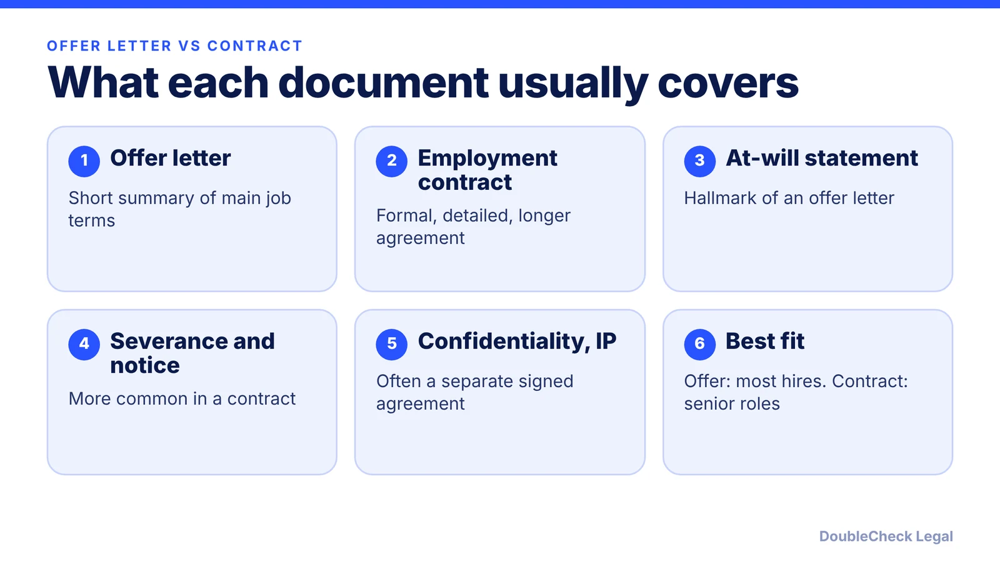
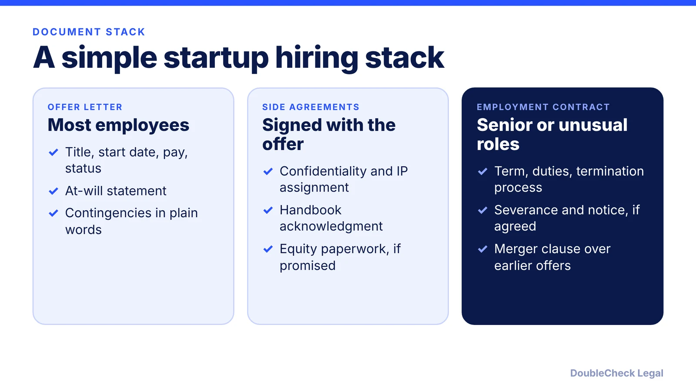

*An offer letter confirms the basics; an employment contract adds detailed terms. Here is how a startup decides which to use, and what each can bind you to.*

**Key takeaways:**

- Offer letters are short and usually include an at-will statement; contracts are longer and more detailed.
- An offer letter can still create liability if wording promises too much or a candidate relies on it.
- Contracts are typically kept for senior roles; confidentiality and IP terms are often signed separately.
- State notice rules (such as California and Illinois) can add required content, so check your state.

## 1. The quick answer

**Quick answer:** An offer letter is a short document that confirms the main terms of a job (title, start date, pay, an at-will statement). An employment contract is a longer, more formal agreement that adds terms such as contract length, termination process, severance and restrictive covenants. Per law-firm guidance as of November 2026, offer letters fit most hires, while contracts are usually kept for founders, CEOs and other senior roles. For a startup, the offer letter vs employment contract choice mostly comes down to how much you want to promise, and how much protection you need in writing.

## 2. Offer letter vs employment contract: the core differences

Three sources agree on the basic split. DLA Piper describes offer letters as short documents covering the basics, with an at-will provision as "a hallmark of an offer letter," while agreements are longer and may include "more complex and sophisticated terms" such as notice and severance requirements. The American Society of Employers (ASE) says an offer letter is a basic, mostly standard document used for most hires, and a contract is more formal and usually reserved for senior leaders and officers.

In practice that gives you this comparison:

- **Length and formality:** offer letters are brief and standardized; contracts are negotiated and detailed.
- **Typical offer letter contents:** position and title, full- or part-time status, start date, work schedule, pay and benefits, and an at-will statement (per ASE). DLA Piper adds exempt or non-exempt status for overtime.
- **Typical contract additions:** contract length, duties, bonus milestones, confidentiality, the termination process, severance and arbitration (per ASE).
- **Protective terms:** with a standard offer letter, the employee is usually also asked to sign a separate confidentiality and inventions assignment agreement, per DLA Piper. See [confidentiality and IP assignment agreements for startups](/blog/confidentiality-ip-assignment-agreements-startups/).
- **Who gets which:** DLA Piper says agreements suit founders, CEOs and other senior-level employees; offer letters suit employees whose relationship with the employer is not as complex.

Neither document changes the legal baseline by itself. If a worker is really an independent contractor, the paperwork is different; see [employee vs independent contractor classification](/blog/employee-vs-independent-contractor-classification-startups/) and the [independent contractor agreement guide](/blog/independent-contractor-agreement-what-to-include/).

## 3. Is an offer letter legally binding?

Often partly, yes, and that surprises founders. Per ASE, at-will language generally keeps an offer letter from being treated as a binding contract in a dispute, but even without a formal contract, rescinding an offer can create liability, especially if the candidate relied on it by quitting a job or relocating. ASE also notes casual wording such as "welcome to the team" could be read as making the letter more like a contract.

FindLaw adds two points:

- A written offer can become an enforceable contract if it has clear, definite terms and both sides show intent to be bound by accepting it.
- Under promissory estoppel, a clear promise that a candidate reasonably relied on (for example by quitting a job or moving) can support a claim for reliance damages even in an at-will job.

The practical lesson: say what you mean, and nothing more. Avoid promises about job security, guaranteed bonuses or future equity that you have not approved. If you want to confirm the at-will rule in writing, see [at-will employment by state and its exceptions](/blog/at-will-employment-by-state-exceptions-employers/). Offers are also commonly conditioned on a background check; see [employee background checks and the FCRA](/blog/employee-background-checks-fcra-small-business/) and [I-9 and E-Verify for startups](/blog/i-9-and-e-verify-for-startups/).

## 4. What a startup should put where

A workable startup setup separates the documents by job:

Points to keep in mind:

- **Equity:** an offer letter that mentions options or shares should not promise a number or price. Equity is typically granted under separate approvals and documents; see [employee equity grants for first hires](/blog/employee-equity-grants-for-first-hires-how-to-structure/) and [stock options and 409A valuations](/blog/stock-options-409a-valuation-startups/).
- **State notices:** ASE says some states, such as California and Illinois, require offer letters to include specific notices (pay rates, employer name and address, workers' compensation details). DLA Piper similarly notes California requires additional written pay and employer notices at hire. Check your state.
- **Hierarchy:** if you do sign a full contract, consider a merger clause so the final contract takes precedence over earlier offers. See [entire agreement (merger) clauses explained](/blog/entire-agreement-merger-clause-explained-what-it-wipes-out/).
- **Restrictive covenants:** non-solicit and non-compete terms depend heavily on state law; see [non-compete agreements by state](/blog/non-compete-agreements-by-state-2026/).
- **Consistency:** ASE recommends a standard offer letter reviewed by an attorney and a consistent hiring process that hiring managers are trained to follow.

## 5. When to handle it yourself and when to get an attorney

**Reasonable to handle yourself (then verify):** a standard at-will offer letter for a non-executive hire in a state where you already know the notice rules. You can draft with AI (see [drafting a job offer letter with AI](/blog/draft-job-offer-letter-with-ai/)), then check it against the list in [AI employment agreement review checklist](/blog/ai-employment-agreement-review-checklist/).

**Get an attorney to look when:**

- the hire is senior, a co-founder-level employee, or someone receiving equity, severance or a guaranteed term;
- you are adding non-compete, arbitration or IP assignment terms;
- the person is relocating, leaving a job for you, or hired remotely in another state (see [multi-state remote employees](/blog/multi-state-remote-employees-compliance-startups/));
- you are also writing a separation document later (see [severance agreement review](/blog/severance-agreement-review-before-you-sign/)).

Our general guidance on timing is in [how to hire your first employee: a legal checklist](/blog/how-to-hire-first-employee-legal-checklist/) and [when to hire a lawyer](/blog/when-to-hire-lawyer-small-business/).

## Where DoubleCheck fits

[DoubleCheck](https://www.contactdoublecheck.com) helps businesses and founders start legal work with AI, verify it, and, when professional advice is warranted, connect with an independent attorney, including for immigration questions. Attorney availability and practice areas vary. Attorneys on DoubleCheck are independent professionals; an attorney-client relationship forms only if an attorney accepts your engagement.

**Sources:** [DLA Piper, Offer letters and employment agreements](https://www.dlapiper.com/insights/publications/accelerate/employee-other-service-provider-matters/offer-letters-and-employment-agreements-is-there-a-difference); [American Society of Employers](https://www.aseonline.org/News/Articles/ArtMID/628/ArticleID/1617/What-is-the-Difference-Between-an-Offer-Letter-and-an-Employment-Contract); [FindLaw, Are Job Offers Legally Binding?](https://www.findlaw.com/employment/hiring-process/are-job-offers-legally-binding.html); [SHRM, Beware: Rescinding Job Offers Can Prompt Legal Consequences](https://www.shrm.org/in/topics-tools/news/talent-acquisition/beware-rescinding-job-offers-can-prompt-legal-consequences).

## FAQ

**What is the difference between an offer letter and an employment contract?**

An offer letter is a short summary of main job terms, usually with an at-will statement. An employment contract is a more formal agreement adding terms like contract length, termination process and severance, per DLA Piper and the American Society of Employers.

**Is an offer letter a legally binding contract?**

It can be. At-will language generally keeps it from being treated as a contract, but rescinding an offer can still create liability if the candidate relied on it, and clear, definite terms can be read as binding, per ASE and FindLaw.

**Does a startup need an employment contract for every employee?**

Usually not. Per DLA Piper and ASE, offer letters fit most hires, and contracts are typically used for founders, CEOs and other senior employees. Confidentiality and IP assignment are commonly signed as separate agreements.

**Can an offer letter be changed or replaced by a later contract?**

Yes, a signed contract can supersede an earlier offer letter, and a merger (entire agreement) clause is a common way to make that explicit. Have both documents signed so there is a dated record of what the employee agreed to.

**Do I need a lawyer to review my offer letter template?**

Not always for a standard at-will letter, but ASE recommends using a standard offer letter reviewed by an attorney. Get review for senior hires, equity, severance, non-competes or multi-state employees.

---

*General information only. This article is not legal, tax, investment, or accounting advice.*
