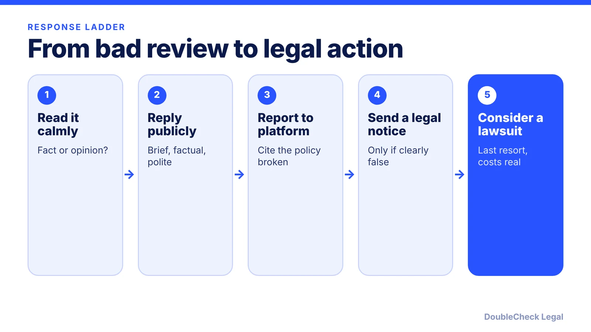
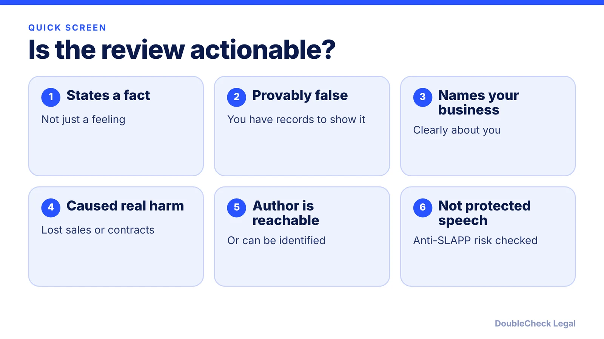

*Not every bad review is defamation, and the platform is usually not the one you can sue.*

**Key takeaways:**

- Only false statements of fact can be defamation; opinion is generally protected.
- Section 230 generally shields platforms from liability for user reviews, so claims target the author.
- Report policy violations, reply professionally, and consider a lawyer's demand letter for clear falsehoods.
- Anti-SLAPP laws in many states can shift legal fees to a business that sues over protected speech.

## 1. The quick answer

**Quick answer:** A negative review is only defamation if it states a false fact, not an opinion, and harms your business. You usually cannot hold Google, Yelp, or similar platforms liable for a user's review because of Section 230, so any legal claim is generally against the author. Your best first moves are to reply professionally, report policy violations to the platform, and talk to a lawyer before sending threats or suing, because many states have anti-SLAPP laws that can shift legal fees to a losing plaintiff.

## 2. Fact, opinion, and defamation basics

Per [Revision Legal](https://revisionlegal.com/internet-law/when-does-negative-review-become-defamation/), citing the Restatement (Second) of Torts, a defamation claim generally requires:

- a false statement of fact, not opinion;
- publication to a third party;
- fault, at least negligence (higher for public figures); and
- damage to reputation, or presumed damages where the statement is defamatory per se.

Opinion is not actionable. "I thought the food was terrible" is opinion; a review saying a restaurant overcharged the reviewer states a fact that can be proven false. Falsely accusing a business of fraud or crimes can fall in the per se category. Truth defeats a claim, so a harsh but accurate review cannot support one.

[Chambers](https://chambers.com/articles/can-a-business-sue-for-a-bad-review) adds a practical lens: courts tend to dismiss "terrible" or "rude" language, while a claim like a cockroach infestation can be tested against records such as health inspections and kitchen logs. Document your evidence before you respond. The rules vary by state, so this is general information.

## 3. Section 230 and the platforms

Section 230 of the Communications Decency Act generally treats platforms as hosts of user content rather than publishers. Per [Eric Goldman's write-up of *Daniloff v. Google*](https://blog.ericgoldman.org/?p=24855), a federal court in Oregon dismissed in January 2023 a lawyer's defamation claim against Google over a user's review that began "A liar. A thief.", holding that Google was also immune for its decision not to remove it. Goldman describes protection of review sites for user reviews as well settled.

What that means for you:

- Suing Google or Yelp over a reviewer's words is usually a dead end.
- Platforms respond to their own content policies (spam, conflicts of interest, harassment), so reports citing a specific policy can work without litigation, per Chambers.
- Per Revision Legal, platforms must respond to properly documented court orders compelling removal of content a court has found defamatory.
- If the reviewer is anonymous, a lawyer may be able to seek pre-suit discovery to identify them, per Chambers.

Fake reviews are also a regulatory issue. The FTC's fake reviews rule bars fake reviews and, in some cases, suppression of reviews; see [FTC endorsement and review rules](/blog/ftc-endorsement-disclosure-rules-small-business/).

## 4. What you can and cannot do

**Do:**

- Reply calmly and factually. Per Revision Legal, use the reply to correct an inaccurate statement.
- Invite satisfied customers to leave honest reviews. Per the FTC's rule, do not reward only positive ones.
- Report fabricated or policy-violating reviews through the platform.
- Have a lawyer send a demand letter if the statement is clearly false and costly; it may prompt a deletion or apology.

**Do not:**

- Argue in the comments. Chambers notes it often worsens reputational damage.
- Write fake reviews of competitors or yourself. See the FTC rule above.
- Threaten customers with penalties for reviewing. The Consumer Review Fairness Act voids such clauses in form contracts, though you may remove libelous, harassing, or clearly false reviews, per JD Supra's summary of FTC guidance.
- Sue without a plan. Per Revision Legal, more than 30 states have anti-SLAPP statutes; if a court finds the review protected, the defendant can seek fees and costs from the business, and in California the motion is heard early.

If you receive a demand yourself, see [how to respond to a cease and desist letter](/blog/how-to-respond-cease-and-desist-letter/). Your customer terms are covered in [website terms of service](/blog/website-terms-of-service-saas-startups/), and a suit against you is covered in [what to do if you are served](/blog/what-to-do-if-your-small-business-is-served-a-lawsuit/).

## Where DoubleCheck fits

[DoubleCheck](https://www.contactdoublecheck.com) helps businesses and founders start legal work with AI, verify it, and, when professional advice is warranted, connect with an independent attorney, including for immigration questions. Attorney availability and practice areas vary. Attorneys on DoubleCheck are independent professionals; an attorney-client relationship forms only if an attorney accepts your engagement.

**Sources:** [Revision Legal, When Does a Negative Review Become Defamation](https://revisionlegal.com/internet-law/when-does-negative-review-become-defamation/); [Chambers, Can a Business Sue for a Bad Review](https://chambers.com/articles/can-a-business-sue-for-a-bad-review); [Eric Goldman, Daniloff v. Google](https://blog.ericgoldman.org/?p=24855); [JD Supra, What the FTC Wants Businesses to Know (CRFA)](https://jdsupra.com/legalnews/what-the-ftc-wants-businesses-to-know-70083/).

## FAQ

**Can I sue Google or Yelp over a defamatory review?**

Usually not. Per Eric Goldman's summary of Daniloff v. Google (D. Or. 2023), the court dismissed the claim against Google under Section 230, including for refusing to remove the review.

**Is a harsh negative review defamation?**

Not by itself. Per Revision Legal, opinion is not actionable and a defamation claim requires a false statement of fact, fault, and harm.

**Can I make customers agree not to post negative reviews?**

Not in a form contract. Per JD Supra's summary of FTC guidance, the Consumer Review Fairness Act voids clauses that restrict reviews, penalize reviewers, or take their IP rights, with exceptions for employment and contractor agreements.

**What is an anti-SLAPP law and why does it matter?**

Per Revision Legal, over 30 states have anti-SLAPP statutes that let a defendant seek early dismissal of claims over protected speech and recover attorney's fees from the plaintiff. They are a real cost risk if you sue over a review.

---

*General information only. This article is not legal, tax, investment, or accounting advice.*
