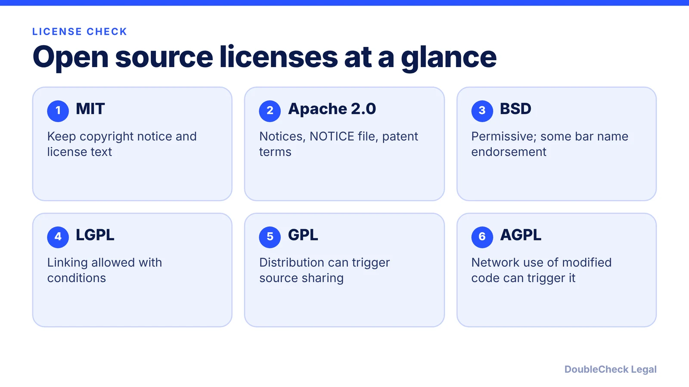
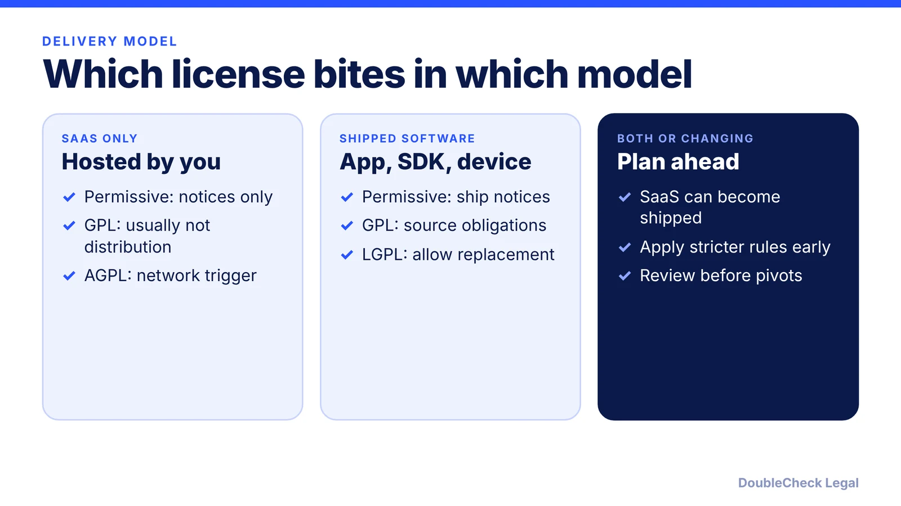

*Open source license compliance for startups: what MIT, GPL and Apache require, how delivery model changes risk, and a checklist, as of November 2026.*

**Key takeaways:**

- MIT, BSD and Apache 2.0 allow closed-source use but still require notices; Apache 2.0 adds NOTICE file and patent terms.
- GPL obligations are generally triggered by distribution; AGPL extends to modified software used over a network.
- Inventory dependencies, classify licenses, keep a notices file and an SBOM.
- Investors and customers often ask for your open source list, so have it ready.

## 1. The quick answer

**Quick answer:** Open source license compliance for startups comes down to knowing which licenses sit in your code and doing what each one asks. MIT and Apache 2.0 are permissive: you can use them in closed-source products, but you must keep the copyright notice and license text (and, for Apache 2.0, any NOTICE file). The GPL can require you to share source when you distribute software that includes it, and the AGPL extends that to software people use over a network. What to check before you ship or raise money: inventory every dependency, classify each license, match it to how you deliver the product, and keep an attribution file.

## 2. What MIT, Apache 2.0 and BSD require

Permissive licenses are the easiest to live with, but they are not obligation-free. Permissive code can sit in closed-source products, but the licenses still require notices (see the [MIT](https://opensource.org/license/mit) and [3-clause BSD](https://opensource.org/license/bsd-3-clause) texts).

- **MIT.** Copies or substantial portions must include the copyright notice and license text. It has no copyleft and no patent provision.
- **Apache 2.0.** Per the license text, you must give recipients a copy of the license, mark modified files with prominent notices, keep existing copyright, patent, trademark and attribution notices, and carry over a NOTICE file's attribution notices if the work includes one. It also contains a patent license, which ends for you if you start patent litigation alleging the work infringes a patent.
- **BSD (2- and 3-clause).** Similar notice duties. The 3-clause version adds a bar on using the copyright holder's or contributors' names to endorse your product without permission.

In practice, the failure mode is not a dramatic lawsuit. It is shipping a product with no attribution page, which fails the notice requirements of these licenses. Heather Meeker, an open source licensing specialist at O'Melveny, also warns that a link or short summary of the license is generally not enough to meet notice requirements (opensource.com, September 2017).

Keep a plain text or web page called "Open Source Licenses" or "Third-Party Notices," include it with the product, and update it whenever dependencies change. For AI model weights, the licenses can differ from software licenses; see [open-weight vs open-source AI licenses](/blog/open-weight-vs-open-source-ai-licenses-what-businesses-can-do/).

## 3. When the GPL, LGPL and AGPL apply to your product

Copyleft licenses are where delivery model matters. The same dependency can be fine in one product and a problem in another.

- **GPL (v2, v3).** Per the [Free Software Foundation](https://www.gnu.org/licenses/quick-guide-gplv3.html), when you distribute object code to users you must also give them a way to get the source, under the GPL. GPLv3 calls this "conveying." Whether a hosted service involves distribution is fact-specific, which is one reason the AGPL exists.
- **LGPL.** Generally allows linking from proprietary software without triggering full copyleft, provided users can replace the LGPL library with a modified version. Notices and sharing of library modifications still apply.
- **AGPL v3.** If you modify the software and make it available over a network, you must offer your modified source to users who interact with it, even without shipping binaries. This is a main SaaS risk, and investors and acquirers may scrutinize AGPL dependencies closely. The FSF's [license list](https://www.gnu.org/licenses/license-list.html) describes the AGPL's network clause.
- **Source-available licenses.** Some well-known database and search projects moved to non-OSI licenses such as the Server Side Public License. Treat these as separate, reviewable licenses, not as "open source" by default.

Meeker's ninth rule is worth underlining: a SaaS business can quickly become a distributed-software business (a desktop client, a mobile app, an on-prem deal), so following the distributed-software rules gives flexibility. Rules about GPL linking and what counts as a combined work are fact-specific. Have an attorney look at any case where GPL or AGPL code touches your core product.

## 4. A startup open source license checklist

Use this before a release, a customer security review, or a fundraise.

1. **Inventory dependencies.** Record every direct and transitive dependency, its license, and its attribution requirements. Meeker suggests a simple spreadsheet and saving each license file.
2. **Find unlicensed code.** Code with no license gives you no permission to use it. Unlicensed or unclear-license code in a dependency tree is a common diligence finding, so flag it for review.
3. **Classify each license.** A simple policy has three lists: approved (for example MIT, Apache 2.0, BSD), legal review required (for example LGPL, MPL, EPL), and not allowed without a commercial license or sign-off (GPL, AGPL, non-OSI source-available).
4. **Check compatibility.** Per the FSF [license list](https://www.gnu.org/licenses/license-list.html), Apache 2.0 is compatible with GPLv3 but not with GPLv2, and GPLv2-only code should be checked carefully against GPLv3 code.
5. **Create the notices file** and ship it with the product.
6. **Generate an SBOM.** A software bill of materials is a machine-readable list of components, versions and licenses. Common formats include SPDX and CycloneDX, and CISA published [2025 minimum elements for an SBOM](https://www.cisa.gov/sites/default/files/2025-08/2025_CISA_SBOM_Minimum_Elements.pdf).
7. **Scan continuously.** Tools named in the guides include FOSSA, Black Duck, Snyk and ScanCode. Pick one that runs in CI so new dependencies are caught at pull request time.
8. **Cover people.** Employees and contractors can introduce licenses you did not approve. Put the policy in your handbook and see [confidentiality and IP assignment agreements](/blog/confidentiality-ip-assignment-agreements-startups/) and [independent contractor agreements](/blog/independent-contractor-agreement-what-to-include/).

If a scan finds a problem, the usual options are to remove or replace the component, run it as a separate process instead of linking it, or ask the copyright holder for a commercial license. Fix missing attribution first; it is the cheapest.

## 5. Contracts, investors and AI-generated code

Open source choices show up in documents, not just repositories.

**Investor diligence.** Meeker notes investors and acquirers commonly ask for a list of the open source you use, and may run scanning tools. Having an SBOM, license inventory, notices file and written policy ready makes this a short conversation. See the [startup fundraising due diligence checklist](/blog/due-diligence-checklist-for-startup-fundraising/) and the [Series A legal due diligence checklist](/blog/series-a-legal-due-diligence-checklist/).

**Customer contracts.** Customers and enterprise buyers may ask you to warrant that your software does not include code under licenses that require disclosure. Compare those promises with what your inventory shows before you sign. See the [indemnification clause explained](/blog/indemnification-clause-explained-small-business/), the [software license vs SaaS agreement](/blog/software-license-agreement-vs-saas-agreement-differences/) and the [AI vendor contract checklist](/blog/ai-vendor-contract-checklist/).

**AI-generated code.** Coding assistants can produce code that resembles licensed code, and your policy should say whether and how it is scanned. We cover this in [AI-generated code and IP for startup founders](/blog/ai-generated-code-ip-startup-founders/). Verify any AI summary of a license against the license text itself, and see [how to verify an AI-generated legal document](/blog/verify-ai-generated-legal-document/).

**Releasing your own code.** If you plan to open source part of your product, get advice first. Meeker recommends consulting an attorney before contributing or releasing code, since released IP may not support company valuation. See [trademark vs copyright vs patent](/blog/trademark-vs-copyright-vs-patent-startups/).

**When to get a lawyer.** Handle a permissive-only inventory yourself. Get an attorney for AGPL or GPL in a core product, a pending acquisition or Series A, or a customer contract with open source warranties. See [when to hire a lawyer for your small business](/blog/when-to-hire-lawyer-small-business/).

## Where DoubleCheck fits

[DoubleCheck](https://www.contactdoublecheck.com) helps businesses and founders start legal work with AI, verify it, and, when professional advice is warranted, connect with an independent attorney, including for immigration questions. Attorney availability and practice areas vary. Attorneys on DoubleCheck are independent professionals; an attorney-client relationship forms only if an attorney accepts your engagement.

**Sources:** [Open Source Initiative, The MIT License](https://opensource.org/license/mit); [Open Source Initiative, The 3-Clause BSD License](https://opensource.org/license/bsd-3-clause); [Free Software Foundation, A Quick Guide to GPLv3](https://www.gnu.org/licenses/quick-guide-gplv3.html); [Free Software Foundation, Various Licenses and Comments about Them](https://www.gnu.org/licenses/license-list.html); [CISA, 2025 Minimum Elements for a Software Bill of Materials](https://www.cisa.gov/sites/default/files/2025-08/2025_CISA_SBOM_Minimum_Elements.pdf); [Heather Meeker, 9 open source license management rules for startups, opensource.com (Sept. 28, 2017)](https://opensource.com/article/17/9/9-open-source-software-rules-startups); [Apache License 2.0 text, via Northwestern](https://wordhoard.northwestern.edu/userman/thirdparty/apache20.html).

## FAQ

**What do I need to do to comply with the MIT license?**

Per the [MIT License text](https://opensource.org/license/mit), copies or substantial portions of the software must include the copyright notice and permission notice. MIT has no copyleft requirement, and the code can be used in closed-source products.

**Does the GPL apply if my startup only offers SaaS?**

Per the Free Software Foundation, GPL source obligations attach when you distribute (convey) the software to others. Whether serving users over a network counts depends on the license and the facts, and the AGPL differs: it adds a section that lets users who interact with the software over a network receive its source. Have a lawyer review the facts.

**What is the difference between Apache 2.0 and MIT?**

Per the Apache 2.0 text, Apache requires a copy of the license, marked changes, retained notices and any NOTICE file attributions, and includes a patent license that ends if you sue over patents in the work. MIT is shorter and has no patent provision.

**What should a startup open source license policy include?**

A practical policy uses approved, review-required and prohibited license lists, named reviewers, and CI checks. Add a notices file, an SBOM, and rules for employees, contractors and AI-generated code.

---

*General information only. This article is not legal, tax, investment, or accounting advice.*
