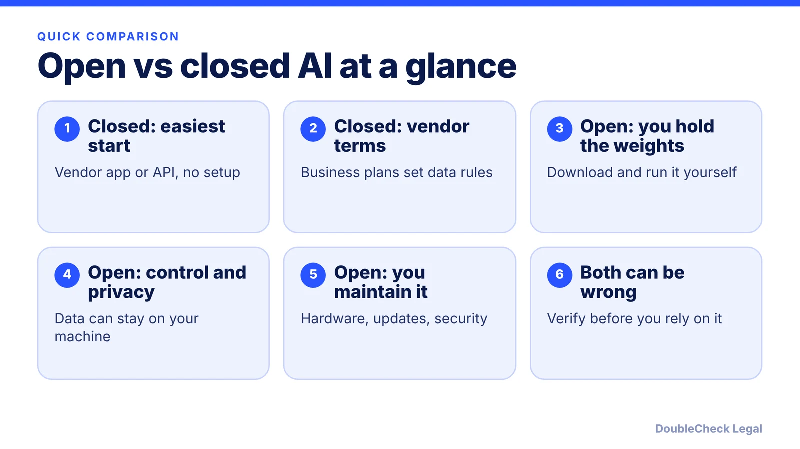
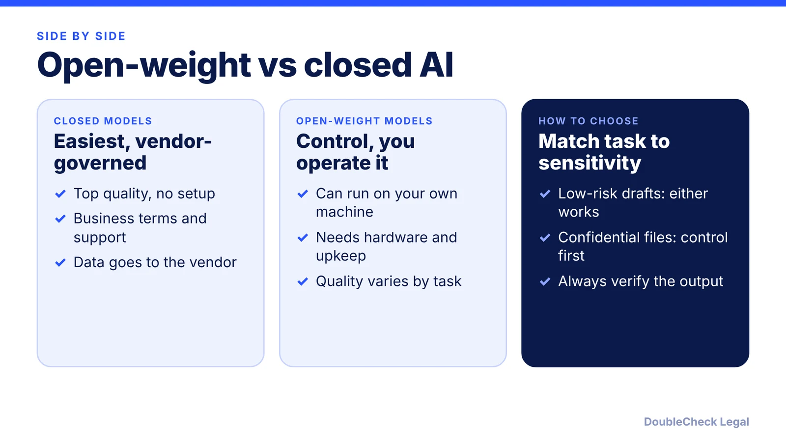

*Open models give you control; closed models give you convenience. Here is how to pick by task and by data sensitivity.*

**Key takeaways:**

- Open-weight models can be downloaded and run on hardware you control; closed models (Claude, ChatGPT, Gemini) are used through a vendor.
- Per Epoch AI, open-weight models have lagged the closed frontier by about four months on average since January 2026; the gap varies by task.
- Open source and open weight are not the same: the OSI definition also asks for training code and data information, and licenses differ.
- Both kinds can be wrong, so verify anything with legal consequences.

## 1. The quick answer

**Quick answer:** Closed models (the ones behind Claude, ChatGPT and Gemini) are reached through a vendor's app or API and are usually the easiest way to get top quality with business contract terms. Open-weight models can be downloaded and run on hardware you control, which gives you privacy, control and predictable cost, at the price of setup, hardware and your own security. Neither is "better" in general. Per Epoch AI (May 29, 2026), the most capable open-weight models have lagged frontier closed models by an average of about four months since January 2026, so for many everyday tasks an open model is good enough. For business use, the practical choice is usually by task and by how sensitive the data is, not by loyalty to a camp. Either way, anything it drafts still needs checking before you rely on it.

## 2. What open-source, open-weight and closed actually mean

The labels get mixed up, so here are short definitions.

- **Closed (proprietary) model.** You use it through the vendor's product or API. You cannot download the model. Claude, ChatGPT and Gemini are in this group.
- **Open-weight model.** Per GEO Toolbox (updated November 7, 2026), open weights means you can download the trained parameters, run them on your own hardware and fine-tune them, but you do not get the training code or training data.
- **Open-source AI.** Stricter. The Open Source Initiative's Open Source AI Definition (version 1.0, published October 28, 2024) asks for the weights, the code used to train and run the system, and sufficiently detailed information about the training data, and it grants four freedoms: use, study, modify and share. Per the same article, many popular downloadable models are open-weight rather than open source in this sense.

Licenses matter more than the label. Per GEO Toolbox, some open-weight models use permissive licenses such as MIT or Apache 2.0, while others use custom licenses with conditions. Meta's Llama license, for example, requires licensees above 700 million monthly active users to request a license. Apache 2.0 appears on both sides of the line, so read the actual license for the model you plan to use commercially, and ask an attorney about anything unclear. Our companion post covers [open-weight vs open-source licenses for businesses](/blog/open-weight-vs-open-source-ai-licenses-what-businesses-can-do/).

Open models are a fair and increasingly practical option, and a healthy one for the field: anyone can inspect, host, adapt and compare them, and you are not locked to a single vendor.

## 3. Strengths and limits of each

**Closed models: strengths.**
- Strong quality with no setup; you open an app or call an API.
- Business contracts. Per OpenAI's business data page, it does not train on business data by default across ChatGPT Business, Enterprise, Edu and the API, and customers own that data. Per Anthropic's privacy center (page dated August 18, 2026), it does not use inputs or outputs from its commercial products for training by default. Google's Gemini Enterprise Business terms say Google processes your content under its Data Processing Addendum, so read the terms for your plan.
- Vendor support, security programs and certifications (OpenAI lists SOC 2 Type 2 and ISO/IEC 27001, among others).

**Closed models: tradeoffs.**
- Your prompts and files go to a third party, so vendor terms decide what happens to them. Consumer and business plans differ: per Anthropic (August 28, 2025), Free, Pro and Max users choose whether chats are used to improve Claude, and opting in extends retention to five years, while commercial services are excluded from that change.
- You depend on the vendor for pricing, availability and model changes.

**Open-weight models: strengths.**
- Control. You can run them on a laptop, server or private cloud, so prompts need not leave your environment (see our guide to [running AI locally with Ollama or LM Studio](/blog/run-ai-locally-for-privacy-ollama-lm-studio-small-business/)).
- Flexibility: fine-tuning, no per-token fees when self-hosted, and you can pin a version so behavior does not shift under you.
- Transparency about what you are running, within the limits of the license.

**Open-weight models: limits.**
- Quality gap on hard tasks. Epoch AI reported on September 23, 2026 that open-weight models trailed closed ones by about seven months on its furniture-assembly benchmark, so the gap varies by task.
- Hardware and upkeep fall to you, and so does security. A Cloud Security Alliance note (May 7, 2026) cited an Intruder scan in which about 31% of roughly 5,200 internet-reachable Ollama servers answered test prompts without authentication.
- No vendor support, and the license terms may restrict some uses.

## 4. Which to use for what

A simple way to decide, with no tribal loyalty required:

- **General research, drafting and summarizing non-sensitive material.** A closed model on a business plan is usually the lowest-effort route. Our [ChatGPT vs Claude vs Gemini comparison](/blog/chatgpt-vs-claude-vs-gemini-legal-work/) and the [Claude for business guide](/blog/claude-for-business-legal-work/) cover how they differ for legal work.
- **Confidential documents.** Prefer an option where you control where the data goes: an open-weight model on your own machine, or a vendor plan with business terms you have read. Do not paste confidential contracts into a consumer account without checking its settings (see [uploading contracts to ChatGPT](/blog/uploading-contracts-to-chatgpt-confidentiality/)).
- **High-volume or repetitive tasks.** Self-hosting an open model can make cost predictable, but count the hardware and your time.
- **Anything with legal consequences.** Quality and privacy are separate from correctness. Models can state wrong things confidently, so see [verifying an AI-generated legal document](/blog/verify-ai-generated-legal-document/) and, for a second opinion, the method for [cross-checking a contract with two AI models](/blog/cross-check-a-contract-with-two-ai-models-method/). The wider framework is in [how to choose an AI model for business](/blog/how-to-choose-an-ai-model-for-business-privacy-cost-quality/).

Model names and rankings change every few weeks, so we deliberately do not name a winner. Check the vendor or project page for what is current as of the day you decide, and review the AI vendor terms with our [vendor contract checklist](/blog/ai-vendor-contract-checklist/).

**Handle it yourself vs get an attorney.** Choosing a model for low-risk drafting is a reasonable solo decision. Get an attorney to look when the output will be signed, filed or sent to a counterparty, when a license or vendor agreement has terms you do not understand, or when regulated personal data is involved.

## Where DoubleCheck fits

[DoubleCheck](https://www.contactdoublecheck.com) helps businesses and founders start legal work with AI, verify it, and, when professional advice is warranted, connect with an independent attorney, including for immigration questions. Attorney availability and practice areas vary. Attorneys on DoubleCheck are independent professionals; an attorney-client relationship forms only if an attorney accepts your engagement.

**Sources:** [GEO Toolbox, Open Weights vs Open Source (updated Nov 7, 2026)](https://geotoolbox.ai/blog/open-weights-vs-open-source); [Epoch AI, open-weight models](https://epoch.ai/topics/open-models); [OpenAI, business data privacy](https://openai.com/business-data/); [Anthropic privacy center, commercial data](https://privacy.claude.com/en/articles/7996868-how-long-do-you-store-my-organization-s-data); [Anthropic, updates to consumer terms (Aug 28, 2025)](https://www.anthropic.com/news/updates-to-our-consumer-terms); [Google, Gemini Enterprise Business terms](https://cloud.google.com/terms/gemini-enterprise/business); [Cloud Security Alliance research note (May 7, 2026)](https://labs.cloudsecurityalliance.org/research/csa-research-note-exposed-ai-infrastructure-selfhosted-secur/). Google Gemini API terms page did not load.

## FAQ

**What is the difference between open-source and open-weight AI models?**

Open weights means you can download and run the trained model, but you do not get the training code or data. The OSI Open Source AI Definition (version 1.0, October 2024) asks for more, including training code and detailed data information (per GEO Toolbox, November 2026).

**Are open-source AI models as good as Claude, ChatGPT or Gemini?**

On average they trail the closed frontier by months, not years. Epoch AI reported a four-month average lag since January 2026, and a larger gap of about seven months on one furniture-assembly benchmark in September 2026. For many routine tasks open models are good enough, but check the task you care about.

**Is open-source AI more private than closed AI?**

It can be, because an open-weight model run on your own machine does not need to send prompts to a vendor. Closed vendors also offer business terms: OpenAI says it does not train on business data by default, and Anthropic says the same for its commercial products. Read the terms for your exact plan.

**Can I use an open-weight model commercially?**

Often yes, but it depends on the license. Some are permissive, such as MIT or Apache 2.0, while others add conditions; Meta Llama license requires a separate license above 700 million monthly active users (per GEO Toolbox). Read the specific license and ask an attorney if unsure.

---

*General information only. This article is not legal, tax, investment, or accounting advice.*
