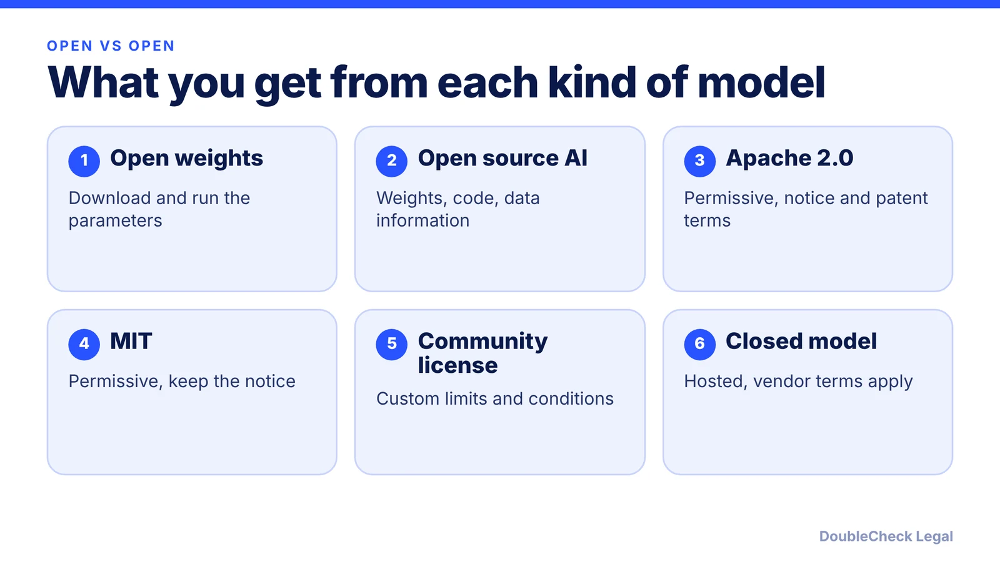
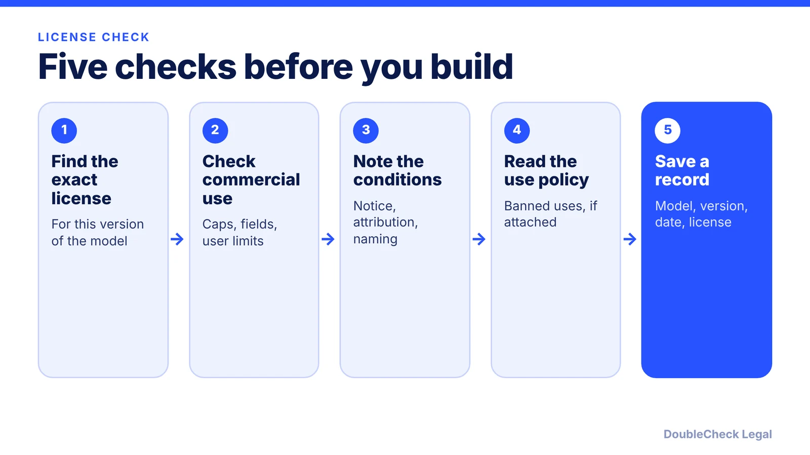

*What the labels mean, what common licenses allow, and how to read a model license before you build on it, as of November 2026.*

**Key takeaways:**

- Open weights means you can download and run the parameters; OSI Open Source AI Definition 1.0 (October 28, 2024) also requires training-data information, complete code and the four freedoms.
- Apache 2.0 and MIT are permissive and generally allow commercial use with notice conditions; Apache adds explicit patent terms.
- Community licenses such as the Llama 3.3 license add conditions: a 700 million user threshold, Built with Llama attribution, naming rules and a use policy.
- Always find the license for the exact model version, record it, and have an attorney review it if it affects a product or contract.

## 1. The quick answer

**Quick answer:** An "open-weight" model is one whose trained parameters (the weights) you can download and run yourself. A truly "open-source" AI system, under the Open Source Initiative's Open Source AI Definition 1.0 (published October 28, 2024), must also come with sufficiently detailed information about the training data and the complete source code used to train and run it, and it must grant the freedoms to use, study, modify and share. What you may do commercially is set by the license attached to the specific model, not by the label. Permissive licenses such as Apache 2.0 and MIT generally allow commercial use. Custom "community" licenses, such as Meta's Llama license, add conditions you should read before building a product on them. As of November 2026, the safe habit is the same for every model: find the license, read it, and record which version you used.

## 2. Open-weight vs open-source: what the words actually mean

People use "open source" loosely for any model you can download. The distinction matters because it decides how much you can inspect, rebuild and rely on.

- **Open weights.** You can download the trained parameters and run the model on your own hardware or a server you control. That gives you privacy and control over where data goes. It does not by itself tell you what data trained the model or let you rebuild it.
- **Open-source AI (OSI definition).** Per the Open Source Initiative, Open Source AI Definition version 1.0 requires the freedoms to use the system for any purpose without asking permission, to study it, to modify it and to share it. To make modification practical, it requires sufficiently detailed information about the training data, the complete source code used to train and run the system, and the parameters under OSI-approved terms.

The OSI has been direct about the gap. In an October 18, 2024 Financial Times interview, reported by It's FOSS, OSI Executive Director Stefano Maffulli said Meta was "polluting the term" open source by applying it to Llama. Whether you agree with that framing or not, it shows why a vendor calling a model "open" is not a license.

For a business, the practical reading is simple: weights you can run are valuable for privacy and cost control, and the license decides your rights. Do not assume a model is free for every commercial use because the weights are public. For the privacy and hosting side of the choice, see [open-source vs closed-source AI models: which should you use](/blog/open-source-vs-closed-source-ai-models-which-should-you-use/) and [how to run AI locally with Ollama or LM Studio](/blog/run-ai-locally-for-privacy-ollama-lm-studio-small-business/).

## 3. What common licenses let a business do (and require)

Here is how the licenses you are most likely to meet compare. These are summaries from the sources named; the license text controls, and versions differ.

**Apache 2.0.** Per FOSSA (published 2021, last modified November 7, 2025), Apache 2.0 allows commercial use, modification and distribution, including inside proprietary products. Conditions include keeping the copyright notice and a copy of the license, stating significant changes where applicable, and carrying forward a NOTICE file if the project has one. FOSSA also notes that contributors grant explicit patent rights, that a defensive termination clause ends those patent rights if you sue over patents in the code, and that the license does not grant trademark rights.

**MIT.** Per Choose a License, MIT permits commercial use, distribution, modification and private use. The condition is to preserve the license and copyright notice, and the license disclaims liability and warranty.

**Community licenses (example: Llama 3.3).** These are custom contracts. Per the Llama 3.3 Community License text as reproduced by Wind River's license list, the terms include:

- A scale threshold: if your products or services exceed "700 million monthly active users in the preceding calendar month," you must request a license from Meta, which it may grant or refuse at its discretion.
- Attribution: if you distribute the model, derivatives or products containing them, you must prominently display "Built with Llama" and include the license notice.
- Naming: a model created, trained, fine-tuned or improved using the materials or their outputs, and then distributed, must begin its name with "Llama."
- An Acceptable Use Policy you must follow, incorporated by reference.

Other community licenses have different limits, and Meta publishes a separate license text for each Llama version, so do not assume the 3.3 terms carry over. Terms can also include restrictions on uses, user counts, or training other models.

Two reminders. First, a license governs the model files; your own data and outputs raise separate questions (see our [AI vendor contract checklist](/blog/ai-vendor-contract-checklist/)). Second, the license is not a warranty: permissive licenses disclaim liability, so the quality and safety of results remain your responsibility.

## 4. A practical license-reading checklist before you build on a model

Reading takes minutes and avoids expensive rework. Before you build a product or workflow on an open model:

Also consider:

- **Where you got the files.** Download from the publisher or a source that preserves the license, and keep the license file with the model.
- **Fine-tuning and distribution.** Licenses often change what you must do if you modify the model or ship it to customers, as the Llama naming rule above shows. Internal-only use is usually simpler than redistribution, but check the text.
- **Regulated or client data.** A permissive license says nothing about privacy law or privilege. See [is local AI private enough for confidential documents](/blog/is-local-ai-private-enough-for-confidential-documents-limits/) and [how to choose an AI model for business](/blog/how-to-choose-an-ai-model-for-business-privacy-cost-quality/).
- **Legal drafting use.** A model is a tool, not a lawyer; see [verifying AI-generated legal documents](/blog/verify-ai-generated-legal-document/) and [uploading contracts to ChatGPT and confidentiality](/blog/uploading-contracts-to-chatgpt-confidentiality/).

If a license affects your product, your customer contracts or your fundraising diligence, that is a reasonable point to have an attorney read it. AI can summarize a license quickly, but it can misstate conditions, so check the summary against the text.

## Where DoubleCheck fits

[DoubleCheck](https://www.contactdoublecheck.com) helps businesses and founders start legal work with AI, verify it, and, when professional advice is warranted, connect with an independent attorney, including for immigration questions. Attorney availability and practice areas vary. Attorneys on DoubleCheck are independent professionals; an attorney-client relationship forms only if an attorney accepts your engagement.

**Sources:** [OSI, Open Source AI Definition 1.0](https://opensource.org/?p=77221); [It's FOSS, OSI and Meta (Oct 2024)](https://itsfoss.com/news/osi-meta-ai/); [FOSSA, Apache License 2.0](https://fossa.com/blog/open-source-licenses-101-apache-license-2-0.md); [Choose a License, MIT](https://choosealicense.com/licenses/mit); [Wind River, Llama 3.3 Community License text](https://open.windriver.com/info/uni-license-list/licenses/llama-3.3-license-2024.html). Meta's own Llama license page could not be fetched, so Llama terms come from the Wind River reproduction.

## FAQ

**What is the difference between open-weight and open-source AI?**

Open-weight models let you download and run the trained parameters. Under the OSI Open Source AI Definition 1.0 (October 28, 2024), open-source AI must also provide sufficiently detailed training-data information, the complete code used to train and run the system, and the freedoms to use, study, modify and share.

**Can a business use open-weight models commercially?**

Often yes, but it depends on the license. Per FOSSA, Apache 2.0 allows commercial use with notice conditions, and per Choose a License, MIT does too. Community licenses such as Llama 3.3 add conditions, including a 700 million monthly active user threshold, per the license text as reproduced by Wind River.

**Is Llama open source?**

Meta calls it open source, but the OSI disagrees. In October 2024, per It's FOSS reporting on a Financial Times interview, OSI Executive Director Stefano Maffulli said Meta was polluting the term open source. Check the current license text for the version you plan to use.

**Does a permissive license make a model safe to use with client data?**

No. A license covers rights in the model files, and it disclaims liability and warranty. Privacy, confidentiality and legal-privilege questions depend on how and where you run the model and what data you put into it. Ask an attorney if the data is sensitive.

---

*General information only. This article is not legal, tax, investment, or accounting advice.*
