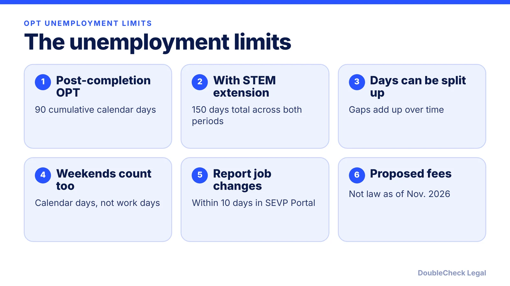
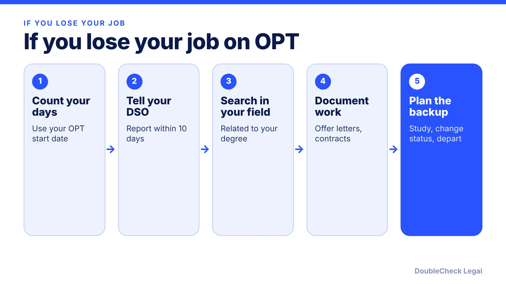

*How the 90-day OPT and 150-day STEM OPT unemployment limits work in November 2026, and what is only proposed.*

**Key takeaways:**

- Post-completion OPT allows 90 cumulative calendar days of unemployment.
- With the STEM extension, the total is 150 days; it does not reset.
- Report employment changes in the SEVP Portal within 10 days, per TrackMyOPT.
- The 2026 OPT fee proposal is not law as of November 2026.

## 1. The quick answer

**Quick answer:** On post-completion OPT you may be unemployed for no more than 90 cumulative calendar days, and if you receive the 24-month STEM OPT extension the total across both periods is 150 days. Per TrackMyOPT, the days need not be consecutive, weekends and holidays count, and the STEM extension adds 60 days to the original 90 rather than resetting the counter. As of November 2026, these limits have not changed. A 2026 DHS proposal would add OPT fees, but it is only proposed and is not law.

## 2. How the days are counted

Per TrackMyOPT, unemployment is counted in calendar days starting from your OPT start date, and days before the start date do not count. Gaps between jobs count as unemployed days. The regulation cited is 8 CFR 214.2(f)(10)(ii); confirm the current text with USCIS or your designated school official (DSO).

What counts as employment, per TrackMyOPT's summary:

- **Paid work:** at least 20 hours per week, in a field related to your degree.
- **Self-employment:** a registered business related to your field.
- **Independent contracting:** 1099 work in your field, with documentation.
- **Volunteer or unpaid work:** counts only during initial OPT, at 20 or more hours per week, and not during the STEM extension.

Travel abroad is described as debated, so ask your DSO before assuming those days stop or pause the count. Practice varies between schools, so your DSO's guidance and your SEVIS record matter more than any article, including this one.

## 3. STEM OPT: what changes

The STEM extension adds time and obligations. Per f1jobs.io's October 2026 summary, STEM OPT requires an E-Verify employer and a Form I-983 training plan, and the work must be directly related to the degree. Unpaid volunteering does not stop the clock during the extension, per TrackMyOPT.

Reaching the limit can lead to SEVIS termination and loss of F-1 status, and can affect pending H-1B petitions, status changes, and future visa applications, per TrackMyOPT. If you are close to the limit, talk to your DSO and an immigration attorney before the last days run out.

Founders: some students keep OPT status by running their own business, but the business must be related to the degree and the arrangement must meet the program's documentation rules. See [starting your own startup on OPT and STEM OPT](/blog/f1-opt-stem-opt-start-your-own-startup/) and the [I-983 training plan guide for startup employers](/blog/stem-opt-i-983-training-plan-startup-employers/). For the difference between work authorizations, read [CPT vs OPT](/blog/cpt-vs-opt-f1-students/).

## 4. What is proposed in 2026, and what is not law

Per f1jobs.io's summary of the October 2026 developments:

- **In effect:** the 90-day and 150-day limits and the 60-day grace period after program or OPT completion.
- **Proposed, not law:** DHS and ICE published an "Optional Practical Training Fees" proposal on October 8, 2026 (91 FR 64566), with a $70,000 charge before a school's initial OPT recommendation and $30,000 for each later recommendation. It has no effective date, and comments were due November 9, 2026.
- **Blocked:** a duration-of-status rule that would have shortened the grace period to 30 days was blocked by a federal court on September 14, 2026, according to the same source, and DHS has appealed.
- **Not written:** DHS has said it is reviewing OPT scope and duration, but there is no published text.

Because the situation changes fast, check the Federal Register and your school before making decisions. Students heading toward the lottery should also read [H-1B cap registration for FY 2028](/blog/h-1b-cap-registration-fy2028-timeline-employers/) and [the cap-gap rules](/blog/f-1-cap-gap-change-of-status-to-h-1b/). If you are weighing next steps, [how to find a good immigration lawyer](/blog/how-to-find-good-immigration-lawyer-startup-founder/) is a useful starting point.

## Where DoubleCheck fits

[DoubleCheck](https://www.contactdoublecheck.com) helps businesses and founders start legal work with AI, verify it, and, when professional advice is warranted, connect with an independent attorney, including for immigration questions. Attorney availability and practice areas vary. Attorneys on DoubleCheck are independent professionals; an attorney-client relationship forms only if an attorney accepts your engagement.

**Sources:** [TrackMyOPT](https://www.trackmyopt.com/blog/opt-unemployment-rules-90-day-limit); [f1jobs.io on the October 2026 proposal](https://www.f1jobs.io/resources/blog/is-opt-ending-what-dhs-proposed-october-2026).

## FAQ

**How many days of unemployment are allowed on OPT?**

Per TrackMyOPT, 90 cumulative calendar days on post-completion OPT. They need not be consecutive, and weekends and holidays count.

**How many unemployment days do I get on STEM OPT?**

The total across OPT and STEM OPT is 150 days, per TrackMyOPT. The extension adds 60 days to the original 90 and does not reset the counter.

**What happens if I exceed the unemployment limit?**

Per TrackMyOPT, it can lead to SEVIS termination and loss of F-1 status, and can affect H-1B petitions and future visa applications. Talk to your DSO and an immigration attorney.

**Is the $70,000 OPT fee in effect?**

No. Per f1jobs.io, DHS proposed it on October 8, 2026 with no effective date, and comments were due November 9, 2026. Current OPT rules and limits remain in effect.

---

*General information only. This article is not legal, tax, investment, or accounting advice.*
