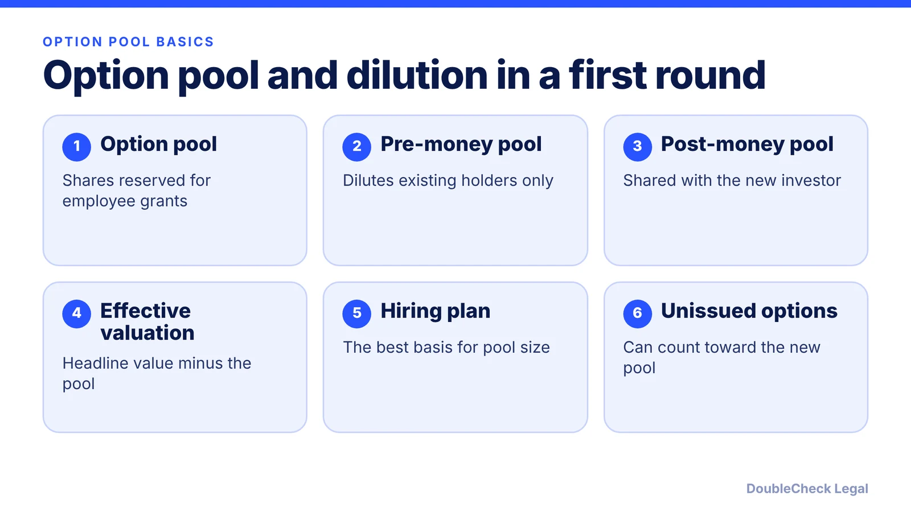
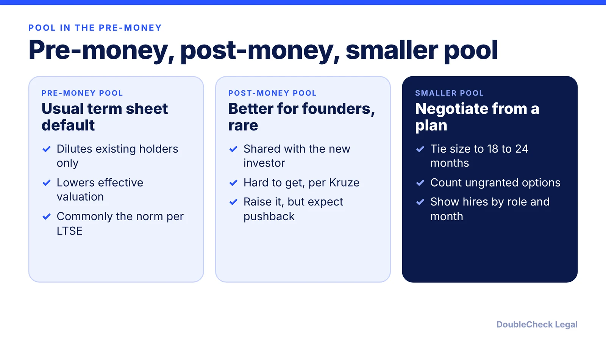

*How a pre-money option pool lowers your effective valuation, and how to size it from a hiring plan.*

**Key takeaways:**

- Pools are usually carved from the pre-money valuation, so founders and existing holders absorb the dilution.
- There is no fixed pool size: Cooley GO suggests sizing it from the hires you need over the next 12 to 18 months.
- Compare effective valuation, not just the headline number: LTSE shows a 20% pool turning $8M into $6M.
- Existing unissued options can count toward the new pool, and a smaller pool needs a plan to back it.

## 1. The quick answer

**Quick answer:** An option pool is a block of shares set aside for future employee equity. In a first priced round, investors often ask for the pool to be created or enlarged before they invest, so existing holders absorb the dilution, not the new investor. That is why option pool size matters as much as the headline valuation. There is no fixed percentage, and benchmarks vary by stage and industry, so size the pool from your own hiring plan.

If you are asking how big the pool should be in a first round and how it dilutes you, the best answer is a hiring plan: map the hires you expect to make before the next raise, estimate their grants, and negotiate from that. The rest of this guide shows the math and the terms to check. For the equity basics see [cap table basics for first-time founders](/blog/cap-table-basics-for-first-time-founders/).

## 2. How the option pool shuffle works

The term option pool shuffle describes a simple move. Per LTSE, investors typically ask for the option pool to be created in the pre-money valuation, and existing shareholders, mainly the founders, absorb the dilution, which lowers the effective pre-money valuation. Per Cooley GO, the pool only dilutes existing holders, not the new shares. Seward & Kissel describes the same dynamic: investors usually want the pool dilution built into the pre-money valuation, so existing owners absorb it.

Here is the worked example from LTSE. A company is offered $8M pre-money with $2M invested and a 20% pool after the deal:

- The pool is $2M of the $10M post-money value.
- The $8M pre-money breaks into a $6M effective valuation plus $2M of new options.
- With a 10% pool instead, LTSE puts the effective valuation at $7M.

The same pattern holds generally: the larger the pool created in the pre-money, the lower the founders' ownership after the round.

Cooley GO notes that investors usually count the full post-closing pool as part of the pre-closing capitalization when setting the price per share, and that a higher headline valuation can come with a larger pool that reduces founder ownership. Pulling the number from your own term sheet is more useful than any benchmark. See [term sheet key terms explained](/blog/term-sheet-key-terms-explained/) for where the pool clause sits, and [anti-dilution provisions](/blog/anti-dilution-provisions-term-sheet/) for a different type of dilution protection.

## 3. How big should the pool be?

There is no single correct number, and the sources we reviewed give none. Treat any generic benchmark you are shown as context, not a target. Cooley GO suggests building an option budget from the hires you need over the next 12 to 18 months, which often supports a smaller pool than an investor's generic benchmark.

A practical method, drawn from Cooley GO, LTSE and Seward & Kissel:

1. **Start bottom-up.** Per Cooley GO, map the hires you need over the next 12 to 18 months and estimate equity for each. Then check the total against any benchmark an investor proposes.
2. **Match the next raise.** Seward & Kissel notes that an inadequate pool can justify a lower valuation, so an investor may ask to increase an existing pool that seems too small.
3. **Subtract what is already available.** In Cooley GO's example, the existing available pool is included in the pre-money share count and the pool is topped up to the target, so fewer new shares may be needed. Confirm how your term sheet counts it.
4. **Show your plan.** Per LTSE, presenting a hiring plan helps you negotiate a smaller pool if the plan supports it. LTSE says investors generally accept a pool justified by hiring needs.

A pool sized too small may need to be enlarged at the next round.

For how grants are structured once the pool exists, see [employee equity grants for first hires](/blog/employee-equity-grants-for-first-hires-how-to-structure/), [ISOs vs NSOs](/blog/isos-vs-nsos-employee-stock-options/) and [409A valuations](/blog/stock-options-409a-valuation-startups/).

## 4. Negotiating the pool in a first round

The valuation number on a term sheet and the effective valuation are different. Per LTSE, a $2M pool inside an $8M pre-money valuation gives an effective valuation of $6M. Before you compare offers, ask three questions of every term sheet:

- **Where is the pool counted?** Pre-money or post-money.
- **What is the target size and the date it covers?** A pool for the next 18 to 24 months is easier to defend than one for an open-ended future.
- **Does it include existing unissued options?** If so, only the top-up counts as new.

Then use the options LTSE, Cooley GO and Seward & Kissel describe: size the pool to a concrete plan, keep it as small as the plan supports, and ask for a smaller pool or a higher headline valuation. LTSE adds that if the investor will not reduce the pool, you should understand its impact before negotiating a higher pre-money valuation instead.

The same dilution logic appears with notes and SAFEs: whether the pool counts in the conversion math changes what you give up, so read [SAFE notes explained](/blog/safe-note-explained-for-founders/), [valuation cap vs discount](/blog/valuation-cap-vs-discount-safe-how-they-work-together/) and [SAFE vs convertible note](/blog/safe-vs-convertible-note-startups/) before you stack instruments. Also check where you are on [startup funding stages](/blog/startup-funding-stages-pre-seed-to-series-b/).

## 5. What to check and when to get a lawyer

A founder can run a first-pass model alone, ideally with a cap table tool and an AI assistant to explain terms. Treat the output as a draft. Mistakes tend to hide in the base: fully diluted shares, converting SAFEs, and the order in which the pool and the new money are counted.

Checklist before you sign:

- **Cap table:** run the round both with and without the pool to see the gap.
- **Hiring plan:** list expected hires by role and month for the next 18 to 24 months.
- **Plan documents:** confirm the equity incentive plan authorizes the share count and that board and stockholder approvals are in order.
- **Existing grants:** confirm what has been granted, what has vested and what remains.
- **Consistency:** the term sheet, charter and plan should state the same numbers.

Get a lawyer when you are negotiating a priced round, when the pool changes the economics of a SAFE conversion, or when your cap table has gaps; see [cap table cleanup before Series A](/blog/cap-table-cleanup-before-series-a-common-problems/) and the [fundraising due diligence checklist](/blog/due-diligence-checklist-for-startup-fundraising/). For how to verify AI output, see [verifying AI-generated legal documents](/blog/verify-ai-generated-legal-document/). Founder terms matter too: see [founder vesting acceleration](/blog/founder-vesting-acceleration-single-vs-double-trigger/) and [co-founder vesting](/blog/cofounder-vesting-cliff-explained/).

## Where DoubleCheck fits

[DoubleCheck](https://www.contactdoublecheck.com) helps businesses and founders start legal work with AI, verify it, and, when professional advice is warranted, connect with an independent attorney, including for immigration questions. Attorney availability and practice areas vary. Attorneys on DoubleCheck are independent professionals; an attorney-client relationship forms only if an attorney accepts your engagement.

**Sources:** [Cooley GO, Negotiating the option pool](https://www.cooleygo.com/negotiating-option-pool/); [Seward & Kissel, Who bears it? Part 1: the option pool shuffle](https://www.sewkis.com/insights/who-bears-it-part-1-the-option-pool-shuffle/); [LTSE, The impact of the option pool shuffle (undated, copyright 2026)](https://ltse.com/insights/funding-your-startup-the-impact-of-the-option-pool-shuffle).

## FAQ

**How big should an option pool be in a first round?**

There is no fixed number. Cooley GO suggests building an option budget from the hires you need over the next 12 to 18 months, and benchmarks vary by stage and deal. Start from a hiring plan, then compare to what investors propose.

**What is the option pool shuffle?**

Per LTSE, it is when investors ask for the pool to be created in the pre-money valuation, so existing shareholders absorb the dilution and the effective pre-money valuation falls. Per LTSE and Seward & Kissel, investors usually want the pool dilution built into the pre-money.

**Does the option pool dilute the investor?**

Usually not in a pre-money pool. Per Cooley GO, the pool only dilutes existing holders, not the new shares, and investors usually count the full post-closing pool in the pre-closing capitalization when setting the price per share.

**Do unissued options count toward the new pool?**

It may, depending on the term sheet. In Cooley GO's example, the existing available pool is included in the pre-money share count and the pool is topped up to the target. Check your term sheet and plan to confirm how it is counted.

**When should I get a lawyer for the option pool?**

When you negotiate a priced round, convert SAFEs, or find gaps in the cap table. A lawyer can check that the plan, charter and term sheet match. Terms vary by deal, so this is general information only.

---

*General information only. This article is not legal, tax, investment, or accounting advice.*
