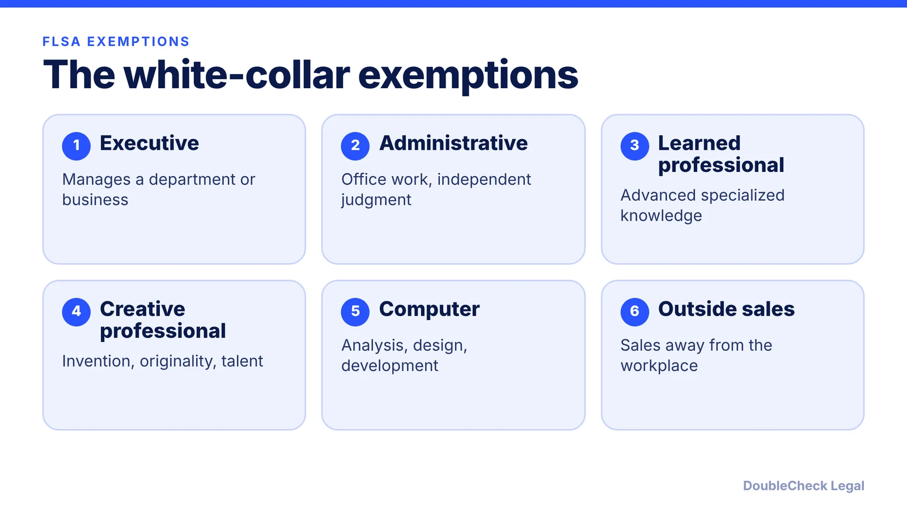
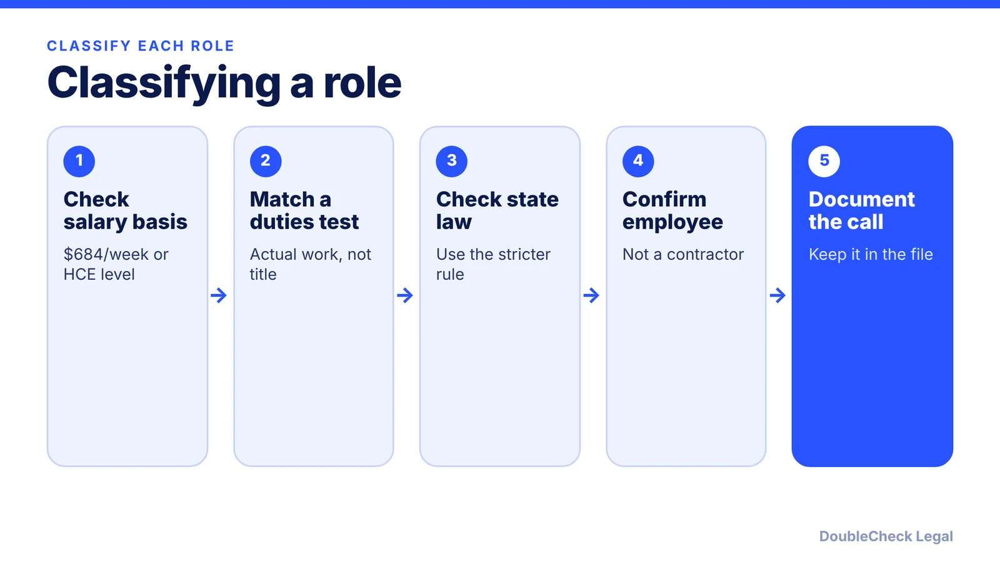

*Overtime eligibility turns on salary and actual duties, not job titles. Here is where the federal rule stands as of November 2026.*

**Key takeaways:**

- Nonexempt employees get 1.5x pay over 40 hours a week; exempt employees do not.
- As of November 2026 the federal salary threshold is $684 per week ($35,568 a year); the 2024 increase was rescinded effective May 15, 2026.
- Exemption also requires passing a duties test; titles and salary alone do not decide it.
- Some states set higher thresholds, so check each state where you have staff.

## 1. The quick answer

**Quick answer:** Under the federal Fair Labor Standards Act, nonexempt employees must be paid 1.5 times their regular rate for hours over 40 in a workweek. To be exempt, an employee generally must be paid on a salary basis of at least $684 per week ($35,568 a year) and pass a duties test. As of November 2026 that is the operative federal threshold: the DOL rescinded the 2024 rule that would have raised it, effective May 15, 2026. Job titles do not decide exempt status.

## 2. Where the salary threshold stands in November 2026

The 2024 DOL rule would have raised the standard threshold to $844 per week in July 2024 and $1,128 per week in January 2025. A Texas federal court vacated it nationwide in November 2024, and per [JD Supra](https://www.jdsupra.com/legalnews/status-quo-dol-final-rule-keeps-9356944/) the DOL withdrew its appeals and formally rescinded the rule on May 15, 2026. The 2019 levels remain:

- **Standard threshold:** $684 per week, or $35,568 a year.
- **Highly compensated employee (HCE):** $107,432 in total annual compensation, including at least $684 per week paid on a salary or fee basis.
- **Computer employees paid hourly:** $27.63 per hour, per the [DOL fact sheet](https://dol.gov/agencies/whd/fact-sheets/17a-overtime).
- **Bonuses:** nondiscretionary bonuses and commissions paid at least annually can count toward up to 10% of the standard salary level (DOL).

The same article notes that rescinding the rule does not stop the DOL from proposing a new increase later, and that some state and local laws set higher thresholds. If you operate in more than one state, check each state labor agency. The [Phillips Lytle](https://phillipslytle.com/overtime-exemptions-under-fair-labor-standards-act-rolled-back-to-2019-standards/) summary reports the same $684 and $107,432 figures.

## 3. The duties tests

Meeting the salary number is not enough. Per the DOL's Fact Sheet 17A, the main tests are:

- **Executive:** primary duty is managing the enterprise or a recognized department, directing at least two full-time employees or equivalent, with authority to hire or fire or recommendations given particular weight.
- **Administrative:** primary duty is office or non-manual work related to management or general business operations, involving discretion and independent judgment on significant matters.
- **Learned professional:** primary duty is predominantly intellectual work requiring consistent discretion and advanced knowledge gained through prolonged specialized instruction.
- **Creative professional:** primary duty requires invention, imagination, originality, or talent in an artistic field.
- **Computer:** systems analyst, programmer, software engineer, or similar, primarily doing analysis, design, development, testing, or modification of systems.
- **Outside sales:** primary duty is making sales away from the employer's place of business, with no salary test.

Calling a role "manager" or putting someone on salary does not by itself make them exempt. A salaried "team lead" with no authority over hiring who mostly does the same work as hourly staff often fails the executive test. Borderline roles are worth a second opinion from an employment attorney.

## 4. A practical classification process

For each role, work through the same questions, and record the answers in the personnel file.

1. **Is the pay on a salary basis** at or above the threshold (or HCE level)?
2. **Which exemption** fits the actual day-to-day duties, not the job description?
3. **Do state laws apply?** Some states are stricter, so use the stricter standard.
4. **Is the person really an employee?** Contractors fall outside overtime rules, but classification is tested on facts; see [employee vs. independent contractor classification](/blog/employee-vs-independent-contractor-classification-startups/).

Nonexempt employees need timekeeping, and the DOL fact sheet sets the premium at 1.5 times the regular rate. Write overtime and timekeeping rules into your [employee handbook](/blog/employee-handbook-small-business-what-to-include/), and state them in the offer letter ([drafting an offer letter with AI](/blog/draft-job-offer-letter-with-ai/)). Hiring for the first time? The [first-employee legal checklist](/blog/how-to-hire-first-employee-legal-checklist/) covers the surrounding steps, and [multi-state remote teams](/blog/multi-state-remote-employees-compliance-startups/) need state-by-state review.

## Where DoubleCheck fits

[DoubleCheck](https://www.contactdoublecheck.com) helps businesses and founders start legal work with AI, verify it, and, when professional advice is warranted, connect with an independent attorney, including for immigration questions. Attorney availability and practice areas vary. Attorneys on DoubleCheck are independent professionals; an attorney-client relationship forms only if an attorney accepts your engagement.

**Sources:** [DOL Fact Sheet 17A](https://dol.gov/agencies/whd/fact-sheets/17a-overtime); [JD Supra, DOL final rule keeps 2019 levels](https://www.jdsupra.com/legalnews/status-quo-dol-final-rule-keeps-9356944/); [Phillips Lytle, May 2026 client alert](https://phillipslytle.com/overtime-exemptions-under-fair-labor-standards-act-rolled-back-to-2019-standards/); [KZA Law](https://kzalaw.com/knowledge-center/employer-reports/dol-officially-returns-to-2019-overtime-rule/).

## FAQ

**What is the overtime salary threshold in 2026?**

The federal standard is $684 per week ($35,568 a year), per JD Supra and the DOL fact sheet. The 2024 rule that would have raised it was rescinded on May 15, 2026. Some states set higher levels.

**Does paying a salary make someone exempt from overtime?**

No. Per the DOL, the employee must also meet a duties test, and job titles do not determine exempt status.

**What is the highly compensated employee exemption?**

Per the DOL, it applies at $107,432 or more in total annual compensation, including at least $684 per week on a salary or fee basis, 

**Are salaried software engineers always exempt?**

No. The computer exemption depends on primary duties such as systems analysis, design, development, or testing, plus pay requirements. Review each role against the DOL test.

---

*General information only. This article is not legal, tax, investment, or accounting advice.*
