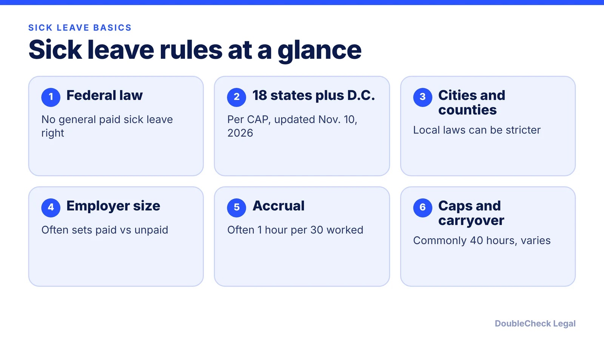
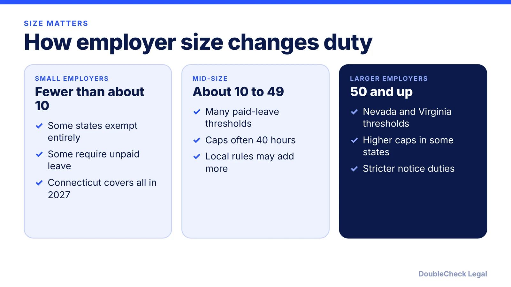

*Paid sick leave laws by state for small business employers: who is covered, thresholds, local layers and a checklist, as of November 2026.*

**Key takeaways:**

- There is no general federal paid sick leave law; CAP counts 18 states plus D.C. with their own as of November 10, 2026.
- Employer size often decides whether leave is paid, unpaid or required, and Connecticut reaches nearly all employers in 2027.
- Cities and counties can add stricter rules, and remote staff can bring in another state.
- Sources differ on some accrual details and dates, so confirm with each state agency.

## 1. The quick answer

**Quick answer:** Paid sick leave laws by state apply to small businesses in a growing number of places, because there is no general federal paid sick leave requirement. As of November 2026, the Center for American Progress counts 18 states plus Washington, D.C. with paid sick time laws: Alaska, Arizona, California, Colorado, Connecticut, Maryland, Massachusetts, Michigan, Minnesota, Nebraska, New Jersey, New Mexico, New York, Oregon, Rhode Island, Vermont, Virginia and Washington (Virginia's takes effect in 2027). Many cities and counties add their own rules. Employer size often decides whether leave is paid, unpaid, or not required at all.

If you have even one employee in a covered state or city, assume a rule may apply and check the thresholds below.

## 2. No federal rule, but many state rules

The Center for American Progress states that no U.S. federal law generally guarantees the right to paid sick time. Federal contractors are generally covered under a 2015 executive order, and a federal Healthy Families Act was reintroduced in 2026 but is a bill, not law, per the same fact sheet (last updated November 10, 2026).

That leaves states and localities. Some recent moves, per CAP and the other sources listed below:

- **Alaska** (effective around July 2025) and **Nebraska** (effective October 1, 2025) added statewide paid sick leave.
- **Connecticut** expanded coverage to employers with 11 or more employees in 2026, and to nearly all employers with at least one employee from January 1, 2027, per Shipman and Goodwin.
- **Missouri** voters passed a law in 2024, but the legislature repealed it in 2025 (Fisher Phillips reports the repeal takes effect August 28, 2025). Voluntary policies remain allowed.
- **Virginia** has a law scheduled for 2027. Start details vary by source, so confirm the date and any employer-size threshold with the state agency.

Because a remote worker can trigger a different state's law, read [multi-state remote employees compliance for startups](/blog/multi-state-remote-employees-compliance-startups/) too.

## 3. Thresholds, accrual and caps by state

Most laws use accrual: employees earn sick time as they work, commonly one hour for every 30 hours worked, with an annual use cap (often 40 hours). Details differ by state, so treat the figures below as a starting point drawn from the U.S. Department of Labor's state summary (dated September 2024, so confirm current figures with each state agency):

- **Connecticut:** 11+ employees in 2026, 1+ from 2027 (Shipman and Goodwin); the Connecticut DOL describes the current rules.
- **Maine:** 10+ employees (a paid time off law, not limited to sick use). **Nevada:** 50+ (also a paid time off law).
- **Maryland:** 15+ employees; up to 64 hours of use per year, with 40 hours accrued. **Massachusetts:** 11+ employees; up to 40 hours. **Oregon:** 10+ employees; up to 40 hours. **Rhode Island:** 18+ employees; up to 40 hours.
- **Michigan:** the Earned Sick Time Act took effect February 21, 2025, with different hour caps for small and standard employers (Michigan LEO), so confirm which tier applies to you.
- **California, Colorado, New Jersey, New Mexico, New York, Washington, Alaska, Arizona and Nebraska:** statewide laws are counted by CAP; check each state agency for size tiers, caps and accrual.

A smaller employer sometimes still owes unpaid protected leave, so "under the threshold" does not always mean "no obligation." Headcount rules can count part-time and temporary workers, so check the statute before assuming you are exempt.

## 4. Cities and counties add layers

State law is only one layer. Local ordinances can exist and be stricter than the state's rule. Cities such as San Francisco and Berkeley in California, Chicago in Illinois and Philadelphia in Pennsylvania are commonly cited examples, and Washington, D.C. has its own law, so check the city and county where each employee works.

Practical effect: a coffee shop in Chicago, a remote designer in Oakland and a warehouse employee in Omaha may all have different entitlements under the same company. Keep a simple matrix of employee location, headcount in that jurisdiction, accrual method, cap and carryover. For hiring across places, see [how to hire your first employee](/blog/how-to-hire-first-employee-legal-checklist/) and [register for state payroll taxes as a new employer](/blog/register-for-state-payroll-taxes-new-employer/).

## 5. What to put in your handbook and payroll process

Compliance is mostly process:

1. **Choose accrual or front-loading** where the state allows either.
2. **Define the covered reasons**, which often include the employee's or a family member's illness and, in many states, safe-leave purposes. Confirm the list per state.
3. **Set notice, documentation and carryover rules** to match the strictest state you employ in.
4. **Show accrued balances** on pay statements or a portal where required.
5. **Do not retaliate.** Treat leave requests like protected activity, and train managers.
6. **Keep records.** Many states require them.

Put the policy in writing; our [employee handbook guide](/blog/employee-handbook-small-business-what-to-include/) shows where it fits. Sick leave also interacts with [meal and rest break rules](/blog/meal-and-rest-break-laws-small-business-employers/), [overtime classification](/blog/overtime-exempt-vs-nonexempt-small-business/) and [final paycheck rules](/blog/final-paycheck-laws-by-state-when-employers-must-pay/), since some states require payout or restoration of unused leave under specific conditions. Verify before assuming either way.

For offers, make sure your [offer letter or employment contract](/blog/offer-letter-vs-employment-contract-differences-startup/) does not promise less than the law gives.

## 6. AI for the matrix, a lawyer for the edge cases

AI is helpful for building the state-and-city matrix from official pages you paste in, and for drafting a plain policy and manager FAQ. It is not reliable on thresholds, effective dates or recent repeals, and the sources above show how quickly that picture moves. Run any draft through the steps in [verify AI-generated legal documents](/blog/verify-ai-generated-legal-document/).

Bring in an attorney when you are crossing a threshold (for example your tenth or eleventh employee), expanding into a new state or city, receiving a complaint, or deciding how to handle a leave dispute or termination. See [how to terminate an employee legally](/blog/how-to-terminate-an-employee-legally-small-business/) and [when to hire a lawyer for a small business](/blog/when-to-hire-lawyer-small-business/).

## Where DoubleCheck fits

[DoubleCheck](https://www.contactdoublecheck.com) helps businesses and founders start legal work with AI, verify it, and, when professional advice is warranted, connect with an independent attorney, including for immigration questions. Attorney availability and practice areas vary. Attorneys on DoubleCheck are independent professionals; an attorney-client relationship forms only if an attorney accepts your engagement.

**Sources:** [Center for American Progress, State of paid sick time (updated Nov. 10, 2026)](https://www.americanprogress.org/article/the-state-of-paid-sick-time-in-the-u-s); [U.S. Department of Labor, State paid sick leave laws (Sept. 2024)](https://dol.gov/sites/dolgov/files/WB/StatePaidSickLeaveLaws.pdf); [Michigan LEO, Earned Sick Time Act](https://www.michigan.gov/leo/bureaus-agencies/ber/wage-and-hour/paid-medical-leave-act); [Connecticut DOL, Overview of the Paid Sick Leave Law](https://portal.ct.gov/dol/-/media/DOL/2022-New-Design-System/Divisions/Legal/PSL-final-2023.pdf); [Fisher Phillips, Missouri paid sick leave repealed](https://www.fisherphillips.com/en/insights/insights/missouri-paid-sick-leave-repealed); [Shipman and Goodwin, Connecticut 2026 changes](https://www.shipmangoodwin.com/insights/connecticut-minimum-wage-and-paid-sick-leave-changes-coming-in-2026.html). Related: [meal and rest break laws](/blog/meal-and-rest-break-laws-small-business-employers/).

## FAQ

**Do small businesses have to offer paid sick leave?**

It depends on the state, city and employer size. There is no general federal requirement, but 18 states plus D.C. have laws as of November 2026, per the Center for American Progress, and some apply to very small employers.

**Which states have paid sick leave laws in 2026?**

Per the Center for American Progress: Alaska, Arizona, California, Colorado, Connecticut, Maryland, Massachusetts, Michigan, Minnesota, Nebraska, New Jersey, New Mexico, New York, Oregon, Rhode Island, Vermont, Virginia and Washington, plus D.C. Virginia takes effect in 2027.

**How much sick leave do employees accrue?**

Often one hour for every 30 hours worked, with a common annual cap of 40 hours, but accrual rates, caps and carryover differ by state. Check the state agency for exact figures.

**Did Missouri repeal its paid sick leave law?**

Yes. Per Fisher Phillips, the repeal takes effect August 28, 2025, after which employers are no longer required to provide earned paid sick time. Voluntary policies are allowed.

**Does my remote employee count toward a different state sick leave law?**

Possibly. A law can apply based on where the employee works, so check the rules in the state and city where each employee performs the work.

---

*General information only. This article is not legal, tax, investment, or accounting advice.*
