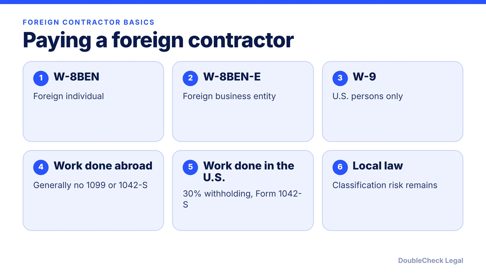
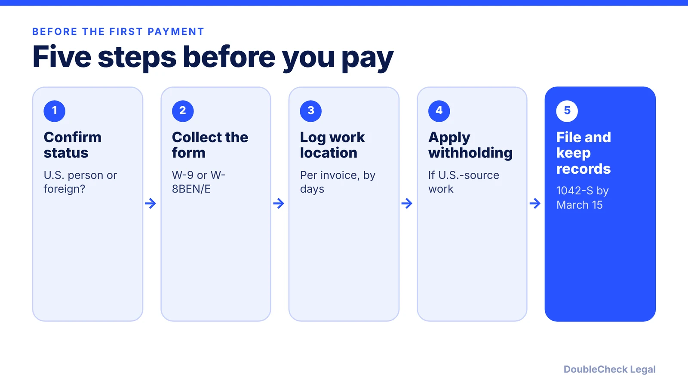

*Which forms to collect and when withholding applies for foreign contractors, as of November 2026. General information, not tax advice.*

**Key takeaways:**

- Collect a W-8BEN or W-8BEN-E from foreign payees, not a W-9; U.S. citizens and residents abroad still give a W-9.
- Per the IRS, where services are performed generally sets the source; foreign-source pay is normally not reported on Form 1042-S.
- U.S.-source work triggers 30% (or treaty rate) withholding and Form 1042-S per the IRS.
- Classification risk under local law remains; consider an EOR and ask a tax professional about edge cases.

## 1. The quick answer

**Quick answer:** Before paying a foreign contractor, collect a Form W-8BEN (individual) or W-8BEN-E (entity) instead of a W-9. Per Tipalti, a contractor who does all work outside the U.S. generally does not get a Form 1099, and per the IRS, income from services is generally sourced by where the work is performed. Per the IRS, foreign-source income paid to a nonresident alien is normally not required to be reported on Form 1042-S. If the contractor performs services while physically in the U.S., the income is generally U.S.-source, and the IRS says U.S.-source nonemployee compensation is withheld at 30% (or a lesser treaty rate) and reported on Form 1042-S. A U.S. citizen or resident living abroad is still a U.S. person and gives a W-9. This is general information, not tax advice.

## 2. W-8 or W-9, and where the work is done

**Status decides the form, not the address.** Per [Taxes for Expats](https://www.taxesforexpats.com/articles/foreign-business/form-1099-for-foreign-contractors.html), U.S. citizens, green card holders and resident aliens remain U.S. persons abroad and typically provide a W-9. Per the [IRS requester instructions for Form W-9](https://irs.gov/instructions/iw9), requesters should advise foreign persons to use the appropriate Form W-8, and a foreign person may not provide a W-9.

**Why collect the W-8 first.** Per Tipalti, without a valid W-8 the presumption rules may treat the payee as a U.S. person, which can trigger 24% backup withholding and 1099 reporting. Per the IRS ([Publication 515](https://www.irs.gov/publications/p515)), foreign persons who give a valid Form W-8 are exempt from backup withholding. Per [the IRS Form W-8BEN page](https://www.irs.gov/forms-pubs/form-w-8ben-certificate-of-foreign-status-of-beneficial-owner-for-united-states-tax-withholding), the form is submitted when the withholding agent or payer requests it.

**Where the work is done.** Per the [IRS](https://irs.gov/zh-hans/individuals/international-taxpayers/source-of-income-personal-service-income), the place services are performed generally determines the source, regardless of where the contract was made, the place of payment or the payer's residence. Mixed work is allocated by time: the IRS multiplies pay by the fraction of service days spent in the U.S.

**How long a W-8 lasts.** Per Tipalti and Taxes for Expats, a W-8BEN is valid from signing through the end of the third calendar year after, unless circumstances change, such as the contractor moving to the U.S. Diarize renewals and ask for a new form if their situation changes.

For the 1099 side of the question for U.S. contractors, see [the 1099-NEC threshold for freelancers](/blog/1099-nec-2000-threshold-hiring-freelancers/).

## 3. Form 1042-S and withholding when income is U.S.-source

Most foreign contractors who stay abroad never trigger this. It matters when someone does paid work while in the U.S., for example during a visit to your office.

- **Withholding.** Per the [IRS](https://www.irs.gov/individuals/international-taxpayers/federal-income-tax-withholding-and-reporting-on-other-kinds-of-us-source-income-paid-to-nonresidents), withhold at 30% or a lesser treaty rate on U.S.-source nonemployee compensation. Per Publication 515, you withhold on the gross amount.
- **Reporting.** The IRS says U.S.-source nonemployee compensation is reportable on Form 1042-S, even if the entire amount is exempt under a treaty. Per the [Form 1042 instructions](https://www.irs.gov/zh-hant/instructions/i1042), withholding agents generally file an annual Form 1042 as well.
- **Treaties.** For personal services, the IRS says the contractor claims the lower treaty rate with Form 8233, not a W-8BEN. Per Tipalti, the payer sends the 8233 to the IRS within five days and waits ten days before applying the reduced rate; confirm that with a tax professional.
- **Deadline.** Per Tipalti, Form 1042-S for 2026 payments is due March 15, 2027.
- **Foreign-source payments.** Per the [IRS](https://www.irs.gov/individuals/international-taxpayers/foreign-source-income-form-1042-s-reporting-not-required), if you report them anyway, use exemption code 03, "Income is not from U.S. sources."

Under Publication 515, the withholding agent is personally liable for the tax, and the liability is separate from the payee's. That is why a small tracking habit is worth it: record where each invoice's work was performed.

## 4. Classification risk, EOR, and when to get help

Tax forms are only half the picture. Even if you owe no U.S. withholding, the contractor's own country may treat the relationship as employment. Per Tipalti, misclassification can lead to back taxes, penalties and possibly local employment claims. Our guides on [employee vs. independent contractor classification](/blog/employee-vs-independent-contractor-classification-startups/) and [hiring international employees via EOR, contractor or sponsorship](/blog/hire-international-employees-remote-eor-vs-contractor-vs-sponsorship/) explain the tradeoff.

**Use a contract that matches reality.** A written agreement should cover scope, deliverables, who owns the work, confidentiality and who pays taxes. See [what to include in an independent contractor agreement](/blog/independent-contractor-agreement-what-to-include/).

**EOR option.** An employer of record (EOR) is a third party that employs the person locally and invoices you. It tends to fit full-time, long-term, closely managed roles where the contractor label is hard to defend. It usually costs more, so compare it before you scale up.

**When you can handle it yourself.** One or two short engagements, work clearly done outside the U.S., a signed W-8 on file and no signs of an employment relationship.

**When to get a tax professional or attorney:**

- The contractor visits the U.S., or you are unsure where work happened.
- You want to apply a treaty rate or the person is paid through an entity.
- The role looks like a full-time job, or the person works set hours under your direction.
- The contractor will own IP, handle customer data or work in a regulated country.

DoubleCheck helps with the legal-document side, such as a contractor agreement draft that an independent attorney verifies, but tax filings are for a CPA or tax advisor.

## Where DoubleCheck fits

[DoubleCheck](https://www.contactdoublecheck.com) helps businesses and founders start legal work with AI, verify it, and, when professional advice is warranted, connect with an independent attorney, including for immigration questions. Attorney availability and practice areas vary. Attorneys on DoubleCheck are independent professionals; an attorney-client relationship forms only if an attorney accepts your engagement.

**Sources:** [IRS: federal income tax withholding on U.S.-source income paid to nonresidents](https://www.irs.gov/individuals/international-taxpayers/federal-income-tax-withholding-and-reporting-on-other-kinds-of-us-source-income-paid-to-nonresidents); [IRS: source of personal service income](https://irs.gov/zh-hans/individuals/international-taxpayers/source-of-income-personal-service-income); [IRS: foreign-source income and Form 1042-S](https://www.irs.gov/individuals/international-taxpayers/foreign-source-income-form-1042-s-reporting-not-required); [IRS Publication 515](https://www.irs.gov/publications/p515); [IRS Form W-8BEN page](https://www.irs.gov/forms-pubs/form-w-8ben-certificate-of-foreign-status-of-beneficial-owner-for-united-states-tax-withholding); [IRS requester instructions for Form W-9](https://irs.gov/instructions/iw9); [Instructions for Form 1042](https://www.irs.gov/zh-hant/instructions/i1042); [Tipalti](https://tipalti.com/blog/1099-for-foreign-contractors/); [Taxes for Expats](https://www.taxesforexpats.com/articles/foreign-business/form-1099-for-foreign-contractors.html). Where IRS pages were incomplete when fetched, secondary sources are named in the text.

## FAQ

**Do I send a 1099 to a foreign contractor?**

Per Tipalti, a foreign contractor who works entirely outside the U.S. generally does not get a 1099. U.S. persons living abroad give a W-9 and are treated differently, per Taxes for Expats.

**What is the difference between W-8BEN and W-8BEN-E?**

Per Tipalti, W-8BEN is for foreign individuals and W-8BEN-E is for foreign business entities. A W-9 is for U.S. persons.

**When do I have to withhold 30%?**

Per the IRS, on U.S.-source nonemployee compensation paid to a foreign person, unless a lesser treaty rate applies. Services performed physically in the U.S. are generally U.S.-source.

**How long is a W-8BEN valid?**

Per Tipalti, from the signing date through the end of the third calendar year after it was signed, unless circumstances change.

---

*General information only. This article is not legal, tax, investment, or accounting advice.*
