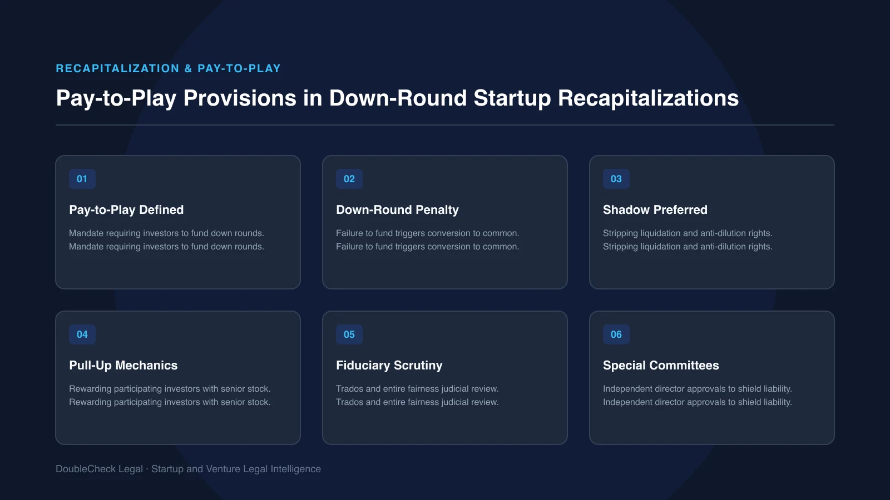
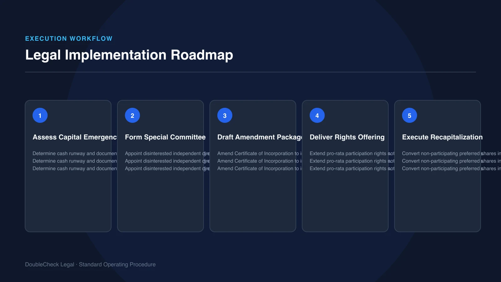

*A definitive legal guide to pay-to-play provisions, distressed down-round venture recapitalizations, pull-up equity incentives, Delaware entire fairness litigation risks, and corporate governance compliance.*

**Key takeaways:**
- **Incentivizing Distressed Capital:** Pay-to-play clauses solve the "free rider" problem by penalizing passive venture investors who refuse to support a struggling portfolio company during economic downturns.
- **Conversion to Common / Shadow Stock:** Non-participating investors forfeit their liquidation preferences, anti-dilution adjustments, and protective board vetoes.
- **The Shadow of Entire Fairness:** Under Delaware Chancery Court precedent (*In re Trados Inc. Shareholder Litigation*), insider-led recapitalizations trigger strict fiduciary scrutiny unless procedural protections are implemented.
- **Pull-Up Multiplication:** Aggressive recapitalizations utilize "pull-ups," rewarding active capital by elevating older underwater shares into the senior liquidation preference tranche.

## 1. The quick answer: How pay-to-play provisions work

In venture financings, a **pay-to-play provision** mandates that existing preferred stockholders must participate pro-rata in subsequent financing rounds (typically down-rounds) to preserve their preferred stock privileges:

1. **The Financing Trigger:** The company issues a capital call or launches a down-round financing.
2. **The Investment Requirement:** Each existing preferred shareholder is offered the opportunity to purchase their pro-rata share of the new round.
3. **The Consequence:**
   - **Participation:** The investor maintains their preferred status and may receive upgraded "pull-up" shares.
   - **Non-Participation:** The investor’s existing preferred shares are forcibly converted into Common Stock (or "Shadow Preferred Stock"), forfeiting liquidation preferences and veto powers.



## 2. In-depth legal analysis: The mechanics of down-round recapitalizations

When market valuations compress or a startup misses milestones, new outside capital is often unobtainable. Existing lead venture funds may agree to fund a "cram-down" or recapitalization, but only on the condition that all other investors contribute or get wiped out.

### A. Charter Amendments and Conversion Mechanics
Under Delaware General Corporation Law (DGCL) § 242, altering the rights and preferences of an existing class of stock requires amending the Certificate of Incorporation (the Charter).

Standard institutional charters insert pay-to-play language into the mandatory conversion section:

```
"In the event that any holder of Series A Preferred Stock fails to purchase its full Pro Rata Share of New Securities in a Qualified Pay-to-Play Financing... each share of Series A Preferred Stock held by such Non-Participating Holder shall automatically be converted into one fully paid share of Common Stock."
```

Alternatively, to soften the blow, some deals convert non-participants into **Series A-1 Shadow Preferred Stock**, which retains a 1x non-participating liquidation preference but eliminates:
- Price-based anti-dilution adjustments;
- Class-based protective voting provisions;
- Board designation rights;
- Pro-rata rights in future rounds.

### B. Pull-Up Mechanics Explained
In a distressed environment, participating investors often demand a **pull-up**:
- For every $1.00 of new money invested in the down round, $1.00 (or $2.00) of the investor’s older, underwater Series A Preferred is converted ("pulled up") into the new **Series A Senior Preferred Stock**.
- Non-participating investors are left behind in common stock or junior preferred stock, effectively subordinating their entire investment.

### C. Down-Round Comparison Matrix

| Mechanism | Mild Pay-to-Play | Aggressive Recapitalization | Cram-Down / Washout |
|---|---|---|---|
| Non-Participant Penalty | Converts to Shadow Preferred | Converts to Common Stock | 1-for-100 Reverse Split + Common Conversion |
| Liquidation Preference | Preserved (1x non-participating) | Completely Eliminated | Wiped Out |
| Anti-Dilution Rights | Forfeited | Forfeited | Forfeited |
| Pull-Up Incentive | None | 1x Pull-Up to Senior Class | 2x-3x Super Pull-Up |
| Judicial Risk Profile | Low to Moderate | High (*Entire Fairness*) | Severe (*Trados / Nine Systems*) |

## 3. Delaware fiduciary duties and litigation risks: Avoiding the *Trados* trap

Down-round recapitalizations are prime targets for shareholder litigation. In Delaware, when a board dominated by preferred stock investors approves a recapitalization that benefits preferred holders at the expense of common shareholders:

### The *Entire Fairness* Standard
Business judgment review is discarded. The interested directors and controlling shareholders must prove:
1. **Fair Dealing:** How the deal was timed, initiated, structured, negotiated, and disclosed.
2. **Fair Price:** The economic and financial reality of the transaction.

### Critical Procedural Protections
To survive judicial scrutiny, corporate boards must implement the framework established in *Kahn v. M&F Worldwide Corp. (MFW)* and *Trados*:
- **Special Committee of Independent Directors:** Form a committee composed exclusively of disinterested directors who hold no preferred stock and have no ties to the investing venture funds, empowered with independent legal and financial advisors.
- **Robust Market Check:** Document exhaustive attempts to raise capital from third-party arm’s-length investors, proving the recapitalization was the sole alternative to corporate dissolution.
- **Majority-of-the-Minority Vote:** Condition the transaction upon the affirmative vote of an uncoerced majority of the common and disinterested shareholders.



## 4. Step-by-step: Executing a legally defensible pay-to-play round

### Step 1: Formalize Board Deliberations and Valuation Analysis
Convene the board to analyze cash runway, burn rate, and insolvency risks. Secure an independent 409A or fair market valuation to substantiate the down-round price per share.

### Step 2: Establish the Independent Committee
Delegate negotiation of the financing terms, including pull-up ratios and charter amendment penalties, to the independent committee.

### Step 3: Draft Comprehensive Rights Offering Documents
Prepare a comprehensive disclosure document (Information Statement / Rights Offering Notice) delivered to all shareholders. Disclose:
- The financial crisis facing the company;
- Full terms of the proposed recapitalization;
- The consequences of non-participation;
- Potential conflicts of interest of the participating venture funds.

### Step 4: Charter Amendment Filing
Following requisite shareholder approval under DGCL § 242, file the Amended and Restated Certificate of Incorporation with the Delaware Secretary of State.

### Step 5: Post-Closing Recapitalization Stock Issuance
Execute the conversion of non-participating preferred shares into common or shadow stock, and issue new senior preferred shares to participating investors.

## 5. Due diligence checklist: Preparing for a down-round restructuring

1. **Verify Charter Voting Thresholds:** Ensure the existing Certificate of Incorporation permits amendment of preferred preferences by class or series vote.
2. **Review Anti-Dilution Waivers:** Confirm that the participating majority can waive existing broad-based weighted average anti-dilution adjustments.
3. **Assess D&O Insurance Coverage:** Verify that corporate Directors & Officers liability policies are active and do not contain broad insolvency or recapitalization exclusions.
4. **Audit Stock Plan Capacity:** Re-establish a viable employee equity incentive pool post-recapitalization to retain critical engineering and executive talent.

## Where DoubleCheck fits

[DoubleCheck](https://www.contactdoublecheck.com) equips venture-backed founders, boards, and corporate attorneys with AI-powered contract analysis for restructuring and recapitalization events. DoubleCheck parses existing investor rights agreements, flags mandatory conversion and pay-to-play provisions, analyzes class-voting rights, and assists counsel in verifying disclosure materials to protect boards against down-round fiduciary liability.

**Related reading:**
- [Broad-Based Weighted Average vs Full Ratchet Anti-Dilution](/blog/anti-dilution-weighted-average-vs-full-ratchet-mechanics/)
- [Board Control & Protective Provisions: Series A Term Sheets](/blog/board-control-protective-provisions-series-a-term-sheets/)
- [Term Sheet Key Terms Explained](/blog/term-sheet-key-terms-explained/)
- [Series A Legal Due Diligence Checklist](/blog/series-a-legal-due-diligence-checklist/)

**Sources:** [Delaware General Corporation Law § 242 (Amendment of Certificate of Incorporation)](https://delcode.delaware.gov/title8/c001/sc08/); [Delaware Court of Chancery, In re Trados Inc. Shareholder Litigation](https://courts.delaware.gov/chancery/); [Delaware Supreme Court, Kahn v. M&F Worldwide Corp. (MFW Framework)](https://courts.delaware.gov/opinions/); [National Venture Capital Association (NVCA), Model Certificate of Incorporation](https://nvca.org/model-legal-documents/).

## FAQ

**What is a pay-to-play provision in venture capital?**

A pay-to-play provision is a legal mechanism in a startup charter or financing agreement requiring existing preferred stockholders to invest their pro-rata share in a subsequent financing round (especially a down round) or suffer penalties such as loss of liquidation preferences or automatic conversion to common stock.

**What is the penalty for not participating in a pay-to-play round?**

Investors who decline to participate typically have their existing preferred stock converted into common stock, or into a junior class of shadow preferred stock stripped of anti-dilution protection, voting vetoes, and liquidation preferences.

**What are pull-up mechanics in a startup recapitalization?**

Pull-up mechanics reward investors who participate in a distressed round by converting a multiple (e.g., 1x or 2x) of their existing prior preferred shares into the new, senior-most class of preferred stock, leapfrogging non-participating investors in the liquidation stack.

**Why do pay-to-play recapitalizations create fiduciary litigation risk in Delaware?**

When insider venture investors lead a down-round recapitalization that dilutes founders and common shareholders, Delaware courts apply the strict Entire Fairness standard of review unless the deal is negotiated and approved by an independent special committee and an uncoerced majority of minority shareholders.

**How can AI contract tools support legal teams during recapitalizations?**

AI tools rapidly analyze existing certificates of incorporation and investor rights agreements, modeling cap table redistribution scenarios, verifying class-vote thresholds, and drafting rights offering disclosures.

---

*General information only. This article is not legal, tax, investment, or accounting advice.*
