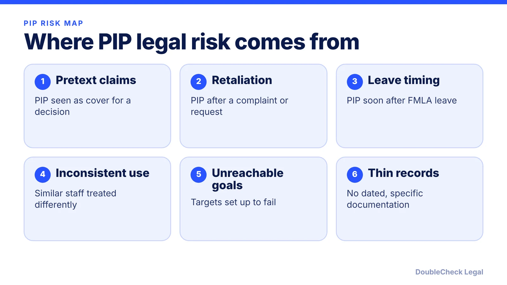
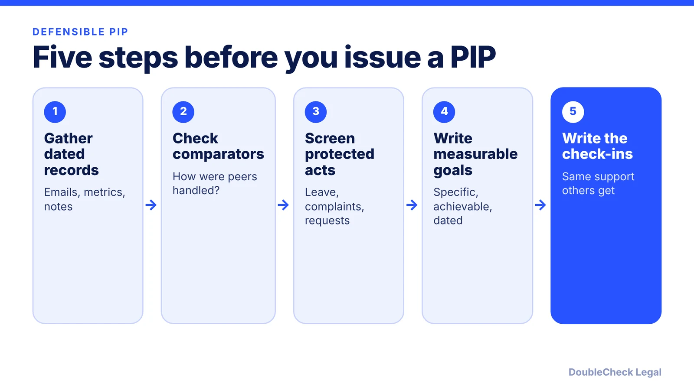

*Performance improvement plan (PIP) legal risks for employers: where claims come from, how timing around leave and complaints matters, and how to document a PIP, as of November 2026.*

**Key takeaways:**

- A PIP is not unlawful by itself, but it can be attacked as pretext, retaliation or unequal treatment.
- Per Burr & Forman (April 2026), courts look at whether the PIP was reasonable, achievable and applied consistently.
- A 2026 Eleventh Circuit case shows that records predating protected activity matter, and that timing alone was not enough there.
- Check recent leave, complaints and accommodation requests before issuing a PIP, and consider counsel if any exist.

## 1. The quick answer

**Quick answer:** A performance improvement plan (PIP) is a legal risk when it looks like a paper trail for a decision already made, when it follows protected activity such as a leave request, accommodation request or complaint, or when it is applied unevenly. The risk shrinks when the PIP rests on documented problems that predate any protected activity, sets realistic and measurable goals, matches how similar employees were treated, and is reviewed before it is issued. As of November 2026, that is the pattern in the case law summaries and agency guidance below. This article is general information for US employers, not legal advice.

## 2. Why a PIP can become a legal issue

A PIP is not unlawful by itself. Employers are free to manage poor performance, and the EEOC's retaliation guidance says so directly, while also recommending that employers independently evaluate whether a manager's recommended action is appropriate. The trouble starts when an employee later claims the PIP was really about something else.

Three theories come up most often:

- **Pretext.** The employee argues the stated reason (performance) was not the real one. Per Burr & Forman (April 22, 2026), some employees describe a PIP as a "paper trail" to justify a later termination, and courts have grown more willing to hear that argument when a PIP is combined with other negative actions.
- **Retaliation.** The employee argues the PIP followed protected activity. Under the [EEOC retaliation guidance](https://www.eeoc.gov/node/130223), protected activity includes taking part in an EEO process and opposing conduct the EEO laws prohibit, such as complaining about discrimination or requesting a disability or religious accommodation.
- **Discrimination.** The employee argues similar employees outside their protected class were treated better.

Burr & Forman also reports that, after the Supreme Court's decision in *Muldrow v. City of St. Louis*, an employee may need to show only that they were made "worse off" in the terms or conditions of the job, rather than a major harm such as a firing or demotion. A PIP is not automatically an adverse action. Per the same article, a federal appellate court in *Walsh v. HNTB Corp.* required a fact-specific review: PIPs meant to warn about problems or build skills are generally not adverse actions, while PIPs that add new duties, alter employment terms or limit advancement may be.

The EEOC guidance adds that closer scrutiny of an employee's work or attendance than that of coworkers, without justification, can count as materially adverse. A PIP that comes with sudden daily check-ins nobody else gets is the kind of fact that gets noticed.

Whether employment is at will does not remove these risks. At-will status does not allow a reason that discrimination or retaliation laws prohibit. See [at-will employment by state and its exceptions](/blog/at-will-employment-by-state-exceptions-employers/).

## 3. Timing: PIPs after leave, complaints or accommodation requests

Timing is where small employers get hurt most, because a manager often reaches the end of their patience right after an employee returns from leave or raises a concern.

A March 27, 2026 Eleventh Circuit decision, *Cooper v. Airbus Americas, Inc.* (No. 25-10378), shows both sides. Per J. J. Keller and the court's opinion, an employee was placed on a PIP immediately after returning from FMLA leave, the PIP was extended after five weeks, and he was later terminated. The employer won summary judgment. The court noted the employer had documented performance concerns from trainers before the PIP, and it found no evidence that the stated performance reason was pretext. The lesson: suspicious timing draws scrutiny, but documentation that predates the protected activity can make the decision defensible, and timing alone was not enough. The opinion is unpublished, so it is not binding precedent.

Do not read that as a safe harbor. J. J. Keller's own takeaway is that a PIP soon after FMLA leave is risky because closeness in time can look retaliatory, and that taking leave does not shield an employee from performance management as long as the performance reasons are genuine and unconnected to the leave.

Practical checks before issuing a PIP:

1. List any leave, accommodation request, complaint, wage question or safety concern from the employee in the past months.
2. Find the date of the first written performance concern. If it came after the protected activity, talk to an attorney before proceeding.
3. Confirm the expectations in the PIP are not the result of the leave itself (for example, targets that ignore protected time off).
4. Keep the decision-maker independent of any complaint where you can.

Leave rules vary by state and employer size, so check the specific law that applies. See [workplace harassment policy requirements](/blog/workplace-harassment-policy-requirements-small-business/) and [paid sick leave laws by state](/blog/paid-sick-leave-laws-by-state-small-business-2026/) for adjacent obligations.

## 4. How to write a PIP that holds up

Burr & Forman's practice points are consistent with what the case summaries stress: base the PIP on well-documented issues, set realistic and measurable goals, give a fair chance to improve, apply PIPs consistently, and state that the purpose is to correct unsatisfactory performance. Per the same article, courts weigh whether the PIP materially changed duties or conditions, whether its requirements were reasonable and achievable, whether it was applied consistently to similarly situated employees, and whether there is evidence of discriminatory or retaliatory intent.

A few drafting habits help:

- **Describe the gap, not the person.** State the standard, what the work showed, and the date.
- **Make goals measurable.** Extensions are easier to defend when criteria are objective and written in advance, while open-ended extensions or discretion without benchmarks can suggest the outcome was predetermined.
- **Offer real support.** Training, clearer priorities or a named point of contact show the goal is improvement.
- **Do not promise a result.** Avoid language such as "complete this and your job is safe" unless you mean it.
- **Keep it confidential** and limited to people who need to know.

If the employee is a remote worker, make sure the expectations and timekeeping are fair and documented. See the [remote work policy checklist](/blog/remote-work-policy-legal-checklist-small-business/).

## 5. PIP legal risks for employers: when to bring in an attorney

Many PIPs are routine and low risk. Some deserve a second look before they go out. Consider asking an employment attorney to review when:

- The employee recently complained about discrimination, harassment, pay or safety, or asked for an accommodation or leave.
- The employee is in a protected class and a similar employee with comparable issues was treated differently.
- The PIP is paired with other changes such as removing duties, changing pay or reassigning the employee.
- You are leaning toward termination regardless of the PIP outcome. If so, a PIP may be the wrong tool; see [how to terminate an employee legally](/blog/how-to-terminate-an-employee-legally-small-business/) and the [separation agreement review checklist](/blog/separation-agreement-review-checklist/).
- The employee holds a visa that depends on the job. See [H-1B layoff and the 60-day grace period](/blog/h-1b-layoff-60-day-grace-period/).

Also keep your [employee handbook](/blog/employee-handbook-small-business-what-to-include/) consistent with how you actually manage performance, because a handbook that promises a progressive process can be used against you if you skip it.

AI can help here, with limits. It can turn a messy list of incidents into a clean timeline, draft a first version of measurable goals, and flag vague language. It cannot know your state law, your handbook promises or what the employee's file contains. Treat output as a draft and use the approach in [verify AI-generated legal documents](/blog/verify-ai-generated-legal-document/), and see [when to hire a lawyer for a small business](/blog/when-to-hire-lawyer-small-business/).

## Where DoubleCheck fits

[DoubleCheck](https://www.contactdoublecheck.com) helps businesses and founders start legal work with AI, verify it, and, when professional advice is warranted, connect with an independent attorney, including for immigration questions. Attorney availability and practice areas vary. Attorneys on DoubleCheck are independent professionals; an attorney-client relationship forms only if an attorney accepts your engagement.

**Sources:** [Burr & Forman, Changing Legal Landscape of Performance Improvement Plans (April 22, 2026)](https://www.burr.com/newsroom/articles/changing-legal-landscape-of-performance-improvement-plans); [EEOC, Enforcement Guidance on Retaliation and Related Issues](https://www.eeoc.gov/node/130223); [Eleventh Circuit, Cooper v. Airbus Americas, Inc., No. 25-10378 (Mar. 27, 2026) (unpublished)](https://media.ca11.uscourts.gov/opinions/unpub/files/202510378.pdf); [J. J. Keller, Employer put employee on a PIP right after FMLA leave, and won](https://www.jjkeller.com/news/article/Employer-put-employee-on-a-PIP-right-after-FMLA-leave-and-won_id-9faad93a-3f24-4f28-e159-588176d069ef).

## FAQ

**What are the main legal risks of a performance improvement plan?**

The main risks are claims that the PIP was pretext for a decision already made, retaliation after protected activity, and discrimination shown by unequal treatment of similar employees. Per Burr & Forman (April 2026), courts look at whether the PIP was reasonable, achievable and consistently applied.

**Is a PIP an adverse employment action?**

Not automatically. Per Burr & Forman, a federal appellate court required a fact-specific review, and PIPs that merely warn or build skills are generally not adverse actions, while ones that add duties or limit advancement may be. Rules and outcomes vary by court and claim.

**Can I put an employee on a PIP after they take FMLA leave?**

You can manage performance, but timing carries risk. Per J. J. Keller, a PIP soon after FMLA leave can look retaliatory, and in a 2026 Eleventh Circuit decision (Cooper v. Airbus) the employer won where it had documented performance concerns before the leave-related PIP. Ask an attorney if the record is thin.

**Does a PIP protect me from a wrongful termination claim?**

No. A PIP is evidence of a legitimate reason only if it is genuine, documented and consistently applied. A PIP that looks like a formality can be used as evidence of pretext.

**Do I need a lawyer to write a PIP?**

Not for every PIP. Consider one when the employee recently complained, took leave or requested an accommodation, or when similar employees were treated differently. An attorney can review the draft and the surrounding record.

---

*General information only. This article is not legal, tax, investment, or accounting advice.*
