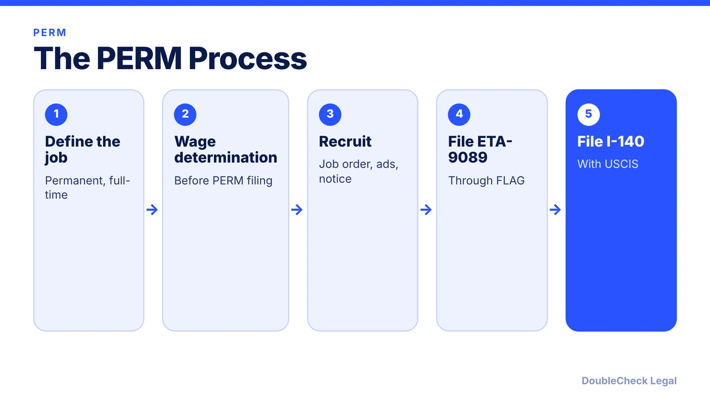
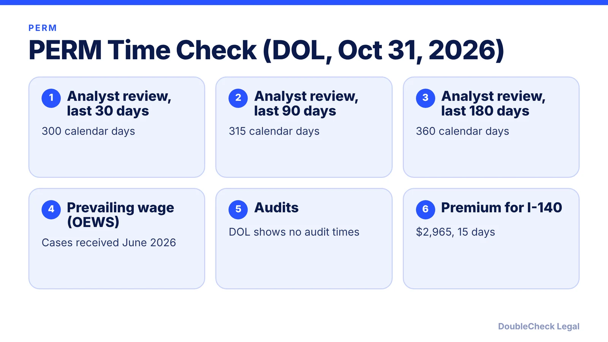

*PERM is the first big step in many employer-sponsored green cards. Here is the process, the recruitment rules, and how long DOL is taking.*

**Key takeaways:**

- The employer generally must get a certified PERM before filing the I-140.
- The prevailing wage determination must be issued before filing PERM.
- As of October 31, 2026, DOL's analyst review time was about 300 to 360 days.
- The employer pays all PERM costs; the foreign worker may not.

## 1. The quick answer

**Quick answer:** PERM is the Department of Labor process an employer generally must complete before filing an I-140 immigrant petition for many employment-based green cards. The employer gets a prevailing wage determination, runs mandatory recruitment, and files Form ETA-9089 through DOL's FLAG system, then files the I-140 with USCIS. As of October 31, 2026, DOL showed a PERM analyst review time of about 300 to 360 days, so plan for a long timeline.

## 2. What DOL requires

Per DOL, the employer must show there are not enough able, willing, qualified, and available U.S. workers and that hiring the foreign worker will not hurt wages or working conditions. The employer needs a valid FEIN and a U.S. location where U.S. workers can be referred, and a prevailing wage determination from the National Prevailing Wage Center must be issued before filing. DOL's steps: identify the job, get the prevailing wage, complete pre-filing recruitment and the Notice of Filing, then submit the application. Filings since June 1, 2023 run through FLAG and end with a signed Final Determination, per USCIS. For NIW, the beneficiary can self-petition without PERM ([NIW for founders](/blog/niw-eb-2-national-interest-waiver-founders/)).

## 3. Recruitment and who pays

Per Nolo (verify against the regulation, 20 CFR 656.17): mandatory recruitment includes a state workforce agency job order for 30 consecutive days, two Sunday newspaper ads, and a workplace notice for 10 consecutive business days, and professional positions need three of ten additional steps. No ad may be older than 180 days at filing, and you must wait at least 30 days after the later of the job order or notice ending. The employer alone pays PERM advertising, and the foreign worker may not pay any PERM costs, including attorney fees.

## 4. After PERM

After certification, the employer files Form I-140 with USCIS. Premium processing for the I-140 is $2,965 since March 1, 2026, with a 15-day clock (45 days for NIW and EB-1), per Boundless and USCIS. Check USCIS's live fee schedule for the base I-140 fee. If you get an RFE, see [how to respond](/blog/how-to-respond-to-uscis-request-for-evidence-rfe/). For startups, read [sponsoring an H-1B employee](/blog/startup-sponsor-h1b-employee-requirements/), and for other green card paths [EB-1A vs. O-1](/blog/eb-1a-vs-o-1-founder-which-path/).

## Where DoubleCheck fits

[DoubleCheck](https://www.contactdoublecheck.com) helps businesses and founders start legal work with AI, verify it, and, when professional advice is warranted, connect with an independent attorney, including for immigration questions. Attorney availability and practice areas vary. Attorneys on DoubleCheck are independent professionals; an attorney-client relationship forms only if an attorney accepts your engagement.

**Sources:** [DOL FLAG: PERM](https://flag.dol.gov/programs/perm); [DOL processing times](https://flag.dol.gov/processingtimes); [USCIS EB-2](https://www.uscis.gov/working-in-the-united-states/permanent-workers/employment-based-immigration-second-preference-eb-2); [Nolo](https://nolo.com/legal-encyclopedia/employer-recruitment-requirements-under-perm.html); [Boundless](https://www.boundless.com/blog/uscis-premium-processing-fees-increase-march-2026).

## FAQ

**What is PERM labor certification?**

A DOL process in which the employer shows there are no qualified, willing, available U.S. workers for the job and that wages are not harmed, per DOL.

**How long does PERM take?**

DOL's page shows analyst review times of 300 to 360 days as of October 31, 2026, plus wage determination and recruitment time before filing.

**Who pays for PERM?**

Per Nolo, the employer pays all advertising and the foreign worker may not pay any PERM costs, including attorney fees.

**Does NIW need PERM?**

No. USCIS says the beneficiary can self-petition for an NIW.

---

*General information only. This article is not legal, tax, investment, or accounting advice.*
