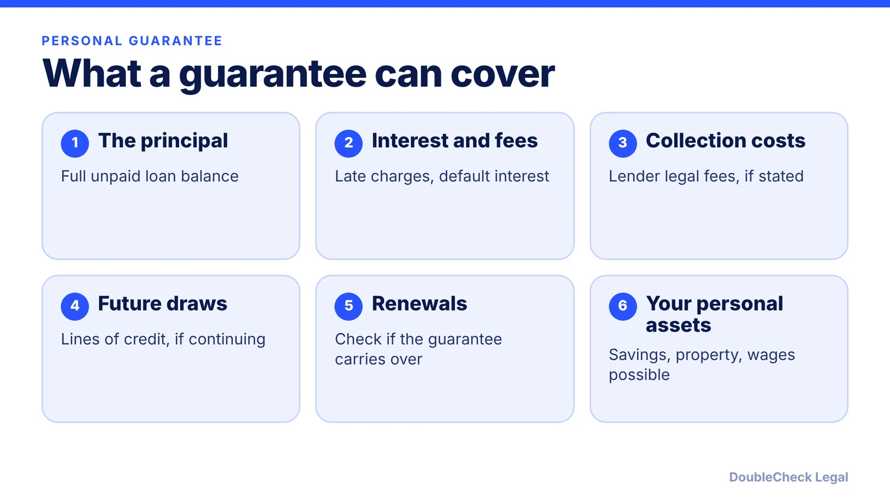
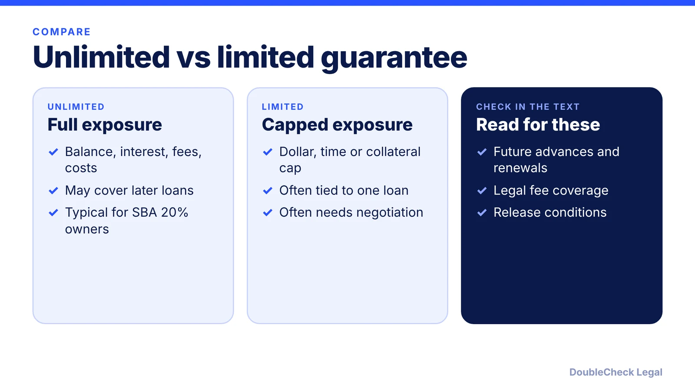

*What a personal guarantee on a business loan really means, how unlimited and limited guarantees differ, and what to check before signing, as of November 2026.*

**Key takeaways:**

- A personal guarantee makes you liable for business debt even if your LLC or corporation normally shields you.
- Unlimited guarantees can cover interest, fees, collection costs and sometimes future loans; limited ones are capped.
- SBA says owners of 20% or more must give an unlimited guarantee on 7(a) and 504 loans.
- Selling or leaving does not automatically release you; ask for a written release.

## 1. The quick answer

**Quick answer:** A personal guarantee on a business loan is your own promise to repay the debt if the business cannot. It can reach your personal assets even when the borrower is an LLC or corporation. Guarantees come in forms: unlimited (covers the full balance plus interest, fees and collection costs) or limited (capped by amount, time or collateral). For SBA 7(a) and 504 loans, SBA's own form page says individuals who own 20% or more of the applicant must give an unlimited personal guaranty. Before you sign, read what it covers, whether it reaches future loans, and how you get released.

This guide explains what a personal guarantee means, what is negotiable and what to check, as of November 2026. For the liability shield it overrides, see [LLC vs C corp for startups](/blog/llc-vs-c-corp-startups/) and [LLC bank account and commingling habits](/blog/llc-startup-bank-account-commingling-liability-protection-habits/).

## 2. What a personal guarantee is and why lenders ask

LLCs and corporations normally keep owners' personal assets separate from business debts. A guarantee is a separate contract in which you agree to be liable anyway.

Why lenders ask: a young business may have little history or collateral, so they want a person with assets behind the loan. QuickBooks (published July 2026) says a guarantee can reach past an LLC or corporation's protection for that specific debt.

That matters. A guarantee is often a "payment" guarantee, so the lender may come to you directly without first pursuing the business, depending on the wording. Some are "collection" guarantees, meaning they come after the lender has tried the borrower. Which one you signed is stated in the document, so look for the wording.

This is separate from collateral. Pledging equipment, inventory or property gives the lender a claim on that asset. A guarantee gives a claim on you personally. Many loans have both. See [what makes a contract legally binding](/blog/what-makes-a-contract-legally-binding/) for why signing is enough to be bound.

## 3. Types of guarantee and the SBA 20% rule

Common structures, per QuickBooks (July 2026):

- **Unlimited:** covers the full balance at default plus interest, lender legal fees, collection costs and late penalties.
- **Limited:** caps liability by dollar amount or time, or ties it to specific collateral.
- **Continuing:** An unlimited or continuing guaranty can be written to cover the current loan and other existing and future obligations to that lender, depending on its wording.
- **Several vs joint and several:** with several owners, a several guarantee limits each to their share, while joint and several lets the lender collect the whole debt from any one guarantor (QuickBooks).

**SBA loans.** SBA's Form 148 page (last updated September 21, 2020) says individuals who own 20% or more of the applicant must provide an unlimited personal guaranty; the form applies to the 7(a) and CDC/504 programs. NerdWallet (updated November 4, 2026) adds that spouses owning 5% or more each may both be required to sign if their combined stake reaches 20%, and that if no one owns 20%, at least one owner must give an unlimited guarantee. SBA's [Form 148-L page](https://legacy.sba.gov/document/sba-form-148-l-limited-guarantee) says individuals who own less than 20% of a small business may provide a limited or full guaranty. Because SBA procedures change, confirm the current rule with your lender and sba.gov.

## 4. What a lender can pursue and what happens on default

QuickBooks lists assets lenders may pursue: savings and checking accounts, real estate, non-retirement investments and vehicles with equity, and possibly wage garnishment. It says retirement accounts, some home equity under state homestead exemptions and certain jointly held property may have protection, but state rules differ, so ask an attorney about yours.

For SBA loans, NerdWallet says missed payments make a loan delinquent, and if the borrower neither pays nor contacts the lender for roughly three to four months it can go into default. The lender and SBA may then pursue personal assets under the guarantee, sell collateral, or refer the debt to the U.S. Treasury, which can garnish wages and tax refunds. Treat those timelines as general; the loan documents control.

Selling or leaving does not end it. Transferring shares or leaving an officer role generally does not cancel a guarantee on its own; check the guarantee for release terms and get any release from the lender in writing. If you plan to bring in a partner or exit, see [how to add a member to an LLC](/blog/how-to-add-a-member-to-an-llc/) and make a written release part of the deal.

## 5. Negotiating and reviewing before you sign

Not every term is fixed. Sources describe asks that lenders sometimes accept, though none are guaranteed:

- **Cap the amount** or a percentage of the balance instead of unlimited liability (QuickBooks).
- **Burn-off clause:** the guarantee ends after a period of on-time payments. The period is negotiated, and lenders may refuse.
- **Exclude assets,** such as your primary residence (QuickBooks).
- **Limit to the current loan** so renewals and future draws are not covered.
- **Keep a spouse off** when your own signature qualifies. Ask whether a spouse's signature is actually required, and have an attorney confirm how federal and state law apply to you.
- **Get a written release** as a closing condition if ownership changes.

**Checklist before signing:**

1. Read whether it is payment or collection, limited or unlimited, and continuing.
2. Check whether legal fees, interest and future loans are included.
3. Compare with other clauses in the loan: [indemnification](/blog/indemnification-clause-explained-small-business/), [limitation of liability](/blog/limitation-of-liability-clause-explained/), [governing law and venue](/blog/governing-law-and-venue-clause-explained-which-state-law-applies/), and [contract red flags](/blog/contract-red-flags-small-business/).
4. Ask what the loan costs without a guarantee.

You can use AI to summarize the guarantee and list questions, but [verify AI-generated legal documents](/blog/verify-ai-generated-legal-document/) and see [AI contract review: what to check](/blog/ai-contract-review-what-to-check-before-signing/). For a loan that puts your home or savings at risk, consider an attorney review: [how much a contract review costs](/blog/how-much-does-a-lawyer-charge-to-review-a-contract/).

## Where DoubleCheck fits

[DoubleCheck](https://www.contactdoublecheck.com) helps businesses and founders start legal work with AI, verify it, and, when professional advice is warranted, connect with an independent attorney, including for immigration questions. Attorney availability and practice areas vary. Attorneys on DoubleCheck are independent professionals; an attorney-client relationship forms only if an attorney accepts your engagement.

**Sources:** [SBA Form 148 Unconditional Guarantee page (last updated September 21, 2020)](https://legacy.sba.gov/document/sba-form-148-unconditional-guarantee); [NerdWallet, Are SBA Loans Personally Guaranteed? (updated November 4, 2026)](https://www.nerdwallet.com/business/loans/learn/are-sba-loans-personally-guaranteed); [QuickBooks, Business Loan Personal Guarantee (2026)](https://quickbooks.intuit.com/r/funding/business-loan-personal-guarantee/); [SBA Form 148-L Limited Guarantee page](https://legacy.sba.gov/document/sba-form-148-l-limited-guarantee). Single-source statistics were dropped.

## FAQ

**What is a personal guarantee on a business loan?**

It is a separate contract where you promise to repay the business debt if the business cannot. It can reach your personal assets even if your LLC or corporation normally shields you. Read whether it is limited or unlimited and what it covers.

**Do SBA loans require a personal guarantee?**

Generally, for owners of 20% or more. SBA Form 148 (last updated September 21, 2020) says individuals owning 20% or more of the applicant must give an unlimited personal guaranty for the 7(a) and CDC/504 programs. Confirm current requirements with your lender and sba.gov.

**What is the difference between a limited and an unlimited personal guarantee?**

An unlimited guarantee covers the full balance plus interest, legal fees and collection costs, per QuickBooks. A limited guarantee caps liability by dollar amount, time period or collateral. Neither is automatic, so the loan documents decide.

**Can I get released from a personal guarantee?**

Only if the lender agrees. Selling shares or leaving a role generally does not end it by itself; it typically lasts until the lender agrees to release you, so get that release in writing. Ask for a burn-off clause or a written release as part of the deal.

**Can I negotiate a personal guarantee?**

Sometimes. Sources suggest asking for a cap, a burn-off after on-time payments, an exclusion for your home, or limiting it to the current loan. Lenders may refuse, so compare the cost of the loan with and without a guarantee.

---

*General information only. This article is not legal, tax, investment, or accounting advice.*
