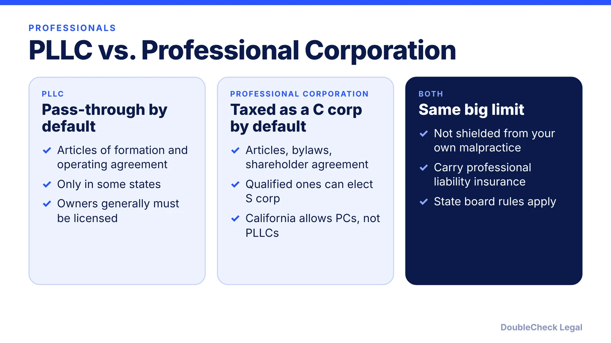
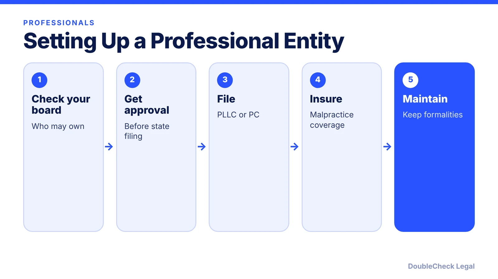

*Licensed professional starting a practice? A regular LLC may not be allowed. Here is how PLLCs and professional corporations differ.*

**Key takeaways:**

- Licensed professionals often must use a PLLC or professional corporation, depending on the state.
- Owners generally must be licensed; boards may need to approve before filing.
- A PLLC protects against a partner's malpractice, not your own.
- California allows professional corporations but not PLLCs, per BizCounsel.

## 1. The quick answer

**Quick answer:** If your work needs a state license, such as a doctor, lawyer, dentist, engineer, or accountant, many states require or offer a professional LLC (PLLC) or professional corporation (PC) instead of a regular LLC. All owners must generally be licensed, the licensing board may need to approve first, and the entity does not protect you from your own malpractice, only from a partner's.

## 2. Who can own it

NerdWallet says anyone needing a state license can form a PLLC and all owners must be licensed. LegalZoom says some states allow a small share of non-licensed owners. InCorp adds that a doctor and a lawyer generally cannot share one PLLC, law-firm PLLCs often limit ownership to attorneys licensed in the formation state, and CPA PLLCs often need a controlling majority of active CPAs. Many states require board approval before the Secretary of State accepts the filing.

## 3. Which states and which entity

Sources disagree on how many states recognize PLLCs (NerdWallet lists 32 plus DC, InCorp says roughly 30), so verify your state and profession. Some states allow both PLLCs and PCs; BizCounsel says California permits only professional corporations and West Virginia only PLLCs. Compare general entities in [LLC vs. C corp](/blog/llc-vs-c-corp-startups/), and California costs in [how to start an LLC in California](/blog/how-to-start-an-llc-in-california-step-by-step/).

## 4. Insurance, taxes, and keeping the shield

InCorp says many states require malpractice coverage, often in the $100,000 to $1,000,000 range. NerdWallet says PLLC earnings are subject to self-employment tax, some states charge franchise or gross receipts taxes, and workers' compensation is required with employees in every state except Texas. InCorp also notes courts can pierce the shield if the entity is not properly maintained. Use an [operating agreement](/blog/llc-operating-agreement-with-ai/) and confirm rules with your state's licensing board.

## Where DoubleCheck fits

[DoubleCheck](https://www.contactdoublecheck.com) helps businesses and founders start legal work with AI, verify it, and, when professional advice is warranted, connect with an independent attorney, including for immigration questions. Attorney availability and practice areas vary. Attorneys on DoubleCheck are independent professionals; an attorney-client relationship forms only if an attorney accepts your engagement.

**Sources:** [NerdWallet](https://www.nerdwallet.com/business/legal/learn/professional-limited-liability-company); [LegalZoom](https://www.legalzoom.com/articles/what-makes-an-llc-different-from-a-pllc); [BizCounsel](https://bizcounsel.com/PLLC-vs-Professional-Corporation-Whats-the-Difference); [InCorp](https://www.incorp.com/resources/knowledge-base/professional-services-llc).

## FAQ

**Can a doctor form a regular LLC?**

It depends on the state and licensing board. Many states require a PLLC or professional corporation for licensed professions. Check your board.

**Does a PLLC protect me from malpractice claims?**

Per NerdWallet and LegalZoom, it protects you from a partner's malpractice, not your own.

**Can a lawyer and a doctor own a PLLC together?**

InCorp says generally no; PLLC owners are typically limited to the same licensed profession.

**How many states allow PLLCs?**

Sources differ. NerdWallet lists 32 states plus DC and InCorp says roughly 30. Verify your state.

---

*General information only. This article is not legal, tax, investment, or accounting advice.*
