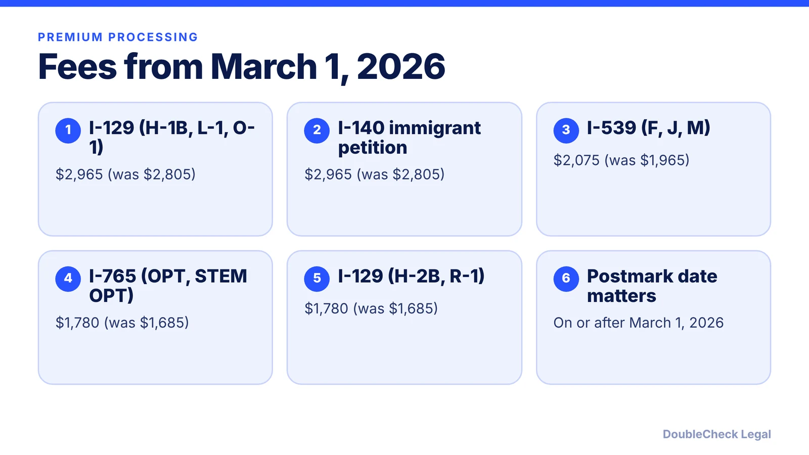
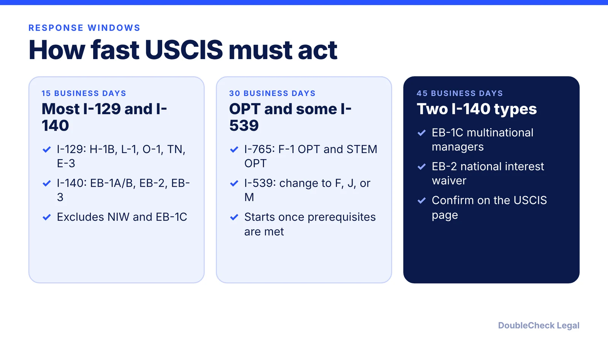

*Premium processing costs more as of March 1, 2026. Here is the fee for each form, the response window, and what the fee does not buy.*

**Key takeaways:**

- From March 1, 2026: $2,965 for most I-129 and I-140 filings, $2,075 for I-539, $1,780 for OPT/STEM OPT I-765.
- USCIS lists 15 days for most classifications and 45 for certain I-140s; confirm your category.
- Per USCIS, an RFE or NOID stops the clock, and premium processing does not guarantee approval.
- Check the current USCIS page before sending a fee.

## 1. The quick answer

**Quick answer:** For Form I-907 requests postmarked on or after March 1, 2026, premium processing costs $2,965 for most I-129 categories (H-1B, L-1, O-1, TN, E-3) and for the I-140, $2,075 for I-539 (F, J, M), and $1,780 for OPT and STEM OPT I-765s and for H-2B and R-1 petitions, per HSF Kramer. USCIS lists a response window of 15 days for most classifications and 45 days for certain I-140 petitions. Premium processing buys speed only; per USCIS it guarantees some action within the window, not approval.

## 2. Fee table by form

Per HSF Kramer, the new fees apply to premium processing requests postmarked on or after March 1, 2026, and the new fee must be included. HSF Kramer reports fee ranges that match this table.

| Form and category | Old fee | Fee from March 1, 2026 |
|---|---|---|
| I-129: H-1B, L-1, O-1, TN, E-3 and other eligible classes | $2,805 | $2,965 |
| I-140: EB-1, EB-2, EB-3 | $2,805 | $2,965 |
| I-129: H-2B and R-1 | $1,685 | $1,780 |
| I-539: F-1, F-2, J-1, J-2, M-1, M-2 | $1,965 | $2,075 |
| I-765: OPT and STEM OPT | $1,685 | $1,780 |

Premium processing is requested on Form I-907, and only for benefit types USCIS has designated as eligible. Fees can change and published tables sometimes contain errors, so confirm any number on the [USCIS premium processing page](https://www.uscis.gov/forms/all-forms/how-do-i-request-premium-processing) before paying. If you are weighing a filing strategy, see our posts on [O-1 processing time and premium processing](/blog/o-1-visa-processing-time-premium-processing/) and [H-1B transfers](/blog/h-1b-transfer-change-of-employer-portability/).

## 3. 15, 30, or 45 business days

Per the [USCIS premium processing page](https://www.uscis.gov/forms/all-forms/how-do-i-request-premium-processing), the window is 15 days for most classifications and 45 days for I-140 multinational executive/manager and national interest waiver petitions. Confirm the unit and your category on that page. The clock starts when USCIS properly receives a complete Form I-907 with the correct fee. Other forms, such as I-539 and I-765, have their own rules on the USCIS page.

Per USCIS, if it does not take adjudicative action in the window, it will refund the premium processing fee and continue expedited processing. A response can be an approval, denial, notice of intent to deny, request for evidence (RFE), or a fraud or misrepresentation investigation. If USCIS sends an RFE or NOID, the clock stops and a new period begins when USCIS receives your response.

## 4. What premium processing does not do

- **It does not improve approval prospects.** Per USCIS, it guarantees some adjudicative action within the time frame, not a particular outcome, and an RFE or NOID can still issue.
- **It does not cover H-4 and L-2 dependents on its own.** Dependent applications are not automatically included in the principal's premium request; check the USCIS page for whether a dependent filing is eligible. See [H-4 EAD for spouses](/blog/h-4-ead-spouses-of-h-1b/).
- **It cannot be filed by the beneficiary.** Per USCIS, the petitioner (or an attorney with a Form G-28) files Form I-907; the beneficiary may pay the fee but cannot sign or file, except in self-petition cases.
- **It does not add categories or change eligibility rules.**
- **It does not apply to everything.** USCIS offers it only for the forms and classifications on its charts.

Premium processing also does not fix a weak filing. Before you spend $2,965, run the petition through our guide to [checking immigration documents with AI](/blog/check-immigration-documents-with-ai-before-filing/), and for strong-evidence cases compare [EB-1A for software engineers](/blog/eb-1a-for-software-engineers-and-tech-employees/). Students should also read [CPT vs OPT](/blog/cpt-vs-opt-f1-students/).

## Where DoubleCheck fits

[DoubleCheck](https://www.contactdoublecheck.com) helps businesses and founders start legal work with AI, verify it, and, when professional advice is warranted, connect with an independent attorney, including for immigration questions. Attorney availability and practice areas vary. Attorneys on DoubleCheck are independent professionals; an attorney-client relationship forms only if an attorney accepts your engagement.

**Sources:** [USCIS: How do I request premium processing?](https://www.uscis.gov/forms/all-forms/how-do-i-request-premium-processing); [HSF Kramer: USCIS premium processing fees set to increase in March 2026](https://www.hsfkramer.com/insights/2026-01/uscis-premium-processing-fees-set-to-increase-in-march-2026).

## FAQ

**How much is premium processing in 2026?**

Per HSF Kramer, for requests postmarked on or after March 1, 2026, fees run up to $2,965 for most I-129 and I-140, $2,075 for I-539 (F, J, M), and $1,780 for OPT/STEM OPT I-765 and for H-2B and R-1.

**How long does premium processing take?**

USCIS lists 15 days for most classifications and 45 days for certain I-140 petitions (multinational executive/manager and national interest waiver). Confirm the unit and your category on the USCIS page.

**Does premium processing guarantee approval?**

No. Per USCIS, it guarantees some adjudicative action within the time frame, not a particular outcome.

**Can I get a refund if USCIS misses the deadline?**

USCIS says that if it does not take adjudicative action in the time frame, it will refund the premium processing fee and continue with expedited processing; confirm the current terms on the USCIS premium processing page.

---

*General information only. This article is not legal, tax, investment, or accounting advice.*
