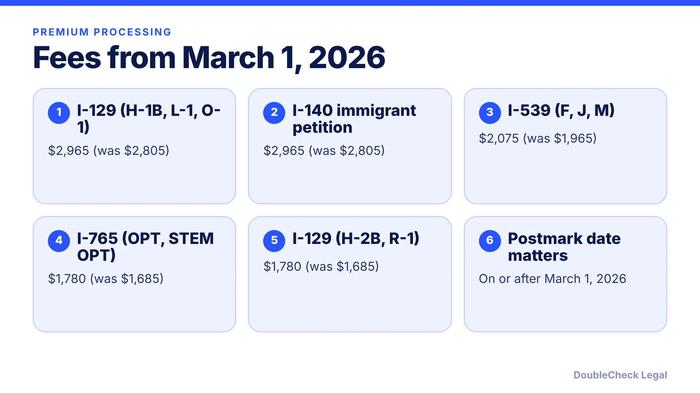
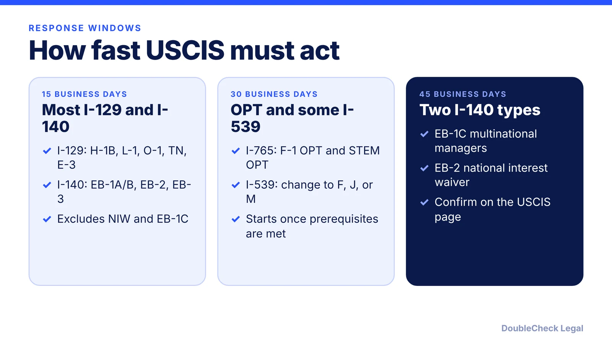

*Premium processing costs more as of March 1, 2026. Here is the fee for each form, the response window, and what the fee does not buy.*

**Key takeaways:**

- From March 1, 2026: $2,965 for most I-129 and I-140 filings, $2,075 for I-539, $1,780 for OPT/STEM OPT I-765.
- CI Law Group lists 15, 30, or 45 business days depending on form and category.
- An RFE restarts the clock, and premium processing does not raise approval odds.
- Check the current USCIS page before sending a fee.

## 1. The quick answer

**Quick answer:** For Form I-907 requests postmarked on or after March 1, 2026, premium processing costs $2,965 for most I-129 categories (H-1B, L-1, O-1, TN, E-3) and for the I-140, $2,075 for I-539 (F, J, M), and $1,780 for OPT and STEM OPT I-765s and for H-2B and R-1 petitions, per Boundless and HSF Kramer. CI Law Group lists the response windows as 15 business days for most I-129 and I-140 categories, 30 for OPT/STEM OPT I-765 and certain I-539s, and 45 for EB-1C and national interest waiver I-140s. Premium processing buys speed only; it does not raise approval odds or prevent a request for evidence.

## 2. Fee table by form

Boundless reports the new fees apply to Form I-907 requests postmarked on or after March 1, 2026, and that USCIS will reject a request with the wrong fee. Boundless and HSF Kramer agree on this table.

| Form and category | Old fee | Fee from March 1, 2026 |
|---|---|---|
| I-129: H-1B, L-1, O-1, TN, E-3 and other eligible classes | $2,805 | $2,965 |
| I-140: EB-1, EB-2, EB-3 | $2,805 | $2,965 |
| I-129: H-2B and R-1 | $1,685 | $1,780 |
| I-539: F-1, F-2, J-1, J-2, M-1, M-2 | $1,965 | $2,075 |
| I-765: OPT and STEM OPT | $1,685 | $1,780 |

Premium processing is requested on Form I-907, and only for benefit types USCIS has designated as eligible. One law firm's table (EIG) briefly misprinted the I-765 fee as $2,075 and corrected it to $1,780, so confirm any number on the [USCIS premium processing page](https://www.uscis.gov/forms/all-forms/how-do-i-request-premium-processing) before paying. If you are weighing a filing strategy, see our posts on [O-1 processing time and premium processing](/blog/o-1-visa-processing-time-premium-processing/) and [H-1B transfers](/blog/h-1b-transfer-change-of-employer-portability/).

## 3. 15, 30, or 45 business days

These windows are from CI Law Group's summary. Another firm (RJ Immigration Law) describes the I-140 window as 45 calendar days, so confirm the unit and category on the USCIS page for your filing. Both agree the clock does not start until USCIS accepts the request, and for I-539 and I-765 not until prerequisites such as biometrics or an approved associated petition are met.

CI Law Group says USCIS must respond within the window or the premium fee may be refunded. A response can be an approval, denial, notice of intent to deny, request for evidence (RFE), or investigative action. If USCIS sends an RFE, RJ Immigration Law says the clock restarts once USCIS receives your response.

## 4. What premium processing does not do

- **It does not improve approval prospects.** NNU Immigration quotes that it "does not improve approval prospects and does not prevent requests for evidence." RJ Immigration Law says it guarantees action, not approval.
- **It does not cover H-4 and L-2 dependents on its own.** CI Law Group says it is unavailable for I-539s filed by dependents of an I-129 beneficiary, and the Edakunni settlement that required USCIS to adjudicate those with the principal's premium case expired January 18, 2025. USCIS often processes them together anyway, but is no longer required to. See [H-4 EAD for spouses](/blog/h-4-ead-spouses-of-h-1b/).
- **It cannot be requested by the beneficiary.** Only the applicant or petitioner can, which for I-129 and I-140 is normally the employer (CI Law Group).
- **It does not add categories or change eligibility rules** (Boundless).
- **It does not apply to everything.** Ellis notes premium processing is not available for the I-751.

Premium processing also does not fix a weak filing. Before you spend $2,965, run the petition through our guide to [checking immigration documents with AI](/blog/check-immigration-documents-with-ai-before-filing/), and for strong-evidence cases compare [EB-1A for software engineers](/blog/eb-1a-for-software-engineers-and-tech-employees/). Students should also read [CPT vs OPT](/blog/cpt-vs-opt-f1-students/).

## Where DoubleCheck fits

[DoubleCheck](https://www.contactdoublecheck.com) helps businesses and founders start legal work with AI, verify it, and, when professional advice is warranted, connect with an independent attorney, including for immigration questions. Attorney availability and practice areas vary. Attorneys on DoubleCheck are independent professionals; an attorney-client relationship forms only if an attorney accepts your engagement.

**Sources:** [Boundless: premium processing fees March 2026](https://www.boundless.com/blog/uscis-premium-processing-fees-increase-march-2026); [HSF Kramer](https://www.hsfkramer.com/insights/2026-01/uscis-premium-processing-fees-set-to-increase-in-march-2026); [NNU Immigration](https://www.nnuimmigration.com/us-premium-processing-fees-increase-march-1-2026/); [EIG Law](https://eiglaw.com/uscis-announces-inflation-adjustment-to-premium-processing-fees-effective-march-1-2026/); [CI Law Group: Form I-907](https://cilawgroup.com/?p=15734); [RJ Immigration Law](https://rjimmigrationlaw.com/resources/premium-processing-how-long-uscis-really-takes/); [Ellis: Form I-751](https://www.ellis.com/resources/i-751).

## FAQ

**How much is premium processing in 2026?**

Per Boundless, for requests postmarked on or after March 1, 2026: $2,965 for most I-129 and I-140, $2,075 for I-539 (F, J, M), and $1,780 for OPT/STEM OPT I-765 and for H-2B and R-1.

**How long does premium processing take?**

CI Law Group lists 15 business days for most I-129 and I-140 categories, 30 for OPT/STEM OPT I-765 and certain I-539s, and 45 for EB-1C and NIW I-140s.

**Does premium processing guarantee approval?**

No. RJ Immigration Law says it guarantees action by USCIS, not approval, and NNU Immigration says it does not prevent requests for evidence.

**Can I get a refund if USCIS misses the deadline?**

CI Law Group says USCIS must respond within the applicable window or the premium fee may be refunded; confirm the current terms on the USCIS premium processing page.

---

*General information only. This article is not legal, tax, investment, or accounting advice.*
