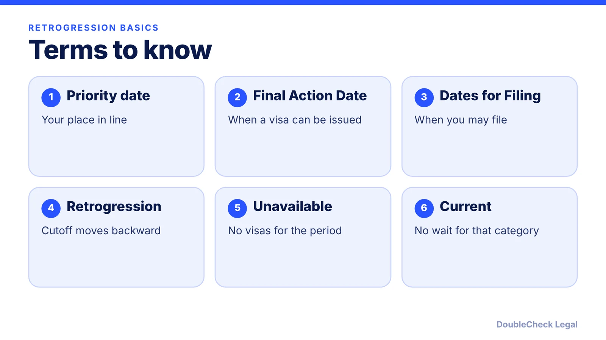
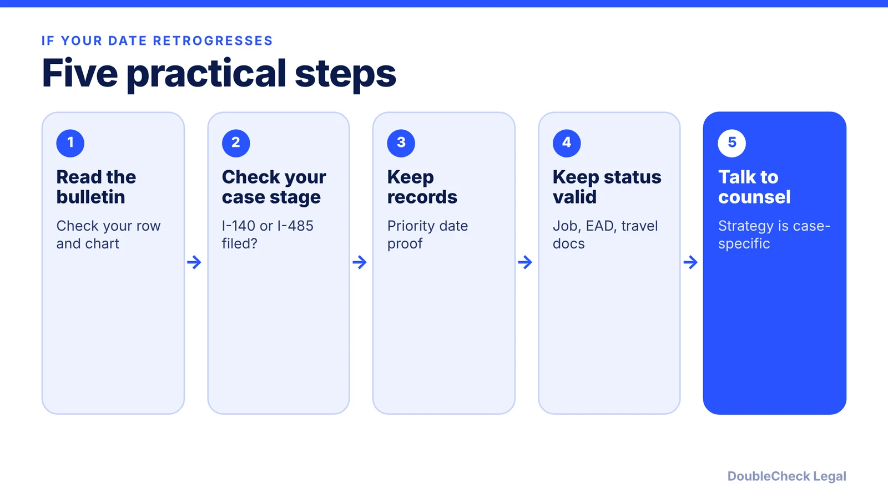

*A bulletin date moving backward is not a denial, but it can change when your case is able to finish.*

**Key takeaways:**

- Retrogression means a category's cutoff date moves backward.
- October 2026: EB-2 for most countries retrogressed from Current to January 1, 2025 (per Beyond Border).
- November 2026: EB-2 India and China dates were unchanged; EB-3 India advanced 21 days (per Wolfsdorf).
- Keep your priority date records and consider category options with an attorney.

## 1. The quick answer

**Quick answer:** Retrogression happens when the State Department moves a category's cutoff date backward, so a priority date that was current last month is no longer current. Per Beyond Border's summary of the October 2026 Visa Bulletin, EB-2 for most countries retrogressed from Current to January 1, 2025, and EB-3 for most countries retrogressed from September 1, 2024 to May 15, 2024. The page says the State Department made the change to keep visa issuances within FY 2027 quarterly and annual limits. For India and China, long backlogs already apply.

## 2. What changed in October and November 2026

Per [Beyond Border](https://www.beyondborderglobal.com/resources/october-2026-visa-bulletin), the October 2026 bulletin was the first of fiscal year 2027, and its changes included:

- **EB-2 all others:** Current to January 1, 2025 (retrogressed). The page says this applies to all countries except China, India, Mexico, and the Philippines.
- **EB-2 India:** from Unavailable to November 1, 2013 (reopened).
- **EB-2 China:** September 1, 2021 to October 1, 2021.
- **EB-3 India:** unchanged at January 1, 2014.

Then in November 2026, per [Wolfsdorf](https://wolfsdorf.com/november-2026-visa-bulletin-selected-employment-categories-make-gains-family-categories-advance/), EB-2 for the rest of the world advanced to April 1, 2025, EB-2 India and China were unchanged (November 1, 2013 and October 1, 2021), and EB-3 India moved to January 22, 2014. Wolfsdorf did not report any employment-based retrogression in the November bulletin. Check the State Department bulletin for the current month, since these dates move.

## 3. Why India and China are different

India and China applicants have their own columns in the bulletin, and their dates sit years behind the rest of the world: for India EB-2, the November 2026 Final Action Date is November 1, 2013, per Wolfsdorf. Beyond Border's July 2026 comparison estimates 5-10+ years for India EB-2 and 5-12 years for India EB-3, with roughly 7-14+ years total timelines. Treat those as one firm's estimates, not guarantees.

What this means in practice:

- **Your priority date is your place in line.** Keep proof of it.
- **A date can go backward after you file.** Per Beyond Border, a visa is available only when your priority date is earlier than the Final Action Date shown, or the category is Current.
- **Switching categories may help.** In November 2026, the EB-3 China and India dates are later than EB-2, so a category change may deserve a conversation. See [EB-2 vs EB-3](/blog/eb-2-vs-eb-3-green-card-categories/).

For background, read [the Visa Bulletin explained](/blog/visa-bulletin-explained-priority-dates-eb-categories/) and [H-1B to green card timeline](/blog/h-1b-to-green-card-timeline-tech-workers/).

## 4. What to do when a date retrogresses

A retrogression is a bulletin change, not a denial. Typical steps, in plain terms:

If your I-485 is already pending, the case generally waits until your date is current; see [the I-485 guide](/blog/i-485-adjustment-of-status-guide/), [EAD and advance parole while pending](/blog/advance-parole-and-ead-while-i-485-pending/), and [changing jobs with I-140 portability](/blog/i-140-portability-ac21-changing-jobs/). Whether to file at all when a bulletin allows it is a strategy question for an attorney.

## Where DoubleCheck fits

[DoubleCheck](https://www.contactdoublecheck.com) helps businesses and founders start legal work with AI, verify it, and, when professional advice is warranted, connect with an independent attorney, including for immigration questions. Attorney availability and practice areas vary. Attorneys on DoubleCheck are independent professionals; an attorney-client relationship forms only if an attorney accepts your engagement.

**Sources:** [Beyond Border, October 2026 Visa Bulletin](https://www.beyondborderglobal.com/resources/october-2026-visa-bulletin); [Wolfsdorf, November 2026 Visa Bulletin](https://wolfsdorf.com/november-2026-visa-bulletin-selected-employment-categories-make-gains-family-categories-advance/); [Beyond Border, EB-2 vs EB-3](https://www.beyondborderglobal.com/resources/eb-2-vs-eb-3).

## FAQ

**What is priority date retrogression?**

It is when the State Department moves a category's cutoff date earlier, so applicants who were current may have to wait again. Beyond Border reported that the October 2026 EB-2 and EB-3 retrogression for most countries was made to keep issuances within quarterly and annual limits.

**Did India EB-2 retrogress in 2026?**

Per Beyond Border, EB-2 India went from Unavailable in the September bulletin to November 1, 2013 in October 2026, which it labels as reopened. Wolfsdorf reports it unchanged in November 2026.

**Do I lose my priority date if I change jobs or categories?**

Not necessarily. Beyond Border says the original priority date can be kept when moving between EB-2 and EB-3. Confirm the rules for your case with an attorney.

**Where do I find the current dates?**

On the State Department's monthly Visa Bulletin. Each month, check which chart USCIS designates for adjustment of status filings.

---

*General information only. This article is not legal, tax, investment, or accounting advice.*
