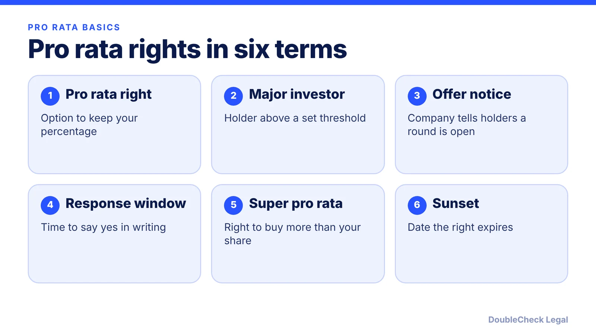
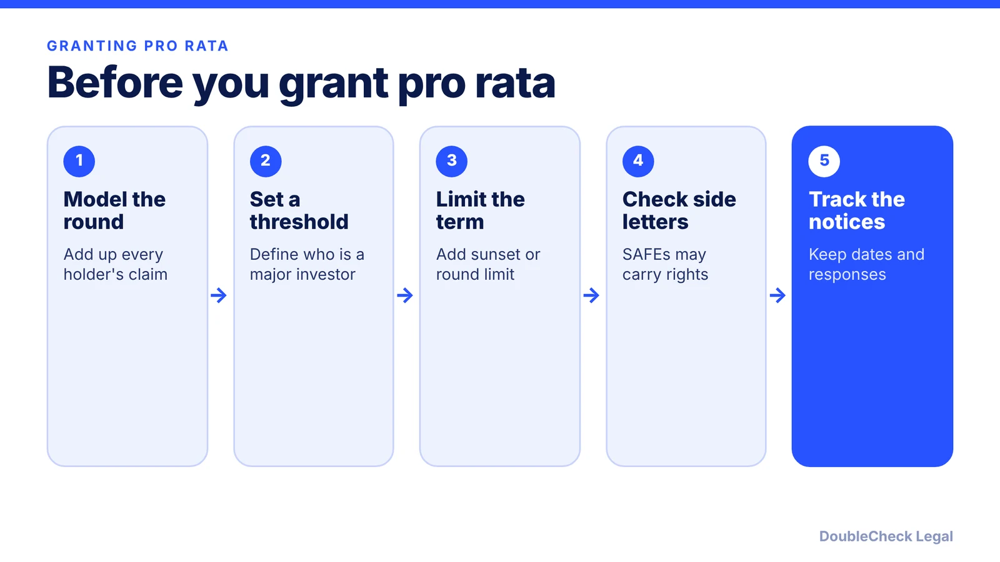

*Pro rata rights decide who can fill your next round. Here is how they work, what they cost founders, and what to negotiate.*

**Key takeaways:**

- Pro rata rights are an option, not an obligation: an investor who passes is diluted (per CRV).
- Check size = ownership % x round size; a 10% holder in a $3M round can invest $300,000 (our arithmetic).
- Per CRV, rights typically go to major investors, often holding about 1% to 2% of fully diluted equity.
- Limit thresholds, duration, and super pro rata so a new lead still has room.

## 1. The quick answer

**Quick answer:** Pro rata rights let an existing investor buy enough shares in a future funding round to keep the same ownership percentage. Per CRV, the rights are optional: an investor who passes is diluted by the new money. The check size is the investor's ownership percentage times the size of the new round, so a 10% holder in a $3 million round can invest $300,000 to stay at 10%. For founders, the questions are who gets the right, for how long, and how much of each round it can take.

## 2. How the math works

CRV gives the formula: ownership percentage times the total size of the new round equals the pro rata investment. Its example is an 8% holder in a $5 million Series A, who would need $400,000.

Our arithmetic on a hypothetical, so you can check the dilution effect:

- An investor owns 10% before a round. The company raises $3 million at a $12 million pre-money valuation, so the post-money valuation is $15 million.
- If the investor passes, the new shares are 20% of the company ($3M / $15M), so the investor's stake falls to 10% x 80% = 8%.
- To get back to 10%, the investor invests $300,000, which buys 2% of the post-money company ($300,000 / $15 million). That 2% plus the diluted 8% equals 10%.
- Founders and employees are diluted either way. The $300,000 simply comes out of the room otherwise available to the new lead.

Pro rata is different from anti-dilution protection. CRV notes that anti-dilution adjusts a conversion price in a down round without new money, while pro rata requires the investor to write a new check. For the price-adjustment side, see [anti-dilution provisions in a term sheet](/blog/anti-dilution-provisions-term-sheet/).

## 3. Who gets the right and how to limit it

CRV says that under the NVCA model term sheet, these rights typically go to "major investors," usually holders of roughly 1% to 2% of fully diluted equity, and that founders can set the threshold higher to shorten the list. It also reports that investors usually get about 20 days to respond in writing after an offer notice.

CRV describes several structures:

- **Full:** the holder can keep its percentage through later rounds.
- **Partial or capped:** limited to major investors, often with an over-subscription mechanism so unused allocations pass to other major investors.
- **Time-bound or round-limited:** the right expires after a period or applies only to the next round.
- **Super pro rata:** lets an investor increase its stake. CRV advises founders to avoid it because it can crowd out a new lead.

The founder concern is cap table room. CRV warns that if existing investors fill most of a later round, a new lead may be left with a small slice, when it may expect a larger stake. Its suggested tools include thresholds, duration limits, pay-to-play conditions, and keeping full rights for the lead investor. [Capboard](https://www.capboard.io/en/pro-rata-rights-explained) adds the administrative side: tracking and enforcing rights across several rounds gets complicated, and rights can create friction between investors.

SAFE investors usually get pro rata only through a side letter; see [SAFE note explained for founders](/blog/safe-note-explained-for-founders/) and [SAFE review before you sign](/blog/safe-review-before-you-sign/).

## 4. A founder checklist before you grant it

Treat pro rata as something you grant deliberately, round by round, not a default.

- **Add it up.** Total every right already granted (charter, investor rights agreement, side letters) before promising more. A [cap table](/blog/cap-table-basics-for-first-time-founders/) with a rights column helps.
- **Read it against the term sheet.** Pro rata sits alongside liquidation preference, board seats, and information rights in [key term sheet terms](/blog/term-sheet-key-terms-explained/) and the [NVCA model documents](/blog/nvca-model-documents-priced-round-explained/).
- **Expect diligence questions.** A new investor will ask who holds pro rata rights, so list them in your [fundraising diligence checklist](/blog/due-diligence-checklist-for-startup-fundraising/).

An attorney can check that the defined terms (major investor, offer notice, waiver) match what you negotiated.

## Where DoubleCheck fits

[DoubleCheck](https://www.contactdoublecheck.com) helps businesses and founders start legal work with AI, verify it, and, when professional advice is warranted, connect with an independent attorney, including for immigration questions. Attorney availability and practice areas vary. Attorneys on DoubleCheck are independent professionals; an attorney-client relationship forms only if an attorney accepts your engagement.

**Sources:** [CRV, Pro Rata Rights](https://www.crv.com/content/pro-rata-rights); [Capboard, Pro-Rata Rights Explained](https://www.capboard.io/en/pro-rata-rights-explained).

## FAQ

**What are pro rata rights in simple terms?**

They are an investor's option to buy enough shares in a future round to keep its ownership percentage. Per CRV, the rights are optional, and an investor who passes is diluted by the new money.

**How do you calculate a pro rata investment?**

Multiply the investor's ownership percentage by the total size of the new round. CRV's example: an 8% holder in a $5 million Series A would invest $400,000.

**Who usually gets pro rata rights?**

Per CRV, under the NVCA model term sheet the rights typically go to major investors, usually holders of about 1% to 2% of fully diluted equity. The threshold is negotiable, so check your own documents.

**What is a super pro rata right and should founders worry about it?**

It lets an investor buy more than its current percentage. CRV advises founders to avoid it because it can crowd out a new lead investor. Whether it fits your deal is a question for your attorney.

---

*General information only. This article is not legal, tax, investment, or accounting advice.*
