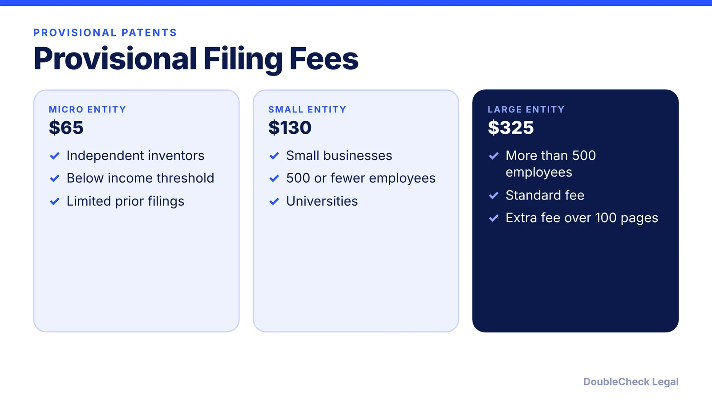
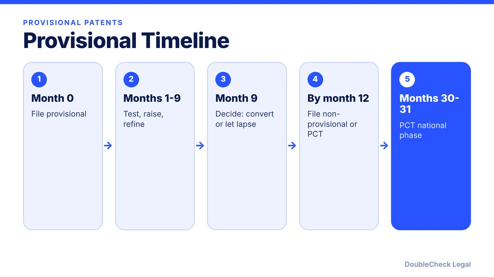

*What a provisional patent application does, what it costs, and how it connects to a PCT filing.*

**Key takeaways:**

- USPTO fees: $65 micro, $130 small, $325 large entity (per TMarkMetric and IP Boutique Law).
- You have 12 months, with no extension, to file a non-provisional or lose the priority date.
- A provisional is never examined and does not protect elements it does not describe.
- PCT filing within the 12 months leads to national phases at about 30 to 31 months; it is not a single global patent.

## 1. The quick answer

**Quick answer:** A provisional patent application is a lower-cost U.S. filing that establishes an early filing date for an invention and gives you 12 months to file a non-provisional application. It is never examined and never becomes a patent on its own. As of November 2026, USPTO provisional filing fees are $65 for micro entities, $130 for small entities, and $325 for large entities (per TMarkMetric and IP Boutique Law, in effect since January 2025). The quality of the written description is what protects your date.

## 2. How the 12-month window works

The provisional has a fixed 12-month life from its filing date, and the USPTO does not grant extensions, per IP Boutique Law. If you do not file a non-provisional application claiming its benefit within that period, the provisional expires and you lose the priority date.

What the filing gives you, per TMarkMetric: a priority date, 12 months to decide whether to convert, and the right to say "patent pending." It requires no search or examination fee, and you do not need an attorney to file one, though many founders use one for the drafting.

The same 12-month period is the window for foreign filings that claim priority, including a PCT application (see below). Plan the conversion date in your calendar on day one and treat month 9 as your decision point.

## 3. What a provisional does not do

- **It is not a patent.** It is never examined and grants no enforceable rights, per TMarkMetric.
- **It does not protect what it does not describe.** Claims to elements missing from the provisional cannot use its filing date. A thin filing can leave details without the early date, so describe the invention thoroughly, cover variations, and include drawings.
- **It does not extend the 20-year patent term.** A utility patent runs 20 years from the non-provisional filing date, per GleanMark.
- **It does not stop public disclosure from mattering.** Disclosing the invention publicly during the window may bar foreign patents in countries with absolute novelty requirements, per IP Boutique Law.
- **It is not cheap overall.** Attorney-drafted provisionals are typically quoted at $1,500 to $5,000 or more, and converting to a non-provisional can run $8,000 to $15,000 or more in attorney fees, per TMarkMetric. Those are one site's estimates; get quotes.

For other IP types and how they fit together, see [trademark vs. copyright vs. patent](/blog/trademark-vs-copyright-vs-patent-startups/).

## 4. US vs. international: PCT basics

Patents are national. A provisional only helps in the U.S. unless you file within 12 months and claim priority. The Patent Cooperation Treaty (PCT) lets you file one international application within 12 months of the earlier filing; it does not create a single international patent, and each country or regional office decides on grant under its own law, per UpCounsel's summary.

Typical PCT milestones, per UpCounsel: the international search report and written opinion around months 16 to 17 from priority, publication around month 18, and national or regional phase entry at 30 months for many offices (the U.S., Canada, China, Japan) or 31 months for others (Australia, India, the UK, the European Patent Office). Check each office's current rules.

If you are a foreign founder or have co-inventors abroad, ownership and assignment paperwork matters; see [IP assignment agreements](/blog/confidentiality-ip-assignment-agreements-startups/) and [how to incorporate a company in the U.S.](/blog/how-to-incorporate-a-company-in-the-us/). Founders who also have a brand to protect should read [how to trademark a business name](/blog/how-to-trademark-a-business-name/).

## Where DoubleCheck fits

[DoubleCheck](https://www.contactdoublecheck.com) helps businesses and founders start legal work with AI, verify it, and, when professional advice is warranted, connect with an independent attorney, including for immigration questions. Attorney availability and practice areas vary. Attorneys on DoubleCheck are independent professionals; an attorney-client relationship forms only if an attorney accepts your engagement.

**Sources:** [TMarkMetric on provisional costs](https://www.tmarkmetric.com/insights/provisional-patent-cost); [IP Boutique Law](https://ipboutiquelaw.com/cost-provisional-patent-application-2026-guide-dc-usa/); [UpCounsel PCT timeline](https://upcounsel.com/pct-filing-timeline); [GleanMark](https://gleanmark.com/insights/trademark-vs-patent-vs-copyright-a-practical-guide-for-entrepreneurs).

## FAQ

**How much does a provisional patent application cost?**

USPTO filing fees are $65 (micro), $130 (small), or $325 (large entity), per TMarkMetric and IP Boutique Law. Extra fees apply over 100 pages. Attorney drafting is separate; verify fees with the USPTO.

**Can I extend the 12-month provisional deadline?**

No. Per IP Boutique Law, the USPTO does not grant extensions; the provisional expires if no non-provisional claims its benefit in time.

**Does a provisional give me patent protection?**

No. Per TMarkMetric it is never examined and grants no enforceable rights. It establishes a priority date and lets you say patent pending.

**What is a PCT application?**

A single international filing, usually within 12 months of your first filing, that preserves your path to many countries. Each country decides on grant separately, per UpCounsel.

---

*General information only. This article is not legal, tax, investment, or accounting advice.*
