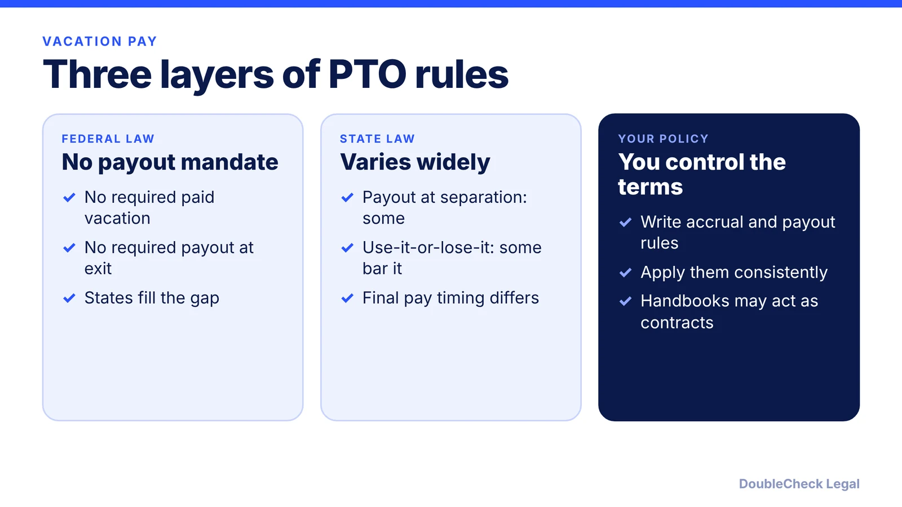
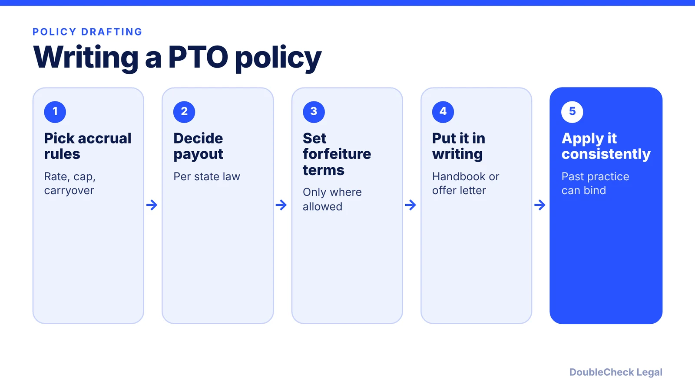

*Vacation pay is set by state law and your own written policy, not by the federal government.*

**Key takeaways:**

- No federal law requires paid vacation or payout of unused vacation at separation (Gusto, Paycor).
- California bars use-it-or-lose-it and requires payout; New York allows forfeiture with notice but requires payout absent a written policy.
- A written policy promising payout is generally enforceable, so draft it carefully.
- Multi-state employers need a per-state policy table.

## 1. The quick answer

**Quick answer:** No federal law requires you to offer paid vacation or to pay out unused vacation when someone leaves; per [Gusto](https://www.gusto.com/resources/articles/hr/termination/pay-accrued-vacation-sick-time-terminated-employees), payout rules come from state law, employment agreements, and company policy. States split on two questions: whether unused vacation must be paid at separation, and whether "use-it-or-lose-it" policies are allowed. California prohibits forfeiture; New York allows it with advance notice. Your written policy is the safest place to settle both.

## 2. How states differ on payout

Per [Paycor's state table](https://www.paycor.com/resource-center/articles/pto-payout-laws-by-state/), accrued, unused vacation is not subject to federal law, and states take different approaches. Examples it lists:

- **California:** employees cannot be deprived of earned, unused vacation on separation, unless a collective bargaining agreement says otherwise. Gusto adds that the payout belongs in the final paycheck.
- **New York:** the employer's policy or contract governs, but if there is no written policy, unused vacation pay must be paid out.
- **Massachusetts and Nebraska:** employers are liable to pay separating employees earned, unused vacation.
- **Maine:** private employers with 11 or more employees must pay unused PTO.
- **Rhode Island:** owed to employees with at least one year of service.
- **Washington:** payout is not required (Gusto).

Illinois is described differently by different secondary sources: Paycor says the employer's policy or agreement decides, while Gusto says payout is generally required under policy or agreement. Treat Illinois as a state to confirm with the Illinois Department of Labor or an attorney.

The takeaway is that there is no safe national default. Payroll for a multi-state team needs a per-state policy table; see [multi-state remote employees](/blog/multi-state-remote-employees-compliance-startups/).

## 3. Use-it-or-lose-it and carryover

Per Paycor, state law on forfeiture falls into three groups:

- **Prohibited:** California, Colorado, Montana (though maximum caps are allowed), and Nebraska.
- **Permitted:** Illinois, Kansas, Louisiana, Massachusetts, Nevada, New York, North Carolina, North Dakota, and Wyoming, most with conditions. New York requires advance notice; North Carolina requires written notice; Wyoming requires a full opportunity to use the time.
- **Not addressed by state law:** other states, which Paycor notes does not mean employers cannot adopt such a policy.

A common compromise is an accrual cap: employees stop accruing at a set balance rather than losing earned time, though you should confirm that approach is allowed where your employees work. Unlimited PTO is another option; Gusto says unlimited vacation generally does not vest, so there may be nothing to pay out, but it recommends legal advice on such a policy.

If you terminate someone, final pay timing also matters. Kentucky, for example, requires payment by the next pay period or 14 days after the last day, whichever is later (Gusto). Pair this with the process in [how to terminate an employee legally](/blog/how-to-terminate-an-employee-legally-small-business/).

## 4. Writing a PTO policy that holds up

Gusto's guidance is practical: a written policy promising payout is generally enforceable regardless of state law, handbooks may function as employment contracts, and if you regularly pay out PTO, courts may treat that as binding. If you skip a required payout, a former employee may sue for unpaid wages or breach of contract and you could owe attorneys' fees and damages.

A policy should answer:

1. How time accrues, and whether there is a cap or carryover limit.
2. Whether unused time is paid at separation, and any conditions (for example, a minimum service period, where your state allows it).
3. Whether the rule differs by state.
4. How requests and approvals work.

Put these in the handbook; [what to include in a small business employee handbook](/blog/employee-handbook-small-business-what-to-include/) covers the structure. Overtime-eligible staff raise separate questions, covered in [exempt vs. nonexempt](/blog/overtime-exempt-vs-nonexempt-small-business/). For the first-hire basics, see the [first employee checklist](/blog/how-to-hire-first-employee-legal-checklist/), and offer terms in [drafting a job offer letter](/blog/draft-job-offer-letter-with-ai/).

## Where DoubleCheck fits

[DoubleCheck](https://www.contactdoublecheck.com) helps businesses and founders start legal work with AI, verify it, and, when professional advice is warranted, connect with an independent attorney, including for immigration questions. Attorney availability and practice areas vary. Attorneys on DoubleCheck are independent professionals; an attorney-client relationship forms only if an attorney accepts your engagement.

**Sources:** [Paycor, PTO Payout Laws by State](https://www.paycor.com/resource-center/articles/pto-payout-laws-by-state/); [Gusto, PTO payout when an employee leaves](https://www.gusto.com/resources/articles/hr/termination/pay-accrued-vacation-sick-time-terminated-employees).

## FAQ

**Do I have to pay out unused vacation when an employee leaves?**

It depends on the state. Per Paycor, federal law does not require it; California does require payout of earned, unused vacation, while in New York payout depends on your written policy and is required if there is none.

**Can I have a use-it-or-lose-it vacation policy?**

Per Paycor, California, Colorado, Montana (caps allowed), and Nebraska prohibit it, while states such as New York and Illinois permit it, often with notice conditions.

**Does unlimited PTO avoid payout?**

Gusto says unlimited vacation generally does not vest, so there may be nothing to pay out, but it recommends getting legal advice on such a policy for your state.

**Is a handbook promise of PTO payout binding?**

Often, yes. Gusto says a written policy promising payout is generally enforceable regardless of state law, and handbooks may function as employment contracts.

---

*General information only. This article is not legal, tax, investment, or accounting advice.*
