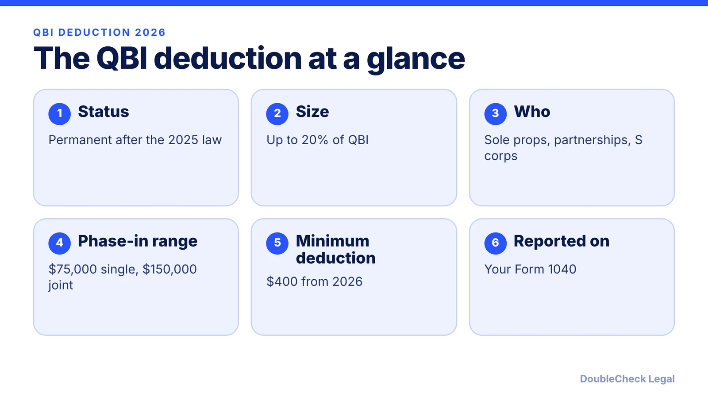
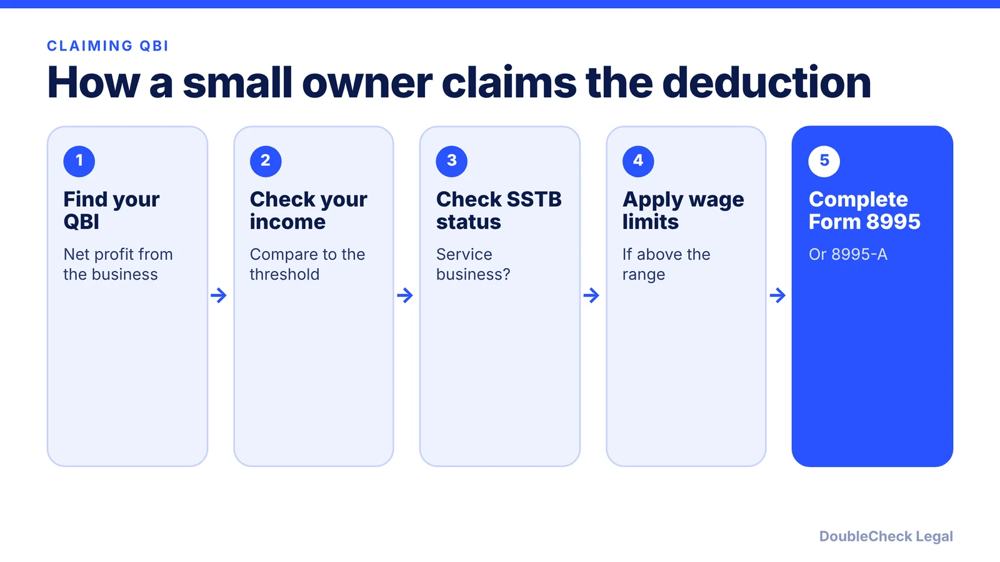

*Is the 20% pass-through deduction still alive in 2026? Here is what the 2025 tax law changed, as of November 2026.*

**Key takeaways:**

- The Section 199A deduction is permanent after the One Big Beautiful Bill Act.
- It remains up to 20% of qualified business income for sole proprietors, partners, and S corporation owners.
- From 2026 the phase-in range is $75,000 (single) and $150,000 (joint), and a $400 minimum may apply.
- Verify your thresholds on the IRS Form 8995 instructions.

## 1. The quick answer

**Quick answer:** The qualified business income (QBI) deduction under Section 199A is now permanent. The One Big Beautiful Bill Act removed the end-of-2025 expiration, so eligible owners of sole proprietorships, partnerships, and S corporations can keep deducting up to 20% of qualified business income, per RSM and Warren Averett. Starting in 2026, the income phase-in range widens and a $400 minimum deduction applies to some owners with at least $1,000 of QBI.

## 2. What changed in 2026

Before the 2025 law, Section 199A was scheduled to expire after tax years ending on or before December 31, 2025. Per RSM, it is now permanent for noncorporate taxpayers. Warren Averett adds that there are no changes for 2025, and the new provisions apply starting in 2026.

Two changes begin in 2026, per RSM, Warren Averett, and ThinkAdvisor:

- **Wider phase-in range.** Above the income threshold, limits based on specified service trade or business (SSTB) status, W-2 wages, and business property phase in over $75,000 for single filers (up from $50,000) and $150,000 for joint filers (up from $100,000).
- **$400 minimum deduction.** An applicable taxpayer, meaning one with at least $1,000 of aggregate QBI from active businesses in which they materially participate, gets a minimum deduction of $400. Warren Averett says it will be adjusted for inflation.

The 2026 taxable income threshold amounts are published by the IRS each year; we did not verify the exact figures, so check the Form 8995 instructions.

## 3. Who gets it and how the limits work

Per Warren Averett, QBI comes from S corporations, partnerships, and sole proprietorships and is claimed on the owner's individual return. It is not available through a regular C corporation, which pays its own tax, as RSM's description of a deduction for noncorporate taxpayers indicates.

How the limits work, per Warren Averett:

- **Below the income threshold:** the 20% deduction generally applies without the wage and property tests.
- **Above it, non-SSTB businesses:** you can still qualify, but the deduction is limited using W-2 wages and business property.
- **Above it, SSTBs:** fields such as health, law, consulting, investment management, and athletics face a phase-out that can reduce the deduction to zero at high incomes.

For a solo owner, QBI is based on net business profit, so it interacts with your tax calculations. Read [self-employment tax for a solo business owner](/blog/self-employment-tax-solo-business-owner-2026/) for the other half of the picture, and [quarterly estimated taxes](/blog/quarterly-estimated-taxes-solo-business-owner/) for how the deduction feeds your payments.

## 4. Planning points for small business owners

**Entity choice.** An LLC with one owner is generally taxed as a sole proprietorship, so it is eligible; see [single-member LLC taxes](/blog/single-member-llc-taxes-disregarded-entity/). An LLC that elects C corporation status is not a pass-through, so compare options in [LLC vs. C corp for startups](/blog/llc-vs-c-corp-startups/).

**Record keeping.** Keep profit-and-loss statements by business, and W-2 wage records if you have employees, since higher earners use them for the limit. If you run more than one business, how you group them can matter, so ask a CPA.

**Minimum deduction.** The $400 minimum may help owners with small profits, but only those who materially participate and meet the $1,000 QBI test, per ThinkAdvisor.

**Do not overpromise.** Your result depends on income, filing status, and business type. Content creators and online sellers can read [LLCs for content creators](/blog/llc-for-content-creators-influencers/) and [forming an LLC as an e-commerce seller](/blog/how-to-form-llc-amazon-seller-ecommerce/). A CPA can confirm your exact deduction.

## Where DoubleCheck fits

[DoubleCheck](https://www.contactdoublecheck.com) helps businesses and founders start legal work with AI, verify it, and, when professional advice is warranted, connect with an independent attorney, including for immigration questions. Attorney availability and practice areas vary. Attorneys on DoubleCheck are independent professionals; an attorney-client relationship forms only if an attorney accepts your engagement.

**Sources:** [RSM on the permanent QBI deduction](https://www.rsmus.com/insights/services/business-tax/obbba-tax-qbi-deduction); [Warren Averett on QBI under the One Big Beautiful Bill](https://warrenaverett.com/insights/one-big-beautiful-bill-breakdown-qualified-business-income); [ThinkAdvisor on small business changes](https://www.thinkadvisor.com/tax-facts/2025/07/10/343-in-trumps-big-beautiful-bill-impact-on-small-business-and-individual-clients/).

## FAQ

**Is the QBI deduction permanent?**

Yes. Per RSM, the One Big Beautiful Bill Act made the Section 199A deduction permanent for noncorporate taxpayers, so the end-of-2025 expiration no longer applies.

**How much is the QBI deduction in 2026?**

Up to 20% of qualified business income, per Warren Averett, subject to income-based limits. A $400 minimum applies to some taxpayers with at least $1,000 of QBI from businesses in which they materially participate.

**What changed for QBI in 2026?**

Per RSM and Warren Averett, the phase-in range above the income threshold widened to $75,000 for single filers and $150,000 for joint filers, and the $400 minimum deduction began.

**Can an LLC owner claim the QBI deduction?**

Generally yes if the LLC is taxed as a sole proprietorship, partnership, or S corporation, since QBI comes from those pass-through types, per Warren Averett. A C corporation is not eligible.

---

*General information only. This article is not legal, tax, investment, or accounting advice.*
