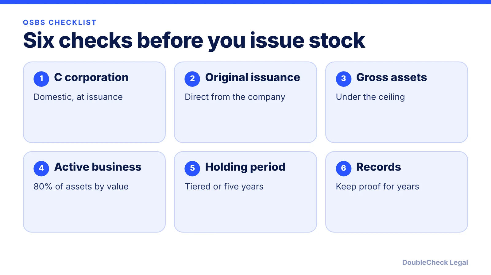
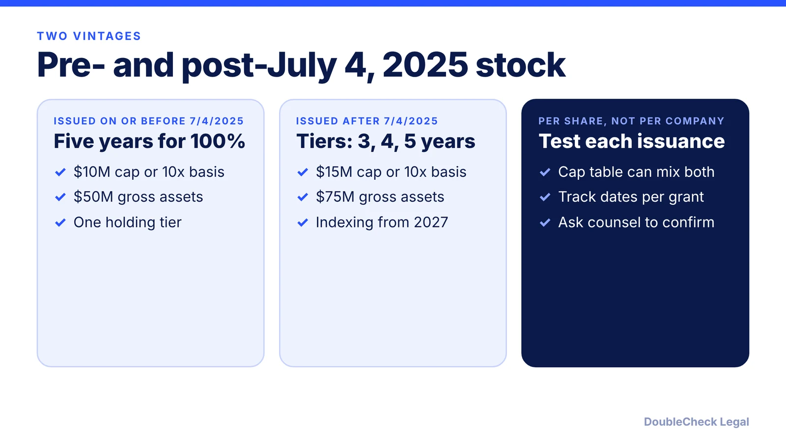

*A pre-issuance checklist for preserving QSBS eligibility, including what changed for stock issued after July 4, 2025.*

**Key takeaways:**

- QSBS needs a domestic C corporation issuing stock directly to you for cash, property or services (per Rho).
- Gross assets are tested before and right after issuance; the ceiling is $75M for stock issued after July 4, 2025 (per The Startup Law Blog).
- The 2025 law added 50% and 75% exclusion tiers at three and four years, for stock issued after July 4, 2025 only (per RSM, Surgent).
- Review redemptions and keep issuance, asset and active-business records for the whole holding period.

## 1. The quick answer

**Quick answer:** QSBS (qualified small business stock, Section 1202) can exclude part or all of the gain when you sell startup stock, but eligibility is decided when the stock is issued and kept through the holding period. The core checklist: a domestic C corporation issues the stock directly to you for cash, services or property; the company's aggregate gross assets stay under the ceiling; at least 80% of assets are used in an active qualified business; you hold long enough; and the company avoids certain redemptions. Per Rho's 2026 checklist, stock issued after July 4, 2025 uses a $75 million gross assets ceiling, while older stock keeps $50 million. This post is a pre-issuance checklist. For the basics, see our [QSBS explainer](/blog/qsbs-section-1202-explained-startup-founders/) and [does my startup qualify](/blog/does-my-startup-qualify-for-qsbs/).

## 2. The checklist, item by item

**1. Entity type.** Per Rho, the issuer must be a domestic C corporation when the stock is issued and for substantially all of the holding period; S corporations and LLCs do not issue QSBS. If you started as an LLC, Rho says the clock starts at conversion and earlier appreciation does not qualify. See [converting an LLC to a C-corp before fundraising](/blog/convert-llc-to-c-corp-before-fundraising/) and [LLC vs C-corp for startups](/blog/llc-vs-c-corp-startups/).

**2. Original issuance.** The stock must come directly from the corporation for money, property or services. Rho notes that secondary purchases from other shareholders do not qualify. FBT Gibbons adds that satisfaction of this requirement should be documented.

**3. Gross assets test.** Per The Startup Law Blog (April 2026), aggregate gross assets are measured as cash plus the adjusted tax basis of other property, not company valuation, and tested both before issuance and immediately after, including the proceeds. The ceiling is $50 million for stock issued on or before July 4, 2025 and $75 million for later issuances, with indexing after 2026.

**4. Active business.** Per FBT Gibbons, at least 80% by value of assets must be used in the active conduct of a qualified trade or business. Excess non-operating cash or passive investments can cause a failure, with an exception for working capital and research needs of a start-up business. Excluded fields include many professional services, consulting, brokerage, banking, insurance, farming, mining, hotels and restaurants, plus businesses whose main asset is employee reputation or skill.

**5. Holding period.** Covered in the next section, because it depends on the issuance date.

**6. Redemptions.** Covered below, because this is where well-meaning cleanups go wrong.

## 3. Holding period and the 2025 law change

**What changed.** The One Big Beautiful Bill Act was signed July 4, 2025. Per RSM (July 2025) and Surgent (April 2026), the changes apply only to stock issued after July 4, 2025. Each share is tested under the rules in force when it was issued, so a cap table can hold both vintages (Rho).

- **Issued after July 4, 2025:** per RSM and Surgent, a 50% exclusion at three years, 75% at four years and 100% at five or more years. Surgent says the unexcluded gain on the three- and four-year tiers is taxed at 28%, and RSM adds that the net investment tax may also apply.
- **Per-taxpayer cap:** Surgent (April 2026) says the flat dollar component rose from $10 million to $15 million, with the greater of that or 10 times adjusted basis applying, and annual inflation adjustments beginning in 2027.
- **Issued on or before July 4, 2025:** Surgent says the five-year holding period, $10 million cap (or 10x basis) and $50 million threshold continue.

**Start dates matter.** Per Rho, the holding period for an exercised option starts at exercise, not grant. For founder stock that vests, Rho states the 83(b) election must be filed within 30 days of grant: see our [83(b) election guide](/blog/83b-election-startup-founders/) and [cofounder vesting](/blog/cofounder-vesting-cliff-explained/).

Whether a given share qualifies depends on facts such as the exact issuance date and your state tax treatment. Do not assume the new tiers apply to older shares.

## 4. Issuance and redemption pitfalls, and keeping records

**Redemption traps.** Per FBT Gibbons, redemptions from the holder or a related person, or significant redemptions from any shareholder, can make stock ineligible, so review past buybacks and restrict later ones. Per The Startup Law Blog (April 2026), the related-person look-back covers a four-year period beginning two years before issuance, with a de minimis rule (over $10,000 and over 2% in purchase percentages), and the significant-redemption window is two years beginning one year before issuance, with a 5% value condition. It also lists exceptions for employees or directors, death, disability, divorce and certain transfers, which should be documented. A founder buyback, a repurchase on departure or a tender offer is worth checking before it happens.

**Other pitfalls to watch:**
- Buying stock from another shareholder instead of from the company.
- Letting cash pile up beyond reasonable working capital, which can strain the 80% test (Rho).
- Issuing stock after gross assets cross the ceiling. Rho notes earlier stock stays qualified, but new issuances do not.
- Missing the 83(b) deadline on vesting founder stock.

**Documentation.** FBT Gibbons says good records are critical; The Startup Law Blog says contemporaneous documentation is the best defense since the IRS can challenge a claim years after a sale. Keep:
- Stock purchase or grant documents showing original issuance
- Board approvals and authorization records
- Financial records supporting the gross assets test
- Active-business records through the holding period
- 83(b) filing confirmation and any 409A valuation
- Records of any company stock redemptions

**When to handle it yourself vs. get an attorney.** Making your own checklist and collecting records is something you can do, and AI can help you organize it. Get an attorney or tax adviser to review before you convert an entity, issue stock near a financing, do a buyback, or file a claim, since a single missed step can cost the exclusion. See [how to incorporate in Delaware](/blog/how-to-incorporate-in-delaware-step-by-step/), [incorporating a SaaS or AI startup](/blog/how-to-incorporate-saas-ai-startup-delaware-c-corp/), the [co-founder agreement](/blog/co-founder-agreement-startups/) and [how to choose a good lawyer](/blog/how-to-choose-good-lawyer/).

**Related reading:** [QSBS documentation to keep](/blog/qsbs-documentation-what-founders-should-keep-for-the-holding-period/); [QSBS exit checklist](/blog/qsbs-exit-checklist-what-to-verify-before-you-sell-your-stock/)

## Where DoubleCheck fits

[DoubleCheck](https://www.contactdoublecheck.com) helps businesses and founders start legal work with AI, verify it, and, when professional advice is warranted, connect with an independent attorney, including for immigration questions. Attorney availability and practice areas vary. Attorneys on DoubleCheck are independent professionals; an attorney-client relationship forms only if an attorney accepts your engagement.

**Sources:** [Rho, QSBS eligibility in 2026](https://www.rho.co/blog/qsbs-eligibility); [FBT Gibbons, Section 1202 checklist](https://fbtgibbons.com/section-1202-qualification-checklist-and-planning-pointers/); [The Startup Law Blog, QSBS checklist (April 2026)](https://www.thestartuplawblog.com/qsbs-eligibility-checklist-section-1202/); [RSM, OBBBA and QSBS (July 2025)](https://www.rsmus.com/insights/services/business-tax/obbba-tax-qsbs); [Surgent, Section 1202 and OBBBA (April 2026)](https://blog.surgentcpe.com/section-1202-qsbs-2026-obbba-changes). IRS and Congress pages were not fetched, so these secondary sources are named; confirm figures against current law.

## FAQ

**What is on a QSBS checklist?**

Per Rho and FBT Gibbons: a domestic C corporation issuer, original issuance for cash, property or services, aggregate gross assets under the ceiling, at least 80% of assets used in an active qualified business, a sufficient holding period, no disqualifying redemptions and good records.

**Did the 2025 law change QSBS?**

Yes, for stock issued after July 4, 2025. Per RSM and Surgent, exclusion tiers are 50% at three years, 75% at four and 100% at five, the gross assets ceiling rose from $50 million to $75 million, and the flat cap rose from $10 million to $15 million.

**Can LLC or S corporation stock be QSBS?**

No. Per Rho, S corporations and LLCs do not issue QSBS. If you convert from an LLC, the clock starts at conversion and earlier appreciation does not qualify.

**Do stock buybacks affect QSBS?**

They can. Per FBT Gibbons, redemptions from the holder or a related person, or significant redemptions from any shareholder, can make stock ineligible. Check the look-back windows and exceptions with a tax adviser before any buyback.

---

*General information only. This article is not legal, tax, investment, or accounting advice.*
