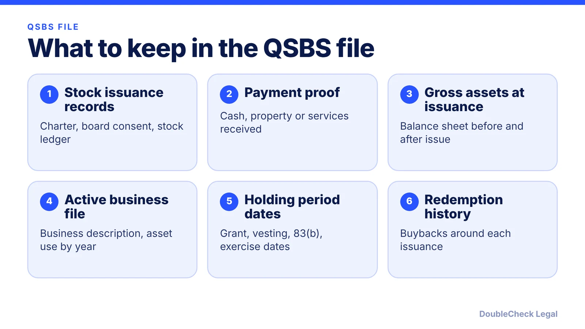
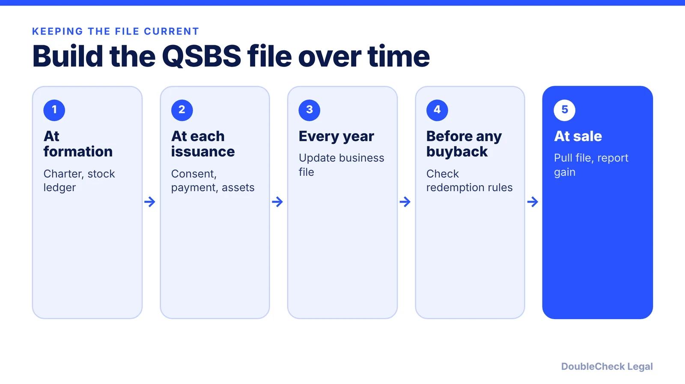

*Your QSBS exclusion is only as strong as your paper trail. Here is what to keep, and why, as of November 2026.*

**Key takeaways:**

- Keep four sets: issuance records, gross assets at issuance, active business evidence and holding period dates.
- The burden of proof is on the taxpayer, per EisnerAmper (September 2026).
- Stock issued after July 4, 2025 has a 3, 4 and 5 year tier structure and a $75 million gross assets ceiling.
- Log 83(b) elections, redemptions and option exercises as they happen, not at exit.

## 1. The quick answer

**Quick answer:** For QSBS documentation over the holding period, founders should keep four sets of records: (1) stock issuance records showing the shares were originally issued by a domestic C corporation for money, property or services, (2) a gross assets statement for each issuance date, (3) evidence the company ran a qualifying active business, and (4) dates that prove how long each block of stock was held. As of November 2026, stock issued after July 4, 2025 can earn a 50% exclusion at three years, 75% at four and 100% at five, per the statute text on Cornell LII and RSM. The records matter because EisnerAmper (September 23, 2026) says the burden of proving QSBS eligibility falls on the taxpayer, not the corporation.

This post is about the paper trail. For the eligibility tests themselves see [QSBS explained for founders](/blog/qsbs-section-1202-explained-startup-founders/) and the [QSBS checklist before you issue stock](/blog/qsbs-checklist-before-you-issue-stock-startups/).

## 2. The four record sets, in detail

**1. Stock issuance records.** The statute (26 U.S.C. 1202, as shown on Cornell LII with the July 4, 2025 amendments) requires stock to come from a domestic C corporation and be acquired at original issue, for money or property (not stock) or as pay for services. Keep the certificate of incorporation, board approvals, stock purchase agreements, the stock ledger, and proof of payment. Plante Moran lists articles of incorporation, stock issuance records, contribution agreements, redemption records, shareholder agreements, balance sheets and Section 83(b) elections as key documents. See [issuing founder stock](/blog/issue-founder-stock-purchase-agreement/).

**2. Gross assets statement.** Per the statute, aggregate gross assets are tested at all times before issuance and immediately after it, counting the money received. The ceiling is $75 million for stock issued after July 4, 2025 and $50 million for earlier stock. Assets are measured as cash plus adjusted bases, with contributed property valued at fair market value when contributed. Plante Moran says the test is generally based on tax basis, not book value. Save a balance sheet and a basis schedule for every financing, not just the first.

**3. Active business evidence.** The statute requires at least 80% of asset value to be used in the active conduct of qualified businesses during substantially all of the holding period. Businesses such as health, law, accounting, consulting, financial services, farming, and hotels or restaurants are excluded. Working capital counts as active use, but after two years of existence no more than 50% of assets can qualify that way. Plante Moran adds that startup and R&D work counts when tied to an anticipated qualified business, and that pivots into excluded activity can disqualify stock. Keep a one-page business description, updated each year, plus a simple asset-use summary.

**4. Holding period dates.** Keep the acquisition date for every block of stock. EisnerAmper advises tracking each block separately. For options, CohnReznick (July 20, 2026) says the holding period starts at exercise, not grant.

## 3. Restricted stock, 83(b) and redemptions

Two areas generate the most missing paperwork.

**Restricted founder stock.** According to Strictly Business Law Blog (December 2023), without a timely 83(b) election the holding period runs share by share from vesting, and with a timely election it starts at grant for all shares. The election is due within 30 days of grant. Keep the filed election and proof of mailing with the grant documents. See [83(b) elections](/blog/83b-election-startup-founders/) and [co-founder vesting](/blog/cofounder-vesting-cliff-explained/).

**Redemptions and buybacks.** Under the statute, stock is disqualified if the company bought stock from the taxpayer or a related person in the four-year window starting two years before issuance. Stock is also disqualified if repurchases in the two-year window starting one year before issuance exceeded 5% of total stock value. Keep a redemption log, and have a CPA or attorney review any buyback before the board approves it, a point CohnReznick also makes. This matters in [co-founder buyouts](/blog/how-to-remove-or-buy-out-a-co-founder/).

## 4. Who holds what, and when to get help

EisnerAmper (September 23, 2026) says corporations are not required to certify QSBS eligibility when they issue stock, so claimants rely on capitalization records and other history. CohnReznick says the company generally holds issuer-level records while each shareholder evaluates its own position, and that certifications work best when negotiated at formation or financing rather than at an exit. The statute also says the corporation must agree to submit reports to the Treasury and shareholders as required (section 1202(d)(1)(C)). When you sell, the IRS 2025 Form 8949 instructions say to enter code Q in column (f) and the excluded amount as a negative number in column (g). Those instructions do not list any attachments for code Q, so ask your preparer what to keep.

**Handle yourself vs. get help.** A founder can build the folder: a shared drive with the four record sets, a one-page business description, and a dated change log. Use AI to organize and flag gaps, then verify it (see [verify AI-generated legal documents](/blog/verify-ai-generated-legal-document/)). Bring an attorney or CPA in before you issue stock to a new investor, convert from an LLC ([convert LLC to C corp](/blog/convert-llc-to-c-corp-before-fundraising/)), do a buyback, pivot your business, or sell. Also see [does my startup qualify for QSBS](/blog/does-my-startup-qualify-for-qsbs/).

## Where DoubleCheck fits

[DoubleCheck](https://www.contactdoublecheck.com) helps businesses and founders start legal work with AI, verify it, and, when professional advice is warranted, connect with an independent attorney, including for immigration questions. Attorney availability and practice areas vary. Attorneys on DoubleCheck are independent professionals; an attorney-client relationship forms only if an attorney accepts your engagement.

**Sources:** [Cornell LII, 26 U.S.C. 1202](https://www.law.cornell.edu/uscode/text/26/1202); [RSM, OBBBA QSBS (July 18, 2025)](https://www.rsmus.com/insights/services/business-tax/obbba-tax-qsbs); [EisnerAmper (September 23, 2026)](https://www.eisneramper.com/insights/private-equity/qsbs-planning-for-private-equity-under-obbba-rules-0926/); [CohnReznick (July 20, 2026)](https://www.cohnreznick.com/insights/section-1202-qsbs-after-the-obbb/); [Plante Moran](https://www.plantemoran.com/explore-our-thinking/insight/2025/01/dispelling-section-1202-myths-for-startup-companies); [Strictly Business Law Blog (December 7, 2023)](https://www.strictlybusinesslawblog.com/2023/12/07/the-qsbs-5-year-holding-period-and-section-83b); [IRS Form 8949 instructions (2025)](https://irs.gov/pub//irs-pdf/i8949.pdf).

## FAQ

**What QSBS documentation do founders need to keep for the holding period?**

Keep stock issuance records, proof of payment, a gross assets statement for each issuance, evidence of a qualifying active business, redemption records, and dates that prove each holding period, including any 83(b) election. Plante Moran and EisnerAmper both stress keeping these from issuance through exit.

**Does the company have to certify that my stock is QSBS?**

Not automatically. EisnerAmper (September 2026) says corporations are not required to certify QSBS eligibility at issuance, so shareholders rely on capitalization records. CohnReznick suggests negotiating a certification at formation or financing.

**Did the 2025 law change what I should record?**

Yes. The acquisition date now decides which rules apply: stock acquired after July 4, 2025 has 3, 4 and 5 year tiers and a $75 million gross assets ceiling, while earlier stock has the older $50 million ceiling, per Cornell LII.

**How do I prove my QSBS holding period if I hold restricted stock or options?**

Keep the grant, vesting and exercise dates. Per Strictly Business Law Blog, a timely 83(b) election starts the clock at grant for all shares, and per CohnReznick the holding period for options starts at exercise. Confirm your facts with a tax professional.

---

*General information only. This article is not legal, tax, investment, or accounting advice.*
