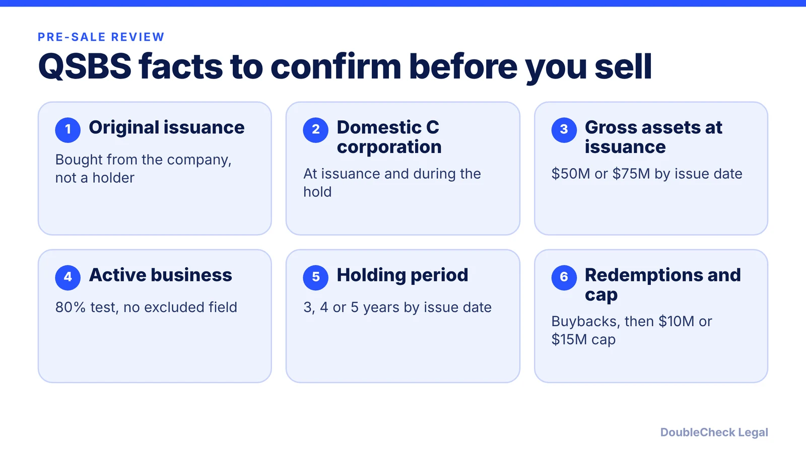
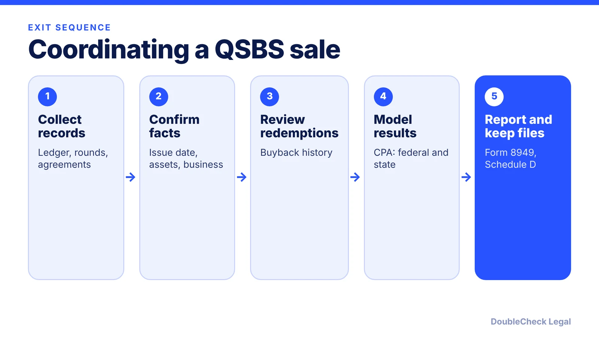

*A pre-sale QSBS exit checklist: what to confirm about your stock, the company, the 2025 changes and the tax forms before a sale closes, as of November 2026.*

**Key takeaways:**

- Confirm original issuance, C corporation status and the asset test at issuance before anything else.
- Stock issued after July 4, 2025 has 3, 4 and 5 year exclusion tiers; older stock generally needs more than five years.
- Check redemptions around issuance and the per-issuer cap before modeling the gain.
- State conformity varies and Form 8949 code Q reporting needs care, so coordinate your CPA and attorney early.

## 1. The quick answer

**Quick answer:** A QSBS exit checklist is the list of facts you confirm before a sale closes, so you know whether Section 1202 can exclude any of the gain. Confirm six things: the stock was originally issued by a domestic C corporation, the company passed the gross assets test when the stock was issued, it ran a qualified active business, you held the shares long enough, no disqualifying redemptions happened around your issuance, and your gain fits within the per-issuer cap. Then check your state and how the sale is reported. As of November 2026, stock issued after July 4, 2025 can qualify for a 50% exclusion at three years, 75% at four and 100% at five, per law-firm summaries of the 2025 law.

This is a pre-sale verification list, not a general explainer. For the rules themselves see [QSBS and Section 1202 explained](/blog/qsbs-section-1202-explained-startup-founders/); for issuing stock correctly see the [QSBS checklist before you issue stock](/blog/qsbs-checklist-before-you-issue-stock-startups/); and for the paper trail see [QSBS documentation to keep for the holding period](/blog/qsbs-documentation-what-founders-should-keep-for-the-holding-period/).

## 2. Facts about the stock and the company

Start with facts that are fixed at or near the date you received the shares. They are the ones you cannot fix later, so check them first.

**Original issuance.** Per FBT Gibbons, the stock must be issued by the corporation for cash, services or property, and the original holder generally has to be the seller, with exceptions for gifts, transfers at death and certain partnership distributions. Per The Startup Law Blog (Joe Wallin, updated October 22, 2026), shares bought from another shareholder in a secondary purchase do not qualify, while gifts and inheritances can carry over the holding period.

**C corporation status.** FBT Gibbons says only a domestic C corporation can issue QSBS and S corporation stock is excluded. If you started as an LLC or S corporation, the date of conversion and the date you received shares in the C corporation both matter. See [converting an LLC to a C corp before fundraising](/blog/convert-llc-to-c-corp-before-fundraising/) and [LLC vs C corp for startups](/blog/llc-vs-c-corp-startups/).

**Asset test at issuance.** Wallin writes that the gross assets limit is $50 million for stock issued on or before July 4, 2025 and $75 million for later issuances, both indexed after 2026. The test is run before and immediately after issuance, and measures cash plus the adjusted tax basis of other property, not valuation or book value. Growth after a qualifying issuance does not by itself disqualify earlier shares. This is a point-in-time question for each financing round, so a founder with shares from several rounds may have different answers per round.

**Active business.** Both sources describe an 80% by value test during substantially all of the holding period, with excluded fields such as professional services, banking, insurance, farming, mining, hotels and restaurants. FBT Gibbons notes that holding more than 10% of asset value in portfolio stock or non-operating real estate can break the test, with a working capital exception for a startup that is building the business.

Ask the company for its original stock records, a cap table, and any QSBS representation it gave at issuance. A written representation is not proof, but it shows what the company believed and when.

## 3. Holding period and the 2025 changes

The holding period depends on when you acquired the stock, and 2025 legislation added a second tier of rules.

- **Stock acquired after July 4, 2025:** per RSM and Hughes Hubbard, 50% exclusion at three years, 75% at four years, and 100% at five years or more.
- **Stock acquired September 27, 2010 through July 4, 2025:** per Wallin, more than five years is needed for the 100% exclusion. Earlier dates fall under older 50% or 75% regimes.
- **Partial tiers:** per RSM and Wallin, the non-excluded part of the gain can be taxed at up to 28%, and the 3.8% net investment income tax may also apply.

Per Wallin, gifts and inheritances can carry over the holding period, and Hughes Hubbard refers to holding-period tacking rules. Wallin also notes that a Section 1045 rollover is possible for stock held more than six months, subject to requirements. FBT Gibbons says the rollover must be completed within 60 days of sale. If you are close to a milestone, count days carefully using the issuance date on the stock record, not the date a grant was promised. See [83(b) election for startup founders](/blog/83b-election-startup-founders/) and [issuing a founder stock purchase agreement](/blog/issue-founder-stock-purchase-agreement/) for why the acquisition date can differ from the date you started working.

## 4. Redemption rules and exclusion limits

**Redemptions.** A company buying back its own stock can taint shares issued near that buyback. Wallin describes two tests. The related-person test looks at a four-year period starting two years before each issuance, with a de minimis threshold of more than $10,000 in purchases and purchase percentages summing to more than 2%. The significant-redemption test looks at a two-year period starting one year before each issuance, and needs both the de minimis condition and a 5% of stock value condition to be exceeded. Exceptions exist for death, disability, divorce and certain employee or director terminations, each with its own conditions. These are technical rules, so ask for the buyback history rather than relying on memory.

**Exclusion limits.** Per RSM and Hughes Hubbard, the per-issuer cap rose from the greater of $10 million or 10 times basis to the greater of $15 million or 10 times basis for stock acquired after July 4, 2025, and the figures are indexed for inflation. Wallin adds that the dollar limit is per issuer and per taxpayer, not additive across rounds, and that partial tiers reduce the exclusion: his example is $15 million of eligible gain at the 50% tier giving a $7.5 million exclusion.

What to ask for, fact by fact:

- **Issue date and type:** the stock ledger and the grant or purchase agreement.
- **Asset test:** the balance sheet at issuance and the financing documents.
- **Active business:** the business description and any pivots.
- **Buybacks:** the company repurchase history.
- **Basis and gain:** purchase price, exercise cost and the deal statement.

Do not do arithmetic on your own gain with outdated numbers. Ask your CPA to model both the exclusion and the amount above the cap, plus any partial-tier tax.

## 5. State conformity and reporting on tax forms

**State tax.** Federal exclusion does not always carry over. FBT Gibbons (August 8, 2025) lists California, Pennsylvania, Mississippi and Alabama as states that do not conform to Section 1202, and says New Jersey conforms for tax years beginning in 2026. Other sources group the states differently, so lists can disagree. Wallin (October 2026) says Oregon requires an addition for gain excluded federally for tax years beginning on or after January 1, 2026, and describes a Washington regime where partial exclusions or gain above the limit can remain taxable. Because your state is based on where you live, where you worked and how the deal is sourced, ask the CPA which state returns apply, and check that conclusion against your own state tax agency. See [Delaware corporation doing business in California](/blog/delaware-corporation-doing-business-in-california/) if your company is incorporated in one state and run from another.

**Federal reporting.** Per the IRS Instructions for Form 8949, you report the sale as you would without the exclusion, enter code Q in column (f) and enter the exclusion as a negative amount in column (g). Instead.com (February 12, 2026) adds that separate Form 8949 sections may be needed for each combination of acquisition date range and exclusion percentage. Gain then flows to Schedule D. For a Section 1045 rollover, the same article says Form 8949 uses code R with a statement. Installment sales have separate Schedule D instructions per the IRS.

**Records.** Keep brokerage or cap-table statements, stock certificates or ledger entries, the purchase agreement, the closing statement and any QSBS certificate or representation from the company.

## 6. How to coordinate with a CPA and an attorney

Put the roles in writing before signing a letter of intent.

- **Corporate attorney:** pulls stock records, checks issuance mechanics, redemptions and how the deal is structured, and flags whether the stock class matters.
- **CPA or tax adviser:** confirms the tax conclusion, models the exclusion and state tax, and files the return.
- **You:** gather the facts and share timelines early, because a closing date moved by a few weeks can cross a holding-period tier. If the purchase agreement includes tax representations, ask who is responsible for the company's QSBS statement, and do not assume the acquirer will confirm it for you. You can start the fact collection with AI, for example by sorting records into the table above, but the conclusion on eligibility is a legal and tax judgment that a professional should verify. Related: [how to prepare for a first meeting with a startup lawyer](/blog/how-to-prepare-for-first-meeting-with-startup-lawyer/) and [does my startup qualify for QSBS](/blog/does-my-startup-qualify-for-qsbs/).

**Related reading:** [Earnout Clauses Explained: Selling a Small Business](/blog/earnout-clauses-explained-selling-a-small-business/); [Secondary Sales for Founders: Startup Liquidity Rules to Know](/blog/secondary-sales-founder-liquidity-startup-rules/)

## Where DoubleCheck fits

[DoubleCheck](https://www.contactdoublecheck.com) helps businesses and founders start legal work with AI, verify it, and, when professional advice is warranted, connect with an independent attorney, including for immigration questions. Attorney availability and practice areas vary. Attorneys on DoubleCheck are independent professionals; an attorney-client relationship forms only if an attorney accepts your engagement.

**Sources:** [RSM, OBBBA expands QSBS exclusions](https://www.rsmus.com/insights/services/business-tax/obbba-tax-qsbs); [Hughes Hubbard, Expansion of QSBS tax benefits (July 9, 2025)](https://www.hugheshubbard.com/news-insights/insights/expansion-of-qualified-small-business-stock-tax-benefits); [The Startup Law Blog, QSBS Checklist (updated October 22, 2026)](https://www.thestartuplawblog.com/qsbs-eligibility-checklist-section-1202/); [FBT Gibbons, Section 1202 qualification checklist](https://fbtgibbons.com/section-1202-qualification-checklist-and-planning-pointers/); [FBT Gibbons, survey of states that do not conform (Aug. 8, 2025)](https://fbtgibbons.com/section-1202-and-qsbs-a-survey-of-states-that-dont-conform-to-the-federal-treatment/); [IRS, Instructions for Form 8949](https://irs.gov/instructions/i8949); [Instead, QSBS stock sales reporting requirements (Feb. 12, 2026)](https://instead.com/resources/blog/qsbs-stock-sales-reporting-requirements-for-tax-filing). Not fetched: Vinson and Elkins Section 1202 brief (failed to load).

## FAQ

**What is a QSBS exit checklist?**

It is a list of facts to confirm before selling stock you believe is qualified small business stock: original issuance, C corporation status, the gross assets test at issuance, active business, holding period, redemptions, the exclusion cap, state tax and reporting. It does not prove eligibility by itself; a CPA or attorney should verify the conclusion.

**What changed for QSBS in 2025?**

Per RSM and Hughes Hubbard, for stock acquired after July 4, 2025 the exclusion is 50% at three years, 75% at four years and 100% at five years, the per-issuer cap rose to the greater of $15 million or 10 times basis, and the gross assets limit rose from $50 million to $75 million, with inflation indexing.

**Do all states follow the federal QSBS exclusion?**

No. FBT Gibbons (August 2025) lists California, Pennsylvania, Mississippi and Alabama as nonconforming and says New Jersey conforms beginning in 2026, and The Startup Law Blog notes Oregon changes for 2026. Lists differ by source, so confirm your state with a CPA or the state tax agency.

**How is a QSBS sale reported on a federal return?**

Per the IRS Instructions for Form 8949, you report the sale as if no exclusion applied, enter code Q in column (f) and the exclusion as a negative amount in column (g). Gain then flows to Schedule D. A CPA should confirm the details for your return.

**Who should I ask before I sign a sale agreement?**

Ask a corporate attorney to verify the stock records, redemptions and deal structure, and a CPA to model the federal and state result. Do this before signing, because holding-period and structure points are hard to change after closing.

---

*General information only. This article is not legal, tax, investment, or accounting advice.*
