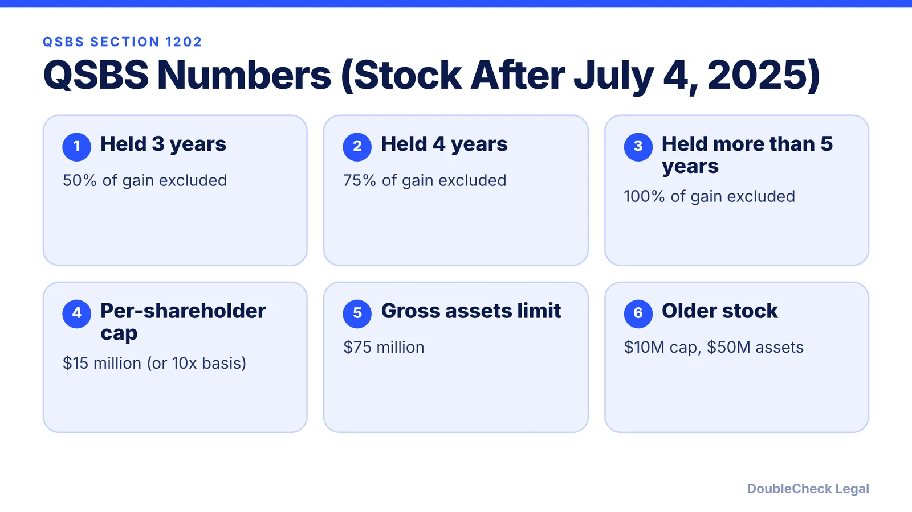
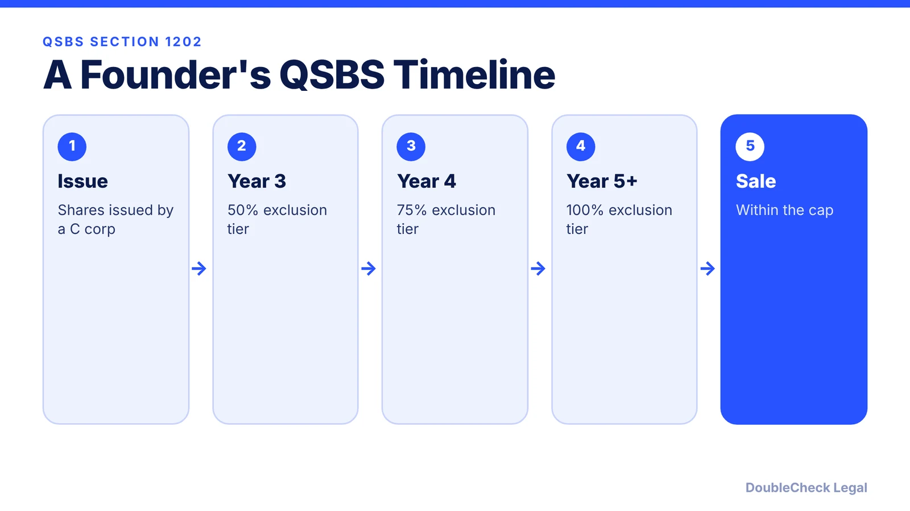

*QSBS can make a founder's sale far cheaper in tax. Here are the numbers and dates from a Cooley cheat sheet.*

**Key takeaways:**

- For stock acquired after July 4, 2025: 50% exclusion at 3 years, 75% at 4 years, 100% after more than 5 years.
- The per-shareholder cap is the greater of $15 million or 10 times basis; the gross asset limit is $75 million.
- Older stock uses a $10 million cap and a $50 million asset limit.
- The issuer must be a C corporation.

## 1. What QSBS is

Qualified small business stock (QSBS) under Section 1202 lets eligible shareholders exclude part or all of the gain when they sell stock in a qualifying small C corporation, if they meet holding-period and other requirements. For founders, it is one reason entity type and the date shares are issued matter. This article summarizes the rules in a Cooley cheat sheet; it is not tax advice.

## 2. The 2025 change in numbers

The rules depend on when the shares were acquired. For stock acquired after July 4, 2025, Cooley lists:

- The excludable gain is capped at the greater of $15 million (reduced by amounts excluded in prior years from the same company) or 10 times the shareholder's aggregate adjusted basis in the company's QSBS.
- The company's aggregate gross assets (adjusted tax basis) must be at or below $75 million at all times after August 10, 1993, and immediately after the issuance. Cooley notes the $75 million figure is adjusted for inflation starting in 2027.
- Older stock uses the $10 million cap and $50 million asset limit.

## 3. Older stock

For stock acquired before the July 2025 change, the exclusion depends on the acquisition date: 50% after more than five years for stock acquired before February 18, 2009; 75% after more than five years for stock acquired February 18, 2009 to September 27, 2010; and 100% after more than five years for stock acquired after September 27, 2010.

## 4. Timeline for a founder

Founder stock timing interacts with [vesting](/blog/cofounder-vesting-cliff-explained/) and the [83(b) election](/blog/83b-election-startup-founders/); ask a tax professional how your facts fit.

## 5. What can break it

Cooley cautions that significant redemptions, reorganizations, or conversions can compromise QSBS treatment. See the [qualification checklist](/blog/does-my-startup-qualify-for-qsbs/) for the C corporation, original issuance, and active business tests.

## 6. Why this affects your entity choice

Because QSBS requires a C corporation, an LLC taxed as a partnership is not eligible. Read [LLC vs. C corp for startups](/blog/llc-vs-c-corp-startups/) and [S corp vs. C corp for venture-backed startups](/blog/s-corp-vs-c-corp-venture-backed-startup/).

## Where DoubleCheck fits

[DoubleCheck](https://www.contactdoublecheck.com) is built for businesses that start legal work with AI. Bring your question or draft, use an AI-first workflow to understand and verify it, and when professional advice is warranted, you can connect with an independent attorney. Attorneys on DoubleCheck are independent professionals; an attorney-client relationship forms only if an attorney accepts your engagement.

**Sources:** [Cooley: Qualified small business stock cheat sheet](https://www.cooley.com/-/media/cooley/pdf/qualified-small-business-stock-cheat-sheet.pdf).

## FAQ

**What is QSBS?**

Qualified small business stock under Section 1202, which can let eligible shareholders exclude part or all of the gain on sale if they meet the requirements.

**What changed after July 4, 2025?**

For stock acquired after that date, Cooley lists tiered exclusions at 3, 4, and 5 years, a $15 million cap, and a $75 million gross asset limit.

**Does an LLC qualify?**

The issuer must be a C corporation; pass-throughs are not eligible, per Cooley.

**Is this tax advice?**

No. Confirm how the rules apply to your facts with a tax professional.

---

*General information only. This article is not legal, tax, investment, or accounting advice.*
