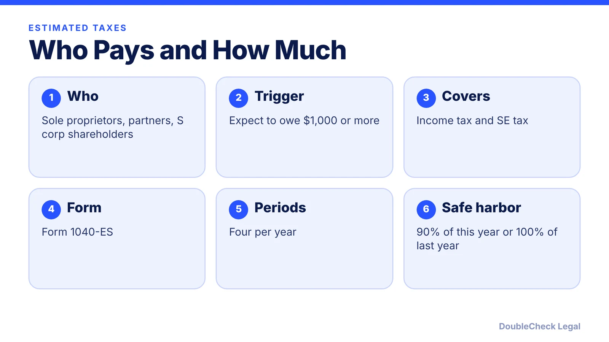
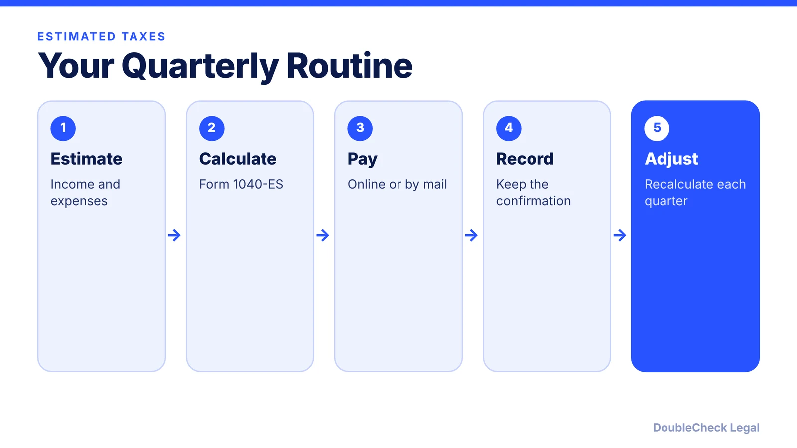
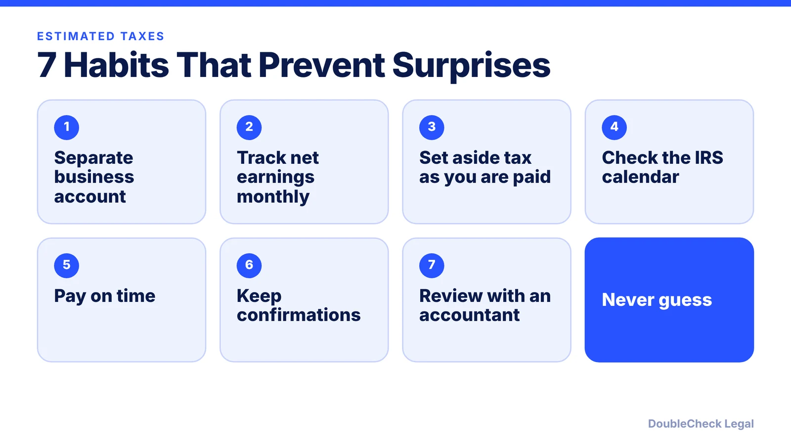

*Self-employed people usually pay tax quarterly, not once a year. Here is what the IRS says about who pays, safe harbor, and how.*

**Key takeaways:**

- The IRS says you generally need estimated payments if you are in business for yourself and expect to owe $1,000 or more.
- Safe harbor: pay the smaller of 90% of this year's tax or 100% of last year's.
- Use Form 1040-ES and pay online, by phone, by app, or by mail.
- Check Publication 505 or the IRS calendar for the current due dates.

## 1. The quick answer

**Quick answer:** If you are in business for yourself, you generally need to make estimated tax payments, according to the IRS. Individuals, including sole proprietors, partners, and S corporation shareholders, generally must pay if they expect to owe **$1,000 or more** when they file. Estimated tax covers income tax and other taxes such as self-employment tax.

## 2. Safe harbor and the penalty

You generally avoid the underpayment penalty if you owe less than $1,000 after withholding and credits. Otherwise, you must have paid the smaller of **90% of the current year's tax** or **100% of the tax shown on the prior year's return**. Farmers, fishermen, and certain higher-income taxpayers have special rules in Publication 505. Use Form 2210 to see whether you owe the penalty; if income arrived unevenly, annualizing may reduce it.

## 3. How to pay

Use Form 1040-ES to figure and pay. Start with your prior-year return as a guide, estimate income, deductions, and credits, and recalculate for later quarters if your estimate turns out off. You can mail Form 1040-ES with payment, or pay online, by phone, through the IRS app, or through your IRS online account. Weekly or monthly payments are allowed as long as you have paid enough by the end of each quarter. If a due date falls on a weekend or holiday, the payment is on time the next business day.

The IRS page does not list the four due dates; check Publication 505 or the IRS tax calendar for the current year.

## 4. Why solo founders get surprised

Income that arrives unevenly, a big client, or a good month with no withholding can leave you short. Setting aside money as you are paid and tracking [self-employment tax](/blog/self-employment-tax-solo-business-owner-2026/) helps. See also [sole proprietor vs. LLC](/blog/sole-proprietor-vs-llc-solo-founder/).

## 5. Seven habits

## Where DoubleCheck fits

[DoubleCheck](https://www.contactdoublecheck.com) is built for businesses that start legal work with AI. Bring your question or draft, use an AI-first workflow to understand and verify it, and when professional advice is warranted, you can connect with an independent attorney. Attorneys on DoubleCheck are independent professionals; an attorney-client relationship forms only if an attorney accepts your engagement.

**Sources:** [IRS: Estimated taxes](https://www.irs.gov/businesses/small-businesses-self-employed/estimated-taxes).

## FAQ

**Who must pay estimated taxes?**

Individuals, including sole proprietors, partners, and S corporation shareholders, who expect to owe $1,000 or more when they file, per the IRS.

**What is the safe harbor?**

You generally avoid the penalty if you paid the smaller of 90% of the current year's tax or 100% of the prior year's tax.

**What form do I use?**

Form 1040-ES; use Form 2210 to check for an underpayment penalty.

**Do estimated taxes cover self-employment tax?**

Yes. Estimated tax covers income tax and other taxes such as self-employment tax.

---

*General information only. This article is not legal, tax, investment, or accounting advice.*
