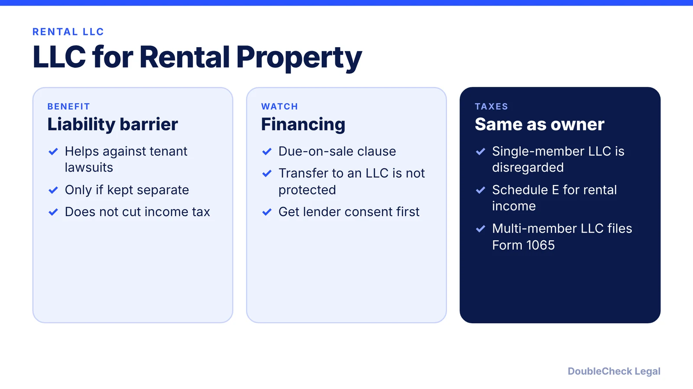
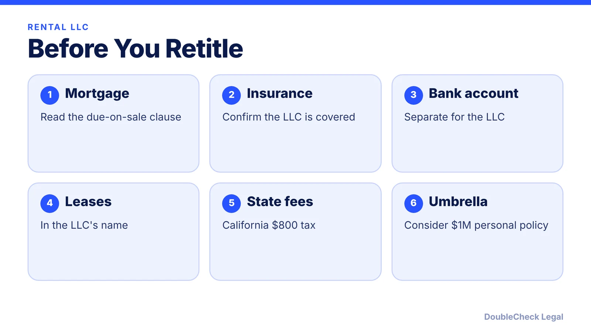

*Thinking of holding a rental in an LLC? Here is what it does, what it does not, and the mortgage clause to check first.*

**Key takeaways:**

- An LLC mainly adds a liability barrier; it does not by itself cut income tax.
- The Garn-St Germain list does not mention LLCs, so a due-on-sale clause may stay enforceable, per Morkel.
- Rental income goes on Schedule E for a single-member LLC.
- Series LLCs are recognized in only some states.

## 1. The quick answer

**Quick answer:** The main benefit of putting a rental property in an LLC is a legal barrier against tenant lawsuits, not a tax saving, and it only works if you keep the LLC separate: its own bank account, leases in the LLC's name, and no personal expenses, per Morkel Financial. Check two things first: your mortgage's due-on-sale clause and your insurance.

## 2. The due-on-sale clause

The Garn-St Germain Act (12 U.S.C. 1701j-3(d)) bars due-on-sale enforcement for certain transfers of residential property with fewer than five units, such as to a spouse or children or into certain trusts. LLCs are not in the statutory list. Morkel says a transfer to an LLC is therefore not protected, so the clause stays enforceable, and that lenders rarely accelerate performing loans but you should get the servicer's written consent first. Morkel also suggests a $1 million personal umbrella policy (about $150 to $300 a year per III estimates) as part of the plan.

## 3. Taxes and fees

Per the IRS, a single-member LLC is a disregarded entity for income tax and a multi-member LLC is a partnership by default. Rental income and expenses go on Schedule E, passive loss limits use Form 8582, and residential rentals are depreciated over 27.5 years from when the property is ready for rent, while land is not depreciable (IRS Publication 527). A security deposit you must return is not income when received. Morkel says late Form 1065 penalties are $255 per partner per month and that California charges an $800 minimum annual LLC tax ([California LLC annual tax](/blog/california-llc-annual-tax-and-fee/)).

## 4. What about a series LLC?

LegalZoom lists series LLC statutes in Delaware, Texas, Illinois, Nevada, and Wyoming, says other states may not recognize them, notes IRS final guidance is lacking, California charges $800 per series, bankruptcy treatment is unsettled, and protection can collapse with commingling. The state list comes from one source and may be incomplete. See [single-member LLC taxes](/blog/single-member-llc-taxes-disregarded-entity/) and [LLC operating agreements](/blog/llc-operating-agreement-with-ai/).

## Where DoubleCheck fits

[DoubleCheck](https://www.contactdoublecheck.com) helps businesses and founders start legal work with AI, verify it, and, when professional advice is warranted, connect with an independent attorney, including for immigration questions. Attorney availability and practice areas vary. Attorneys on DoubleCheck are independent professionals; an attorney-client relationship forms only if an attorney accepts your engagement.

**Sources:** [Morkel Financial](https://www.morkelfinancial.com/blog/do-i-need-an-llc-for-rental-property); [12 U.S.C. 1701j-3](https://www.law.cornell.edu/uscode/text/12/1701j-3); [IRS: Limited liability company](https://www.irs.gov/businesses/small-businesses-self-employed/limited-liability-company-llc); [IRS Publication 527](https://www.irs.gov/publications/p527); [LegalZoom: Series LLC](https://www.legalzoom.com/business-glossary/series-llc).

## FAQ

**Do I need an LLC for a rental property?**

Not required. Morkel says the benefit is a liability barrier, and it works only if the LLC is kept separate. Ask an attorney.

**Can the lender call my loan if I transfer the property to an LLC?**

Morkel says a transfer to an LLC is not protected under Garn-St Germain, so the clause may be enforceable. Get lender consent first.

**How is a rental LLC taxed?**

A single-member LLC is disregarded and reports on Schedule E; a multi-member LLC is a partnership by default, per the IRS.

**What is a series LLC?**

A structure with separate series under one LLC, recognized only in some states. LegalZoom says protection can collapse with commingling.

---

*General information only. This article is not legal, tax, investment, or accounting advice.*
