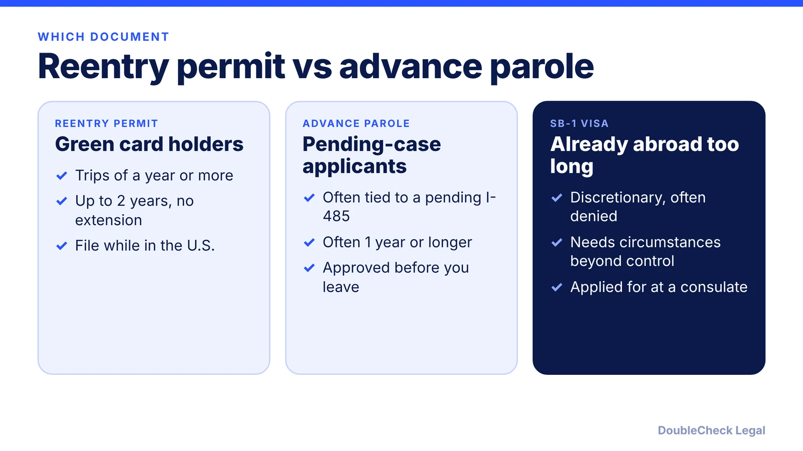
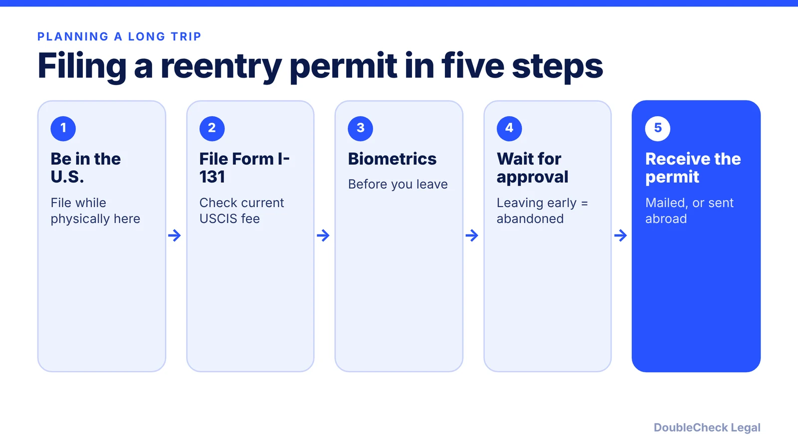

*Short version: planning a year or more abroad as a green card holder points to a reentry permit, filed while you are in the U.S.*

**Key takeaways:**

- A reentry permit is for green card holders planning a year or more abroad; it is valid up to two years and cannot be extended.
- You must be in the U.S. when you file and for biometrics; you cannot apply from abroad.
- Advance parole is commonly for people with a pending adjustment case, not for green card holders.
- If you are stuck abroad, the SB-1 returning resident visa is discretionary and often denied.

## 1. The quick answer

**Quick answer:** A reentry permit (Form I-131) is a travel document for green card holders who plan to be abroad for one year or more. Per Nolo, it is valid for no more than two years and cannot be extended, and you must be physically in the U.S. when you file and for your biometrics appointment. Advance parole is different: per CitizenPath, it is commonly used by adjustment applicants with a pending case, while a reentry permit is tied to permanent resident status, not a pending case. Per ILBSG (February 2026), a reentry permit does not guarantee reentry and does not preserve continuous residence for naturalization. If you are already abroad and cannot return in time, the SB-1 returning resident visa may be the only route, and it is discretionary.

## 2. How a reentry permit works

Per [Nolo](https://www.nolo.com/legal-encyclopedia/reentry-permits-preparing-green-card-holders-long-absences-the-us.html):

- **Who qualifies.** Most green card holders, except refugees, asylees, and crewmembers. It is aimed at anyone expecting an absence of one year or more.
- **Validity.** No more than two years, with no extension. For most holders who have been outside the U.S. for more than four years since getting the green card, it is limited to one year. Per [CitizenPath](https://citizenpath.com/form-i-131-guide/reentry-permit/), a conditional resident's permit cannot run past the end of the conditional status.
- **Where you must be.** In the U.S. when you file, and for biometrics. Per Nolo, the permit cannot be applied for from abroad. Biometrics consist of a photo, plus fingerprints for ages 14 to 79.
- **After filing.** Per CitizenPath, you can leave once biometrics are done, and the approved permit can be sent to a U.S. embassy or consulate or forwarded to you. Per [ILBSG](https://bizlegalservices.com/2026/02/04/re-entry-permits-what-green-card-holders-should-know/), USCIS recommends filing at least 60 days before departure. Per a USCIS presentation, leaving before USCIS decides is treated as abandoning the Form I-131.

Nolo says a green card automatically becomes invalid for entry after an absence of one year or longer, and without a reentry permit or other authorization most holders are likely to face removal proceedings on return. Filing fees change, and the 2026 amount was not verified for this article, so check the USCIS Form I-131 page before you file.

For the broader abandonment question, see [green card holder travel abroad and abandonment](/blog/green-card-holder-travel-abroad-abandonment/).

## 3. Reentry permit vs advance parole, and conditional residents

The two documents solve different problems. Per [CitizenPath's Form I-131 guide](https://citizenpath.com/form-i-131-guide/):

- **Advance parole** is for certain people, commonly adjustment of status applicants. It requires a pending application, often runs about one year, and must be approved before you leave the U.S.
- **Reentry permit** is for lawful permanent residents planning extended time abroad. It does not need a pending application and runs up to two years.

If you are still waiting on a green card, you are in the advance parole world, not the reentry permit one. See [advance parole and EAD while an I-485 is pending](/blog/advance-parole-and-ead-while-i-485-pending/) and our [I-485 guide](/blog/i-485-adjustment-of-status-guide/). Travel while a case is pending without the right document can lead to denial, per CitizenPath.

**Conditional residents.** Per ILBSG, the reentry permit is available to both permanent and conditional permanent residents, but the permit cannot outlast the conditional status.

**Limits of a permit.** Per ILBSG, it does not preserve continuous residence for naturalization: absences of a year or more break it even with a permit. If citizenship is a goal, review the [naturalization requirements](/blog/n-400-naturalization-eligibility-requirements/) before a long stay abroad. Per the same source, an absence over 180 days can also bring extra questioning at the port of entry.

## 4. If you are already abroad: the SB-1 visa, and when to get help

**Returning resident visa (SB-1).** Per Nolo, it is the first option for a green card holder stuck abroad a year or more because of circumstances beyond their control, and it is generally not available if you had time to anticipate the length of the absence. Per a USCIS presentation, the qualifications are LPR status, intent to return, and a protracted stay caused by circumstances beyond your control, with a consular process that starts with Form DS-117 and then an immigrant visa interview. ILBSG calls it discretionary and often denied. The same USCIS slides give inconsistent thresholds (one year in one place, two years in another), so confirm the current rule with the State Department or a lawyer.

**When you can handle it yourself.** A straightforward plan: you are in the U.S., you know you will be abroad a year or more, you have time, and your facts are simple. Filing Form I-131 and attending biometrics before you leave is a manageable paperwork task.

**When to get an attorney to review it:**

- You are already abroad, or your trip is already running long.
- You have been abroad more than four of the last five years.
- You have a conditional green card, a prior abandonment question, or a pending naturalization case.
- Your absence will stretch past your permit's validity.

A permit does not guarantee reentry, so keep U.S. ties (tax filings, home, job, family) well documented. DoubleCheck can help you prepare questions for that review.

## Where DoubleCheck fits

[DoubleCheck](https://www.contactdoublecheck.com) helps businesses and founders start legal work with AI, verify it, and, when professional advice is warranted, connect with an independent attorney, including for immigration questions. Attorney availability and practice areas vary. Attorneys on DoubleCheck are independent professionals; an attorney-client relationship forms only if an attorney accepts your engagement.

**Sources:** [Nolo, reentry permits](https://www.nolo.com/legal-encyclopedia/reentry-permits-preparing-green-card-holders-long-absences-the-us.html); [CitizenPath, reentry permit](https://citizenpath.com/form-i-131-guide/reentry-permit/); [CitizenPath, Form I-131 guide](https://citizenpath.com/form-i-131-guide/); [ILBSG, re-entry permits (Feb 2026)](https://bizlegalservices.com/2026/02/04/re-entry-permits-what-green-card-holders-should-know/); [USCIS presentation, LPRs who travel overseas](https://uscis.gov/sites/default/files/document/presentations/6-LPRs-Who-Travel-Overseas.pdf). The USCIS reentry permit page and fee table were not fetched, so the fee is omitted.

## FAQ

**Can I apply for a reentry permit from outside the U.S.?**

No. Per Nolo and ILBSG, you must be physically in the U.S. when you file Form I-131, and biometrics generally must be done before you leave.

**How long is a reentry permit valid?**

Per Nolo, up to two years and not extendable. For most holders who spent more than four years abroad since getting the green card, it is limited to one year. A conditional resident's permit cannot run past the conditional status.

**Is advance parole the same as a reentry permit?**

No. Per CitizenPath, advance parole is commonly for adjustment applicants with a pending case, while a reentry permit is for permanent residents planning extended time abroad and does not need a pending application.

**Does a reentry permit count toward naturalization continuous residence?**

No. Per ILBSG (February 2026), a reentry permit does not preserve continuous residence for naturalization, and absences of one year or more break it even with a permit.

---

*General information only. This article is not legal, tax, investment, or accounting advice.*
