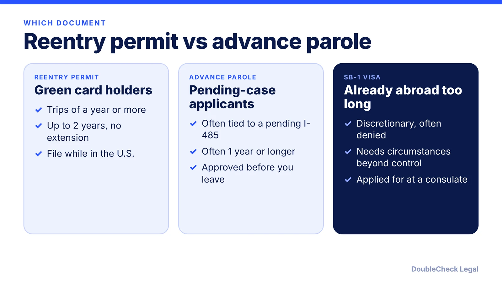
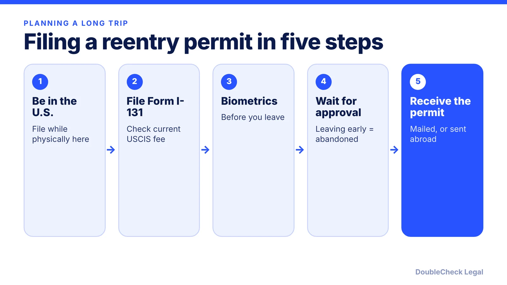

*Short version: planning a year or more abroad as a green card holder points to a reentry permit, filed while you are in the U.S.*

**Key takeaways:**

- A reentry permit is for green card holders planning a year or more abroad; it is valid up to two years and cannot be extended.
- You must be in the U.S. when you file and for biometrics; you cannot apply from abroad.
- Advance parole is commonly used by people with a pending adjustment case; a reentry permit does not need a pending application.
- If you are stuck abroad, the SB-1 returning resident visa has strict requirements and is not guaranteed.

## 1. The quick answer

**Quick answer:** A reentry permit (Form I-131) is a travel document for green card holders who plan to be abroad for one year or more. Per Nolo, it is valid for no more than two years and cannot be extended, and you must be physically in the U.S. when you file and for your biometrics appointment. Advance parole is different: it is commonly used by adjustment applicants with a pending case, while a reentry permit is tied to permanent resident status, not a pending case. Per a USCIS presentation, a reentry permit does not guarantee reentry. If you are already abroad and cannot return in time, the SB-1 returning resident visa may be the only route, and it has strict requirements.

## 2. How a reentry permit works

Per [Nolo](https://www.nolo.com/legal-encyclopedia/reentry-permits-preparing-green-card-holders-long-absences-the-us.html):

- **Who qualifies.** Most green card holders, except refugees, asylees, and crewmembers. It is aimed at anyone expecting an absence of one year or more.
- **Validity.** No more than two years, with no extension. For most holders who have been outside the U.S. for more than four years since getting the green card, it is limited to one year.
- **Where you must be.** In the U.S. when you file, and for biometrics. Per Nolo, the permit cannot be applied for from abroad. Biometrics consist of a photo, plus fingerprints for ages 14 to 79.
- **After filing.** Per Nolo, you apply in advance of a trip, and if you request it you can pick up the permit at a U.S. embassy or consulate abroad after the biometrics appointment. Per a USCIS presentation, leaving before USCIS decides is treated as abandoning the Form I-131.

Nolo says a green card automatically becomes invalid for entry after an absence of one year or longer, and without a reentry permit or other authorization most holders are likely to face removal proceedings on return. Filing fees change, and the 2026 amount was not verified for this article, so check the USCIS Form I-131 page before you file.

For the broader abandonment question, see [green card holder travel abroad and abandonment](/blog/green-card-holder-travel-abroad-abandonment/).

## 3. Reentry permit vs advance parole, and conditional residents

The two documents solve different problems. In general:

- **Advance parole** is for certain people, commonly adjustment of status applicants. It requires a pending application and must be approved before you leave the U.S.
- **Reentry permit** is for lawful permanent residents planning extended time abroad. It does not need a pending application and runs up to two years.

If you are still waiting on a green card, you are in the advance parole world, not the reentry permit one. See [advance parole and EAD while an I-485 is pending](/blog/advance-parole-and-ead-while-i-485-pending/) and our [I-485 guide](/blog/i-485-adjustment-of-status-guide/). Per a USCIS presentation, leaving the U.S. while a Form I-131 or I-485 is pending can be treated as abandoning it, so check the rule for your situation before you travel.

**Conditional residents.** Special rules apply. Per a USCIS presentation, conditional residents applying after their two-year anniversary must show they applied to remove conditions, so confirm the current requirements with USCIS or an attorney.

**Limits of a permit.** A permit does not guarantee reentry, and absences of a year or more can break continuous residence for naturalization even with a permit. If citizenship is a goal, review the [naturalization requirements](/blog/n-400-naturalization-eligibility-requirements/) before a long stay abroad.

## 4. If you are already abroad: the SB-1 visa, and when to get help

**Returning resident visa (SB-1).** Per Nolo, it is the first option for a green card holder stuck abroad a year or more because of circumstances beyond their control, and it is generally not available if you had time to anticipate the length of the absence. Per a USCIS presentation, the qualifications are LPR status, intent to return, and a protracted stay caused by circumstances beyond your control, with a consular process that starts with Form DS-117 and then an immigrant visa interview. The same USCIS slides give inconsistent thresholds (one year in one place, two years in another), so confirm the current rule with the State Department or a lawyer.

**When you can handle it yourself.** A straightforward plan: you are in the U.S., you know you will be abroad a year or more, you have time, and your facts are simple. Filing Form I-131 and attending biometrics before you leave is a manageable paperwork task.

**When to get an attorney to review it:**

- You are already abroad, or your trip is already running long.
- You have been abroad more than four of the last five years.
- You have a conditional green card, a prior abandonment question, or a pending naturalization case.
- Your absence will stretch past your permit's validity.

A permit does not guarantee reentry, so keep U.S. ties (tax filings, home, job, family) well documented. DoubleCheck can help you prepare questions for that review.

## Where DoubleCheck fits

[DoubleCheck](https://www.contactdoublecheck.com) helps businesses and founders start legal work with AI, verify it, and, when professional advice is warranted, connect with an independent attorney, including for immigration questions. Attorney availability and practice areas vary. Attorneys on DoubleCheck are independent professionals; an attorney-client relationship forms only if an attorney accepts your engagement.

**Sources:** [Nolo, reentry permits](https://www.nolo.com/legal-encyclopedia/reentry-permits-preparing-green-card-holders-long-absences-the-us.html); [USCIS presentation, LPRs who travel overseas](https://uscis.gov/sites/default/files/document/presentations/6-LPRs-Who-Travel-Overseas.pdf). The USCIS reentry permit page and fee table were not fetched, so the fee is omitted.

## FAQ

**Can I apply for a reentry permit from outside the U.S.?**

No. Per Nolo, a reentry permit can be applied for only from within the U.S., and you must attend the biometrics appointment in the U.S.

**How long is a reentry permit valid?**

Per Nolo, up to two years and not extendable. For most holders who spent more than four years abroad since getting the green card, it is limited to one year. A conditional resident's permit cannot run past the conditional status.

**Is advance parole the same as a reentry permit?**

No. Advance parole is commonly used by adjustment applicants with a pending case, while a reentry permit is for permanent residents planning extended time abroad and does not need a pending application.

**Does a reentry permit count toward naturalization continuous residence?**

Generally no. A reentry permit is a travel document, and absences of one year or more can break continuous residence for naturalization even with a permit, so check the USCIS Policy Manual or ask an attorney before a long stay abroad.

---

*General information only. This article is not legal, tax, investment, or accounting advice.*
