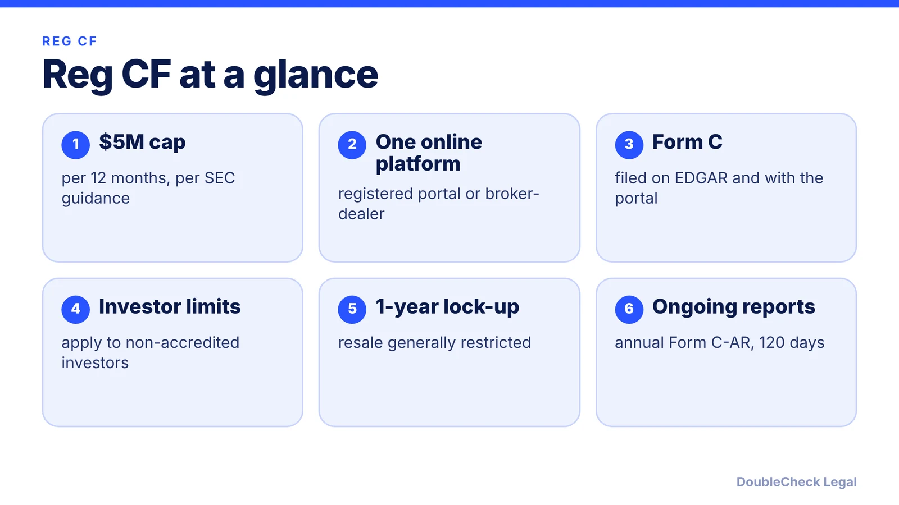
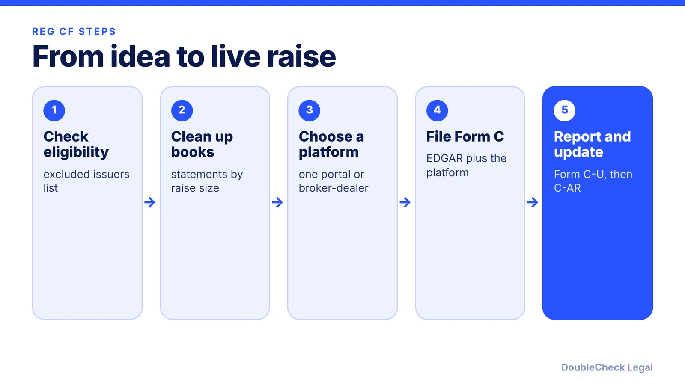

*A founder-friendly overview of Regulation Crowdfunding rules, costs of compliance and how it compares with a private angel round.*

**Key takeaways:**

- Reg CF allows up to $5 million in 12 months through one registered online platform, per the SEC.
- Form C, financial statements and ongoing annual reports are required; the statement level depends on how much you raise.
- Non-accredited investors face annual limits, and shares generally cannot be resold for one year.
- Crowdfunding changes your cap table and public disclosure, so plan for how future investors will view it.

## 1. The quick answer

**Quick answer:** Regulation Crowdfunding (Reg CF) lets a U.S. startup sell securities to the general public online, not only to accredited investors. Per the SEC's issuer guidance, a company may raise up to $5 million in a 12-month period, the offering must run through one SEC-registered broker-dealer or funding portal, and the company files a Form C with the SEC. Non-accredited investors face annual investment limits, and the securities generally cannot be resold for one year. Equity crowdfunding for startups is legal, but it comes with disclosure, financial statement and ongoing reporting duties that a private angel round does not.

## 2. Who can use Reg CF and what the main limits are

Reg CF is available to many U.S. companies, but not all. The SEC's guidance for issuers lists several excluded groups: non-U.S. companies, companies already reporting under the Exchange Act, certain investment companies, companies disqualified under the bad actor rules, companies that failed to meet annual reporting requirements in the previous two years, and companies with no specific business plan or whose plan is to merge with an unidentified company.

Three numbers matter most, all from the SEC and Investor.gov pages as of November 2026:

- **Issuer cap:** up to $5,000,000 in any 12-month period. It counts prior Reg CF sales by the company, entities it controls and predecessors, but other exempt offerings are not counted.
- **Investor limits:** a non-accredited investor whose income or net worth is under $124,000 can invest the greater of $2,500 or 5% of the greater of income or net worth. If both are at least $124,000, the limit is 10% of the greater of the two, capped at $124,000 across all crowdfunding offerings in 12 months. Accredited investors have no limit.
- **Resale:** the securities generally cannot be resold for one year, with exceptions such as transfers to the issuer, to an accredited investor, to certain family members or trusts, or in a registered offering.

The platform usually checks investor limits, and the SEC says an issuer may rely on the intermediary unless it knows an investor would exceed them. Because the dollar thresholds are adjusted periodically for inflation, confirm the current figures on the SEC page before you plan a raise.

If you are earlier in the process and still comparing structures, see [startup funding stages from pre-seed to Series B](/blog/startup-funding-stages-pre-seed-to-series-b/) and the company-type question in [LLC vs C corp for startups](/blog/llc-vs-c-corp-startups/).

## 3. The legal steps: Form C, financial statements and the platform

A Reg CF raise is a public securities offering with a lighter rulebook, not a casual fundraiser. The SEC guidance describes the core steps.

**Pick an intermediary.** Each offering is conducted exclusively through one online platform run by a registered broker-dealer or a funding portal registered with the SEC and FINRA. Platforms have their own onboarding, fees and vetting, so compare them.

**File Form C.** The Form C is filed on EDGAR and given to the intermediary. Per the SEC, it covers officers, directors and 20%+ owners, the business and use of proceeds, the price or pricing method, the target amount and deadline, whether you accept money above the target, certain related-party transactions, and your financial condition and financial statements.

**Prepare the right level of financial statements.** The SEC page ties the requirement to how much you raise in 12 months:

- $124,000 or less: statements certified by the principal executive officer, plus certain tax return information (reviewed or audited statements can be used instead).
- Over $124,000 up to $618,000: statements reviewed by an independent public accountant.
- Over $618,000: first-time issuers offering up to $1,235,000 need reviewed statements; larger raises, or any issuer that has used Reg CF before, need audited statements.

That step is often the biggest cost and timing driver. An accountant has to be involved well before launch, and your books need to be clean.

**Report progress.** Form C-U updates are due within five business days after reaching 50% and 100% of the target amount, per the SEC, unless the platform posts frequent progress updates.

**Handle investor cancellations.** Per Investor.gov, an investor can cancel a commitment until 48 hours before the offering period ends, and if you materially change the terms, investors get five business days to reconfirm.

If any other state or federal exemption is in play, for example a parallel private placement, read [Form D and Rule 506 for startup fundraising](/blog/form-d-rule-506-fundraising-startups/) so the two offerings do not collide.

## 4. Reg CF versus a SAFE round with angels

Many founders ask whether crowdfunding replaces angels. They are different tools.

**Disclosure.** A private angel round usually involves a pitch, a data room and a handful of documents. Reg CF puts a public Form C and your financial statements in front of everyone, including competitors.

**Cap table.** A crowd can mean hundreds or thousands of small holders. Some platforms use pooled vehicles or standard instruments, but how you structure the securities affects later rounds. Before offering anything, read [cap table basics for first-time founders](/blog/cap-table-basics-for-first-time-founders/) and [how SAFEs work](/blog/safe-note-explained-for-founders/). Future lead investors will look hard at how many holders and what rights exist, which is a theme in [cap table cleanup before a Series A](/blog/cap-table-cleanup-before-series-a-common-problems/).

**Ongoing duties.** After a Reg CF raise you generally owe an annual report on Form C-AR within 120 days after fiscal year-end, filed on EDGAR and posted on your website, until a termination event occurs. Per the SEC page, that includes the company having fewer than 300 holders of record after at least one report, or total assets of $10 million or less after at least three reports.

**Terms.** Whether to sell SAFEs, notes or stock is a separate decision. See [SAFE vs convertible note](/blog/safe-vs-convertible-note-startups/) and [valuation cap vs discount](/blog/valuation-cap-vs-discount-safe-how-they-work-together/).

Neither path is better in general. A community-driven consumer brand may value the crowd as customers and advocates, while a company aiming at institutional venture capital may prefer a clean, small cap table. Ask how a future investor will view the structure you choose.

## 5. When to get an attorney involved

You can learn the rules yourself and use AI to summarize the SEC pages, but a securities offering has penalties attached to misstatements. Get an independent attorney involved when:

- you have not decided between Reg CF, Rule 506(b) or another exemption
- your company is an LLC and you are weighing a conversion first (see [converting an LLC to a C corp before fundraising](/blog/convert-llc-to-c-corp-before-fundraising/))
- your Form C will make forward-looking claims about revenue, users or product timelines
- you plan to use a special purpose vehicle or give investors unusual rights
- any founder, officer or 20% owner has a regulatory, criminal or securities history that could trigger the bad actor rules

A practical way to prepare: draft your Form C story and financial summary with AI, then check each factual statement against your records, as described in [verifying AI-generated legal documents](/blog/verify-ai-generated-legal-document/). Bring the annotated draft and a list of open questions to a lawyer. If you are not sure how to pick one, see [how to choose a good lawyer](/blog/how-to-choose-good-lawyer/) and [when to hire a lawyer for a small business](/blog/when-to-hire-lawyer-small-business/).

## Where DoubleCheck fits

[DoubleCheck](https://www.contactdoublecheck.com) helps businesses and founders start legal work with AI, verify it, and, when professional advice is warranted, connect with an independent attorney, including for immigration questions. Attorney availability and practice areas vary. Attorneys on DoubleCheck are independent professionals; an attorney-client relationship forms only if an attorney accepts your engagement.

**Sources:** [SEC: Regulation Crowdfunding](https://www.sec.gov/smallbusiness/RegCrowdfunding); [SEC: Regulation Crowdfunding guidance for issuers](https://www.sec.gov/resources-small-businesses/regulation-crowdfunding-guidance-issuers); [Investor.gov: Investor Bulletin on crowdfunding (Oct. 14, 2022)](https://investor.gov/news-alerts/investor-bulletins/investor-bulletin-crowdfunding-investors). A Crowdfund Insider article on February 2026 SEC guidance could not be loaded and is not relied on.

## FAQ

**Is equity crowdfunding legal for startups in the US?**

Yes. Regulation Crowdfunding is an SEC exemption that lets eligible U.S. companies raise up to $5 million in 12 months from the public through a registered online platform, per the SEC. Companies must file a Form C and follow disclosure and reporting rules.

**Who can invest in a Reg CF offering?**

Anyone can, including non-accredited investors, subject to annual limits. Per Investor.gov, non-accredited investors with income or net worth under $124,000 can invest the greater of $2,500 or 5% of the greater of income or net worth. Accredited investors have no limit.

**Do I need an audit to run a Reg CF raise?**

It depends on size. Per the SEC guidance, raises up to $124,000 can use officer-certified statements, raises up to $618,000 need an accountant review, and larger raises need reviewed or audited statements depending on whether you are a first-time issuer and the amount.

**What do I have to file after a Reg CF offering closes?**

Generally an annual report on Form C-AR within 120 days after fiscal year-end, plus Form C-U progress updates during the offering. The annual report duty ends on certain events listed in the SEC guidance, such as total assets of $10 million or less after three reports.

**Can I run Reg CF and an angel round at the same time?**

Sometimes, but the offerings must be structured so that exemptions do not conflict, and the Reg CF cap counts only Reg CF sales. Ask a securities attorney before running parallel offerings.

---

*General information only. This article is not legal, tax, investment, or accounting advice.*
