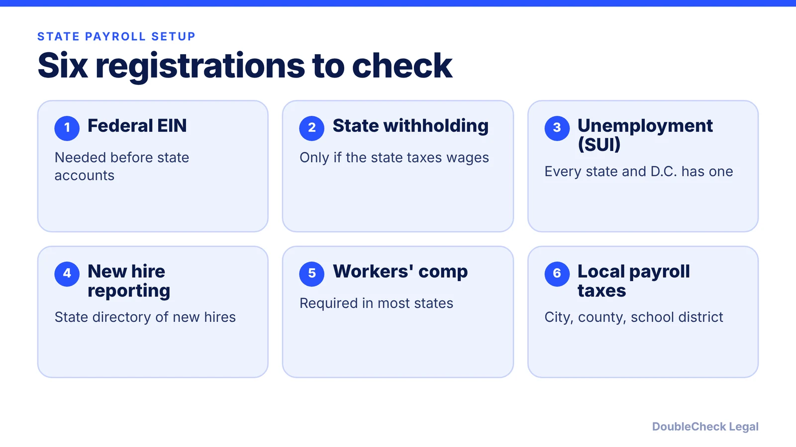
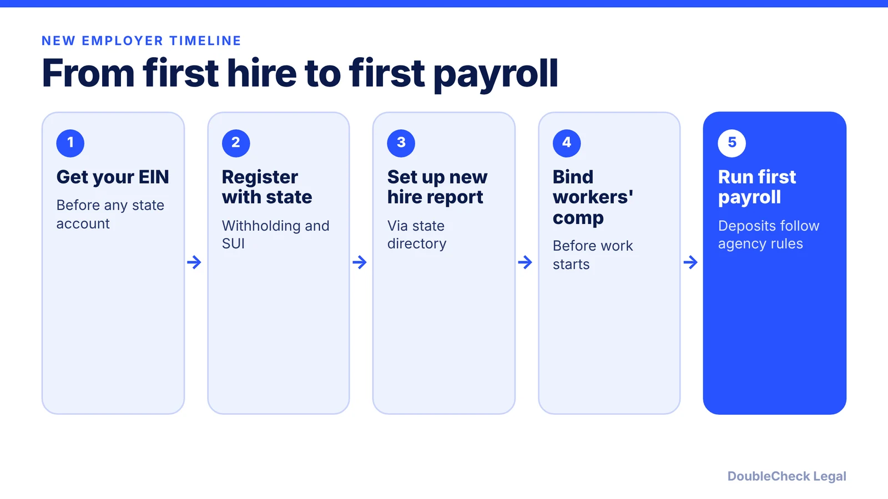

*Hiring your first employee triggers several state registrations. Here is the order, the triggers, and what to check as of November 2026.*

**Key takeaways:**

- Get your federal EIN first, then open state accounts before the first payday.
- Every state and D.C. requires an unemployment insurance account; wage thresholds differ by state (for example $1,500 per quarter in Connecticut, $300 in New York).
- Nine states do not tax wages, per LegalZoom, so state withholding may not apply.
- Report new hires to your state directory; confirm each state's deadline.

## 1. The quick answer

**Quick answer:** Before your first payday, get a federal EIN, then register with your state for withholding (if the state taxes wages), unemployment insurance, and new hire reporting, and check workers' compensation and any local payroll taxes. Per LegalZoom's checklist, every state and D.C. requires an unemployment insurance account once you hire, and nine states do not tax wages at all. Deadlines and forms differ by state, so confirm with each state agency where your employees work.

## 2. The registration order

A practical sequence, drawn from [LegalZoom's payroll tax registration checklist](https://www.legalzoom.com/tools/payroll-tax-registration-checklist) and [Patriot Software's employer registration guide](https://www.patriotsoftware.com/blog/payroll/mandatory-employer-registration/):

1. **Federal EIN.** Patriot notes you can apply free with the IRS online or by mailing Form SS-4. LegalZoom calls the EIN typically the first thing you need before opening employer tax accounts. (If you have not formed an entity yet, start with [how to incorporate in the US](/blog/how-to-incorporate-a-company-in-the-us/).)
2. **State withholding account.** Most states tax wages, so you register to withhold. LegalZoom says nine states do not.
3. **State unemployment insurance (SUI or SUTA).** You receive an employer account number and, per Patriot, your new employer contribution rate. This is often handled by a labor or workforce agency, not the tax department.
4. **New hire reporting.** You report each new hire to the state.
5. **Workers' compensation.** Patriot says most states require coverage when you bring on your first employee; some run it through the state and others let you pick a private insurer. See [workers' compensation requirements for startups](/blog/workers-compensation-insurance-requirements-startups/).
6. **Local taxes.** Some cities, counties, and school districts levy their own payroll taxes, and a state agency site usually will not cover them, per LegalZoom.

Have ready: legal name, entity type, EIN, formation documents, address, owner or officer names, and each employee's start date and work location, per LegalZoom.

## 3. When you become liable for unemployment tax

The trigger is set by each state, so do not assume a rule from another state. Examples reported by [Patriot Software's SUTA guide](https://www.patriotsoftware.com/blog/payroll/suta-tax/) and the state agencies:

- **Connecticut:** liable if you paid wages of $1,500 or more in a calendar quarter, or had at least one employee in each of 20 different weeks, in the current or preceding year. Employers must register online through ReEmployCT, per the [Connecticut DOL](https://portal.ct.gov/dol/knowledge-base/articles/unemployment-taxes/how-do-i-register).
- **New York:** a general business is liable on the first day of the calendar quarter in which it pays $300 or more in remuneration, per the [New York DOL](https://dol.ny.gov/register-unemployment-insurance-0). Register through New York Business Express after getting an FEIN.
- **Nevada:** $225 or more in a calendar quarter; **Michigan:** $1,000 or more in a calendar year, per Patriot.
- **Alaska, Hawaii, Pennsylvania, Rhode Island:** liability is tied to having employees, not a dollar amount, per Patriot.

Connecticut's page states that failure to register does not relieve the employer of the obligation to register. Also note that SUTA is mostly employer-paid, but Patriot lists Alaska, New Jersey, and Pennsylvania as states where employees also contribute.

## 4. New hire reporting and multi-state teams

Per the federal [Office of Child Support Services page for employers](https://acf.gov/css/outreach-material/new-hire-reporting-employers), private employers report to their state's State Directory of New Hires, which forwards reports to the National Directory of New Hires. Federal law requires seven data elements: employer name, address and FEIN, plus the employee's name, address, SSN, and date of hire. States may require more. Patriot says reports are generally due within 20 days of hire, though each state sets its own rule, so check yours.

If you employ people in several states, the same federal page says you can either report each hire to the state where that person works, or choose one state and register with HHS as a multistate employer (electronic reports, no more than twice a month, 12 to 16 days apart). For a wider look at remote teams, see [multi-state remote employees](/blog/multi-state-remote-employees-compliance-startups/).

Pair this with the broader [first employee legal checklist](/blog/how-to-hire-first-employee-legal-checklist/), and decide worker status first using [employee vs. independent contractor](/blog/employee-vs-independent-contractor-classification-startups/). Registration is only setup: deposits and returns then follow each agency's schedule, per LegalZoom.

## Where DoubleCheck fits

[DoubleCheck](https://www.contactdoublecheck.com) helps businesses and founders start legal work with AI, verify it, and, when professional advice is warranted, connect with an independent attorney, including for immigration questions. Attorney availability and practice areas vary. Attorneys on DoubleCheck are independent professionals; an attorney-client relationship forms only if an attorney accepts your engagement.

**Sources:** [LegalZoom, Payroll Tax Registration Checklist](https://www.legalzoom.com/tools/payroll-tax-registration-checklist); [Patriot Software, Mandatory Employer Registration](https://www.patriotsoftware.com/blog/payroll/mandatory-employer-registration/); [Patriot Software, SUTA Tax Requirements](https://www.patriotsoftware.com/blog/payroll/suta-tax/); [New York DOL, Register for Unemployment Insurance](https://dol.ny.gov/register-unemployment-insurance-0); [Connecticut DOL, How do I register](https://portal.ct.gov/dol/knowledge-base/articles/unemployment-taxes/how-do-i-register); [ACF OCSS, New Hire Reporting for Employers](https://acf.gov/css/outreach-material/new-hire-reporting-employers).

## FAQ

**Do I need a separate state payroll tax account?**

Usually yes. Per LegalZoom, most states tax wages so you register to withhold, and every state and D.C. requires an unemployment insurance account once you hire. Nine states do not tax wages, so withholding registration may not apply.

**When do I have to register for state unemployment tax?**

It depends on the state. Connecticut sets liability at $1,500 in wages in a calendar quarter or one employee in 20 different weeks; New York sets it at $300 in a quarter for general businesses, per those states' labor departments. Check your state agency.

**What information goes in a new hire report?**

Federal law requires seven items: employer name, address and FEIN, and the employee's name, address, SSN and date of hire, per the federal Office of Child Support Services. States may require additional data elements.

**Is workers' compensation part of payroll registration?**

It is a separate registration. Per Patriot Software, most states require workers' compensation coverage when you bring on your first employee; some states run it through the state and others let you choose a private provider. Check your state rules.

---

*General information only. This article is not legal, tax, investment, or accounting advice.*
