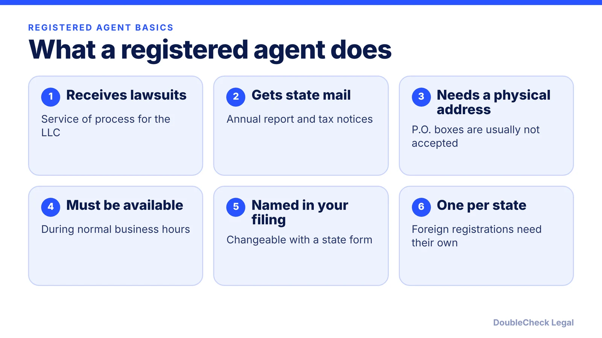
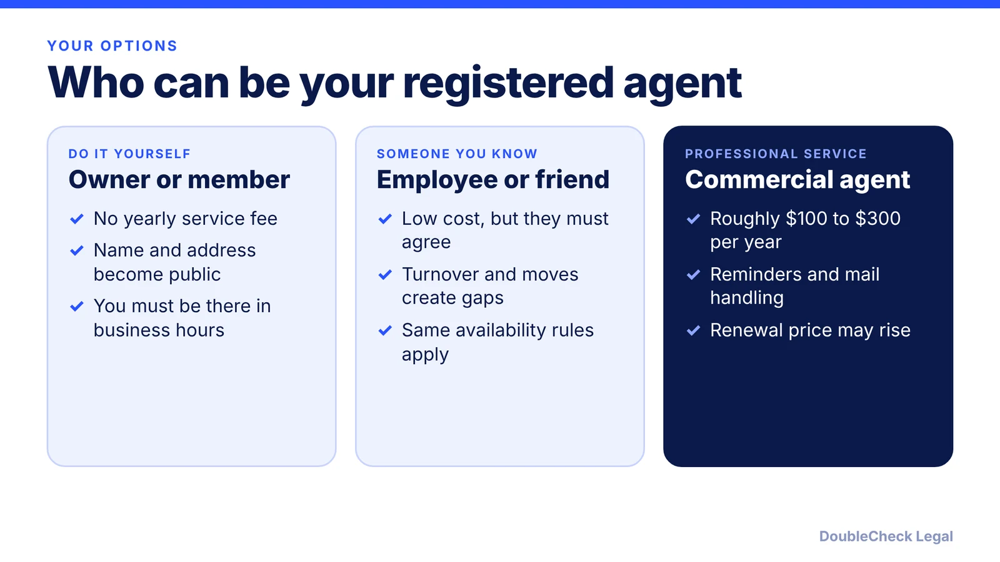

*A registered agent for an LLC: who can serve, what happens if you have none and what it costs, as of November 2026.*

**Key takeaways:**

- A registered agent receives lawsuits and state notices at a physical in-state address.
- Owners, employees and commercial services can often serve, but state rules differ.
- Commercial services typically run about $100 to $300 per year; compare renewal prices.
- No valid agent can mean a default judgment or loss of good standing.

## 1. The quick answer

**Quick answer:** A registered agent is the person or company your LLC names to receive lawsuits and official government mail at a physical address in the state. Most states let an owner, an employee or a commercial service act as agent if they meet the state's rules, such as an in-state street address and availability during business hours. Commercial services typically cost roughly $100 to $300 per year, per Nolo, plus any state fee for changing the agent.

The agent matters because a missed lawsuit can become a default judgment. Rules differ by state, so treat this guide as a framework and confirm with your Secretary of State. For formation context see [how to start an LLC in Texas](/blog/how-to-start-an-llc-in-texas/) or [best state to form an LLC](/blog/best-state-to-form-an-llc-comparison/).

## 2. What a registered agent actually does

Per Nolo, the agent receives court documents if the business is sued, plus business registration renewal notices from the secretary of state and tax notices. In practice the job is simple but time-sensitive: sign for documents, record when they arrive, and pass them to you quickly.

The reason states require an agent is reachability. Someone suing your LLC needs a dependable place to deliver papers, and the state needs a place to send notices. The agent's address becomes part of the public record, per Wolters Kluwer.

If a lawsuit does arrive, deadlines to respond can be short. See [what to do if your small business is served a lawsuit](/blog/what-to-do-if-your-small-business-is-served-a-lawsuit/) for the first steps. For annual filings that the agent may flag, see [annual report requirements by state for LLCs](/blog/annual-report-requirements-by-state-llc/).

## 3. Who can be a registered agent, and who can serve papers

**Who can be your agent.** Nolo lists common options: an owner, member, officer or employee, a lawyer, a relative or friend, or a commercial registered agent service. Per Nolo, an individual agent is typically over 18 (or a business located in the state), must give a street address in the state, and must be available during normal business hours. Washington's Secretary of State also requires the agent's consent. Check your own state's rules.

**Rules that vary by state.** Examples from our sources:

- **Texas:** Wolters Kluwer (April 30, 2026) says the agent must be a Texas resident or a company authorized to do business in Texas, a business cannot be its own agent but an officer, owner or employee who qualifies can, and the registered office must be a physical Texas address available Monday through Friday during normal business hours.
- **Virginia:** Wolters Kluwer notes a Virginia-specific limit and says the agent must be a Virginia State Bar member or an LLC member or manager.
- **Delaware:** See [Delaware registered agent requirements](/blog/delaware-registered-agent-requirements/).

**Who can be served on behalf of the LLC.** This is a separate question from who your agent is. Los Angeles County's Department of Consumer and Business Affairs says that in California the entity may be served through its designated agent, who must be registered with the Secretary of State, or through an officer. If an entity has no agent, the agent resigned without replacement or the agent cannot be found, a plaintiff may ask the court for permission to serve the Secretary of State, per the same page. The page says service on the Secretary of State is considered complete 10 days after the sheriff sends the forms. That is California small claims procedure, and other states differ, but it shows why an unreachable agent is risky.

**Multiple states.** An LLC that registers in another state generally needs an agent with a physical address there; Washington's Secretary of State, for example, requires registered foreign entities to maintain an agent with a Washington physical address. See [foreign qualification: register your LLC in another state](/blog/foreign-qualification-register-llc-in-another-state/).

## 4. What a registered agent costs

Costs have two parts: the provider fee and the state filing fee.

- **Provider fee:** Per Nolo, commercial registered agent services typically charge about $100 to $300 per year. Prices vary by provider, state and entity.
- **Renewal price:** Introductory prices can change at renewal, so ask each provider for the renewal price, not just the promotion.
- **Several states:** Each state needs its own agent, so provider fees multiply with every state you register in.
- **State change fee:** Per Nolo, filing a change of agent form usually costs about $5 to $60 depending on the state. Confirm your state's current amount.
- **Add-ons:** Ask providers about extras such as mail scanning, forwarding and resignation or termination fees.

## 5. Pitfalls: when serving as your own agent goes wrong

Wolters Kluwer lists risks of acting as your own agent: missed documents when you travel, a public name and address, papers delivered at your place of business in front of customers, and the time it takes to update the address with the state. If you work from home, your home address may end up on the public record.

Consequences of having no valid agent, per FindLaw and Wolters Kluwer:

- Default judgment if court papers are missed
- Fines or penalties in some states
- Loss of good standing, which can block financing and expansion
- Loss of registered status or administrative dissolution in some states, which can expose owners to liability for business debts, though reinstatement may be possible

Wolters Kluwer notes reversal is possible in most cases, but not always.

Two habits help. First, put the agent's renewal and your annual report on one calendar. Second, update the state when the agent or address changes, such as when you move or an employee leaves. If dissolution is the plan instead, see [how to dissolve an LLC step by step](/blog/how-to-dissolve-an-llc-step-by-step/). For other post-formation tasks see [startup LLC first 30 days checklist](/blog/startup-llc-first-30-days-checklist-after-you-form/).

## 6. How to choose, and when to ask an attorney

A reasonable decision rule:

- **One state, home-based, low risk of being sued:** a commercial agent often costs less than the trouble of missed mail, and keeps your address off the public record.
- **Office with regular staff in the formation state:** an owner or employee can work if they are reliably present and the state allows it.
- **Multiple states or investors involved:** use a professional service and a single compliance calendar.

Before you sign up, read the contract for auto-renewal, cancellation and resignation fees. If a provider asks you to appoint it through a form you do not understand, or if you have received legal papers already, get them reviewed. AI can help you compare terms and organize deadlines, and you can then verify the conclusion with an independent attorney. Related reading: [do I need a lawyer to start an LLC](/blog/do-i-need-a-lawyer-to-start-an-llc-diy-ai-or-attorney/) and [LLC formation cost by state](/blog/llc-formation-cost-california-texas-florida-new-york/).

## Where DoubleCheck fits

[DoubleCheck](https://www.contactdoublecheck.com) helps businesses and founders start legal work with AI, verify it, and, when professional advice is warranted, connect with an independent attorney, including for immigration questions. Attorney availability and practice areas vary. Attorneys on DoubleCheck are independent professionals; an attorney-client relationship forms only if an attorney accepts your engagement.

**Sources:** [Nolo, What is a registered agent and who can be your company's agent](https://www.nolo.com/legal-encyclopedia/what-registered-agent.html); [FindLaw, What is a registered agent](https://www.findlaw.com/smallbusiness/starting-a-business/what-is-a-registered-agent.html); [Washington Secretary of State, Registered agents](https://www.sos.wa.gov/corporations-charities/business-entities/maintain-business-compliance/registered-agents); [Wolters Kluwer, Can I be the registered agent for my LLC?](https://www.wolterskluwer.com/en/expert-insights/can-i-be-the-registered-agent-for-my-llc); [Wolters Kluwer, Texas registered agent services (Apr. 30, 2026)](https://www.wolterskluwer.com/en/expert-insights/texas-registered-agent-services); [LA County DCBA, Serving a Corporation, LLC, or LP](https://dcba.lacounty.gov/?p=18892). Not fetched: Wolters Kluwer how to choose a registered agent (failed to load).

## FAQ

**Can I be my own registered agent for my LLC?**

Often yes, if you meet your state rules. Per Nolo, an owner can serve, but the agent needs an in-state street address and must be available during normal business hours. Wolters Kluwer warns your name and address become public.

**Who can serve a registered agent with legal papers?**

It depends on state law. Los Angeles County says California entities may be served through a registered agent or an officer, and a court can allow service on the Secretary of State if the agent cannot be found. Check your state.

**How much does a registered agent cost per year?**

Per Nolo, commercial registered agent services typically cost about $100 to $300 per year, and filing a change of agent typically costs about $5 to $60 in state fees depending on the state. Prices vary by provider.

**What happens if my LLC has no registered agent?**

Per FindLaw and Wolters Kluwer, risks include missed lawsuits and default judgment, penalties and fines, and loss of registered status in some states, which can expose owners to liability for company debts. Reinstatement may be possible in many cases.

**Can I use a P.O. box or virtual mailbox as my registered agent address?**

Usually not. The Washington Secretary of State says P.O. boxes and private mailboxes are prohibited for the agent address, and Wolters Kluwer says mailing boxes do not qualify. The agent needs a physical street address in the state.

---

*General information only. This article is not legal, tax, investment, or accounting advice.*
