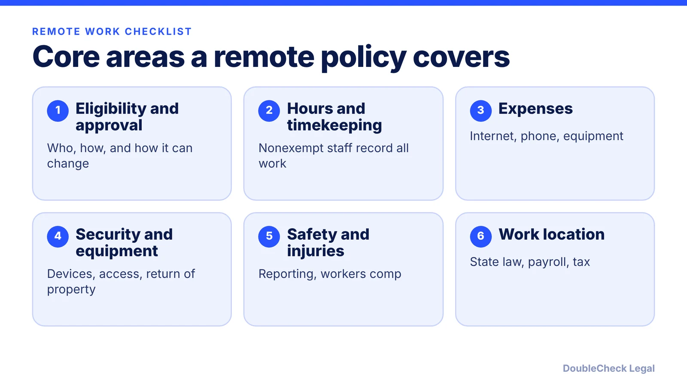
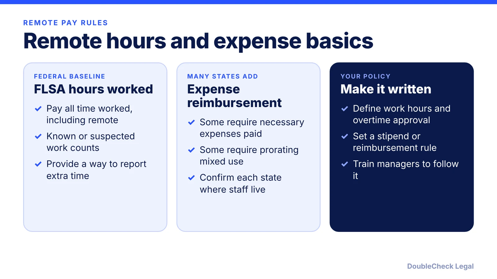

*A remote work policy legal checklist for small business: eligibility, timekeeping, expense reimbursement, safety, security and multi-state issues, as of November 2026.*

**Key takeaways:**

- Nonexempt remote employees must be paid for all time worked, and employers should give them a way to report extra time.
- Several states require reimbursement of necessary work expenses; confirm the rule for each state where staff live.
- OSHA says it does not inspect home offices, but injury recordkeeping duties can still apply.
- Get a signed agreement covering equipment, security, location changes and return of property.

## 1. The quick answer

**Quick answer:** A remote work policy legal checklist for a small business covers eight areas: who is eligible and how arrangements are approved, hours and timekeeping for nonexempt staff, expense reimbursement, equipment and data security, workers' compensation and safety, where each employee actually works (state tax, payroll and employment law), disability accommodations, and what happens when the arrangement ends. As of November 2026, the federal wage-hour rules still apply at home, and several states require reimbursement of necessary work expenses. This is general information for US small businesses, not legal advice.

## 2. Remote work policy legal checklist: eligibility and approval

Start with a written policy and a short signed agreement. Core policy items usually include whether remote work is standard, temporary or discretionary; which roles are eligible; whether arrangements are fully remote, hybrid or occasional; and that approval is not guaranteed and can be changed or revoked. Consider job duties, performance and attendance history, ability to work independently, security concerns and technology capability, and consider a trial period and periodic review. Akin Gump's checklist adds that flexible workplace policies should be administered in a nondiscriminatory manner, with legitimate, nondiscriminatory reasons if some employees cannot work from home.

A good policy for a small team usually says:

- Who can work remotely and who cannot (for example, roles that need on-site equipment).
- How to request it and who approves it.
- That remote work is a work arrangement, not a change in employment terms. Consider stating that employment remains at will, where applicable. See [at-will employment by state](/blog/at-will-employment-by-state-exceptions-employers/).
- That the company may change or end the arrangement, and that in-office attendance may be required.
- That the existing handbook policies, including anti-harassment and confidentiality, still apply. See [what to include in an employee handbook](/blog/employee-handbook-small-business-what-to-include/) and [workplace harassment policy requirements](/blog/workplace-harassment-policy-requirements-small-business/).

Keep the language consistent. If your policy says arrangements are discretionary but managers hand them out as informal promises, the policy will not match your practice.

## 3. Hours, timekeeping and expenses

This is where remote policies most often create real exposure, and Akin Gump's checklist says employers should make sure nonexempt employees record all remote work time, and that employers may restrict overtime but must pay for all overtime worked.

**Hours worked.** Per the Department of Labor Wage and Hour Division's Field Assistance Bulletin 2023-1 (February 9, 2023), nonexempt remote employees must be paid for all time worked, wherever they are. If the employer knows or has reason to believe work is being performed, the time counts, and the employer must use reasonable diligence to learn about unscheduled work. The bulletin says an employer can meet that duty by giving employees a reasonable procedure to report unscheduled work, and then must pay for all reported hours, including hours it did not request. Short breaks of 20 minutes or less are paid. See [overtime: exempt vs nonexempt](/blog/overtime-exempt-vs-nonexempt-small-business/).

Per Jackson Lewis (HR Dive, October 14, 2025), off-the-clock work such as answering emails after hours counts as work time and must be recorded and paid, even when the employee chooses to do it. Standard operating hours in a designated time zone and limits on work email on phones can help. The same article notes that tracking software can raise privacy-law issues that may limit its use.

**Expenses.** Per Jackson Lewis, the FLSA requires reimbursement of remote work expenses if the costs would push an employee's pay below the federal minimum wage or overtime rates. It also lists California, Illinois, Iowa, Massachusetts, Minnesota, Montana, New Hampshire, North Dakota and South Dakota as states that mandate reimbursement of necessary business expenses, and says Seattle has a similar requirement. California, Illinois and Seattle require prorating when personal items such as phones or internet serve both business and personal use. Because state rules change, confirm the current rule for each state where you have employees.

Two practical habits: give nonexempt employees a simple way to record time and report extra work, and decide in advance whether you will provide equipment, pay a stipend or reimburse receipts.

## 4. Safety, workers' compensation, accommodations and security

**Safety and OSHA.** OSHA's directive CPL 2-0.125 (effective February 25, 2000) says OSHA does not inspect home offices, does not hold employers liable for them and does not expect employers to inspect them. It still says employers required to keep injury and illness records must continue to do so if a work-related injury occurs in a home office and meets the recordability criteria. The directive treats other home-based worksites, such as home manufacturing, differently. Check your state, since state safety rules can differ.

**Workers' compensation.** Akin Gump's checklist recommends confirming with workers' compensation and liability brokers or carriers that coverage applies to employees working from home. It is also sensible to require prompt reporting of work-related injuries and to cross-reference your workers' compensation policy. See [workers' compensation insurance requirements for startups](/blog/workers-compensation-insurance-requirements-startups/).

**Accommodations.** Per Akin Gump, employers must provide disability accommodations to remote employees, such as ergonomic equipment, when they would be provided in an office. Handle requests through your normal interactive process, and treat remote work requests as possible accommodation requests where the law may apply. A remote request tied to a medical condition deserves a careful response, not an automatic yes or no.

**Equipment, confidentiality and security.** Akin Gump's checklist says employers should provide company equipment where possible and otherwise assess whether personal equipment used for work requires reimbursement. A policy would also typically cover safeguarding duties, limits on personal use, return obligations, cybersecurity protocols, secure networks, prompt incident reporting, and incorporating existing confidentiality agreements by reference. See [confidentiality and IP assignment agreements](/blog/confidentiality-ip-assignment-agreements-startups/), [data breach notification laws](/blog/data-breach-notification-laws-small-business/), and the [AI agent security checklist for Gmail, Slack and Drive](/blog/ai-agent-gmail-slack-drive-security-checklist/). If employees use AI tools with company data, set rules in an [AI policy](/blog/ai-policy-template-small-business/).

## 5. Where employees work: multi-state and cross-border issues

A remote employee can create obligations where they live, not just where your company is formed. Consider an agreement item requiring employees to disclose work location changes, get approval before relocating, and cooperate with payroll or tax requirements. That is a useful minimum.

Questions to answer before approving a move:

- Does the new state require payroll tax registration, unemployment insurance or paid leave? See [register for state payroll taxes as a new employer](/blog/register-for-state-payroll-taxes-new-employer/) and [multi-state remote employees: compliance for startups](/blog/multi-state-remote-employees-compliance-startups/).
- Does the state's expense reimbursement, sick leave or wage statement rule apply? See [paid sick leave laws by state](/blog/paid-sick-leave-laws-by-state-small-business-2026/).
- Is the worker an employee or a contractor? Calling someone a contractor does not remove obligations if the relationship is really employment. See [employee vs independent contractor](/blog/independent-contractor-vs-employee/).
- Is the person outside the US? That raises immigration, tax and employment issues. See [hiring international employees remotely](/blog/hire-international-employees-remote-eor-vs-contractor-vs-sponsorship/), and [I-9 and E-Verify](/blog/i-9-and-e-verify-for-startups/) for US work authorization.

Rules vary by state and by city, so treat the list above as prompts for verification, not conclusions.

**Ending the arrangement.** Have the agreement address return of equipment, revocation of system access, deletion of company data from personal devices and return of hard copies when employment ends. Plan this at hiring, not at termination.

**Using AI to draft the policy.** AI is useful for a first draft and for turning a template into plain English. It will not know which states your employees live in or which rules changed. Verify the draft with the steps in [verify AI-generated legal documents](/blog/verify-ai-generated-legal-document/), and consider counsel review via [when to hire a lawyer](/blog/when-to-hire-lawyer-small-business/).

## Where DoubleCheck fits

[DoubleCheck](https://www.contactdoublecheck.com) helps businesses and founders start legal work with AI, verify it, and, when professional advice is warranted, connect with an independent attorney, including for immigration questions. Attorney availability and practice areas vary. Attorneys on DoubleCheck are independent professionals; an attorney-client relationship forms only if an attorney accepts your engagement.

**Sources:** [Jackson Lewis via HR Dive (October 14, 2025)](https://www.hrdive.com/news/remote-worker-timekeeping-expenses/802722/); [U.S. DOL Wage and Hour Division, Field Assistance Bulletin 2023-1 (February 9, 2023)](https://unemployment.gov/sites/dolgov/files/WHD/fab/2023-1.pdf); [OSHA, CPL 2-0.125 home-based worksites](https://www.osha.gov/enforcement/directives/cpl-02-00-125); [Akin Gump, Work-From-Home Legal Issues Checklist (undated, written during COVID-19)](https://www.akingump.com/en/insights/alerts/work-from-home-legal-issues-checklist).

## FAQ

**What should a remote work policy include?**

Typical items are eligibility, approval and the right to change or end the arrangement, hours and timekeeping, equipment, confidentiality and security, injury reporting, expenses, location changes and return of property. The DOL, OSHA and Akin Gump sources below cover the legal pressure points among these.

**Do I have to reimburse remote employees for internet and phone costs?**

It depends on the state. Per Jackson Lewis (October 2025), nine states and Seattle mandate reimbursement of necessary business expenses, and the FLSA applies if costs push pay below minimum wage or overtime rates. Check the rule where each employee works.

**Do I have to pay remote employees for time answering emails after hours?**

For nonexempt employees, yes if it is work. Per Jackson Lewis, off-the-clock work such as after-hours emails must be recorded and paid, even when voluntary. Per DOL Field Assistance Bulletin 2023-1, employers can use a reporting procedure for unscheduled work.

**Does OSHA inspect home offices?**

Per OSHA directive CPL 2-0.125, OSHA does not inspect home offices or hold employers liable for them. Employers that must keep injury and illness records still must record work-related injuries that meet the criteria, even at home. State rules can differ.

**Do I need a lawyer to write a remote work policy?**

Not always, but multi-state staff, nonexempt employees or accommodation requests raise the stakes. An employment attorney can check the draft against the states where your employees live.

---

*General information only. This article is not legal, tax, investment, or accounting advice.*
