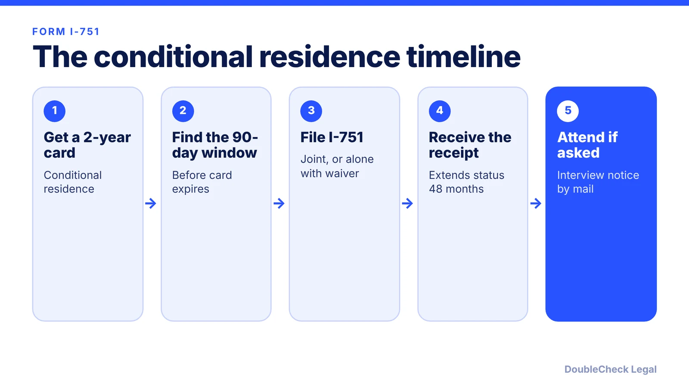
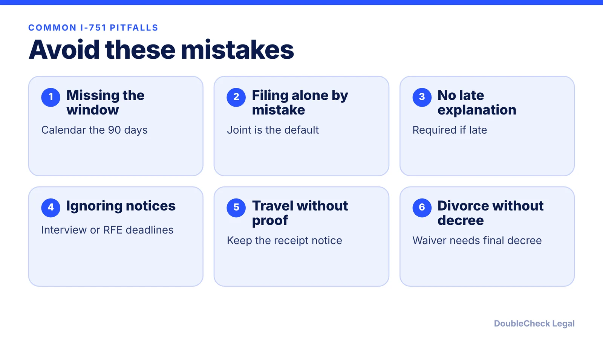

*A 2-year conditional green card is only a starting point. The 90-day window before it expires is the deadline that matters.*

**Key takeaways:**

- File Form I-751 in the 90 days immediately before your 2-year card expires (per USCIS).
- A properly filed I-751 extends status and work authorization for 48 months.
- You can file alone with a waiver in cases like divorce, death, abuse, or hardship.
- Not filing ends conditional status and can lead to a Notice to Appear.

## 1. The quick answer

**Quick answer:** If your green card is valid for 2 years, it is a conditional card and you generally must file Form I-751 within the 90 days immediately before it expires. Per USCIS, a properly filed I-751 extends your conditional status and work authorization for 48 months, and USCIS may require an interview. Missing the window without good cause can end your conditional status automatically and lead to removal proceedings.

## 2. Who files and when

Per [USCIS](https://uscis.gov/node/44447), you generally file jointly with your U.S. citizen or lawful permanent resident spouse (or stepparent) if you are still married to that person. A conditional resident spouse can include a child whose conditional status began at the same time or within 90 days, and a child filing separately may file at any time, including before the window.

You may file alone, without your spouse, if:

- your spouse died,
- the good-faith marriage ended in divorce or annulment,
- you or your child were abused by your spouse, or
- removal would cause extreme hardship.

USCIS says the 2-year card is valid for 2 years and joint filers must file within the 90 days immediately before it expires. For how marriage cases begin, see [the marriage-based green card timeline](/blog/marriage-based-green-card-process-timeline/) and [the I-485 guide](/blog/i-485-adjustment-of-status-guide/).

## 3. Receipt notice, interview, and waivers

After you file, USCIS says the receipt notice for a properly filed I-751 extends your conditional status and work authorization for 48 months. After that, if you still need proof of status, call the USCIS Contact Center at 800-375-5283. If USCIS requires an interview, it mails an appointment notice.

**Waivers.** USCIS says you can request a waiver of the joint filing requirement before or after the 90-day window, until a final removal order is issued. Grounds include extreme hardship, death of a spouse, divorce or annulment, abuse or extreme cruelty, and a parent's marriage ending in abuse, and you can request more than one. If you are legally separated or in pending divorce or annulment proceedings, USCIS requires a final decree or annulment.

**Fees.** The USCIS page does not list the dollar amount; use the USCIS Fee Calculator before you mail the form. For evidence of a real marriage and interview preparation, see [green card interview: what to expect](/blog/green-card-interview-what-to-expect/).

## 4. Late filing and what can go wrong

**Late filing.** USCIS says you must include a written explanation, and USCIS decides whether you had good cause.

**No filing at all.** Your conditional status automatically terminates, USCIS notifies you, and it starts removal proceedings by issuing a Notice to Appear. At the hearing you must prove you met the conditional residence requirements.

**Denial.** If USCIS denies your I-751, you may also face removal proceedings, and you have 30 days to appeal a removal order using Form EOIR-26.

Travel is covered in [green card holder travel and abandonment](/blog/green-card-holder-travel-abroad-abandonment/), and the path to citizenship in [the N-400 guide](/blog/n-400-naturalization-eligibility-requirements/) and [green card vs citizenship](/blog/green-card-vs-us-citizenship-differences/). If a waiver or divorce is involved, an attorney review is worth it.

## Where DoubleCheck fits

[DoubleCheck](https://www.contactdoublecheck.com) helps businesses and founders start legal work with AI, verify it, and, when professional advice is warranted, connect with an independent attorney, including for immigration questions. Attorney availability and practice areas vary. Attorneys on DoubleCheck are independent professionals; an attorney-client relationship forms only if an attorney accepts your engagement.

**Sources:** [USCIS, Removing Conditions on Permanent Residence Based on Marriage](https://uscis.gov/node/44447).

## FAQ

**When do I file Form I-751?**

Per USCIS, joint filers file within the 90 days immediately before the 2-year green card expires. A child filing separately may file at any time.

**What if I file late?**

USCIS says you must include a written explanation, and USCIS decides whether you had good cause.

**How long does the I-751 receipt extend my status?**

USCIS says a properly filed I-751 extends your conditional status and work authorization for 48 months.

**Can I file without my spouse?**

Yes, in certain cases. USCIS lists the spouse's death, a good-faith marriage that ended in divorce or annulment, abuse or extreme cruelty, and extreme hardship as grounds for filing alone with a waiver.

---

*General information only. This article is not legal, tax, investment, or accounting advice.*
