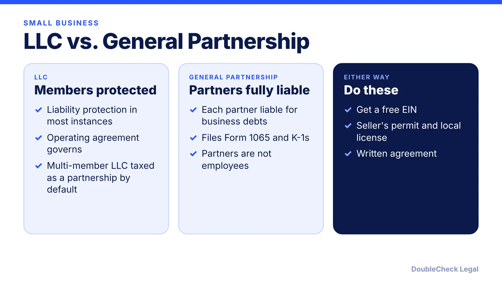
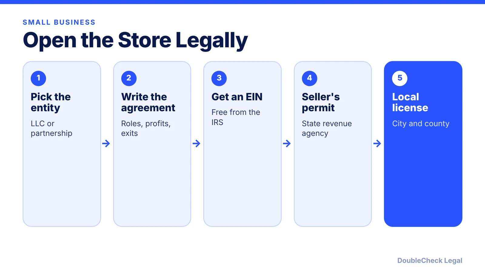

*Opening a store or going into business with family? Here is how an LLC compares with a partnership, plus the permits you need.*

**Key takeaways:**

- General partners are each fully liable; LLC members are protected in most instances.
- A multi-member LLC is taxed as a partnership by default; partnerships file Form 1065.
- Most retail sellers need a state seller's permit; fees vary by state.
- Put roles, profits, and exits in a written operating agreement.

## 1. The quick answer

**Quick answer:** For a small retail store or family business, an LLC is a common choice because members are protected from personal liability in most instances, while general partners in a partnership are each fully liable for the business's debts and lawsuits, per the SBA and LegalZoom. Put the rules in writing in an operating agreement, get an EIN, and apply for your state's seller's permit before you sell.

## 2. Taxes and paperwork

Per the IRS, a partnership files Form 1065 and gives each partner a Schedule K-1, the partnership itself does not pay income tax, and partners should not receive W-2s. A multi-member LLC is a partnership for tax by default, a single-member LLC is disregarded, and an LLC can elect corporate taxation. The EIN is free from the IRS, and a new one is generally needed when ownership or structure changes (SBA). See [how to get an EIN for free](/blog/how-to-get-an-ein-for-your-business-free/) and [LLC vs. C corp](/blog/llc-vs-c-corp-startups/).

## 3. Seller's permit and local licenses

Nolo says most retail sellers need a seller's permit in each state where they operate, fees vary (many states charge nothing, others typically $10 to $100), you apply through the state revenue agency, and some states require a permit per location. A resale certificate, which lets you buy inventory tax-free, is different. The U.S. Chamber lists examples such as Arizona $12, Arkansas $50, Connecticut $100, and says California is free with a possible refundable security deposit up to $100; Delaware, Oregon, Montana, New Hampshire, and Alaska have no statewide permit. The SBA says local licensing commonly covers retail, so check your city and county too.

## 4. Going into business with family

The SBA recommends an operating agreement for protection even when a state does not require one, and LegalZoom says it covers profit distribution, contributions, decision-making, and admitting or removing members. Family members should agree in writing on who decides what and who can join or leave. Draft with [AI and an operating agreement checklist](/blog/llc-operating-agreement-with-ai/), then have an attorney review it. Solo owner? See [sole proprietor vs. LLC](/blog/sole-proprietor-vs-llc-solo-founder/).

## Where DoubleCheck fits

[DoubleCheck](https://www.contactdoublecheck.com) helps businesses and founders start legal work with AI, verify it, and, when professional advice is warranted, connect with an independent attorney, including for immigration questions. Attorney availability and practice areas vary. Attorneys on DoubleCheck are independent professionals; an attorney-client relationship forms only if an attorney accepts your engagement.

**Sources:** [SBA: Choose a structure](https://www.sba.gov/business-guide/launch-your-business/choose-business-structure); [SBA: Tax IDs](https://www.sba.gov/business-guide/launch-your-business/get-federal-state-tax-id-numbers); [SBA: Licenses and permits](https://www.sba.gov/business-guide/launch-your-business/apply-licenses-permits); [IRS: Partnerships](https://www.irs.gov/businesses/small-businesses-self-employed/partnerships); [IRS: Limited liability company](https://www.irs.gov/businesses/small-businesses-self-employed/limited-liability-company-llc); [LegalZoom](https://www.legalzoom.com/articles/llc-vs-partnership); [Nolo](https://www.nolo.com/legal-encyclopedia/how-to-get-a-sellers-permit.html); [U.S. Chamber](https://uschamber.com/co/start/strategy/sellers-permit-and-tax-id).

## FAQ

**Is an LLC or a partnership better for a family business?**

An LLC generally protects members from personal liability, while general partners are each fully liable, per the SBA and LegalZoom. Ask a professional about your situation.

**Do I need a seller's permit for a retail store?**

Per Nolo, most retail sellers need one in each state where they operate. Fees and rules vary by state.

**Do partners get a W-2?**

No. The IRS says partners are not employees and should not receive W-2s; they receive a K-1.

**Do I need an EIN?**

The EIN is free from the IRS and is needed for businesses with employees or operating as a corporation or partnership, per the SBA.

---

*General information only. This article is not legal, tax, investment, or accounting advice.*
