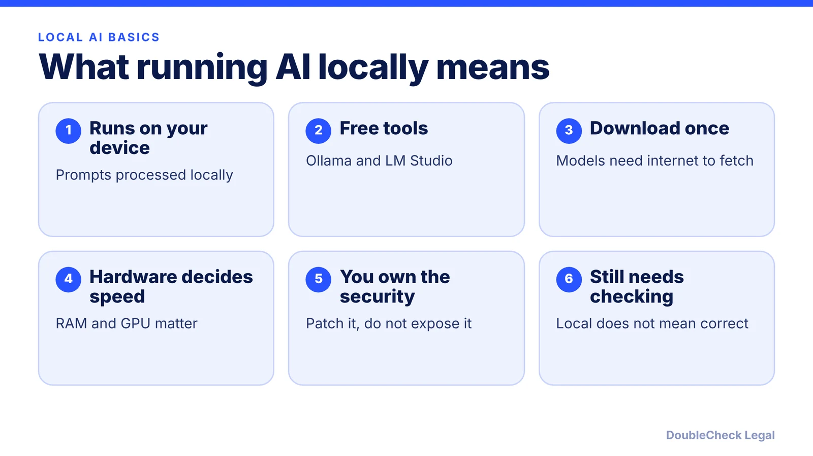
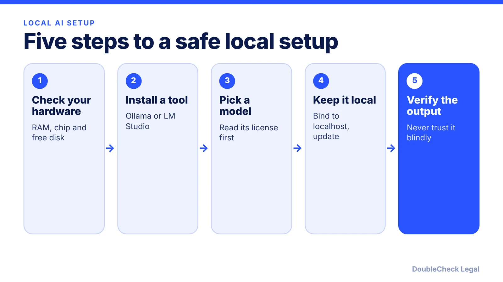

*Local AI keeps prompts on your machine. Here is what that does and does not protect, and what it takes to set up.*

**Key takeaways:**

- Ollama and LM Studio run open-weight models on your own computer, so prompts are processed locally (per LM Studio's documentation).
- LM Studio recommends 16GB of RAM on Mac and Windows; bigger models need much more memory, and a GPU speeds things up.
- Local does not mean correct or secure by default: keep the service on localhost, patch it, and verify outputs.
- A mix of local and business-plan hosted models is common for small businesses.

## 1. The quick answer

**Quick answer:** You can run an open-weight AI model on your own computer with free tools such as Ollama or LM Studio, so your prompts are processed on your machine instead of a vendor's servers. Ollama and LM Studio are free tools for running models locally. Per LM Studio's documentation, a Mac needs Apple Silicon and 16GB of RAM is recommended, while Windows also recommends at least 16GB of RAM. Local AI is a good fit for a small business that wants control over sensitive text and has a reasonably modern computer. It is not magic: the model can still be wrong, the files still sit on your device, and quality on hard tasks may trail the big hosted models.

## 2. What stays on your machine, and what does not

**What stays local.** Downloading a model requires an internet connection, but running it does not need to send your prompts to a vendor. LM Studio describes itself as natively local, with models running through its own runtime, and says voice and audio data is processed locally and never leaves your device. In practice: the prompts, documents and answers you run through a downloaded model are handled by software on your computer, not sent to an AI vendor.

**What does not change.**
- **The model download.** You fetch weights from the internet once, and update tools periodically. Check each tool's own settings and documentation for anything it may send or check online.
- **Your files and backups.** A confidential contract on your laptop is as exposed as your laptop is. Disk encryption, screen locks and backup rules still apply.
- **Accuracy.** A local model can hallucinate just like a hosted one. See [AI hallucinated citations](/blog/ai-hallucinated-citations-business/) and [verifying AI-generated legal documents](/blog/verify-ai-generated-legal-document/).
- **Legal duties.** Using a local tool changes where data is processed, not your confidentiality or privacy obligations. Whether AI chats can be privileged is a separate legal question; see [AI chats and privilege](/blog/ai-chats-not-privileged-heppner/), and note that our deeper post asks [whether local AI is private enough for confidential documents](/blog/is-local-ai-private-enough-for-confidential-documents-limits/).

**The security catch.** Local tools can become public by accident if a server is exposed to the internet. A Cloud Security Alliance research note (May 7, 2026) cited an Intruder scan in which about 31% of roughly 5,200 Ollama API servers answered test prompts without authentication, and a critical Ollama vulnerability (CVE-2026-7482) that the note says was fixed. Its recommendations include binding the service to localhost or a private interface, requiring authentication, keeping software patched, and not exposing port 11434. For a single laptop, the simple rule is: keep it on localhost and update it.

## 3. Setup realities and hardware

**Setup is easier than it was, but not zero effort.** Ollama is typically used from the command line, which suits technical users, while LM Studio is a desktop app with a graphical interface for downloading and chatting with models. Many tools also offer a local OpenAI-compatible API so other apps can use your model.

**Hardware, from the tools' own docs.**
- **LM Studio (docs).** macOS requires Apple Silicon (M1 to M4) and macOS 14 or newer, with 16GB+ RAM recommended; 8GB Macs may work with smaller models. Windows supports x64 and ARM, needs AVX2 on x64, and recommends at least 16GB of RAM and at least 4GB of dedicated VRAM.
- **Model size vs memory.** Larger models need more memory, and LM Studio's documentation lists minimum RAM and VRAM recommendations for its app. Check the specific model page for its memory needs before downloading.

**Tradeoffs to plan for.** Bigger models give better answers but need more memory; smaller ones are faster and run on ordinary laptops but may struggle with long or complex documents. You also choose which model to use, read its license, and update it. Our guide to [open-weight vs open-source licenses](/blog/open-weight-vs-open-source-ai-licenses-what-businesses-can-do/) covers what you may do commercially.

## 4. When local AI makes sense for a small business

Local AI tends to fit when:
- You regularly work with sensitive text (customer data, contracts, HR notes) and want it processed on a device you control.
- Your computer has enough memory for a model that is good enough for the job, such as summarizing, rewriting, or first-pass document questions.
- You have someone comfortable with basic setup and updates, or are willing to learn.

A hosted model on a business plan may fit better when you need top quality on hard tasks, no maintenance, or team-wide access. Per OpenAI's business data page, it does not train on business data by default and the data is owned by the customer; per Anthropic's privacy center (August 18, 2026), commercial products are not used for training by default. Compare the options in [open-source vs closed-source AI models](/blog/open-source-vs-closed-source-ai-models-which-should-you-use/), [how to choose an AI model for business](/blog/how-to-choose-an-ai-model-for-business-privacy-cost-quality/) and the [small business AI legal work safety guide](/blog/small-business-ai-legal-work-safely/). If you use vendors, review their terms with the [AI vendor contract checklist](/blog/ai-vendor-contract-checklist/).

Many businesses mix both: local for the most sensitive drafts, hosted for everything else. Whatever you use, plan how you will [verify the output](/blog/cross-check-a-contract-with-two-ai-models-method/) before it is signed or sent.

**Handle it yourself vs get an attorney.** Installing a tool and testing it on non-sensitive text is a fine solo project. Get an attorney to look when the output will be signed or sent to others, when you handle regulated personal data (see [state privacy laws](/blog/state-privacy-laws-2027-small-business-checklist/)), or when contract or license terms are unclear.

**Related reading:** [AI Contract Review Prompts: What to Ask and What to Verify](/blog/ai-contract-review-prompts-what-to-ask-and-what-to-verify/); [AI Vendor Data Retention and Training Opt-Outs: What to Check in Settings](/blog/ai-vendor-data-retention-and-training-opt-outs-what-to-check-in-settings/)

## Where DoubleCheck fits

[DoubleCheck](https://www.contactdoublecheck.com) helps businesses and founders start legal work with AI, verify it, and, when professional advice is warranted, connect with an independent attorney, including for immigration questions. Attorney availability and practice areas vary. Attorneys on DoubleCheck are independent professionals; an attorney-client relationship forms only if an attorney accepts your engagement.

**Sources:** [LM Studio, system requirements](https://lmstudio.ai/docs/app/system-requirements); [LM Studio](https://lmstudio.ai:443); [Cloud Security Alliance research note (May 7, 2026)](https://labs.cloudsecurityalliance.org/research/csa-research-note-exposed-ai-infrastructure-selfhosted-secur/); [Epoch AI, open-weight models](https://epoch.ai/topics/open-models); [OpenAI, business data](https://openai.com/business-data/); [Anthropic privacy center](https://privacy.claude.com/en/articles/7996868-how-long-do-you-store-my-organization-s-data). The Ollama dev.to guide and Google Gemini terms pages did not load.

## FAQ

**Does running AI locally keep my data private?**

Largely yes for prompts: LM Studio describes its models as running locally through its own runtime, and local tools such as Ollama run models on your machine once downloaded. But your files, backups and device security still matter, and downloading models needs the internet.

**What do I need to run Ollama or LM Studio?**

LM Studio docs recommend 16GB+ RAM on Apple Silicon Macs (macOS 14 or newer) and at least 16GB of RAM plus 4GB of dedicated VRAM on Windows. Bigger models need much more memory, so check each model page before you download.

**Is local AI safe from hackers?**

Not automatically. A Cloud Security Alliance note (May 2026) cited a scan where about 31% of roughly 5,200 internet-reachable Ollama servers answered without authentication. Keep the service on localhost, require authentication if shared, and apply updates.

**Are local AI answers more accurate than ChatGPT or Claude?**

No. Local models can hallucinate like any model, and on harder tasks open-weight models have lagged closed frontier models by months on average (Epoch AI, 2026). Verify anything with legal consequences.

---

*General information only. This article is not legal, tax, investment, or accounting advice.*
