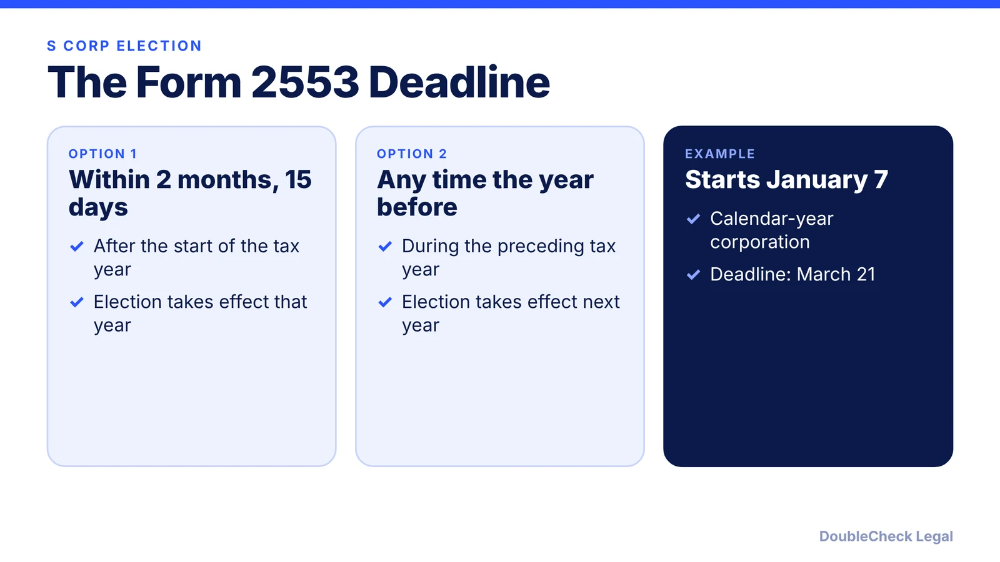
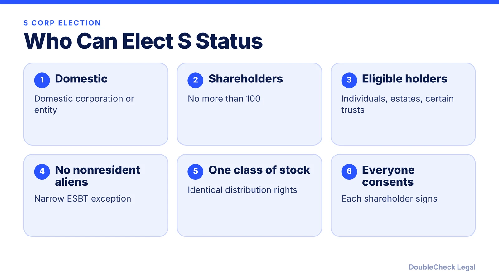
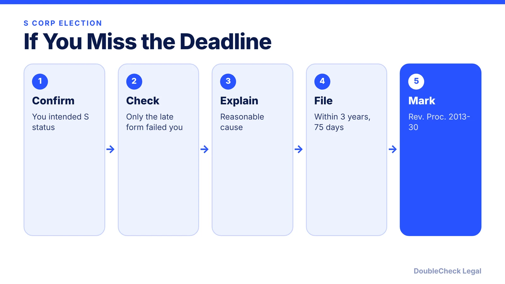

*The Form 2553 deadline is short and the rules are strict. Here is what the IRS instructions say.*

**Key takeaways:**

- File Form 2553 within 2 months and 15 days of the tax year start, or during the preceding tax year.
- You need 100 or fewer shareholders, eligible shareholders only, and one class of stock.
- Every required shareholder must consent and an officer must sign.
- Late relief can be available within 3 years and 75 days if you meet the IRS conditions.

## 1. The deadline

To elect S corporation status you file **Form 2553**. According to the IRS instructions, you file it no more than **2 months and 15 days** after the beginning of the tax year the election is to take effect, or at any time during the tax year before that year.

For a corporation with no prior tax year, the IRS says an election filed before its first tax year begins is not valid. Its example: a calendar-year corporation starting January 7 has until March 21.

## 2. Who can elect

The IRS lists these tests. The corporation must be domestic, have no more than 100 shareholders, and have only eligible shareholders: individuals, estates, certain exempt organizations, or certain trusts. It cannot have nonresident alien shareholders (with an ESBT exception), and it can have only one class of stock, meaning identical distribution and liquidation rights, though voting differences are disregarded.

Banks using the bad-debt reserve method, insurance companies under subchapter L, and DISCs are not eligible.

## 3. Shareholder consent and signatures

Every shareholder consents on Form 2553 (column K or an attached statement). For an election filed after the effective date, that includes anyone who owned stock at any time from the effective date through filing. Spouses with a community interest both consent, and the IRS says an unsigned form will not be considered timely filed. An authorized corporate officer must sign and date it.

## 4. What if you missed the deadline

The IRS describes late-election relief when the failure was due to reasonable cause. The corporation must have intended to be an S corporation, have failed to qualify solely because Form 2553 was not filed on time, show reasonable cause and diligence, and file within **3 years and 75 days** of the intended effective date. A late election must carry the notation "FILED PURSUANT TO REV. PROC. 2013-30" in the top margin of page 1.

If you do not meet the requirements, the IRS says a private letter ruling and user fee are generally needed. Ask a tax professional before relying on relief.

## 5. Is an S corp right for a startup?

An S election is a tax choice, not a legal structure. Whether it fits a company that plans to raise venture money is a separate question; see [S corp vs. C corp for venture-backed startups](/blog/s-corp-vs-c-corp-venture-backed-startup/) and [LLC vs. C corp for startups](/blog/llc-vs-c-corp-startups/).

## Where DoubleCheck fits

[DoubleCheck](https://www.contactdoublecheck.com) is built for businesses that start legal work with AI. Bring your question or draft, use an AI-first workflow to understand and verify it, and when professional advice is warranted, you can connect with an independent attorney. Attorneys on DoubleCheck are independent professionals; an attorney-client relationship forms only if an attorney accepts your engagement.

**Sources:** [IRS: Instructions for Form 2553, Chapter 1](https://www.irs.gov/instructions/i2553/ch01.html).

## FAQ

**When is the S corp election due?**

No more than 2 months and 15 days after the beginning of the tax year the election takes effect, or any time during the preceding tax year, per the IRS.

**How many shareholders can an S corp have?**

No more than 100, with a spouse and certain family members counted together.

**Can I elect S status late?**

The IRS describes relief for reasonable cause if you file within 3 years and 75 days of the intended effective date and meet its other conditions.

**Who must sign Form 2553?**

Every required shareholder consents, and an authorized corporate officer signs and dates the form.

---

*General information only. This article is not legal, tax, investment, or accounting advice.*
