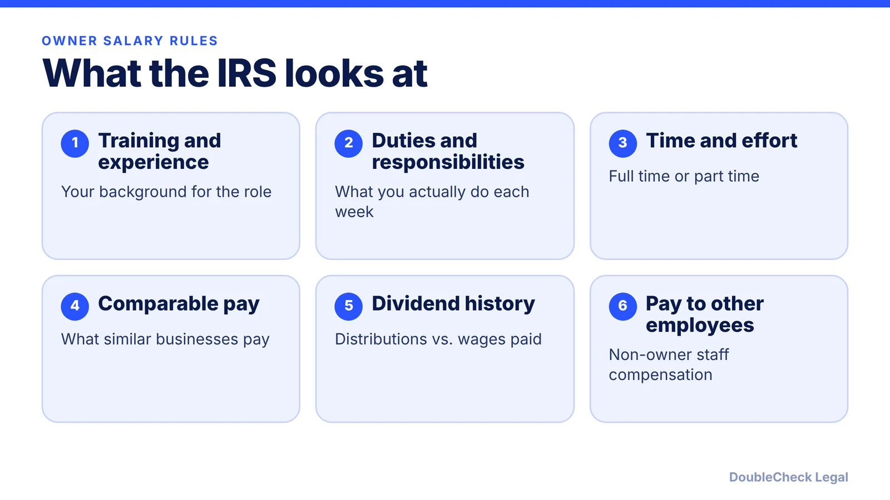
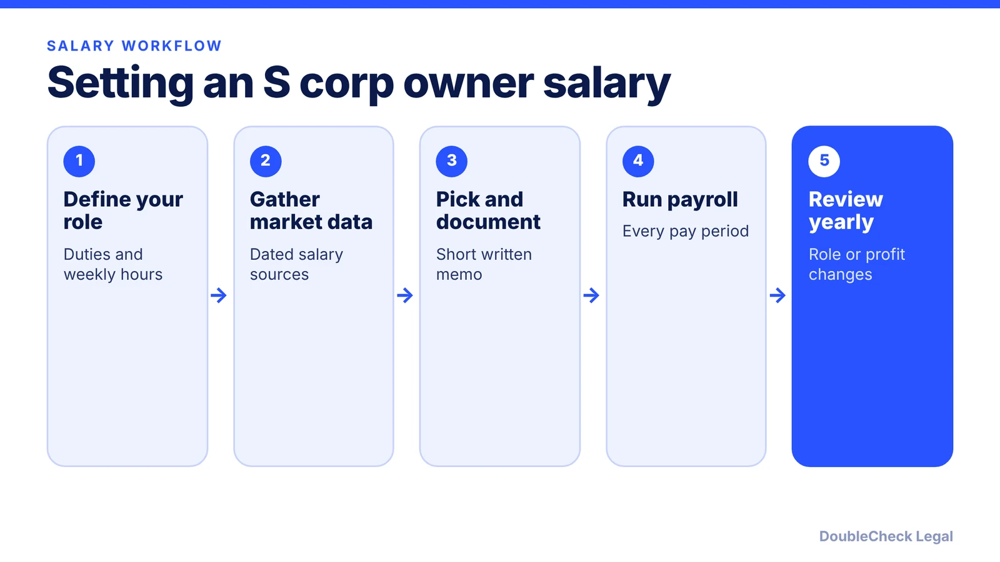

*A plain-English look at what the IRS says S corporation owners must pay themselves before taking distributions.*

**Key takeaways:**

- There is no fixed percentage; the IRS lists factors and courts look at facts and circumstances.
- Per the IRS (March 2026), wages come before non-wage distributions for a working shareholder-employee.
- The IRS can reclassify distributions as wages, which brings employment taxes.
- Document your number with dated market data and run regular payroll.

## 1. The quick answer

**Quick answer:** S corp reasonable compensation means that if you work in your S corporation, you must pay yourself a reasonable wage, run through payroll, before taking non-wage distributions. There is no fixed percentage or formula. Per the IRS page on S corporation compensation (last reviewed March 3, 2026), the IRS can reclassify distributions as wages when pay for your services is too low, which brings employment taxes into play. This guide explains what the owner salary rules say, what factors the IRS lists, how to document a number, and when to ask a CPA or attorney to check it. As of November 2026 these are the IRS positions we could verify; confirm current rules with your tax professional.

## 2. What the S corp owner salary rules actually say

Three IRS statements explain most of the topic.

- **Officers are employees.** Per the IRS page on S corporation employees, shareholders and corporate officers (last reviewed July 4, 2026), corporate officers count as employees for FICA, FUTA and federal income tax withholding. Officers who perform no services or only minor services, and are not entitled to compensation, are not treated as employees.
- **Wages come before distributions.** Per the IRS page on S corporation compensation (last reviewed March 3, 2026), an S corporation must pay reasonable compensation to a shareholder-employee before non-wage distributions. The page quotes the Form 1120-S instructions: distributions and other payments to a corporate officer must be treated as wages to the extent they are reasonable compensation.
- **The IRS can recharacterize.** The same page says the IRS may reclassify shareholder payments from non-wage distributions, which are not subject to employment taxes, to wages, which are.

The legal basis for all of this is court decisions, not a statute with a number in it. An older IRS fact sheet (FS-2008-25, August 2008, marked historical on irs.gov) states that the Code and regulations give no specific guidelines on how much is reasonable, and courts decide on the facts and circumstances. For a quick comparison of how single-owner and multi-owner entities are taxed before the S election, see [single-member LLC taxes and the disregarded entity](/blog/single-member-llc-taxes-disregarded-entity/) and [multi-member LLC taxes and K-1s](/blog/multi-member-llc-taxes-partnership-return-k-1-explained/).

## 3. How to figure out a reasonable salary for yourself

The IRS does not publish a formula. Its page lists these factors that courts consider: training and experience, duties and responsibilities, time and effort devoted to the business, dividend history, payments to non-shareholder employees, timing and manner of paying bonuses to key people, what comparable businesses pay for similar services, compensation agreements, and use of a formula to determine compensation.

The IRS page also frames the key question: where do the gross receipts come from? Per the IRS, receipts tied to non-shareholder employees, capital or equipment may support non-wage distributions, while amounts tied to your personal services should be wages. A shareholder who does administrative work for income-producing employees or assets, such as a manager, should also receive wage treatment.

The IRS Reasonable Compensation Job Aid for its valuation professionals describes three common approaches to support a number:

- **Market approach:** compare your role with similar positions at similar companies. The Job Aid calls this the most commonly used method.
- **Cost approach (the "many hats" method):** break your duties into their components, assign a market wage to each, and add them up.
- **Income approach:** consider whether the salary leaves a reasonable return for an independent investor. Per the Job Aid, it can only be correctly applied when the company's fair market value is available, so it takes more judgment.

The IRS does not publish a mandatory 60/40 split between salary and distributions, and the Job Aid offers only broad indicators that vary considerably by industry. Treat any rule of thumb you read online as a starting point for a conversation with your CPA, not as a safe harbor.

Practical steps:

- Write down your actual duties and weekly hours.
- Save two or three market salary data points for similar roles, with the date and source.
- If you only work part time in the business, record that, because time and effort is on the IRS list.
- Revisit the number when your role or the company's profits change.

## 4. Running payroll and keeping distributions separate

Once the S election is effective (see [S corp election, Form 2553 and the deadline](/blog/s-corp-election-form-2553-deadline/)), the owner who works in the business generally becomes a payroll employee. In practice that means:

- **Register as an employer** with the IRS and your state. See [registering for state payroll taxes as a new employer](/blog/register-for-state-payroll-taxes-new-employer/) for the state side, which varies.
- **Run payroll regularly.** Payroll taxes must be handled for every payroll run, and many owners use a regular payroll schedule. Some owners pay a steady salary plus a year-end bonus, as long as total annual pay stays reasonable.
- **Keep distributions and wages separate in the books.** The IRS warns that S corporations should not try to avoid employment taxes by labeling officer pay as distributions, personal expense payments or loans.
- **Treat health insurance correctly.** Per the IRS page, premiums for a more-than-2% shareholder-employee are generally reported as wages in Box 1 of Form W-2 but are not subject to FICA or FUTA when paid under a qualifying plan. The same page says 2% shareholders cannot take part in a QSEHRA and describes other plan limits, so ask your CPA before reimbursing premiums.

Cross-check how this fits with your other tax obligations in [quarterly estimated taxes for a solo business owner](/blog/quarterly-estimated-taxes-solo-business-owner/) and [self-employment tax for a solo business owner](/blog/self-employment-tax-solo-business-owner-2026/).

## 5. Risks of paying too little (and how courts have treated it)

The IRS page on shareholder-employees cites several court decisions. As summarized on that page:

- In *Veterinary Surgical Consultants, P.C. v. Commissioner* (2001), the Tax Court ruled that an employer cannot avoid federal employment taxes by characterizing compensation as distributions.
- In *Joseph M. Grey Public Accountant, P.C. v. Commissioner* (2002), the court found that amounts labeled dividends were actually wages.
- In *David E. Watson, PC v. U.S.* (8th Cir. 2012), a shareholder received a $24,000 salary plus much larger distributions. The court held that the intent to limit wages was not controlling and that the test is whether the payments were truly remuneration for services performed.

The IRS Job Aid describes how a valuation analyst may allocate amounts between payroll-taxed compensation and non-payroll-taxed distributions, so if the IRS finds salary unreasonably low it may recharacterize distributions as wages, which can mean additional payroll taxes. Taking only distributions while doing substantial work can invite scrutiny. We did not verify specific penalty amounts, so check the current figures with your CPA.

## 6. When to ask a CPA or attorney to check your numbers

You can gather the facts yourself, but a few situations justify a second pair of eyes.

- **You are deciding whether to elect S status at all.** Compare it with an LLC taxed as a partnership or a C corporation, especially if you plan to raise venture money. See [S corp vs. C corp for a venture-backed startup](/blog/s-corp-vs-c-corp-venture-backed-startup/), [LLC vs. C corp for startups](/blog/llc-vs-c-corp-startups/) and the [complete guide to incorporating a business](/blog/how-to-incorporate-a-business-complete-guide-llc-s-corp-c-corp-costs-timeline/).
- **You have taken only distributions so far.** A CPA can tell you how to correct course going forward.
- **You are hiring your first employee** and need payroll and employment documents. See [how to hire your first employee: a legal checklist](/blog/how-to-hire-first-employee-legal-checklist/).

If you use an AI tool to draft a salary memo or summarize IRS pages, treat the output as a draft. [Verify AI-generated legal and tax documents](/blog/verify-ai-generated-legal-document/) against the primary IRS pages before relying on them. For choosing a professional, see [how to choose a good lawyer](/blog/how-to-choose-good-lawyer/) and [when to hire a lawyer for a small business](/blog/when-to-hire-lawyer-small-business/). A CPA usually handles the tax conclusion, while an attorney can help with the entity documents and employment paperwork around it.

## Where DoubleCheck fits

[DoubleCheck](https://www.contactdoublecheck.com) helps businesses and founders start legal work with AI, verify it, and, when professional advice is warranted, connect with an independent attorney, including for immigration questions. Attorney availability and practice areas vary. Attorneys on DoubleCheck are independent professionals; an attorney-client relationship forms only if an attorney accepts your engagement.

**Sources:** [IRS: S corporation compensation and medical insurance issues](https://www.irs.gov/businesses/small-businesses-self-employed/S-Corporation-Compensation-and-Medical-Insurance-Issues) (last reviewed March 3, 2026); [IRS: S corporation employees, shareholders and corporate officers](https://www.irs.gov/node/7676) (last reviewed July 4, 2026); [IRS: Wage compensation for S corporation officers, FS-2008-25](https://www.irs.gov/newsroom/wage-compensation-for-s-corporation-officers) (August 2008, historical); [IRS: Reasonable Compensation Job Aid for IRS Valuation Professionals](https://www.irs.gov/pub/irs-lbi/Reasonable%20Compensation%20Job%20Aid%20for%20IRS%20Valuation%20Professionals.pdf).

## FAQ

**How much salary does an S corp owner have to pay themselves?**

There is no set amount. The IRS says reasonable compensation depends on factors such as training, duties, time devoted, comparable pay and dividend history, and the Code gives no specific guidelines. Ask a CPA to help set and document a figure for your situation.

**Is there a 60/40 rule for S corp salary and distributions?**

No. The IRS does not publish a mandatory 60/40 split and points to facts and circumstances instead of a percentage. Use a split only as a rough check, not as a safe harbor.

**Can an S corp owner take only distributions and no salary?**

That is risky if you perform more than minor services. Per the IRS, an S corporation must pay reasonable compensation to a shareholder-employee before non-wage distributions, and the IRS may reclassify distributions as wages.

**Are S corp owner health insurance premiums treated differently?**

Yes. Per the IRS, premiums for a more-than-2% shareholder-employee are generally reported as wages in Box 1 of Form W-2 but are not subject to FICA or FUTA under a qualifying plan. Details and deduction rules are technical, so confirm with your CPA.

**Does this apply to a single-member LLC that elected S status?**

Generally yes once the S election is effective, because the entity is taxed as an S corporation and an owner who works in the business is a shareholder-employee. Confirm your election status and payroll setup with a tax professional.

---

*General information only. This article is not legal, tax, investment, or accounting advice.*
