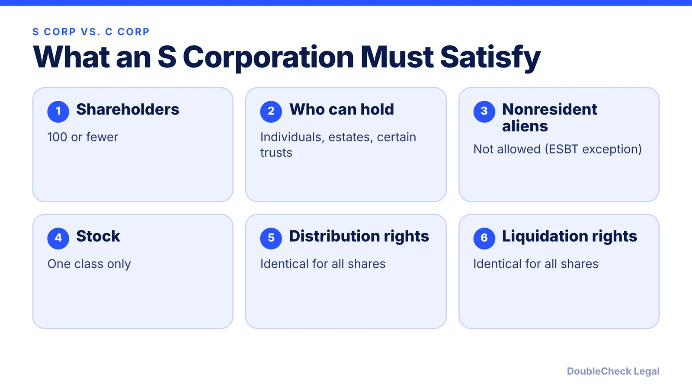
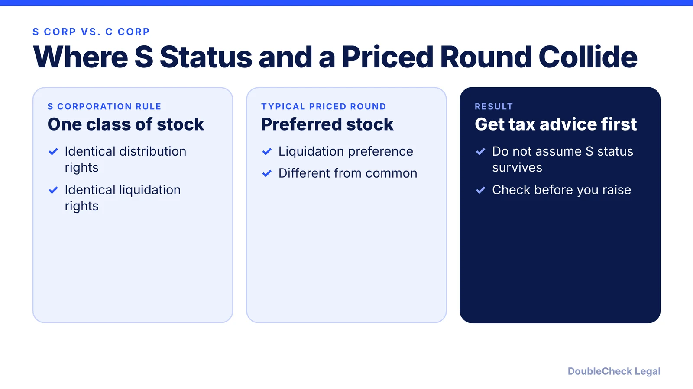
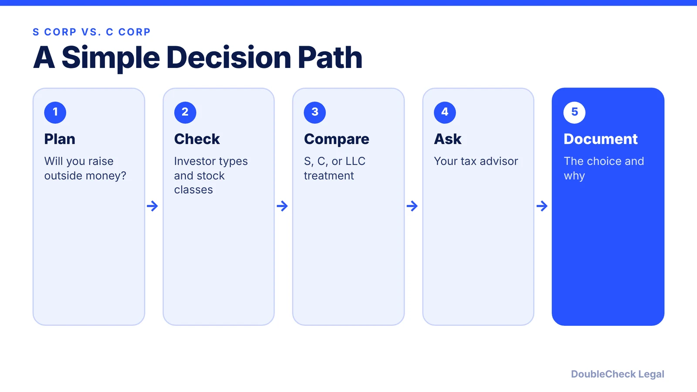

*S corporation status has strict limits that matter if you plan to raise venture money. Here is how to think about it.*

**Key takeaways:**

- An S corporation can have 100 or fewer shareholders, only eligible shareholders, and one class of stock.
- Preferred stock with different liquidation rights and fund investors are common in priced rounds, which is where the S rules can conflict.
- QSBS requires a C corporation, per the Cooley cheat sheet.
- Get tax advice before choosing or electing S status.

## 1. The question

Founders often ask whether an S corporation is better than a C corporation because of the tax treatment. The answer for a company that plans to raise venture money depends on how the S corporation rules interact with a typical financing. This article lays out the IRS's own eligibility rules and what they mean in plain terms. For the general entity comparison, see [LLC vs. C corp for startups](/blog/llc-vs-c-corp-startups/).

## 2. What an S corporation must satisfy

From the IRS Form 2553 instructions, an S corporation:

- has no more than **100 shareholders**
- has only **eligible shareholders**: individuals, estates, certain exempt organizations, or certain trusts
- has no nonresident alien shareholders (with a narrow ESBT exception)
- has **one class of stock**, meaning identical distribution and liquidation rights

## 3. Where venture financing collides

A priced round usually issues **preferred stock** with rights that differ from common stock, such as liquidation preference (see [NVCA documents for a priced round](/blog/nvca-model-documents-priced-round-explained/)). Preferred and common stock with different liquidation rights are, on their face, not "identical distribution and liquidation rights." And the IRS's list of eligible shareholders does not include a venture fund organized as a partnership or LLC.

We are describing how the rules read, not telling you whether a particular company would lose S status. That is a tax-advice question for your accountant or lawyer before any round.

## 4. QSBS needs a C corporation

Per the Cooley QSBS cheat sheet, the issuer of qualified small business stock must be a C corporation; S corporations and other pass-throughs are not eligible. If a QSBS exclusion matters to you, entity type matters from day one. See [QSBS explained](/blog/qsbs-section-1202-explained-startup-founders/) and the [QSBS qualification checklist](/blog/does-my-startup-qualify-for-qsbs/).

## 5. A simple decision path

Founders who expect to bootstrap may reasonably choose differently from founders planning a venture round. Neither is right for everyone.

## Where DoubleCheck fits

[DoubleCheck](https://www.contactdoublecheck.com) is built for businesses that start legal work with AI. Bring your question or draft, use an AI-first workflow to understand and verify it, and when professional advice is warranted, you can connect with an independent attorney. Attorneys on DoubleCheck are independent professionals; an attorney-client relationship forms only if an attorney accepts your engagement.

**Sources:** [IRS: Instructions for Form 2553, Chapter 1](https://www.irs.gov/instructions/i2553/ch01.html); [Cooley: QSBS cheat sheet](https://www.cooley.com/-/media/cooley/pdf/qualified-small-business-stock-cheat-sheet.pdf).

## FAQ

**Can a venture-backed startup be an S corp?**

The IRS limits S corporations to one class of stock with identical distribution and liquidation rights and to eligible shareholders. Those rules often conflict with preferred stock and fund investors, so get tax advice first.

**Does QSBS apply to S corporations?**

No. The issuer must be a C corporation, per the Cooley cheat sheet.

**How many shareholders can an S corp have?**

No more than 100, per the IRS.

**Is an S election a legal structure?**

No. It is a federal tax election made on Form 2553 by a corporation or eligible entity.

---

*General information only. This article is not legal, tax, investment, or accounting advice.*
