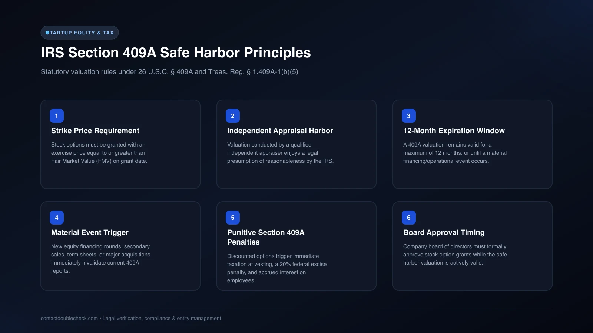
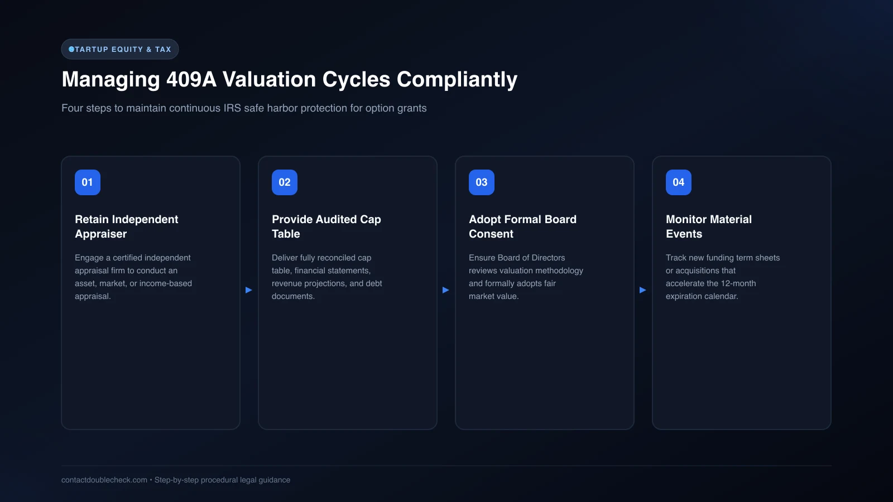

*Compliance guide for private tech companies, founders, and boards issuing stock options under Internal Revenue Code Section 409A safe harbor regulations, as of November 2026. General information, not legal advice.*

**Key takeaways:**

- Section 409A requires private companies granting stock options to set the exercise price at or above the Fair Market Value (FMV) of the underlying common stock on the grant date.
- Establishing an IRS "Safe Harbor" creates a legal presumption that the valuation is reasonable, shifting the burden of proof to the IRS.
- Safe harbor valuations remain valid for 12 months or until a "material event" (such as a new venture funding round) occurs.
- Failure to comply triggers a mandatory 20% federal penalty tax, immediate taxation upon vesting, and interest penalties directly on employees.
- Company boards must formally adopt the valuation and approve option grants while the appraisal is actively valid.

## 1. The quick answer

**Quick answer:** Under **Internal Revenue Code Section 409A (26 U.S.C. § 409A)** and Treasury Regulation § 1.409A-1, private startups that grant employee stock options (ISOs or NSOs) must ensure the option strike price equals or exceeds the **Fair Market Value (FMV)** of the company's common stock on the date of the grant. Discounted stock options are classified as nonqualified deferred compensation, triggering disastrous personal tax penalties for option holders.

To protect employees from IRS audits, startups rely on **safe harbor valuation methodologies**. Obtaining a formal valuation report from a **qualified independent appraiser** establishes a legal "presumption of reasonableness." The IRS cannot challenge the valuation unless it can prove the appraisal methodology was grossly unreasonable. 

A safe harbor 409A valuation remains valid for a maximum of **12 months**, but expires immediately upon the occurrence of any **material event**—such as closing a new priced equity financing round, executing an acquisition term sheet, or experiencing explosive unmodeled revenue growth.

For equity fundamentals, compare our guides on [ISOs vs NSOs employee stock options](/blog/isos-vs-nsos-employee-stock-options/) and [option pool size and dilution in first funding rounds](/blog/option-pool-size-and-dilution-first-round-explained/).

## 2. What Section 409A regulates and why Fair Market Value matters

Enacted as part of the American Jobs Creation Act of 2004 in the wake of the Enron corporate accounting scandals, Section 409A was designed to prevent corporate executives from manipulating deferred compensation timing to avoid income taxation.

While intended for executive compensation, the broad statutory language ensnares all private company equity incentives. Under Treas. Reg. § 1.409A-1(b)(5), a stock option is exempt from Section 409A *only if* the exercise price is never less than the fair market value of the underlying stock on the grant date.

Because public company stocks trade on liquid public exchanges (NYSE, NASDAQ), their FMV is easily determined by closing market prices. In contrast, private startups have illiquid equity with no public market. Without a formal valuation mechanism, setting strike prices based on founder guesswork invites severe regulatory scrutiny.

## 3. The three IRS safe harbor valuation methodologies

Treasury Regulation § 1.409A-1(b)(5)(iv)(B) outlines three specific appraisal methodologies that grant safe harbor protection:

### Method 1: Independent Appraisal (The Universal Standard)
The company secures a written valuation report prepared by an independent appraisal firm using recognized valuation techniques (e.g., Asset Approach, Market Approach, or Discounted Cash Flow Income Approach). 
- *The Safe Harbor Presumption:* The IRS explicitly presumes the valuation is reasonable. In any tax controversy, the IRS bears the heavy burden of establishing that the valuation was grossly arbitrary or flawed.

### Method 2: Illiquid Startup Insider Valuation
Permitted only for early-stage private companies that have been in business for less than 10 years, have no publicly traded securities, and do not anticipate an IPO or acquisition within 180 days. The valuation must be performed in writing by a qualified individual with at least five years of significant relevant experience (such as an experienced CFO).
- *Practical Risk:* Venture capital investors and prospective Series A acquirers heavily scrutinize insider valuations during due diligence, making third-party independent appraisals universally preferred.

### Method 3: Binding Formula / Buy-Sell Method
Applies when stock transfers are governed by a permanent, binding formula used consistently for all equity transactions. Rarely applicable to high-growth tech startups.

## 4. The 12-month expiration rule and material event triggers

A 409A valuation is not a permanent shield. Under Treas. Reg. § 1.409A-1(b)(5)(iv)(B)(1), an appraisal enjoys safe harbor protection for **no longer than 12 months** from the valuation date.

### The Material Event Rule:
Safe harbor protection terminates **immediately** if a material event occurs that could reasonably be expected to affect the company's enterprise value. Common material events include:
- **Priced Equity Financing:** Issuing Series Seed or Series A Preferred Stock to venture capital funds.
- **Term Sheets:** Executing a binding or non-binding term sheet for an acquisition or significant investment.
- **Secondary Transactions:** Founders or early investors selling common stock to private equity secondary buyers at a negotiated valuation.
- **Transformational Financial Shifts:** Signing a multi-million-dollar contract that doubles company annual recurring revenue (ARR) overnight.

If an employer grants stock options based on a 9-month-old 409A valuation *after* executing a new funding term sheet, the grant loses safe harbor protection, exposing optionees to severe penalties.

## 5. The 20 percent excise tax and employee penalties

If the IRS audits a startup and determines that options were granted at a strike price below fair market value, the tax consequences **fall directly on the employee**, not the company:

1. **Immediate Income Acceleration:** Rather than deferring taxation until the option is exercised, the optionee is taxed on the spread between the strike price and FMV **immediately upon vesting**, even though the private stock cannot be sold to pay the tax.
2. **20% Federal Penalty Tax:** An automatic **20% federal excise penalty** is assessed under Section 409A(a)(1)(B) on all unexercised, vested option value.
3. **State Penalty Taxes:** Many states impose supplementary penalties. California assesses an additional **5% penalty tax** under Cal. Rev. & Tax Code § 17085, bringing the combined penalty rate to 25%.
4. **Premium Interest Penalty:** The IRS imposes compounding interest charges at the federal underpayment rate plus 1 percentage point from the date the option originally vested.

## 6. Board of directors governance and grant workflows

Maintaining safe harbor compliance requires coordinated corporate governance between founders, finance leads, and the board:

- **Formal Board Adoption:** When the independent appraisal report is delivered, the Board of Directors must review the valuation summary and execute a formal written board consent adopting the Fair Market Value per common share.
- **Timely Grant Approvals:** Board resolutions approving stock option grants must be dated and executed while the 409A valuation is actively effective. Post-dating option grants or approving grants retroactively ("backdating") is strictly prohibited under federal securities and tax law.
- **Cap Table Synchronization:** Archive the formal valuation PDF, independent appraiser credentials, and executed board consents in your permanent cap table management platform (e.g., Carta, Pulley).

## Where DoubleCheck fits

[DoubleCheck](https://www.contactdoublecheck.com) helps startups, founders, and growing companies maintain corporate governance readiness, organize stock option pools, and audit equity incentive plans with AI-driven compliance workflows. When navigating fundraising diligence, cap table restructuring, or Section 409A valuation audits, DoubleCheck connects you directly with independent corporate and tax attorneys.

**Related reading:**
- [ISOs vs NSOs: Employee Stock Options Differences](/blog/isos-vs-nsos-employee-stock-options/)
- [Option Pool Size and Dilution for First-Time Founders](/blog/option-pool-size-and-dilution-first-round-explained/)
- [Cap Table Cleanup Before Series A: Common Problems](/blog/cap-table-cleanup-before-series-a-common-problems/)
- [Corporate Minutes and Board Consents for Small Corporations](/blog/corporate-minutes-and-board-consents-small-corporation-records/)

**Sources:** [Internal Revenue Code, 26 U.S.C. § 409A (Inclusion in Gross Income of Deferred Compensation Under Nonqualified Deferred Compensation Plans)](https://www.law.cornell.edu/uscode/text/26/409A); [Electronic Code of Federal Regulations, 26 CFR § 1.409A-1 (Definitions and Coverage)](https://www.ecfr.gov/current/title-26/chapter-I/subchapter-A/part-1/section-1.409A-1); [Internal Revenue Service, Section 409A Nonqualified Deferred Compensation Audit Technique Guide](https://www.irs.gov/businesses/corporations/section-409a-audit-techniques); [California Franchise Tax Board, Conformity to Internal Revenue Code § 409A](https://www.ftb.ca.gov/); [Financial Accounting Standards Board (FASB), ASC Topic 718 (Stock Compensation)](https://www.fasb.org/).

## FAQ

**What is an IRS Section 409A valuation?**

A 409A valuation is an independent appraisal of the fair market value of a private company’s common stock, required under Section 409A of the Internal Revenue Code to price employee stock options at or above fair market value.

**How long does a safe harbor 409A valuation remain valid?**

Under Treas. Reg. § 1.409A-1(b)(5)(iv)(B), a safe harbor 409A valuation is legally valid for up to 12 months, provided no material event occurs that affects company value.

**What penalties apply if stock options violate Section 409A?**

If options are priced below fair market value, the optionee faces immediate income taxation upon vesting, an automatic 20% federal penalty tax, state penalty taxes (e.g., California imposes 5%), and compounding penalty interest.

**What constitutes a material event requiring a new 409A valuation?**

Material events include signing a term sheet or closing an equity financing round, issuing convertible debt, experiencing significant revenue growth, or engaging in merger/acquisition discussions.

**Can startup founders calculate their own 409A valuation?**

While illiquid startups may technically use internal non-expert formulas under narrow early-stage rules, venture-backed companies universally use qualified independent appraisers to establish the IRS presumption of reasonableness.

---

*General information only. This article is not legal, tax, investment, or accounting advice.*
