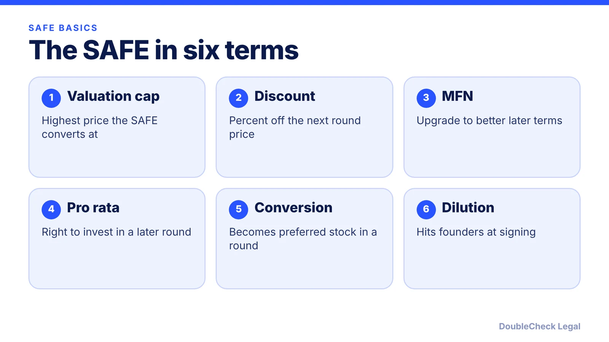
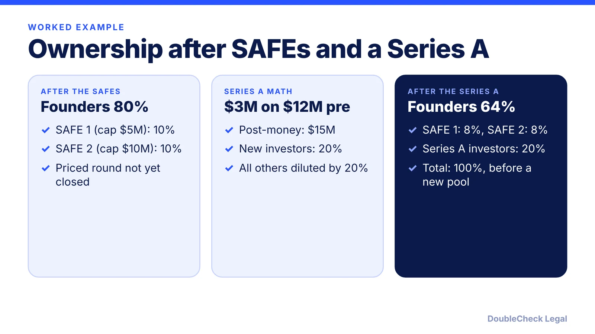

*A SAFE turns today's check into tomorrow's shares. Here is how the cap, discount, MFN, and pro rata rights decide how many.*

**Key takeaways:**

- A SAFE is not debt: no interest, no maturity date, and it converts into preferred stock in a priced round.
- Under the post-money SAFE, ownership = purchase amount / post-money cap ($500,000 / $5M = 10%).
- Cap and discount set the conversion price; MFN and pro rata are separate protections for the investor.
- Every SAFE dollar on a post-money cap dilutes founders, so model the total before signing.

## 1. The quick answer

**Quick answer:** A SAFE (Simple Agreement for Future Equity) is a contract in which an investor funds your startup now and receives shares later, usually when you close a priced equity round. It is not a loan, has no maturity date, and does not accrue interest. In the current post-money form from Y Combinator, the investor's ownership equals the purchase amount divided by the valuation cap, so $500,000 on a $5 million cap is 10%, and founders absorb that dilution.

## 2. Cap, discount, and MFN

Y Combinator's Safe User Guide describes four versions: cap only (the standard form), discount only, and an MFN version with no cap and no discount. A combined cap-and-discount form was removed in Version 1.1 of the guide.

- **Valuation cap:** the maximum valuation at which the SAFE converts. Under the post-money form, the cap is measured after all SAFE money is counted but before the new priced-round money.
- **Discount:** a percentage off the price new investors pay. The guide expresses it as 100 minus the discount, so a 20% discount is an 80% rate. [Haynes Boone](https://www.haynesboone.com/news/publications/safes-and-convertible-notes) gives the plain-English version: at a 20% discount, $80 invested buys $100 of stock. Discounts commonly run 10% to 30%, per Haynes Boone.
- **MFN (most favored nation):** if you later issue SAFEs with better terms, the MFN holder may amend to match them. Per the YC guide, the holder cannot cherry-pick individual terms, and the MFN usually gives only one opportunity to amend.

Compare the structure with a loan-style alternative in [SAFE vs. convertible note](/blog/convertible-note-vs-safe/) and see the term-by-term checklist in [SAFE review before you sign](/blog/safe-review-before-you-sign/).

## 3. Conversion and pro rata rights

A SAFE converts in an "Equity Financing," meaning your next priced round. Per the YC guide, holders receive Safe Preferred Stock priced off the cap; if the round price would give more shares, they receive Standard Preferred at the round price instead. Holders cannot choose whether to convert. In a liquidity event before a priced round, the holder receives the greater of its purchase amount or its as-converted share of proceeds.

**Pro rata rights** are not in the standard SAFE. YC offers them through an optional side letter that lets the holder buy a share of the Equity Financing equal to its as-converted ownership, and only the cap-based post-money forms can use it. Companies can limit who gets it, for example by requiring a minimum investment. [CRV](https://www.crv.com/content/safe-agreements-for-startups) notes that these rights can eat into the allocation a Series A lead wants, so founders often limit them.

Another point from the YC guide: "Company Capitalization," the denominator that sets the SAFE price, includes the unissued option pool but excludes any pool increase made in the Equity Financing, so SAFE holders are diluted by that increase too. Wilson Sonsini described excluding the new-round pool increase as founder favorable. For how pools work, see [cap table basics](/blog/cap-table-basics-for-first-time-founders/).

## 4. A dilution example you can check

Numbers below are our own arithmetic on hypothetical terms, using the YC guide's rule (purchase amount divided by post-money cap).

**Step 1, two SAFEs.** You raise $500,000 on a $5M post-money cap (10%) and $1,000,000 on a $10M post-money cap (10%). Founders go from 100% to 80%, and the two SAFE holders own 10% each.

**Step 2, a Series A.** Say new investors put in $3M at a $12M pre-money valuation, so they own $3M / $15M = 20% after the round. Both caps are below the $12M pre-money, so the SAFEs convert at their caps. Ignoring any new option pool, everyone is diluted by 20%.

The lesson from Wilson Sonsini's analysis of the post-money form: every additional dollar raised on a fixed post-money cap dilutes founders, so model the total you plan to raise before you sign. The older pre-money form, which excluded other SAFEs from the cap calculation, is described by [Terms.law](https://terms.law/Invest-USA/startup-investing/safe-agreements.html) as a legacy form. Also compare with [priced-round terms](/blog/term-sheet-key-terms-explained/) and the [funding stages](/blog/startup-funding-stages-pre-seed-to-series-b/).

## Where DoubleCheck fits

[DoubleCheck](https://www.contactdoublecheck.com) helps businesses and founders start legal work with AI, verify it, and, when professional advice is warranted, connect with an independent attorney, including for immigration questions. Attorney availability and practice areas vary. Attorneys on DoubleCheck are independent professionals; an attorney-client relationship forms only if an attorney accepts your engagement.

**Sources:** [Y Combinator, Safe User Guide](https://bookface-static.ycombinator.com/assets/ycdc/SAFE%20User%20Guide-a47c6588327d73aa2799e61ed7c2cae9f1a0ee9acfa9c43b62039dc06e715832.pdf); [Wilson Sonsini, Post-Money Safes](https://wsgr.com/publications/PDFSearch/Practitioner-Insight-Post-Money-web.html); [Haynes Boone, SAFEs and Convertible Notes](https://www.haynesboone.com/news/publications/safes-and-convertible-notes); [CRV, SAFE Agreements for Startups](https://www.crv.com/content/safe-agreements-for-startups); [Terms.law, SAFE Agreements](https://terms.law/Invest-USA/startup-investing/safe-agreements.html).

## FAQ

**Is a SAFE debt?**

No. Per Haynes Boone, SAFEs have neither an interest component nor a maturity date, and are usually treated as a prepaid forward contract for tax purposes. A convertible note, by contrast, is technically debt and accrues interest.

**What is the difference between a post-money and pre-money SAFE?**

Per Wilson Sonsini, the post-money form counts all SAFE money in the cap, so each investor's percentage is fixed at signing and founders absorb dilution from every added SAFE. The earlier pre-money form excluded SAFEs and convertible notes from that calculation.

**Can a SAFE have both a cap and a discount?**

Not in the current YC forms described in its Safe User Guide: the combined cap-and-discount version was removed in Version 1.1. Other documents and some investors may still negotiate both; if a SAFE has both, the investor typically gets whichever gives more shares.

**Do SAFE investors get pro rata rights automatically?**

No. Per the YC guide, pro rata rights come from an optional side letter, and only the cap-based post-money forms can use it. Companies can limit who receives it.

---

*General information only. This article is not legal, tax, investment, or accounting advice.*
