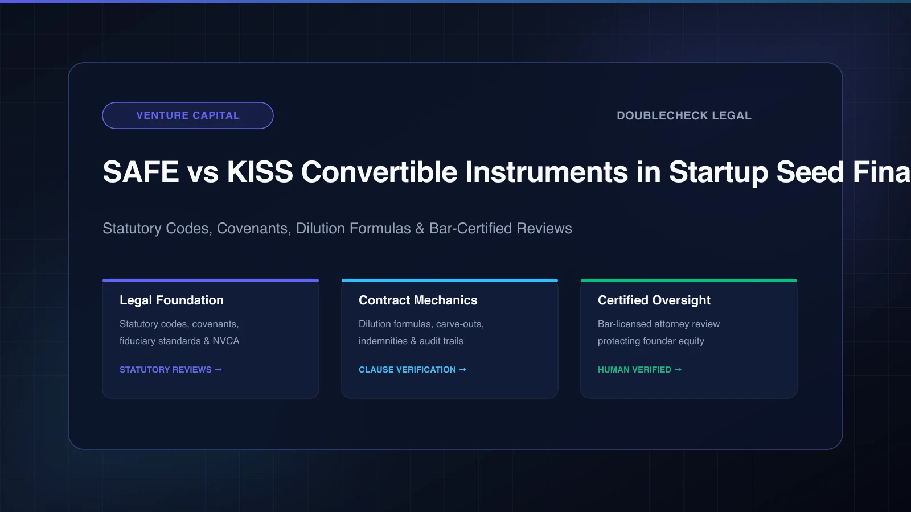
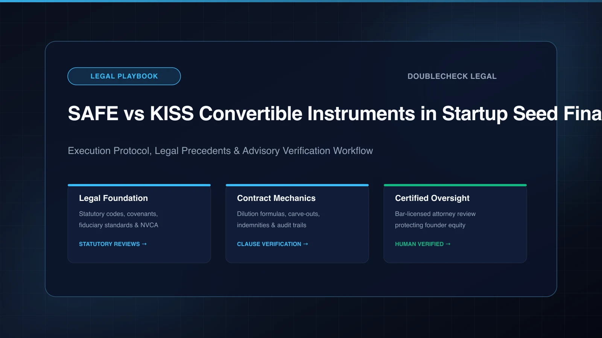

<div class="article-hero-banner mb-8">
  
</div>

## What Is the Difference Between a SAFE and a KISS?

The fundamental legal difference between a **YC SAFE (Simple Agreement for Future Equity)** and a **500 Global KISS (Keep It Simple Security)** is that a SAFE represents a contractual right to receive preferred stock upon a future qualifying financing without creating debt, while a standard KISS exists in either a **debt version** (featuring an interest rate and fixed maturity date) or an **equity version** (without debt characteristics). 

For early-stage tech founders raising pre-seed and seed venture rounds, selecting between a SAFE and a KISS dictates whether the company assumes enforceable balance-sheet liabilities, faces potential default covenants, or locks in predictable pre-Series A cap table dilution.

```
SAFE vs. KISS Structural Comparison

┌─────────────────────────┬───────────────────────────────┬───────────────────────────────┐
│ Feature                 │ Y Combinator Post-Money SAFE  │ 500 Global KISS (Debt / Equity│
├─────────────────────────┼───────────────────────────────┼───────────────────────────────┤
│ Legal Structure         │ Executory Contract (No Debt)  │ Promissory Note or Equity     │
│ Interest Rate           │ 0% (None)                     │ 5% Compounding (Debt Version) │
│ Maturity Date           │ None (No forced repayment)    │ 18–24 Months (Debt Version)   │
│ Valuation Cap Basis     │ Post-Money (NVCA Standard)    │ Pre-Money or Post-Money       │
│ MFN Clause              │ Optional standalone document  │ Built directly into standard  │
│ Information Rights      │ Standardized Major Investor   │ Detailed Financial Covenants  │
└─────────────────────────┴───────────────────────────────┴───────────────────────────────┘
```

---

## Direct Answer for Startup Founders & General Counsels

When deciding between a SAFE and a KISS:
- **Choose the YC Post-Money SAFE** if you are raising standard angel, pre-seed, or institutional seed capital from US investors who prioritize frictionless execution, zero compounding interest liabilities, and no maturity deadlines that could force liquidation before your Series A.
- **Choose the 500 Global KISS** if your institutional angel network requires accrued interest returns, explicit 18–24 month maturity remedies, or automatic Most Favored Nation (MFN) protections built directly into the foundational instrument without requiring bespoke side letters.

---

## 1. Core Mechanics: Debt-Style KISS vs. Post-Money SAFE

### The Maturity Hazard in Debt-Type KISS Instruments
Under a standard 500 Global Debt KISS, the startup promises to convert the principal plus accrued interest (usually 5% per annum) into Preferred Stock when the company closes a Qualified Financing—defined typically as an institutional equity round raising at least **$1,000,000**.

However, if the startup fails to raise a qualifying equity round prior to the **18-month or 24-month maturity date**, a majority of KISS holders hold the contractual power to:
1. **Demand full cash repayment** of the principal plus all compounded interest.
2. **Force conversion into Series Seed Preferred Stock** at an agreed default maturity valuation cap.

Because early-stage startups rarely maintain enough cash reserves to repay six-figure angel investments upon maturity, a Debt KISS gives investors substantial leverage to demand unfavorable recapitalizations if milestone velocity slows. In contrast, a YC Post-Money SAFE carries **no maturity date**; it remains active indefinitely until an equity round, liquidation event, or dissolution occurs.

### Compounded Interest Conversion Math
In a Debt KISS, interest accrues continually. Consider an investor who contributes $250,000 at a $10,000,000 cap with a 5% interest rate:
- After 18 months, accrued interest equals approximately **$19,140**.
- The total converting capital is **$269,140**, diluting founder common equity by an additional 0.19% purely due to timeline friction.
- Under a Post-Money SAFE with no interest rate, the converting capital remains exactly **$250,000**, protecting founders from time-based penalty dilution.

---

## 2. Valuation Caps and Cap Table Modeling

### The Post-Money SAFE Fixed Ownership Formula
Introduced by Y Combinator in late 2018, the Post-Money SAFE defines the investor's percentage ownership immediately prior to the Series A round:

$$\text{Investor Ownership \%} = \frac{\text{Purchase Amount}}{\text{Post-Money Valuation Cap}}$$

For example, an investor writing a **$500,000 check** on a **$5,000,000 Post-Money Cap** will receive exactly **10.0% of the company's capitalization** upon conversion, regardless of how many options or unallocated shares exist in the pool. All subsequent SAFEs dilute previous SAFE holders proportionally alongside common shareholders until the Series A round fixes the overall share register.

### The KISS Conversion Formula
The standard KISS instrument evaluates company capitalization by including all outstanding common shares, preferred shares, vested and unvested options, and promises to issue equity. However, older KISS templates frequently employ a **pre-money framing**, which shifts the dilution burden entirely onto founders if multiple convertible instruments are issued sequentially over an extended fundraising window.

---

## 3. Most Favored Nation (MFN) and Side Letter Realities

A key operational feature distinguishing both securities is how they handle subsequent, more favorable investor terms:

- **Automatic MFN in KISS:** Section 3 of the 500 Global KISS automatically provides that if the company issues any subsequent convertible security with superior provisions (such as a lower valuation cap, higher discount rate, or preferential transfer rights), the KISS investor may elect to adopt those superior terms automatically upon written notice.
- **Standalone YC MFN SAFE:** The YC ecosystem offers a specific *SAFE: MFN Only (No Cap, No Discount)* form. If a founder utilizes the standard *SAFE: Valuation Cap Only*, subsequent investors negotiating side letters do not automatically trigger retroactive rights for previous SAFE holders unless a separate MFN Side Letter was explicitly signed.

---

## 4. Key Negotiation Tactics for Founders

1. **Insist on No-Interest Terms:** If an investor insists on utilizing a KISS document due to international familiarity, strike the interest rate clause or reduce it to the Applicable Federal Rate (AFR) minimum to prevent unnecessary compounding debt.
2. **Extend the Maturity Window:** For debt-bearing convertibles, never accept a maturity horizon shorter than 24 months. Fast-growing AI and deep-tech companies routinely require 18–24 months of runway between funding cycles.
3. **Harmonize Corporate Governance Covenants:** Ensure that information rights granted under convertible instruments require only annual financial statements unless an investor crosses the "Major Investor" threshold (typically $250,000 or greater).

---


Note that convertible securities and SAFEs must also be audited on a fully-diluted basis to maintain compliance with federal [FinCEN Corporate Transparency Act (CTA) beneficial ownership reporting rules](/blog/delaware-corporate-transparency-act-cta-fin-cen-compliance-founders/).

## Statutory Authorities and Benchmark References

- **Delaware General Corporation Law (DGCL § 151 & § 157):** Governing authority for corporate power to issue stock, convertibles, rights, and options.
- **National Venture Capital Association (NVCA) Model Legal Documents:** Standardized financing templates and convertible equity guidelines.
- **Y Combinator Post-Money SAFE Guidelines (2018–2026):** Definitive primer on post-money conversion math and cap table dilution.
- **500 Global Keep It Simple Security (KISS) Legal Framework:** Open-source legal repository for seed financing promissory notes and equity agreements.

<div class="article-steps-banner my-10">
  
</div>
