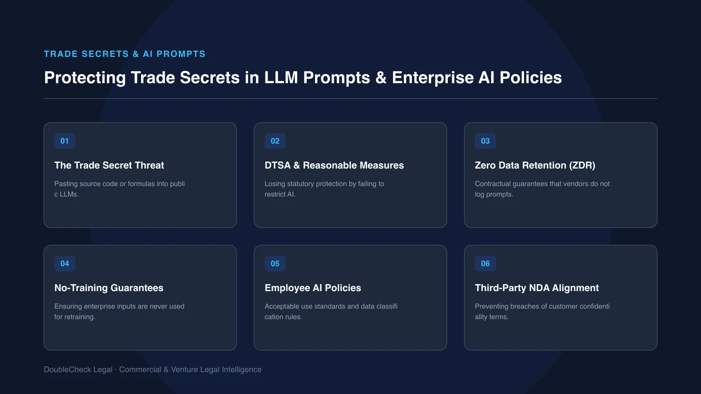
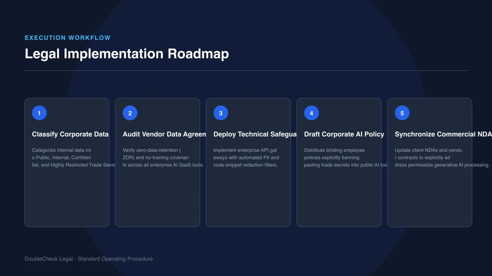

*A rigorous corporate and legal analysis of trade secret protection under the Defend Trade Secrets Act (DTSA), examining the risks of prompt injection and model training leakage, Zero Data Retention (ZDR) architecture, and enterprise AI acceptable use governance.*

**Key takeaways:**
- **The "Reasonable Measures" Test:** Under federal (DTSA) and state (UTSA) law, trade secret status is forfeited if a company fails to take reasonable measures to maintain secrecy—such as allowing employees to input proprietary data into public AI chats.
- **Consumer vs Enterprise AI Tiers:** Free and consumer-tier AI tools typically reserve the contractual right to train models on user inputs, whereas paid enterprise APIs offer enforceable Zero Data Retention (ZDR) covenants.
- **Third-Party Breach Exposure:** Uploading confidential client information into generative AI tools without contractual ZDR safeguards triggers immediate breach of contract claims under commercial NDAs.
- **Policy Enforcement:** Companies must establish binding internal AI governance policies paired with automated data loss prevention (DLP) filters.

## 1. The quick answer: The trade secret threat in generative AI

When employees paste proprietary code, financial forecasts, or secret algorithms into an AI prompt box, they risk **permanently destroying the company’s trade secret protections**:

1. **Loss of Statutory Protection:** If an unauthorized disclosure occurs on a public platform that uses inputs for model training, courts will find the company failed the mandatory "reasonable efforts" test under 18 U.S.C. § 1839.
2. **Contractual Breach:** If the data belongs to a customer or partner, the upload violates confidentiality covenants, exposing the company to substantial breach-of-contract damages.
3. **The Necessary Solution:** Enterprise teams must mandate **Enterprise AI APIs** with verified Zero Data Retention (ZDR) agreements and distribute a binding Corporate AI Acceptable Use Policy.

## 2. In-depth legal analysis: The Defend Trade Secrets Act and AI prompts

Trade secrets represent the most flexible intellectual property protection, but they are uniquely fragile.

### A. The Statutory Standard: 18 U.S.C. § 1839(3)
Under the federal **Defend Trade Secrets Act (DTSA)**, information qualifies as a trade secret only if:
1. The owner has taken **reasonable measures** under the circumstances to keep such information secret; and
2. The information derives independent economic value from not being generally known.

If an enterprise permits its software engineers to debug proprietary source code using public AI chatbots whose terms of service permit employee review or model training, opposing counsel in trade secret litigation can successfully argue that the company **abandoned reasonable measures**.

### B. The Vendor Agreement Audit: Consumer Terms vs Enterprise BAAs/Addenda

| Dimension | Consumer AI Tiers (Free / Pro) | Enterprise API / Dedicated Instance |
|---|---|---|
| Model Training on Inputs | Yes (default opt-in) | Contractually prohibited |
| Prompt Logging & Retention | Retained for 30+ days for safety review | Zero Data Retention (ZDR) or ephemeral cache |
| Human Reviewers | Prompts may be reviewed by third-party contractors | Strictly prohibited under enterprise DPA |
| Legal Indemnification | Disclaimed or capped at $100 | Enterprise IP indemnity included |
| Commercial NDA Compliance | Direct breach of confidentiality | Legally compliant if ZDR terms match NDA |

### C. The Third-Party NDA Conundrum
Most enterprise Master Services Agreements (MSAs) and Non-Disclosure Agreements (NDAs) define "Confidential Information" broadly and require that disclosure be restricted solely to employees with a "need to know."
- **The Exposure:** Transmission of confidential customer data to an AI vendor constitutes a disclosure to a third party.
- **Contractual Defense:** The enterprise must ensure the AI vendor qualifies as an authorized "Representative" or "Subprocessor" bound by confidentiality obligations at least as restrictive as the primary NDA.

## 3. Step-by-step: Implementing an enterprise trade secret defense program

Corporate legal and security teams must implement a structured five-step governance program:

### Step 1: Corporate Data Classification Protocol
Establish clear operational data tiers:
- **Tier 1 (Public):** Marketing copy, published blogs, public financial filings. *Permitted in any AI tool.*
- **Tier 2 (Internal):** Non-sensitive internal memos, meeting agendas. *Permitted in enterprise AI.*
- **Tier 3 (Confidential):** Customer records, non-public financials, personnel files. *Permitted only in enterprise ZDR tools.*
- **Tier 4 (Trade Secrets):** Core algorithms, proprietary source code, M&A strategy. *Strictly prohibited from third-party cloud LLMs.*

### Step 2: Formalize Enterprise Vendor Agreements
Audit every AI provider. Execute customized Data Processing Addenda (DPAs) confirming:
- The vendor shall not use Customer Data to train, improve, or fine-tune any foundational or public models;
- Data is encrypted in transit (TLS 1.3) and at rest (AES-256);
- Ephemeral processing with zero persistent logging.

### Step 3: Implement Automated Technical Guardrails
Deploy Data Loss Prevention (DLP) proxies and browser extensions that detect and block the transmission of API keys, credit card numbers, Social Security numbers, and proprietary code repositories into web-based AI tools.

### Step 4: Promulgate Employee AI Acceptable Use Policy
Require all employees and contractors to execute a written AI Usage Agreement detailing approved tools, data restrictions, and reporting obligations for accidental disclosures.

### Step 5: Update Standard Commercial NDAs and MSAs
Modernize outbound and inbound contract templates to explicitly include a **Permitted AI Processing Clause**, granting mutual permission to utilize enterprise-grade, non-training AI productivity tools.

## 4. Remediation protocol: What to do after an accidental prompt leak

If an employee inadvertently pastes a crown-jewel trade secret into an unapproved AI system:
1. **Immediate Document Preservation:** Screenshot the prompt, conversation URL, and account details.
2. **Submit Formal Deletion Request:** Contact the AI vendor's legal and privacy team under their privacy policy or API terms requesting immediate purging of the conversation log.
3. **Assess Trade Secret Status:** Consult intellectual property counsel to determine whether the prompt was accessible to other users or incorporated into model weights.
4. **Internal Audit & Disciplinary Review:** Document the breach, implement corrective technical restrictions, and conduct targeted employee retraining.

## 5. Due diligence checklist: AI trade secret protection audit

1. **Verify Opt-Out Settings:** Confirm that organizational admin accounts have explicitly toggled off data sharing for model training.
2. **Audit Subprocessors:** Inspect the AI vendor’s list of hosting providers and human evaluation contractors.
3. **Review Employee Handbooks:** Ensure employment agreements contain robust post-employment non-disclosure and trade secret assignment covenants.
4. **Check DTSA Whistleblower Immunity Notice:** Confirm that employment agreements contain the mandatory DTSA 18 U.S.C. § 1833(b) whistleblower immunity notice to preserve exemplary damages and attorney fees.

## Where DoubleCheck fits

[DoubleCheck](https://www.contactdoublecheck.com) equips enterprises, general counsel, and compliance officers with automated contract review tools to safeguard trade secrets. DoubleCheck reviews enterprise SaaS and AI vendor agreements, verifies zero-data-retention covenants, flags conflicting confidentiality terms in customer NDAs, and helps companies maintain defensible "reasonable measures" under federal trade secret statutes.

**Related reading:**
- [Trade Secret Protection Small Business Startups](/blog/trade-secret-protection-small-business-startups/)
- [What to Redact Before Pasting a Contract Into AI](/blog/what-to-redact-before-pasting-a-contract-into-ai/)
- [AI Agent Gmail Slack Drive Security Checklist](/blog/ai-agent-gmail-slack-drive-security-checklist/)
- [AI Vendor Contract Checklist](/blog/ai-vendor-contract-checklist/)

**Sources:** [Defend Trade Secrets Act of 2016 (DTSA), 18 U.S.C. § 1836 et seq.](https://www.law.cornell.edu/uscode/text/18/1836); [Uniform Trade Secrets Act (UTSA), National Conference of Commissioners on Uniform State Laws](https://www.uniformlaws.org/); [Federal Trade Commission (FTC), Policy Statement on AI Secrecy and Data Privacy](https://www.ftc.gov/); [American Bar Association, Formal Opinion 512 (Generative AI in Legal Practice)](https://www.americanbar.org/).

## FAQ

**Does pasting confidential business data into ChatGPT destroy trade secret protection?**

Yes. Under the Defend Trade Secrets Act (DTSA) and Uniform Trade Secrets Act (UTSA), trade secret protection requires taking reasonable measures to maintain secrecy. Entering unencrypted trade secrets into a public consumer AI tool that logs prompts or uses data for model training forfeits trade secret status.

**What is a Zero Data Retention (ZDR) agreement in enterprise AI?**

A Zero Data Retention agreement is a commercial contract where an AI vendor legally covenants that prompts, inputs, and generated completions are immediately discarded from server memory and never stored, logged, or utilized for model training.

**Can using generative AI breach a third-party non-disclosure agreement (NDA)?**

Yes. Standard NDAs strictly prohibit disclosing confidential customer or partner information to third parties without prior consent. Uploading client contracts or technical specifications to an unapproved AI provider constitutes a direct breach of contract.

**What should be included in an enterprise AI acceptable use policy?**

An enterprise AI policy should define data classification tiers, explicitly list approved enterprise AI tools, prohibit the input of customer PII and proprietary source code into public models, and specify disciplinary actions for violations.

**How can AI contract tools protect trade secrets?**

AI contract tools review incoming vendor agreements and outgoing client NDAs, flagging missing zero-data-retention clauses and ensuring AI usage complies with strict confidentiality commitments.

---

*General information only. This article is not legal, tax, investment, or accounting advice.*
